# Deploy008 激活函数

> 来源：[https://aicarrier.feishu.cn/docx/FMcvds1MYoETCBx3mtncmur3nFh](https://aicarrier.feishu.cn/docx/FMcvds1MYoETCBx3mtncmur3nFh)

## 激活函数

### 初步总结

在神经网络中，激活函数 **用于将非线**性引入神经元的输出。它们负责根据神经元收到的输入决定是否应激活神经元。激活函数帮助 神经网络学习输入和输出之间的复杂非线性关系。深度学习中使用多种类型的激活函数，例如“ sigmoid”、“ReLU” 和 “tanh”。

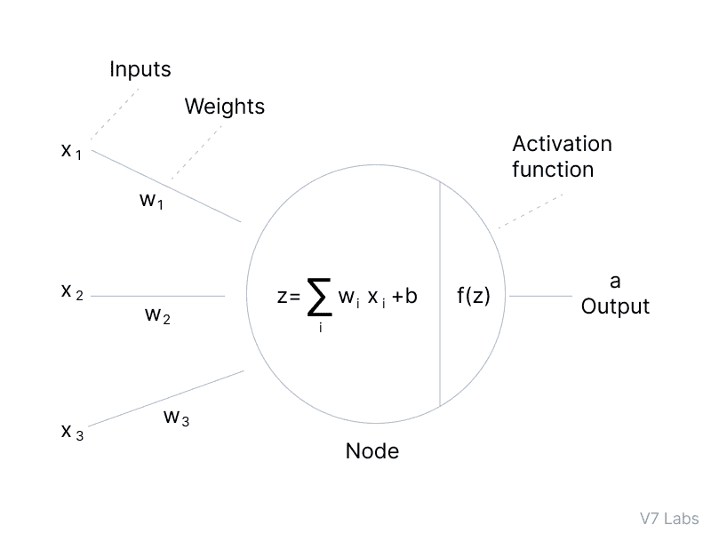

##### 激活函数帮助神经网络使用重要信息，同时抑制不相关的数据点。

#### 💡 前馈传播

+    信息流沿正向方向发生。输入用于计算隐藏层中的一些中间函数，然后用于计算输出。

**在前**馈传播中，激活函数是输入馈送当前神经元和其输出进入下一层之间的“门控”。

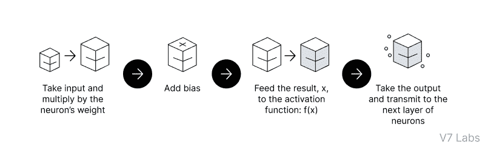

#### 💡 反向传播

+   反复调整网络连接的权重，以最小化网络的实际输出向量与所需输出向量之间的差异。

反向传播旨在通过调整网络的权重和偏差来最小化损失函数。损失函数梯度决定了相对于激活函数、权重、偏差等参数的调整水平。

#### 3 种类型的 激活函数 对比

### 1. ReLU（Rectified Linear Unit）

ReLU 函数不会同时激活所有神经元。只有当线性变换的输出小于 0 时，神经元才会被停用。

+   由于只有一定数量的神经元被激活，因此与 sigmoid 和 tanh 函数相比，ReLU 函数的计算效率要高得多。

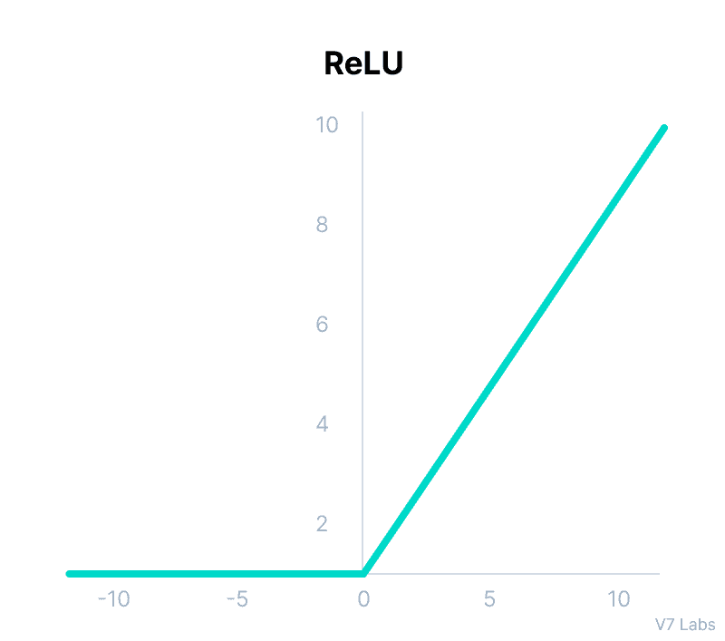

ReLU Activation Function

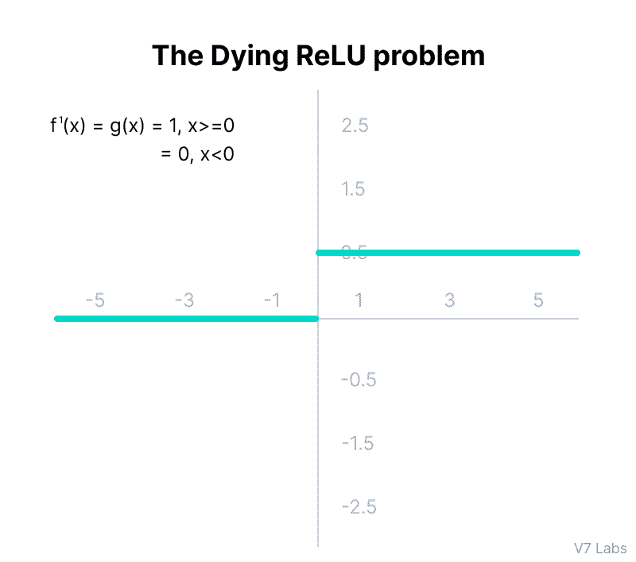

The Dying ReLU problem

存在一定的限制: Relu的导数在负值范围使梯度值为零，由于这个原因，在反向传播过程中，某些神经元的权重和偏差不会更新。某些神经元永远不会被激活 (The Dying ReLU problem)。

- 计算定义:

**   - 特**点: 简单高效，缓解梯度消失，但负值输出为零。

- 可视化: 线性增长，负值为零。

### 2. Leaky ReLU

Leaky ReLU 是 ReLU 函数的改进版本，用于解决 Dying ReLU 问题，因为它在负区域具有较小的正斜率。

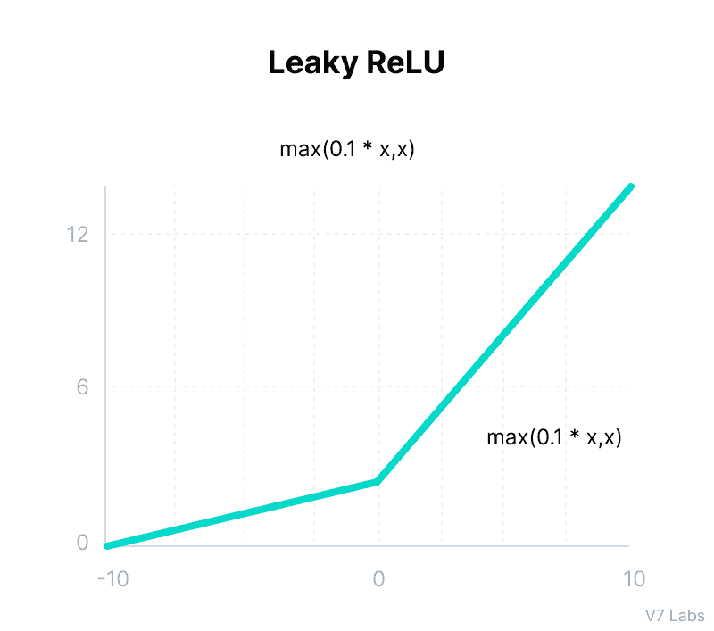

Leaky ReLU

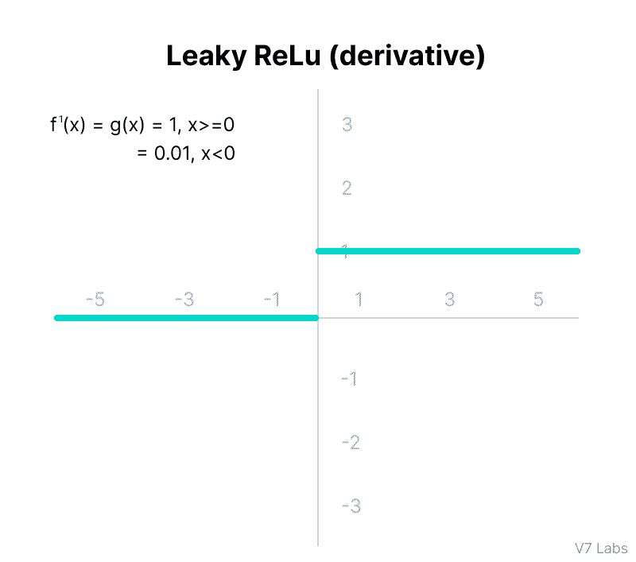

The derivative of the Leaky ReLU function

Leaky ReLU 的优点与 ReLU 的优点相同，此外它还支持反向传播，即使对于负输入值也是如此。

同理 Parametric ReLU 是 ReLU 的另一种变体，旨在解决轴左半部分的梯度变为零的问题。

此函数提供函数负部分的斜率作为参数 a。通过执行反向传播，可以学习到最合适的 a 值。

- 定义:

- 特点: **负值有小斜率**，避免“死亡ReLU”。

- 可视化: 负值区域有小斜率。（当 x≤0，通常 α 取小值如0.01）

### 3. ELU（Exponential Linear Unit）

ELU（Exponential Linear Unit）最早是在论文 "Fast and Accurate Deep Network Learning by Exponential Linear Units (ELUs)" 中提出的。这项工作展示了ELU在加速深度网络学习和提高模型鲁棒性方面的优势。

指数线性单元，简称 ELU，也是 ReLU 的一种变体**，它修改函**数负部分的斜率。ELU 使用 对数曲线 来定义负值，这与使用直线的Leaky ReLU 和 Parametric ReLU 函数不同。

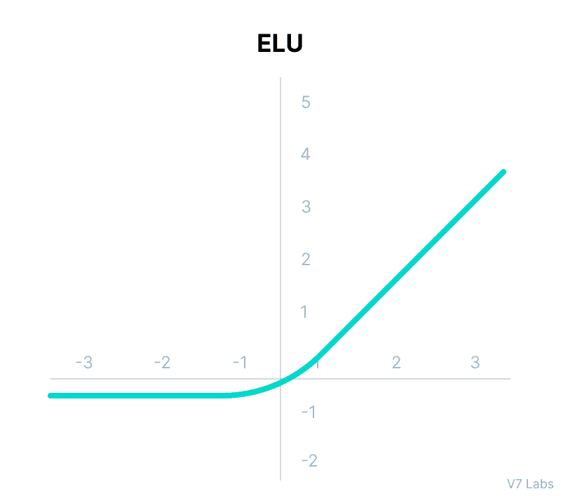

ELU Activation Function

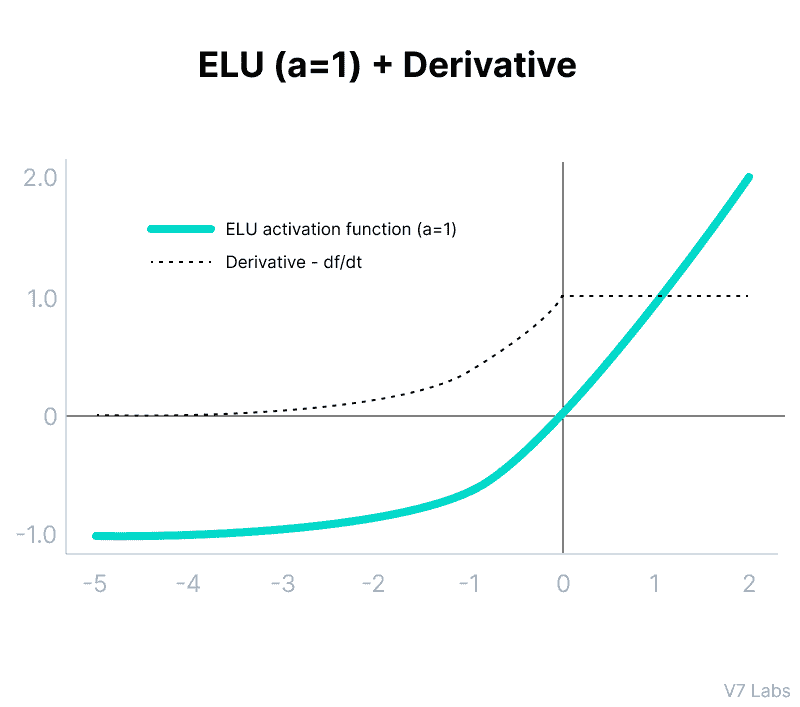

ELU Activation Function and its derivative

ELU 缓慢变得平滑，直到其输出等于 -α ，而 RELU 急剧。通过引入输入负值的对数曲线来避免 Dying ReLU 问题。

但是局限性是 由于包含指数运算，它增加了计算时间，不会学习“a”的参数值(常量)

- 定义:

- 特点: 负值为指数函数，提升学习速度。

- 可视化: 平滑过渡，**负值为指数**。

### **4. Swish / Silu (**Sigmoid Linear Unit)

Swish 激活函数最早是在论文 "Swish: a Self-Gated Activation Function" 中提出的。这项工作展示了 Swish 在深度学习中的有效性，尤其是在提高模型性能方面的优势。Swish在几种高性能图像分类模型（例如EfficientNet）中取代了Relu。

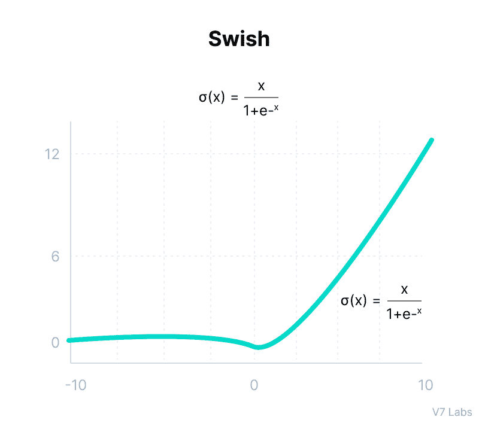

该函数在下方有界，但在上方无界。

+   当 X 接近正无穷大时，Y 接近无穷大。

+   当 X 接近负无穷大时，Y 接近常数值

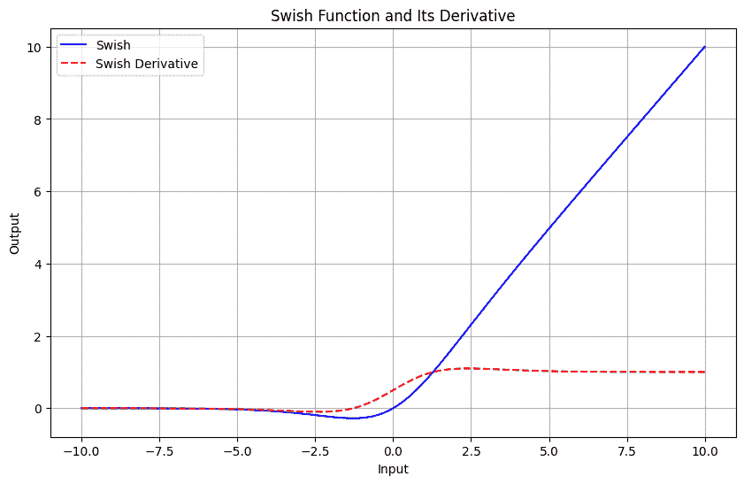

- Swish 激活函数以及其导数可以表示为：

(  是 Sigmoid 函数。  是一个可学习的参数或固定的超参数，通常默认取 1，  是 Sigmoid 函数的导数)

推导过程:

Sigmoid 函数的导数为：

将 Sigmoid 函数的导数代入 Swish 函数的导数公式，可以得到：

因此，Swish 激活函数的导数可以表示为：

这个导数公式可以用于计算 Swish 函数在任意输入 x 处的导数值。


- 特点: 平滑性和非单调性，提高模型表现。

- 可视化: 平滑且非单调凸起。

另外 Silu（Sigmoid Linear Unit）实际上是Swish激活函数的一种特殊情况，

+   当   时，Swish函数就变成了Silu函数。因此，Silu可以被视为Swish函数在特定参数下的一个实例。

##### 绘制 Swish 激活函数以及其导数 曲线图

```
import numpy as np
import matplotlib.pyplot as plt

def swish(x, beta=1.0):
    return x * (1 / (1 + np.exp(-beta * x)))

def swish_derivative(x, beta=1.0):
    sigmoid = 1 / (1 + np.exp(-beta * x))
    return sigmoid + beta * x * sigmoid * (1 - sigmoid)

# 生成一系列输入值
x_values = np.linspace(-10, 10, 100)

# 计算 Swish 函数及其导数的值
y_values_swish = swish(x_values)
y_values_derivative = swish_derivative(x_values)

# 可视化 Swish 函数及其导数
plt.figure(figsize=(10, 6))
plt.plot(x_values, y_values_swish, label=&#x27;Swish&#x27;, color=&#x27;blue&#x27;)
plt.plot(x_values, y_values_derivative, label=&#x27;Swish Derivative&#x27;, color=&#x27;red&#x27;, linestyle=&#x27;--&#x27;)
plt.title(&#x27;Swish Function and Its Derivative&#x27;)
plt.xlabel(&#x27;Input&#x27;)
plt.ylabel(&#x27;Output&#x27;)
plt.grid(True)
plt.legend()
plt.show()
```

### 5. GELU（Gaussian Error Linear Unit）

GELU（Gaussian Error Linear Unit）最早是在论文 "Gaussian Error Linear Units (GELUs**)" 中提出的。这项工作介绍了** GELU 在深度学习中的应用，尤其是在 BERT、 GPT 等模型中的有效性。GELU是一个与Swish非常相似的激活函数，即 高斯误差线性单元 （GELU）。有趣的是，当对 GELU 使用快速近似时，这两种非线性都属于 sigmoid 线性单元的范畴。它们的唯一区别是 GELU 的输入按常数因子缩放。

GELU (Gaussian Error Linear Unit) 函数可以表示为：

其中   是**标准正态分布的累积分布函数**，定义为：

这里，  是误差函数，定义为：

GELU 函数的计算涉及到误差函数，这在实际应用中可能会导致计算成本较高。因此，研究者们提出了一些近似方法来简化 GELU 函数的计算。GELU 可以近似为：

这个近似公式通过使用双曲正切函数（tanh）来替代累积分布函数，从而减少计算复杂度。使用上述近似公式，GELU 函数的计算效率得到了显著提升，尤其是在大规模深度学习模型中。这种近似方法在保持模型性能的同时，减少了计算时间。

GELU 函数的导数可以表示为：

（其中   是标准正态分布的累积分布函数，  是标准正态分布的概率密度函数。）

使用近似公式，GELU 的导数可以进一步表示为：

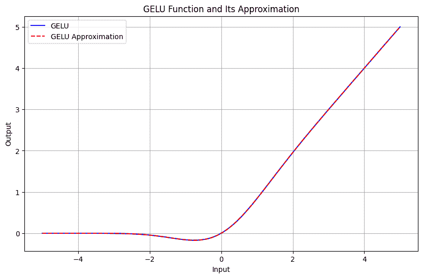

GELU Function and Its Approximation

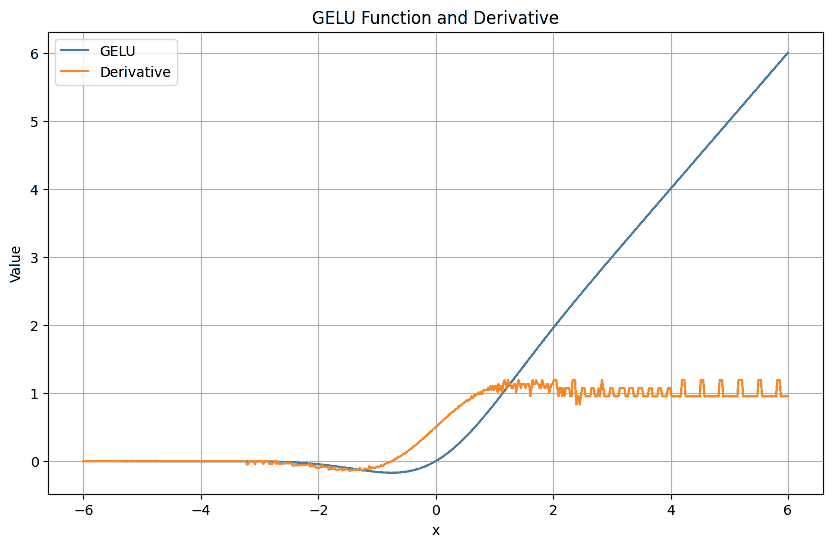

GELU Function and Derivative

1. GELU 函数在负值区域略有饱和，而在正值区域近似于线性。

2. GELU 导数在负值区域较小，在正值区域接近 1，这有助于缓解梯度消失问题。

3. GELU 导数在原点附近较大，这可能会导致训练不稳定。

GELU (Gaussian Error Linear Unit) 是一种基于高斯误差函数的激活函数，相较于 ReLU 等激活函数，GELU 更加平滑，有助于提高训练过程的收敛速度和性能，尤其在BERT和GPT 以及VIT等模型中被广泛使用。

GELU 的特点是：

1. 结合了高斯分布的特性，能够更好地处理神经网络中的激活值，在自然语言处理任务中表现突出。

3. 与 Swish 函数有关联，GELU 是Swish  的一种特例。

总的来说，GELU 函数及其导数的形状都较为平滑，这有助于提高模型的训练效率和性能。

##### 近似以及导数代码段

```
# 以下是使用 Python 和 NumPy 实现 GELU 函数及其近似的示例代码：
import numpy as np
import matplotlib.pyplot as plt
import torch
import torch.nn as nn

# 生成 x 值的范围
x = np.linspace(-6, 6, 600)

# 定义 GELU 函数
class GELU(nn.Module):
    def forward(self, x):
        return 0.5 * x * (1 + torch.tanh(np.sqrt(2 / np.pi) * (x + 0.044715 * x**3)))

# 计算 GELU 函数及其导数
m = GELU()
output = m(torch.Tensor(x))
derivative = (m(torch.Tensor(x + 1e-6)) - m(torch.Tensor(x - 1e-6))) / (2e-6)

# 绘制图像
plt.figure(figsize=(10, 6))
plt.plot(x, output, label=&#x27;GELU&#x27;)
plt.plot(x, derivative, label=&#x27;Derivative&#x27;)
plt.title(&quot;GELU Function and Derivative&quot;)
plt.xlabel(&quot;x&quot;)
plt.ylabel(&quot;Value&quot;)
plt.grid()
plt.legend()
plt.show()
```

```
import numpy as np
import matplotlib.pyplot as plt
import torch
import torch.nn as nn

# 生成 x 值的范围
x = np.linspace(-6, 6, 600)

# 定义 GELU 函数
class GELU(nn.Module):
    def forward(self, x):
        return 0.5 * x * (1 + torch.tanh(np.sqrt(2 / np.pi) * (x + 0.044715 * x**3)))

# 计算 GELU 函数及其导数
m = GELU()
output = m(torch.Tensor(x))
derivative = (m(torch.Tensor(x + 1e-6)) - m(torch.Tensor(x - 1e-6))) / (2e-6)

# 绘制图像
plt.figure(figsize=(10, 6))
plt.plot(x, output, label=&#x27;GELU&#x27;)
plt.plot(x, derivative, label=&#x27;Derivative&#x27;)
plt.title(&quot;GELU Function and Derivative&quot;)
plt.xlabel(&quot;x&quot;)
plt.ylabel(&quot;Value&quot;)
plt.grid()
plt.legend()
plt.show()
```

##### 插曲: Sigmoid 与 CDFs 的差别:

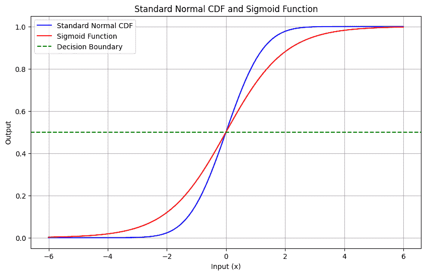

Standard Normal CDF and Sigmoid Function

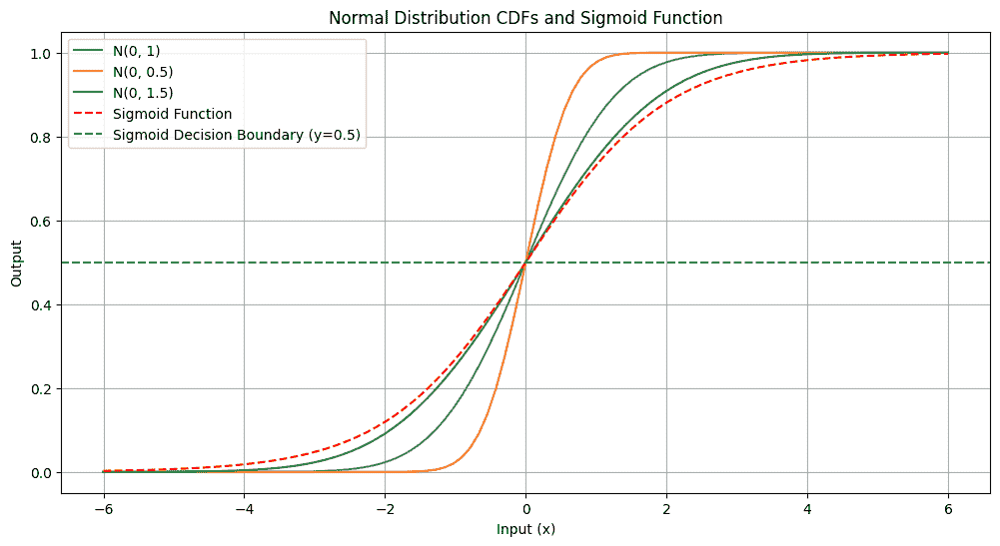

Normal Distribution CDFs and Sigmoid Function

##### Sigmoid 与 CDFs代码段

```
import numpy as np
import matplotlib.pyplot as plt
from scipy.stats import norm

def sigmoid(x):
    return 1 / (1 + np.exp(-x))

# 生成输入数据
x = np.linspace(-6, 6, 100)

# 计算标准正态分布的 CDF 和 Sigmoid 函数的输出
cdf = norm.cdf(x)
y_sigmoid = sigmoid(x)

# 绘制图像
plt.figure(figsize=(10, 6))
plt.plot(x, cdf, label=&#x27;Standard Normal CDF&#x27;, color=&#x27;blue&#x27;)
plt.plot(x, y_sigmoid, label=&#x27;Sigmoid Function&#x27;, color=&#x27;red&#x27;)
plt.axhline(y=0.5, color=&#x27;green&#x27;, linestyle=&#x27;--&#x27;, label=&#x27;Decision Boundary&#x27;)
plt.title(&#x27;Standard Normal CDF and Sigmoid Function&#x27;)
plt.xlabel(&#x27;Input (x)&#x27;)
plt.ylabel(&#x27;Output&#x27;)
plt.grid(True)
plt.legend()
plt.show()
```

```
import numpy as np
import matplotlib.pyplot as plt
from scipy.stats import norm

def sigmoid(x):
    return 1 / (1 + np.exp(-x))

# 生成输入数据
x = np.linspace(-6, 6, 100)

# 定义不同的正态分布参数
params = [
    {&#x27;mu&#x27;: 0, &#x27;sigma&#x27;: 1, &#x27;label&#x27;: &#x27;N(0, 1)&#x27;},
    {&#x27;mu&#x27;: 0, &#x27;sigma&#x27;: 0.5, &#x27;label&#x27;: &#x27;N(0, 0.5)&#x27;},
    {&#x27;mu&#x27;: 0, &#x27;sigma&#x27;: 1.5, &#x27;label&#x27;: &#x27;N(0, 1.5)&#x27;},
    # {&#x27;mu&#x27;: 1, &#x27;sigma&#x27;: 0.5, &#x27;label&#x27;: &#x27;N(1, 0.5)&#x27;},
    # {&#x27;mu&#x27;: -1, &#x27;sigma&#x27;: 1.5, &#x27;label&#x27;: &#x27;N(-1, 1.5)&#x27;},
]

# 绘制正态分布的 CDF
plt.figure(figsize=(12, 6))

for param in params:
    mu = param[&#x27;mu&#x27;]
    sigma = param[&#x27;sigma&#x27;]
    cdf = norm.cdf(x, loc=mu, scale=sigma)
    plt.plot(x, cdf, label=param[&#x27;label&#x27;])

# 计算 Sigmoid 函数的输出
y_sigmoid = sigmoid(x)

# 绘制 Sigmoid 函数
plt.plot(x, y_sigmoid, label=&#x27;Sigmoid Function&#x27;, color=&#x27;red&#x27;, linestyle=&#x27;--&#x27;)

# 添加图例和标题
plt.title(&#x27;Normal Distribution CDFs and Sigmoid Function&#x27;)
plt.xlabel(&#x27;Input (x)&#x27;)
plt.ylabel(&#x27;Output&#x27;)
plt.axhline(y=0.5, color=&#x27;green&#x27;, linestyle=&#x27;--&#x27;, label=&#x27;Sigmoid Decision Boundary (y=0.5)&#x27;)
plt.grid(True)
plt.legend()
plt.show()
```

### 6. **SwiGLU ****(**Swish-Gated Linear Unit)

SwiGLU 最早是在论文 "GLU Variants Improve Transformer" 中提出的。这项工作探讨了不同的 **GLU 变**体在** Trans**former 模型中的应用，并展示了 SwiGLU 的有效性。Gated Linear Units (GLU) 是一种由两个线性投影的逐元素乘积组成的组件，其中一个投影首先通过一个sigmoid函数。测试了GLU的不同变体在Transformer序列到序列模型的前馈子层中的表现，发现某些变体在质量上优于通常使用的ReLU或GELU激活函数。(实验结论)

Transformer模型交替使用多头注意力和“逐位置**前馈网络**”（FFN）。FFN**将一个向**量 （序列中特定位置的隐藏表示）通过两个学习的线性变换传递，其中激活函数为ReLU。

基础公式：

**使用移除偏差bias的版本**

1. ReLU激活函数的FFN:

2. GELU激活函数的FFN:

3. Swish激活函数的FFN:

引入GLU(Gated Linear Units**) 门控线**性单元，由输入的两个线性变换的逐元素乘积定义的神经网络层，其中一个经过sigmoid激活。

**- ****GLU****使用Sigmoid激活函数**

**论文中提到了几种**GLU变体,使用不同的非线性函数代替sigmoid函数:

其中:

- ReGLU使用ReLU激活函数

- GEGLU使用GELU激活函数

**- ****SwiGLU****使用Swish激活函数, **** **

这些变体都保留了GLU的基本结构，即两个线性变换的逐元素乘积，不同之处在于使用了不同的激活函数。

在**T5模型上测****试**了FFN变体，使用相同的代码库和模型架构。模型的编码器和解码器各由12层组成，隐藏层大小为768。SwiGLU 效果相对来说比较好。

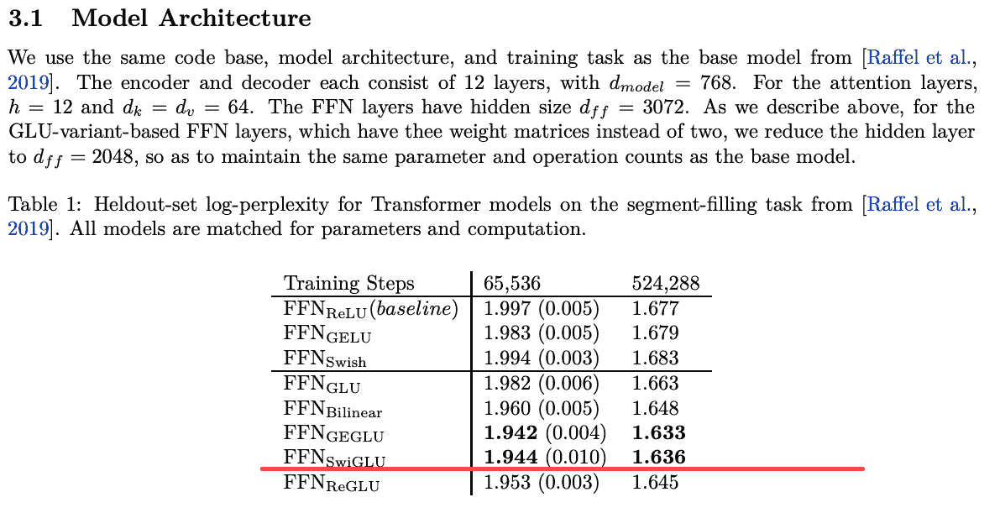

- 特点: 结合**Swish**和**GLU**，增强表达能力。

- 可视化: 结合门控机制，选择性激活。

##### llama3 中的 FeedForward 代码段

```
# https://github.com/meta-llama/llama3/blob/11817d47e1ba7a4959b025eb1ca308572e0e3963/llama/model.py#L193
class FeedForward(nn.Module):
    def __init__(
        self,
        dim: int,
        hidden_dim: int,
        multiple_of: int,
        ffn_dim_multiplier: Optional[float],
    ):
        super().__init__()
        hidden_dim = int(2 * hidden_dim / 3)
        # custom dim factor multiplier
        if ffn_dim_multiplier is not None:
            hidden_dim = int(ffn_dim_multiplier * hidden_dim)
        hidden_dim = multiple_of * ((hidden_dim + multiple_of - 1) // multiple_of)

        self.w1 = ColumnParallelLinear(
            dim, hidden_dim, bias=False, gather_output=False, init_method=lambda x: x
        )
        self.w2 = RowParallelLinear(
            hidden_dim, dim, bias=False, input_is_parallel=True, init_method=lambda x: x
        )
        self.w3 = ColumnParallelLinear(
            dim, hidden_dim, bias=False, gather_output=False, init_method=lambda x: x
        )

    def forward(self, x):
        # in SwiGLU, the Swish function is used to gate the linear function of GLU
        # swish(x) = x * sigmoid(beta * x)
        # when beta = 1, swish function becomes same as the sigmoid linear unit function (SiLU)
        return self.w2(F.silu(self.w1(x)) * self.w3(x))
```