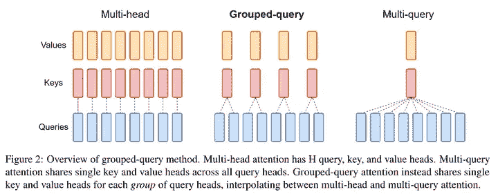
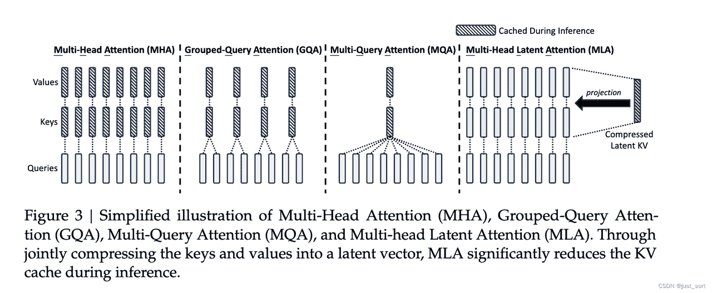
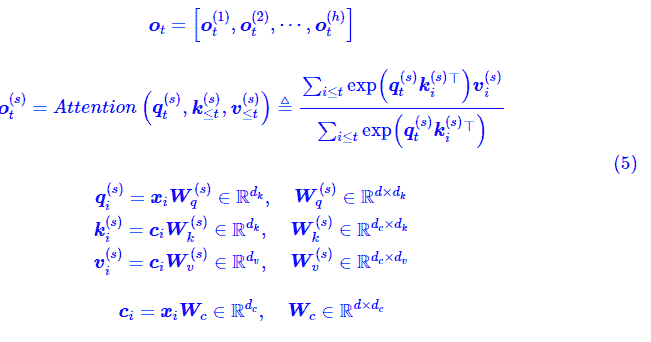
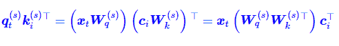
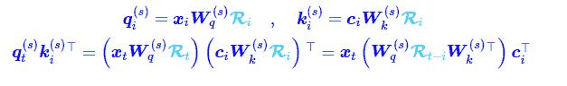
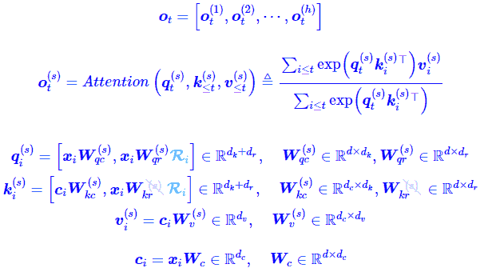
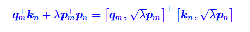
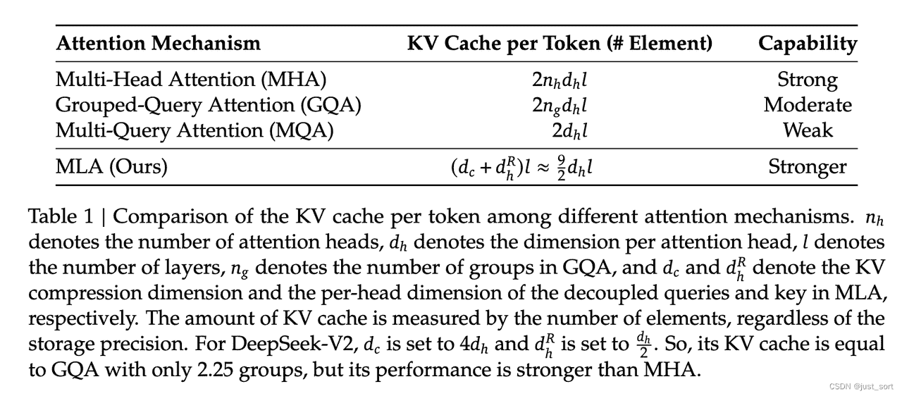

# Deploy029 GQA MHA MLA

> 来源：[https://aicarrier.feishu.cn/docx/XmWXdcoTHoaZlwxThK3c1E9enFc](https://aicarrier.feishu.cn/docx/XmWXdcoTHoaZlwxThK3c1E9enFc)

> 生成阶段，通过缓存KV Cache可以减少重复计算，但是内存有限，当缓存token长度过长，会导致内存爆掉，因而通过减少KV Cache的方式，减少内存占用。

## KV cache

> 以下引自：transformer之KV Cache

+   **原理是什么**

最本质的原理是避免重复计算，将需要重复计算的结果进行缓存，需要缓存的值为历史token对应的KV值，所以叫KV Cache。

+   **为什么只需要KV**

**生成阶段**，输入新的token需要先计算其Q值，然后计算其与历史token K的注意力值，最后与历史token V值进行加权即得到结果，所以只需要缓存历史token的KV值。

+   **为什么会存在重复计算**

首先，生成式模型每生成一个新token都需要调用整个模型进行一次推理，历史token计算得到的中间激活值在Decoder架构的模型中每次推理时都是一样的，所以可以进行缓存。

这是因为Decoder架构中，当前token只用之前的token计算得到注意力值，通过Causal Mask实现，换句话说，在推理的时候前面已经生成的字符不需要与后面的字符产生attention，从而使得前面已经计算的K和V可以缓存起来。

总的来说，KV Cache是以空间换时间的做法，通过使用快速的缓存存取，减少了重复计算。（注意，只有decoder结构的模型可用，因为有mask attention的存在，使得前面的token可以不用关注后面的token）。

以生成阶段的QK计算过程来看，不同的计算方式计算量的差异，来分析K/V cache对计算量的影响：

,    ,

+   方法一

计算量=1xdxd+1xdxd+1xnxd

该方法计算量最小，但是需要缓存历史x信息，如果每次使用index方式索引embedding矩阵替代KV，倒是可以节省缓存，但这种方法效果可能会受损

+   方法二

计算量=dxdxd+1xdxd+1xnxd

该方法计算量最大，但是可以通过**离线计算**** ****方式，这样可极大减**小计算量，但是不适用于Rope相对位置编码，只适用于绝对位置编码，因为相对编码矩阵无法融入权重矩阵中

+   方法三

计算量=1xdxd+dxnxd+1xnxd

该**方法计算量适中，如**果配合KV cache缓存    计算量为1xdxd+1xnxd，计算量最小，并且适用于相对位置编码

但是，用了KV Cache之后也不是立刻万事大吉。

我们简单算一下，对于输入长度为 s ，层数为 L ，hidden size为 d 的模型，需要缓存的参数量为2×L×s×d

如果使用的是半精度浮点数，那么总共所需的空间就是2×2×L×s×d。

以Llama2 7B为例，有 L=32 ， d=4096 ，那么每个token所需的缓存空间就是524,288 bytes，约520K，当 s=1024 时，则需要536,870,912 bytes，超过500M的空间。

下面介绍attention优化算法来减少KV缓存空间。

## Multi-Query Attention & Grouped-Query Attention

> 以下引自：理解Attention:从起源到MHA,MQA和GQA

+   MQA

+   直接让所有Attention Head共享同一个K、V

+   MQA直接将KV Cache减少到了原来的1/n

+   效果方面，目前看来大部分任务的损失都比较有限，且MQA的支持者相信这部分损失可以通过进一步训练来弥补回。

+   GQA

+    由于使用一套共享的 K、V 效果不好，将同一个group内的Q共享同一套 K、V ，不同group的Q所用的 K、V 不同

+   GQA使用者：Meta开源的[LLAMA2-70B](https://llama.meta.com/llama2/)，以及[LLAMA3](https://llama.meta.com/llama3/)全系列，[DeepSeek-V1](https://papers.cool/arxiv/2401.02954)、[Yi](https://papers.cool/arxiv/2403.04652)、[ChatGLM2](https://github.com/THUDM/ChatGLM2-6B)/3

## Multi-head Latent Attention

> 以下引自：[大模型KV Cache节省神器M](https://blog.csdn.net/just_sort/article/details/139583219)LA学习笔记（包含推理时的矩阵吸收分析）DeepSeek2 paper

> 缓存与效果的极限拉扯：从MHA、MQA、GQA到MLA

上面的图是Deepseek2 paper中对集中常见KV Cache压**缩方法的对比，可以看到MLA的**核心是对keys和values进行低秩联合压缩后，通过线性变换升维来增强模型性能。

### 降维->升维

GQA在投影之后做了什么呢？首先它将向量对半分为两份分别作为K、V，然后每一份又均分为g份，每一份复制h/g次，以此来“凑”够h个Attention Head所需要的K、V。我们知道分割、复制都是简单的线性变换，所以MLA的第一个想法是将这些简单的线性变换换成一般的线性变换，以增强模型的能力：

以上公式中 ，通过不同的投影矩阵 ，再次让所有的K、V Head都变得各不相同。

然而，理论上这样是能增加模型能力，但别忘了GQA的主要目的是减少KV Cache，出于节省计算和通信成本的考虑，我们一般会缓存的是投影后的 而不是投影前的 ，而MLA的这个做法，通过不同的投影矩阵再次让所有的K、V Head都变得各不相同，那么KV Cache的大小就恢复成跟MHA一样大了，违背了GQA的初衷。

对此，MLA发现，我们可以结合Dot-Attention的具体形式，通过一个简单但不失巧妙的恒等变换来规避这个问题。首先，在训练阶段还是照常进行，此时优化空间不大；然后，在推理阶段，我们利用

这意味着推理阶段，我们可以将 合并起来作为Q的投影矩阵， 那么 则取代了原本的 ，同理，在 后面我们还有一个投影矩阵，于是 的 也可以吸收到后面的投影矩阵中去，于是等效地 也可以用 代替，也就是说此时KV Cache只需要存下所有的 就行，而不至于存下所有的 。注意到 跟 无关，也就是说是所有头共享的，即MLA在推理阶段它可以恒等变换为一个MQA。

另外 可以取更小的值（DeepSeek-V2取了512），从而进一步压缩KV Cache，这就是MLA的核心思想。

### 兼容RoPE

MLA之所以能保持跟GQA一样大小的KV Cache，其关键一步是“将 合并成一个（跟位置无关的）矩阵作为Q的投影矩阵”，但如果加了RoPE的话，这一步就无法实现了。这是因为RoPE是一个跟位置相关的 的分块对角矩阵 ，满足 ，MLA加入RoPE之后会让 之间多插入了一项 ：

这里的 就无法合并为一个固定的投影矩阵了（跟位置差t−i相关），从而MLA的想法无法结合RoPE实现。结合前序KV cache计算量分析，MHA使用RoPE进行位置编码，进而在生成阶段可直接使用K cache的key值。但是MLA存储的是 ，如果 无法合并，那么相当于每次都要重新计算之前所有token的key值，会极大降低推理效率。

最后发布的MLA，采取了一种混合的方法——每个Attention Head的Q、K新增 个维度用来添加RoPE，其中K新增的维度每个Head共享：

以上拼接方法参考Sandwich通过拼接的方式补充绝对位置信息，其Attention结果则相当于相对位置编码：

这样一来，没有RoPE的维度就可以重复降维升维的操作，在推理时KV Cache只需要存 ，新增的带RoPE的维度就可以用来补充位置信息，并且由于所有Head共享，所以也就只有在K Cache这里增加了 个维度，原论文取了 ，相比原本的 =512，增加的幅度不大。

另外MLA的最终版本，还将Q的输入也改为了低秩投影形式，这与减少KV Cache无关，主要是为了减少训练期间参数量和相应的梯度（原论文说的是激活值，个人表示不大理解）所占的显存，这里不再展开。