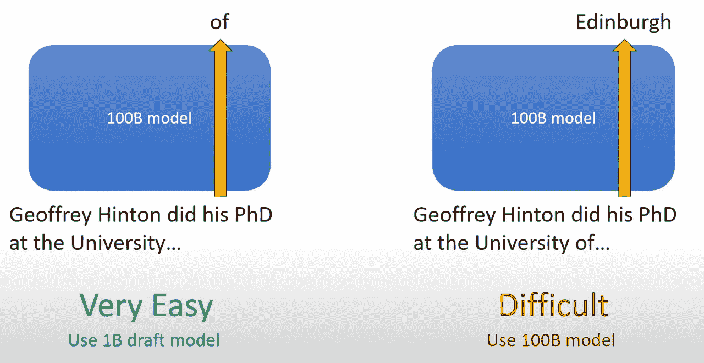
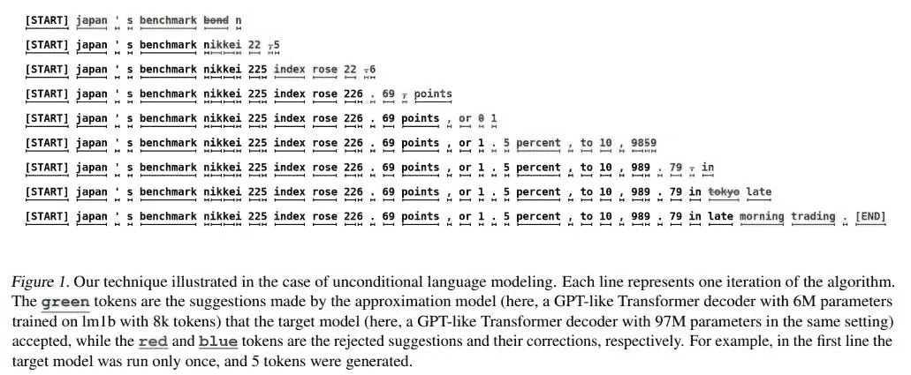

# Deploy034 投机解码

> 来源：https://aicarrier.feishu.cn/docx/SOqSdTAZooOunExGbM4csxn5nTh

## 1.1 投机推理采样 (Speculative Decoding)

> 关于投机推理采样的文章总结:

> [聊聊大模型推理服务之投机推理](https://zhuanlan.zhihu.com/p/699166575)

> Speculative Decoding 论文阅读合订本

> Spec BenchMark:

> [Unlocking Efficiency in Large Language Model Inference: A Comprehensive Survey of Speculative Decoding](http://arxiv.org/abs/2401.07851)

> [Spec-Bench:](https://github.com/hemingkx/Spec-Bench/tree/main)[ A Comprehensive Benchmark and Unified Eval](https://github.com/hemingkx/Spec-Bench/tree/main)uation Platform for Speculative Decoding

关于投机性执行是分布式计算的老话题，在计算机体系结构中也有投机预取，处理器优化中也有推测投机执行指令，也就是分支预测，还有分布式领域 MapReduce/Hadoop 时代（大概在 2010 年前后）就有大量关于投机性执行一些预计性任务的工作等等的相关思想。大语言模型都需要迭代运行顺序生成标记，也就是一个一个 `token` 往外吐，不好在 `token` 级别并行进行加速。所以就有了投机推理技术来帮忙优化增加并行度，一般被称为 speculative decode，推测性解码、投机解码。

## 2.1 Speculative Decoding 背后有两个关键思想

### 2.1.1 预测 Token 难易不一致

在下图中，预测标记 `of` 真的很容易，而且它可能很容易被小得多的模型预测，因此使用较小的模型来预测简单的标记，而使用大模型仅用于预测更困难的标记。



预测标记 `of` 真的很容易，并且可以通过小得多的模型轻松预测，而标记 `Edinburg` 的预测相对来说很困难，而较小的模型可能无法预测。

### 2.1.2 并行验证 Token

尽管这些自回归模型通常一次迭代生成一个单词，但它们可以一次输入多个Token。在生成下一个 Token 时，他们可以一次检查序列中的所有 Token。它通过计算序列中每个标记的概率来实现此目的。


在上图中，较小的模型预测“Toronto”，但正确的单词是“Edinburgh”，较大的模型可以看到“Toronto”的概率很低，并将其更正为“Edinburgh”。

## 2.2 推测解码：推理加速的关键因素

推测解码使用更小、更快的模型（称为`Draft`/`Small` 模型）在生成多组输出。随后检查此输出，并在必要时由更大、功能更强大的模型（称为`Main`/`Target`模型）进行校正。推测解码的本质在于它能够加快推理过程，利用较小模型的速度，同时保持较大模型提供的质量保证。

+ 小型模型提供低延迟，但它们生成的文本质量通常较差。
+ 较大的模型可能能够生成高质量的文本，但响应时间可能会很慢。

> [Fast Inference from Transformers via Speculative Decoding](https://arxiv.org/pdf/2211.17192) 从Paper当中的例子我们能看到



每一行代表模型的一次迭代。

绿色标记是由 6M参数`Draft模型` 提出的建议，

目标模型为 97M参数`Target模型` 接受了这些建议，而红色和蓝色标记分别是被拒绝的建议及其修正。

例如，在第一行中，`Target`模型只运行了一次，生成了5个标记。剩余的Token均为小模型生成。

如果 draft 模型的建议始终准确，那么推测解码的总成本将只是 draft 模型的推理成本，加上`Target`模型的单个验证步骤。与仅使用 `Target` 模型的传统解码方法 (均使用大模型逐token生成) 相比，这种配置将更快的推理。

+ `Draft`模型必须比主模型小得多且速度更快。
+ `Draft`模型应生成主模型可以验证通过的大量token建议。

相反，如果`Draft`模型的建议大多是错误的，那么`Target`模型将需要纠正每个标记，从而有效地将解码工作加倍。(首先生成预测，然后纠正它们。这种情况会使推测解码比单独使用主模型慢。)

> 投机解码的加速关键是 `Draft模型`的推理速度与 能够被`Target模型`验证通过的概率；

### 2.2.1 Huggingface 推测解码实现

```
from transformers import AutoModelForCausalLM, AutoTokenizer
import torch

prompt = "Alice and Bob"
checkpoint = "EleutherAI/pythia-1.4b-deduped"
assistant_checkpoint = "EleutherAI/pythia-160m-deduped"
device = "cuda" if torch.cuda.is_available() else "cpu"

tokenizer = AutoTokenizer.from_pretrained(checkpoint)
inputs = tokenizer(prompt, return_tensors="pt").to(device)

model = AutoModelForCausalLM.from_pretrained(checkpoint).to(device)
assistant_model = AutoModelForCausalLM.from_pretrained(assistant_checkpoint).to(device)
outputs = model.generate(**inputs, assistant_model=assistant_model)
print(tokenizer.batch_decode(outputs, skip_special_tokens=True))
# ['Alice and Bob are sitting in a bar. Alice is drinking a beer and Bob is drinking a']
```

使用 Transformer 实现推测解码非常简单。只需将 `draft` 模型作为参数包含在 `generate` 函数中

`num_assistant_tokens`：定义在每次迭代中由目标模型检查之前应由辅助模型或绘制模型生成的 `speculative tokens` 数。`num_assistant_tokens` 的值越高，生成就越 `speculative` ：如果辅助模型的性能较高，则可以达到更大的加速，如果辅助模型需要大量校正，则会达到较低的加速。

> https://gist.github.com/luv-bansal/9c358ba65b8cab8765ec164c9b806a3f#file-speculative_decoding_evaluation-md

> 结果显示推测抽样比朴素自回归抽样的加速（作为比率）。这些结果来自不同的基准测试运行。

> 上述基准测试结果表明，推测解码的速度比朴素自回归采样高出约 2 倍。

#### 一些经验性质结论

> [Accelerating AI: Exploring Speculative Decoding with Large Language Models](https://medium.com/@tejaswi_kashyap/accelerating-ai-exploring-speculative-decoding-with-large-language-models-326d95e4c595)

+ Speed increase is around 2X in most of the cases based on our results.

根据我们的结果，在大多数情况下，速度提升约为 2 倍。

+ The draft model must be significantly smaller(10–50X smaller) to achieve inference acceleration

Draft 模型必须明显更小（小 10-50 倍）才能实现推理加速

+ The speedup ratio seems to increase as the target model size increases (and when the draft model is also relatively big enough). So, the speedup ratio of 2–2.5x mentioned in the Deepmind paper, could also be true for a 70B `target model` and a 7B `draft model`.

加速比似乎随着`Target`模型大小的增加（以及当 `draft` 模型也相对足够大时）而增加。因此，Deepmind 论文中提到的 2-2.5 倍的加速比也可能适用于 70B 目标模型和 7B 草稿模型。

+ However, there are some instances where the speed actually slows down. We need to look into these cases more closely.

但是，在某些情况下，速度实际上会变慢。我们需要更仔细地研究这些案例。

### 2.2.2 Rejection Sampling 拒绝性采样的证明部分

> [Fast Inference from Transformers via Speculative Decoding](https://arxiv.org/pdf/2211.17192) 论文中附录给出证明

这个证明确保了使用投机采样方法从模型 和 采样得到的样本分布与仅从 采样得到的分布是相同的。下面是具体的证明过程：

**定义和符号**

+ ：`Target模型` 生成的概率分布。
+ ：`Draft模型` 生成的概率分布。
+ ：接受概率，即接受从 采样得到的样本  的概率。

**证明步骤**

1.  样本 的概率 的计算：

+ 样本 被接受的概率由两部分组成：猜测被接受的情况和猜测被拒绝的情况。

+ 猜测被接受的概率为：

+ 猜测被拒绝的概率为：

+ 其中  是调整后的分布，用于在猜测被拒绝时重新采样。

1.  接受概率 的计算：

+ 接受概率  定义为：  这表示如果  ，则接受样本；否则，以一定的概率拒绝。

1.  调整分布 的定义：

+  定义为  减去  和  的较小值，然后归一化：

+ 其中，`norm` 表示归一化操作，确保  是一个有效的概率分布。

1.  最终结果：

+ 将上述两部分合并，得到 `x` 被采样的概率：

+ 简化后得到：

+ 这证明了使用投机采样方法得到的样本分布与仅从  采样得到的分布相同。

**直观解释**

+ 如果  说明大模型在`token` 上概率大于小模型，则大模型对生成`token` 更有把握，说明小模型生成的问题不大可以保留  。

+ 如果  则小模型更有把握，大模型就以  为概率概率拒绝，并重新采样。

因为接收的概率更偏向 大的位置，重新采样的概率应该更偏向 大的位置，所以是 。

### 2.2.3 Speculative Decoding 代码细节

包含拒绝性采样(`Rejection Sampling`)的判断


```python
def speculative_sampling(target_model, draft_model, initial_prompt_seq, target_len, tokenizer, lookahead=4, temperature=1.0, debug=True):
    '''
    Implementation of Algorithm 2 of the paper - Accelerating Large Language Model Decoding 
    with Speculative Sampling (https://arxiv.org/abs/2302.01318)
    '''
    assert initial_prompt_seq.shape[0] == 1, 'Batch size should be 1'

    n = initial_prompt_seq.shape[-1] # 13
    fin_prompt_seq = initial_prompt_seq.detach().clone() # torch.Size([1, 13])

    while n < target_len: # 64 + 1 = 65
        n_orig = n # 13
        N = fin_prompt_seq.shape[-1] # 13
        # OPTForCausalLM opt_model + lmhead (768, 50272)
        # 1 * 4
        draft_outputs, draft_logits = sample_from_draft_model(draft_model, fin_prompt_seq, new_tokens=lookahead, temperature=temperature)
        # torch.Size([1, 17]), torch.Size([1, 4, 50272])
        if debug:
            print(f"Possible continuations: {tokenizer.decode(draft_outputs[0,n_orig:], skip_special_tokens=True)}")
        
        # x + 5
        # OPTForCausalLM opt_model + lmhead (2048, 50272)
        target_logits = target_model(draft_outputs).logits[:, -lookahead-1:, :] 
        # torch.Size([1, 5, 50272])
        
        target_model_distribution = get_distribution(target_logits, temperature)
        draft_model_distribution = get_distribution(draft_logits, temperature)
        accepted_flag = 1 # 初始化接受标志 accepted_flag 为1。
        
        for t in range(lookahead):
            numerator = target_model_distribution[:, t, draft_outputs[0, N+t]]
            denominator = draft_model_distribution[:, t, draft_outputs[0, N+t]]
            ratio = (numerator / denominator) 
            ones_tensor = torch.ones_like(numerator)

            uniform_distribution = torch.rand_like(numerator)

            # Rejection Sampling
            ## Acceptance 
            # 如果随机值小于概率比，则接受草稿模型的生成结果，并更新 fin_prompt_seq 和增加 n。
            # print('uniform_distribution:{}_ratio:{}'.format(uniform_distribution, ratio))
            if (uniform_distribution < torch.min(ones_tensor, ratio)).any():
                fin_prompt_seq = torch.concat([fin_prompt_seq, draft_outputs[:, N+t].unsqueeze(dim=-1)], dim=-1)
                n += 1
                print('{}_lookhead_{}'.format(n, t))
                # 小循环

            ## Rejection
            # 否则，拒绝草稿模型的结果，重新采样目标模型的分布，并更新 fin_prompt_seq，同时将 accepted_flag 设置为0并跳出循环。
            else:
                new_dist = (target_model_distribution[:, t, :] - draft_model_distribution[:, t, :])
                new_dist = torch.max(torch.zeros_like(new_dist), new_dist)
                new_dist = new_dist / new_dist.sum(dim=-1, keepdim=True)
                token_id = torch.multinomial(new_dist, num_samples=1)[0]
                
                fin_prompt_seq = torch.concat([fin_prompt_seq, token_id[None,...]], dim=-1)
                accepted_flag = 0
                break

        if accepted_flag == 1:
            # 如果所有时间步都接受了草稿模型的结果，则从目标模型的最后一步分布中采样一个token，并添加到 fin_prompt_seq 中。
            sample_token = sample(target_logits[:, -1, :], temperature=temperature)
            fin_prompt_seq = torch.concat([fin_prompt_seq, sample_token[None,...]], dim=-1)
        
        if debug:
            print(f"Accepted continuations: {tokenizer.decode(fin_prompt_seq[0,n_orig:], skip_special_tokens=True)}")

        n += 1
        print('{}_target_model'.format(n))

    return fin_prompt_seq
```
