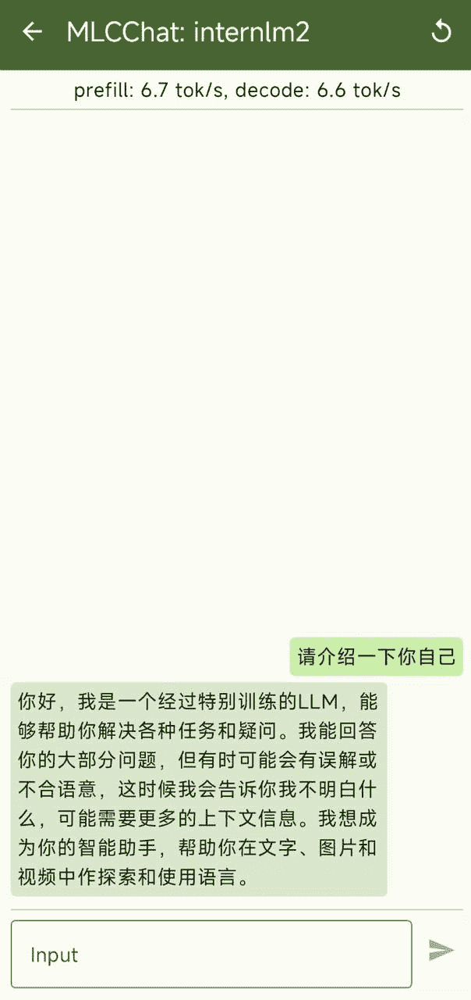
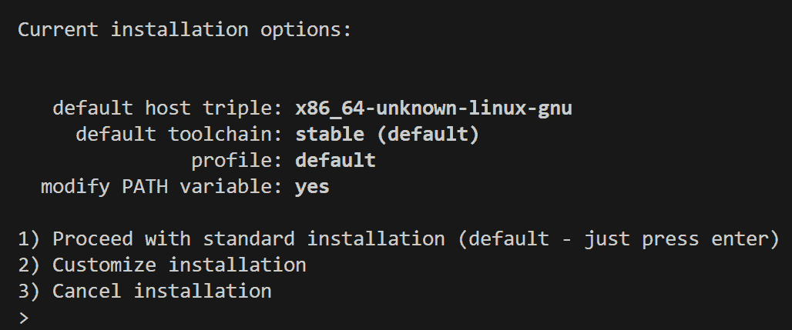
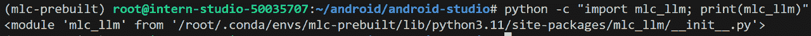
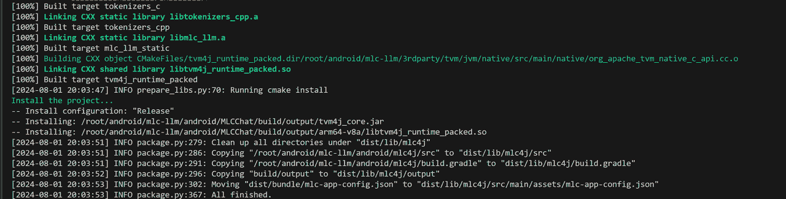
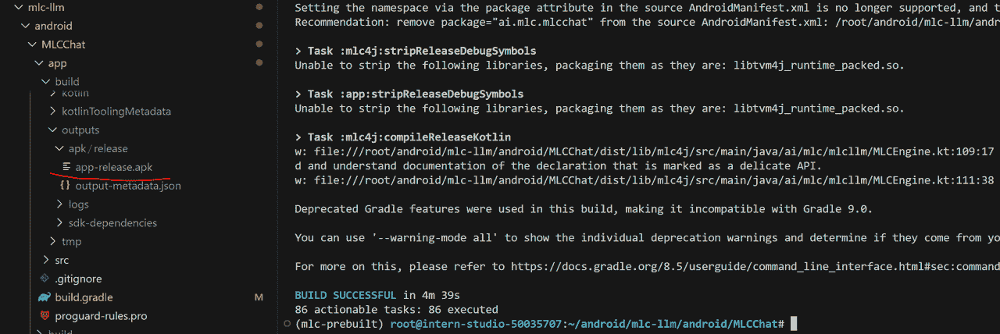

# 安卓部署 InternLM2-1.8B踩坑经验

> 来源：[https://aicarrier.feishu.cn/docx/DAJ0d7JmWoJaTPxEojAcvPi7n3d](https://aicarrier.feishu.cn/docx/DAJ0d7JmWoJaTPxEojAcvPi7n3d)


参考：[https://llm.mlc.ai/docs/deploy/android.html#android-sdk](https://llm.mlc.ai/docs/deploy/android.html#android-sdk)

本文将带大家手把手将 InternLM2 部署到安卓手机上，首先我们来看一下最终的效果～



## 1 环境准备

### 1.1 安装 `rust`

参考 [https://forge.rust-lang.org/infra/other-installation-methods.html#which](https://forge.rust-lang.org/infra/other-installation-methods.html#which)

使用了国内的镜像，下面的选项选择1

```
export RUSTUP_DIST_SERVER=https://mirrors.ustc.edu.cn/rust-static
export RUSTUP_UPDATE_ROOT=https://mirrors.ustc.edu.cn/rust-static/rustup
curl --proto '=https' --tlsv1.2 -sSf https://mirrors.ustc.edu.cn/misc/rustup-install.sh | sh
```



### 1.2 安装Android Studio

参考 [https://developer.android.com/studio](https://developer.android.com/studio)

```
mkdir -p /root/android && cd /root/android
wget https://redirector.gvt1.com/edgedl/android/studio/ide-zips/2024.1.1.12/android-studio-2024.1.1.12-linux.tar.gz
tar -xvzf android-studio-2024.1.1.12-linux.tar.gz
cd android-studio
wget https://dl.google.com/android/repository/commandlinetools-linux-11076708_latest.zip?hl=zh-cn
unzip commandlinetools-linux-11076708_latest.zip?hl=zh-cn
export JAVA_HOME=/root/Downloads/android-studio/jbr
cmdline-tools/bin/sdkmanager "ndk;27.0.12077973" "cmake;3.22.1" "platforms;android-34" "build-tools;33.0.1" --sdk_root='sdk'
```

### 1.3 设置环境变量

```
. "$HOME/.cargo/env"
export ANDROID_NDK=/root/android/android-studio/sdk/ndk/27.0.12077973
export TVM_NDK_CC=$ANDROID_NDK/toolchains/llvm/prebuilt/linux-x86_64/bin/aarch64-linux-android24-clang
export JAVA_HOME=/root/android/android-studio/jbr
export ANDROID_HOME=/root/android/android-studio/sdk
export PATH=/usr/local/cuda-12/bin:$PATH
export PATH=/root/android/android-studio/sdk/cmake/3.22.1/bin:$PATH
```

## 2 转换模型

### 2.1 安装 `mlc-llm`

参考 [https://llm.mlc.ai/docs/install/mlc_llm.html](https://llm.mlc.ai/docs/install/mlc_llm.html)

（如果下载很慢可以取消重新运行一下，或者本地下载了拷过去）

```
conda create --name mlc-prebuilt python=3.11
conda activate mlc-prebuilt
conda install -c conda-forge git-lfs
pip install pytorch==2.1.2 torchvision==0.16.2 torchaudio==2.1.2 pytorch-cuda=12.1 transformers sentencepiece protobuf
wget https://github.com/mlc-ai/package/releases/download/v0.9.dev0/mlc_llm_nightly_cu122-0.1.dev1445-cp311-cp311-manylinux_2_28_x86_64.whl
wget https://github.com/mlc-ai/package/releases/download/v0.9.dev0/mlc_ai_nightly_cu122-0.15.dev404-cp311-cp311-manylinux_2_28_x86_64.whl
pip install mlc_ai_nightly_cu122-0.15.dev404-cp311-cp311-manylinux_2_28_x86_64.whl
pip install mlc_llm_nightly_cu122-0.1.dev1445-cp311-cp311-manylinux_2_28_x86_64.whl
```

测试如下输出说明安装正确

```
python -c "import mlc_llm; print(mlc_llm)"
```



克隆项目

```
git clone https://github.com/mlc-ai/mlc-llm.git
cd mlc-llm
git submodule update --init --recursive
```

### 2.2 转换模型

You can be under the `mlc-llm` repo, or your own working directory. Note that all platforms can share the same compiled/quantized weights. See Compile Command Specification for specification of `convert_weight`.

### 2.3 生成配置

Use `mlc_llm gen_config` to generate `mlc-chat-config.json` and process tokenizers. See Compile Command Specification for specification of `gen_config`.

```
mlc_llm gen_config /root/models/internlm2-chat-1_8b-sft/  \
    --quantization q4f16_1 --conv-template chatml  \
    -o dist/internlm2-chat-1_8b-sft-q4f16_1-MLC
```

### 2.4 上传到huggingface

上传这一步需要能访问huggingface，可能需要部署代理

如果没有代理可以直接在接下来的配置中使用如下链接的模型（和文档中的转换方法一样）

`https://huggingface.co/timws/internlm2-chat-1_8b-sft-q4fml16_1-MLC`

### 2.5 (可选) 模型测试

在打包之前可以测试模型效果，需要编译成二进制文件

在个人电脑上运行测试代码正常，InternStudio上暂未成功

```
mlc_llm compile ./dist/internlm2-chat-1_8b-sft-q4f16_1-MLC/mlc-chat-config.json \
    --device cuda -o dist/libs/internlm2-chat-1_8b-sft-q4f16_1-MLC-cuda.so
```

测试编译的模型是否符合预期，手机端运行的效果和测试效果接近

```
from mlc_llm import MLCEngine

# Create engine
engine = MLCEngine(model="./dist/internlm2-1_8b-q4f16_1-MLC", model_lib="./dist/libs/internlm2-1_8b-q4f16_1-MLC-cuda.so")

# Run chat completion in OpenAI API.
for response in engine.chat.completions.create(
    messages=[{"role": "user", "content": "你是谁？"}],
    stream=True
):
    for choice in response.choices:
        print(choice.delta.content, end="", flush=True)
print("\n")
engine.terminate()
```

## 3 打包运行

### 3.1 修改配置文件

修改 `mlc-package-config.json`

参考如下

```
{
    "device": "android",
    "model_list": [
        {
            "model": "HF://timws/internlm2-chat-1_8b-sft-q4f16_1-MLC",
            "estimated_vram_bytes": 3980990464,
            "model_id": "internlm2-chat-1_8b-sft-q4f16_1-MLC"

        },
        {
            "model": "HF://mlc-ai/gemma-2b-it-q4f16_1-MLC",
            "model_id": "gemma-2b-q4f16_1-MLC",
            "estimated_vram_bytes": 3980990464
        }
    ]
}
```

### 3.2 运行打包命令

```
mlc_llm package
```



### 3.3 创建签名

```
cd /root/android/mlc-llm/android/MLCChat
/root/android/android-studio/jbr/bin/keytool -genkey -v -keystore my-release-key.jks -keyalg RSA -keysize 2048 -validity 10000
Enter keystore password:  
Re-enter new password: 
What is your first and last name?
  [Unknown]:  Any
What is the name of your organizational unit?
  [Unknown]:  Any
What is the name of your organization?
  [Unknown]:  Any
What is the name of your City or Locality?
  [Unknown]:  Any
What is the name of your State or Province?
  [Unknown]:  Any
What is the two-letter country code for this unit?
  [Unknown]:  CN
Is CN=Any, OU=Any, O=Any, L=Any, ST=Any, C=CN correct?
  [no]:  yes

Generating 2,048 bit RSA key pair and self-signed certificate (SHA256withRSA) with a validity of 10,000 days
        for: CN=Any, OU=Any, O=Any, L=Any, ST=Any, C=CN
[Storing my-release-key.jks]
```

### 3.4 修改gradle配置

如果是本地可以WIFI或USB调试不用签名，在服务器构建需要签名

修改 `app/build.gradle` 为如下内容，主要是增加了签名部分，注意确认签名文件的位置


```
plugins {
    id 'com.android.application'
    id 'org.jetbrains.kotlin.android'
}

android {
    namespace 'ai.mlc.mlcchat'
    compileSdk 34

    defaultConfig {
        applicationId "ai.mlc.mlcchat"
        minSdk 26
        targetSdk 33
        versionCode 1
        versionName "1.0"

        testInstrumentationRunner "androidx.test.runner.AndroidJUnitRunner"
        vectorDrawables {
            useSupportLibrary true
        }
    }

    compileOptions {
        sourceCompatibility JavaVersion.VERSION_1_8
        targetCompatibility JavaVersion.VERSION_1_8
    }
    kotlinOptions {
        jvmTarget = '1.8'
    }
    buildFeatures {
        compose true
    }
    composeOptions {
        kotlinCompilerExtensionVersion '1.4.3'
    }
    packagingOptions {
        resources {
            excludes += '/META-INF/{AL2.0,LGPL2.1}'
        }
    }

    signingConfigs {
        release {
            storeFile file("/root/android/mlc-llm/android/MLCChat/my-release-key.jks")
            storePassword "123456"
            keyAlias "mykey"
            keyPassword "123456"
        }
    }

    buildTypes {
        release {
            minifyEnabled false
            proguardFiles getDefaultProguardFile('proguard-android-optimize.txt'), 'proguard-rules.pro'
            signingConfig signingConfigs.release
        }
    }
}

dependencies {
    implementation project(":mlc4j")
    implementation 'androidx.core:core-ktx:1.10.1'
    implementation 'androidx.lifecycle:lifecycle-runtime-ktx:2.6.1'
    implementation 'androidx.activity:activity-compose:1.7.1'
    implementation platform('androidx.compose:compose-bom:2022.10.00')
    implementation 'androidx.lifecycle:lifecycle-viewmodel-compose:2.6.1'
    implementation 'androidx.compose.ui:ui'
    implementation 'androidx.compose.ui:ui-graphics'
    implementation 'androidx.compose.ui:ui-tooling-preview'
    implementation 'androidx.compose.material3:material3:1.1.0'
    implementation 'androidx.compose.material:material-icons-extended'
    implementation 'androidx.appcompat:appcompat:1.6.1'
    implementation 'androidx.navigation:navigation-compose:2.5.3'
    implementation 'com.google.code.gson:gson:2.10.1'
    implementation fileTree(dir: 'src/main/libs', include: ['*.aar', '*.jar'], exclude: [])
    testImplementation 'junit:junit:4.13.2'
    androidTestImplementation 'androidx.test.ext:junit:1.1.5'
    androidTestImplementation 'androidx.test.espresso:espresso-core:3.5.1'
    androidTestImplementation platform('androidx.compose:compose-bom:2022.10.00')
    androidTestImplementation 'androidx.compose.ui:ui-test-junit4'
    debugImplementation 'androidx.compose.ui:ui-tooling'
    debugImplementation 'androidx.compose.ui:ui-test-manifest'
}
```

### 3.5 命令行编译

运行编译命令，完成后在`app/build/outputs/apk/release`生成`app-release.apk`安装包，下载到手机上运行

```
./gradlew assembleRelease
```



### 3.6 运行体验

运行App需要能访问`huggingface`下载模型


