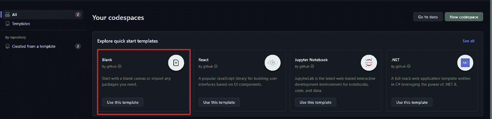
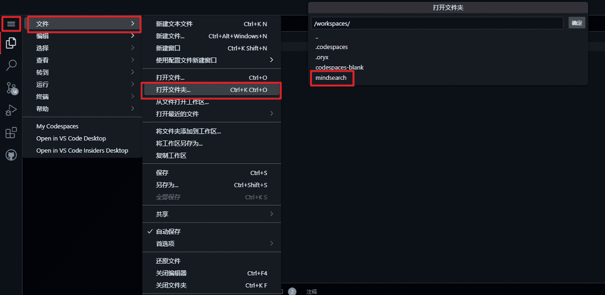
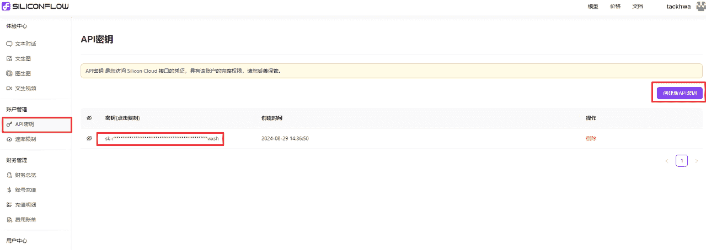
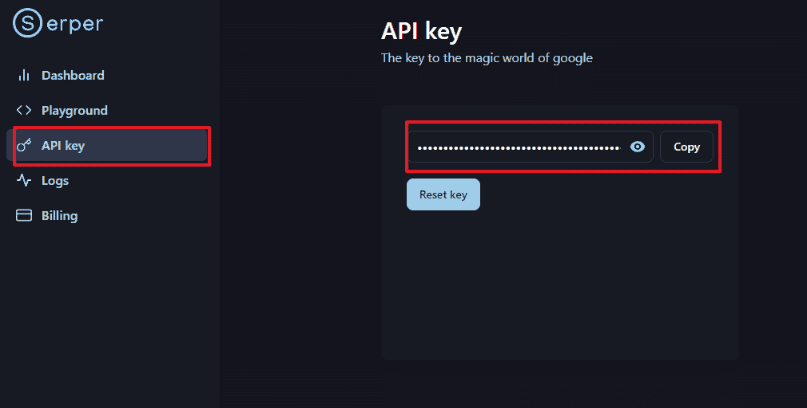
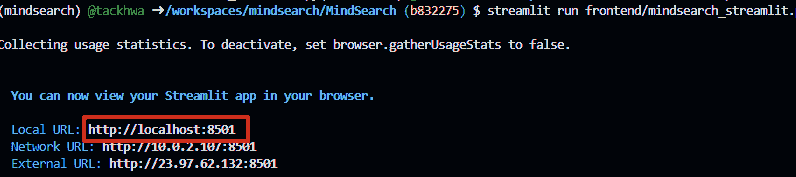
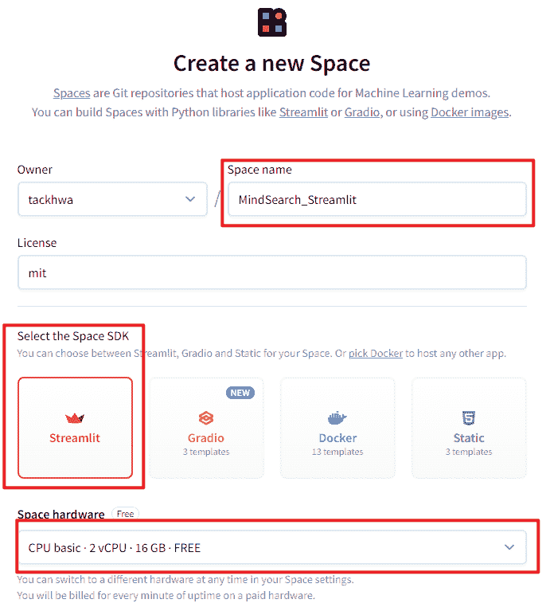
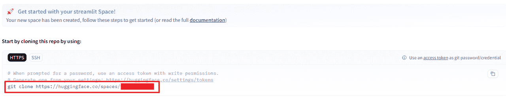
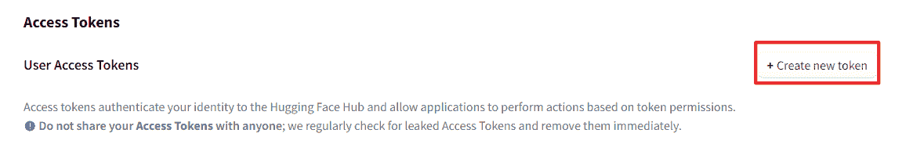
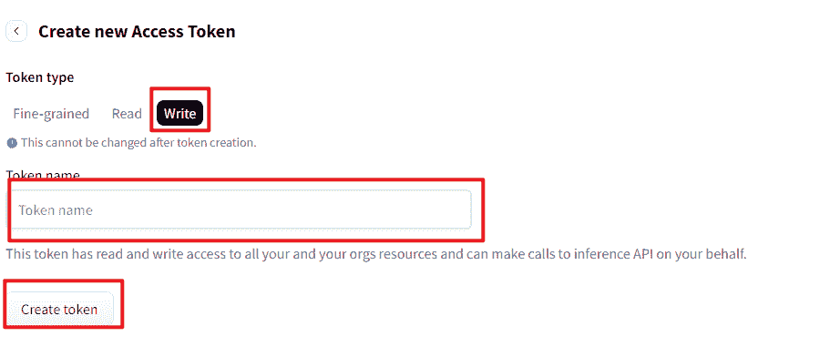

# 「圆桌」在 MindSearch 中支持新的搜索 API

> 来源：https://aicarrier.feishu.cn/docx/Nu28d62fcoNIMVxWwKkcor5mn3g

> 请注意，本文中展示的代码片段是精心挑选的重要部分，旨在简明扼要地阐述关键逻辑或功能。由于篇幅限制，这些代码并不构成完整的实现。为了全面理解和应用这些概念，强烈建议您参考相应的完整源代码。

[兴趣小组](https://aicarrier.feishu.cn/wiki/Wh3WwZ8Jaim5Iyk6vKscymecnmb)加入门槛：将MindSearch部署到Hugging Face上后联系浦语小助手入群。

## 定义

+ `SeacherAgent`指的是 MindSearch 里的两大智能体之一。

+ 搜索API 指的是由第三方服务提供商提供的网络搜索接口，如 Google Serper API、Bing Web Search API等。

+ 如果是在`lagent/actions/bing_browser.py` 支持新的搜索API，`searcher` 指的是实现新的 搜索API 所对应的类。

+ 搜索 API Action 指的是支持新的 搜索API 所需要定义的 Action，如果是直接在 `lagent/actions/bing_browser.py` 支持新的搜索API，那这个 Action 指的就是 `BingBrowser(BaseAction)` 这个类。

## 前置

本文将介绍如何在 MindSearch 里支持的搜索 API，在开始之前，有以下几点需要注意：

+ 根据 MindSearch 里的 `SearcherAgent` 提示词中的 few shot 例子，对于每个节点（由 `MindSearchAgent` 生成的子问题），`SearcherAgent` 会生成 多个 `Query` 用于搜索API来检索内容，所以其 搜索 API Action 中的 `search`函数 需要有处理多个 `Query` 的能力，而不是只处理一个单个的 `Query`。

```
### search
当我希望搜索&quot;王者荣耀现在是什么赛季&quot;时，我会按照以下格式进行操作:
现在是2024年，因此我应该搜索王者荣耀赛季关键词
&lt;|action_start|&gt;&lt;|plugin|&gt;{{&quot;name&quot;: &quot;FastWebBrowser.search&quot;, &quot;parameters&quot;: 
{{&quot;query&quot;: [&quot;王者荣耀 赛季&quot;, &quot;2024年王者荣耀赛季&quot;]}}}}&lt;|action_end|&gt;
```

+ 根据 MindSearch 里的 `SearcherAgent` 提示词中的 few shot 例子，可以看出其实现的 搜索 API Action需要有个可以进一步检索网站内容的函数（网页内容的抓取），也就是 `select`函数 。这是因为多数 搜索API 返回的内容都是网站内容里的片段，并不会包含太多有用的信息。

```
### select
为了找到王者荣耀s36赛季最强射手，我需要寻找提及王者荣耀s36射手的网页。初步浏览网页后，
发现网页0提到王者荣耀s36赛季的信息，但没有具体提及射手的相关信息。网页3提到“s36最强射手出现？”，
有可能包含最强射手信息。网页13提到“四大T0英雄崛起，射手荣耀降临”，可能包含最强射手的信息。
因此，我选择了网页3和网页13进行进一步阅读。
&lt;|action_start|&gt;&lt;|plugin|&gt;{{&quot;name&quot;: &quot;FastWebBrowser.select&quot;, 
&quot;parameters&quot;: {{&quot;index&quot;: [3, 13]}}}}&lt;|action_end|&gt;
&quot;&quot;&quot;
```

+ 搜索 API Action 中的 `search`函数 返回的最终内容最好符合以下所期望的格式，否则在 MindSearch 内部代码解析内容时有可能会报错，MindSearch 里的 `SeacherAgent` 会根据此结果来调用`select`函数：

```
[{&#x27;type&#x27;: &#x27;text&#x27;, &#x27;content&#x27;: &#x27;{&quot;0&quot;: {&quot;url&quot;: &quot;https:&quot;, &quot;summ&quot;: &quot;...&quot;, &quot;title&quot;: &quot;...&quot;},]
```

目前实现 搜索 API Action 的方法有2种：

+ 方法一：在 `lagent/actions/` 文件夹下新建一个文件，并且从零实现搜索 API Action。

+ 方法二：直接在 `lagent/actions/bing_browser.py` 里支持新的搜索 API。

## bing_broswer.py 预览

+ 由于 `bing_browser.py` 里已经内置了 `search` 函数 和 `select` 函数 等功能，并且妥善处理了前置章节中提及的关键注意事项。避免重复造轮子，本文将聚焦于在方法二的基础上，引入一个新的搜索API，以此扩展现有功能。

+ `SearcherAgent` 调用 `BingBrowser` 类的代码流程如下：`def search()` -> `self.searcher.search()` -> `self.searcher._call_serper_api()` -> `self.searcher._parse_response()` -> `def select()` -> `self.fetcher.fetch()`

### 接下来将简单介绍 `bing_broswer.py` 里重要的几个类和函数 :

#### class `BingBrowser(BaseAction)` 类

+ 此类是被设计为 `SearcherAgent` 中的 Action 组件。此类含有两个重要的函数，分别是 `search` 和 `select`，分别对应前置中的 第一点 和 第二点。

##### `def search()` 函数

+ 单独给每个在 `queries` 列表中的 `query` 开一个线程，并且调用对应的 `searcher.serach()` 函数。

```
@tool_api
def search(self, query: Union[str, List[str]]) -> dict:
    """BING search API
    Args:
        query (List[str]): list of search query strings
    """
    queries = query if isinstance(query, list) else [query]
    search_results = {}
    
    with ThreadPoolExecutor() as executor:
        future_to_query = {
            executor.submit(self.searcher.search, q): q
            for q in queries
        }
```

##### `def select()` 函数

+ 单独给每个需要进一步查询的网页（由索引值代表） 开一个线程，并且调用 `fetcher` 去获取网站中的内容，这里的 `fetcher` 指的是 `ContentFetcher` 这一个类，所有的 `searcher` 都是共用这一个 `fetcher`。

```
@tool_api
def select(self, select_ids: List[int]) -> dict:
    """get the detailed content on the selected pages.
    
    Args:
        select_ids (List[int]): list of index to select. Max number of index to be selected is no more than 4.
    """
    if not self.search_results:
        raise ValueError('No search results to select from.')
    
    new_search_results = {}
    with ThreadPoolExecutor() as executor:
        future_to_id = {
            executor.submit(self.fetcher.fetch,
                            self.search_results[select_id]['url']):
            select_id
            for select_id in select_ids if select_id in self.search_results
        }
```

#### class `ContentFetcher` 类

+ 调用 python 中的 `request` 模块爬取网站内容，并且调用 `BeautifulSoup` 结构化得到的 HTML 文档。

> 注意，需要 `cookie` 授权 的网站会访问失败。

```
class ContentFetcher:
    @cached(cache=TTLCache(maxsize=100, ttl=600))
    def fetch(self, url: str) -> Tuple[bool, str]:
        try:
            response = requests.get(url, timeout=self.timeout)
            response.raise_for_status()
            html = response.content
        except requests.RequestException as e:
            return False, str(e)

        text = BeautifulSoup(html, 'html.parser').get_text()
        cleaned_text = re.sub(r'\n+', '\n', text)
        return True, cleaned_text
```

#### class `BaseSearch` 类

+ 内有 `_filter_results` 函数，把 `searcher` 返回的内容统一格式化，对应 前置 中的第3点。

```
class BaseSearch:
    def _filter_results(self, results: List[tuple]) -> dict:
        filtered_results = {}
        count = 0
        for url, snippet, title in results:
            if all(domain not in url
                   for domain in self.black_list) and not url.endswith('.pdf'):
                filtered_results[count] = {
                    'url': url,
                    'summ': json.dumps(snippet, ensure_ascii=False)[1:-1],
                    'title': title
                }
                count += 1
                if count >= self.topk:
                    break
        return filtered_results
```

## 实现新的 `Searcher` 类

+ 综上所述，`bing_broswer.py` 里已经提供了核心的相关类以及函数，现在只需要实现一个新的 `Searcher`（对应 `bing_broswer.py` 里的 `def search()` 函数中的 `self.searcher`）

+ 以 `GoogleSearch` `Seacher` 为例（Google Serper API），需要实现的函数有：`def search()`，`def _call_serper_api()` 和 `def _parse_response()`，其中 `def search()` 是 `Seacher` 的主函数。

> 当前，`SearcherAgent` 中的提示词设计紧密围绕 `BingBrowser` 类展开。因此，为了最便捷地支持新的搜索API，我们只需在现有基础上新增一个 `Searcher` 类即可实现（方法二），这样的改动既直接又高效。否则，如果基于方法一实现且未遵循前置篇章中的注意事项，则可能需要对 `SearcherAgent` 中的提示词进行调整。

> 在开始实现新的 `searcher` 类之前，需要在 `conda` 环境中对 `lagent` 进行源码安装，以便 `lagent` 文件夹中的代码改动能够即时生效：

```
git clone https://github.com/InternLM/lagent.git
cd lagent
pip install -v -e .
```

### `GoogleSearch` 类

+ 首先定义一个 `GoogleSearch` 类，继承 `BaseSearch` 类，并且将参数赋值为对象的属性（参数由 `BingBrowser` 类传入）。`black_list` 参数由 `BaseSearch` 类 调用，判断搜索 API 返回的网站是否处在黑名单当中。`api_key` ，`search_type`，`kwargs` 参数都是和 Google Serper API 相关的参数，使用于对 搜索 API 发送请求。

```
class GoogleSearch(BaseSearch):
    def __init__(self,
                 api_key: str,
                 topk: int = 3,
                 black_list: List[str] = [
                     'enoN',
                     'youtube.com',
                     'bilibili.com',
                     'researchgate.net',
                 ],
                 **kwargs):
        self.api_key = api_key
        self.proxy = kwargs.get('proxy')
        self.search_type = kwargs.get('search_type', 'search')
        self.kwargs = kwargs
        super().__init__(topk, black_list)
```

#### `def search()` 函数

+ 调用内部的 `_call_serper_api` 函数进行搜索，并随后调用内部 `_parse_response` 函数对返回的结果进行结构化处理。在调用过程中，如果发生异常，该函数会实施重试机制，即在短暂等待后重新尝试，直至达到预设的最大重试次数。

> 对于有每秒访问限制的搜索 API，由于用的多线程调用，此函数在尝试最大重试次数之后仍可能报错。


## search 方法

```
@cached(cache=TTLCache(maxsize=100, ttl=600))
    def search(self, query: str, max_retry: int = 3) -> dict:
        for attempt in range(max_retry):
            try:
                response = self._call_serper_api(query)
                return self._parse_response(response)
            except Exception as e:
                logging.exception(str(e))
                warnings.warn(
                    f'Retry {attempt + 1}/{max_retry} due to error: {e}')
                time.sleep(random.randint(2, 5))
        raise Exception(
            'Failed to get search results from Google Serper Search after retries.'
        )
```

## def _call_serper_api() 函数

+   对相对应的 搜索 API 发送请求，并且获得对应结果，其参数以及请求时的格式请参考对应的搜索 API 文档。

```
def _call_serper_api(self, query: str) -> dict:
        endpoint = f'https://google.serper.dev/{self.search_type}'
        params = {
            'q': query,
            'num': self.topk,
            **{
                key: value
                for key, value in self.kwargs.items() if value is not None
            },
        }
        headers = {
            'X-API-KEY': self.api_key or '',
            'Content-Type': 'application/json'
        }
        response = requests.get(
            endpoint, headers=headers, params=params, proxies=self.proxy)
        response.raise_for_status()
        return response.json()
```

## def _parse_response() 函数

+   对于 搜索API 返回的每一个结果，将其提取并包装成 (url,snippest,title) 格式的元组，将这些元组添加到一个名为 `raw_results` 的列表中，随后将 `raw_results` 列表作为参数传递给 `BaseSearch` 类中的 `_filter_results` 函数。

```
def _parse_response(self, response: dict) -> dict:
        raw_results = []

        for result in response[self.result_key_for_type[
                self.search_type]][:self.topk]:
            description = result.get('snippet', '')
            attributes = '. '.join(
                f'{attribute}: {value}'
                for attribute, value in result.get('attributes', {}).items())
            raw_results.append(
                (result.get('link', ''),
                 f'{description}. {attributes}' if attributes else description,
                 result.get('title', '')))

        return self._filter_results(raw_results)

```

---

# 在 Codespaces 上运行 GoogleSearch Searcher

## 配置 CodeSpace 环境

+   打开 [Codespaces](https://github.com/codespaces) ，选择 blank template。



+   为 MindSearch 新建一个文件夹，并把 MindSearch 仓库 clone 下来。

```
mkdir -p /workspaces/mindsearch
cd /workspaces/mindsearch
git clone https://github.com/InternLM/MindSearch.git
cd MindSearch && git checkout b832275 && cd ..
```

+   为 MindSearch 创建一个新的 `conda` 环境。

```
# 创建环境
conda create -n mindsearch python=3.10 -y
# 激活环境
conda activate mindsearch
# 安装依赖
pip install -r /workspaces/mindsearch/MindSearch/requirements.txt
```

+   如果出现 `CondaError`: Run `conda init` before `conda activate` 报错，运行 `source activate base` 即可。

+   如果之前已经安装过 MindSearch 相关环境，则无需运行以上代码创建环境，只需重新安装最新的 `lagent` 即可。

```
conda activate mindsearch
# 卸载旧版本 lagent
pip uninstall lagent -y
# 安装最新版的 lagent
pip install git+https://github.com/InternLM/lagent.git
```

+   点击左上角的 三横杠图标，并且依次选择 文件，打开文件夹，即可打开所有在 `mindsearch` 目录下的文件夹。



## 获取 API KEY

+   在 SiliconFlow API 页面 创建 API KEY。

> 如果没有账号的话，则需要在 [SiliconFlow](https://account.siliconflow.cn/login) 上注册一个账户。



+   接下来需要在 [Serper API 页面](https://serper.dev/api-key) 获取 API KEY。

> 如果没有账号的话，则需要在 [Serper](https://serper.dev/) 上注册一个账户。



+   接下来需要把 API KEY 设置到 Codespace 的环境变量中

```
conda activate mindsearch
cd /workspaces/mindsearch/MindSearch
export SILICON_API_KEY='你的  SILICONFLOW API KEY'
export BING_API_KEY='你的 GOOGLE SERPER API KEY'
```

## 运行 MindSearch

+   启动 MindSearch 后端

```
conda activate mindsearch
cd /workspaces/mindsearch/MindSearch
python -m mindsearch.app --lang cn --model_format internlm_silicon --search_engine GoogleSearch
```

+   打开新的终端，运行 MindSearch 前端（这里运行的是 streamlit 版本）

```
conda activate mindsearch
cd /workspaces/mindsearch/MindSearch
streamlit run frontend/mindsearch_streamlit.py
```

+   Codespace 自带自动转发端口的功能，这里直接点击终端所显示的 streamlit 链接。



---

# 部署到 HuggingFace 上 (Streamlit + GoogleSearch Searcher)

## 创建新的 HF Space

+   打开 [HF Space](https://huggingface.co/spaces) 界面，点击右上角的 Create new Space。


+   依次输入 Space name，License，SDK 选择 Streamlit，Hardware 选用默认的即可。



+   点击右上角的 Settings，定位到 Variables and Secrets 区域，点击 New Secret，分别将 SiliconFlow 密钥以及 Google Serper Key 设置为环境变量 `SILICON_API_KEY` 和 `BING_API_KEY`。


## 准备 HF Space 所需的文件

+   在 HF space 上使用 GoogleSearch Searcher 需要先在 Codespace 上手动构建 `lagent` 的轮子包 ，并且一并上传到 HF space 上。

```
conda activate mindsearch
cd /workspaces/mindsearch
git clone https://github.com/InternLM/lagent.git
cd lagent
git checkout b6bb4e0
#构建 lagent 轮子包
pip install wheel
python setup.py bdist_wheel
```

+   将 HF Space 仓库 clone 到 CodeSpace 上。

```
conda activate mindsearch
cd /workspaces/mindsearch
git clone https://huggingface.co/spaces/<HF用户名>/<HF_Space_仓库名字>
```



+   将需要的文件拷贝到 HF space 仓库中。

```
cp -r /workspaces/mindsearch/MindSearch/mindsearch /workspaces/mindsearch/<HF_Space_仓库名字>
cp /workspaces/mindsearch/MindSearch/requirements.txt /workspaces/mindsearch/<HF_Space_仓库名字>
cp /workspaces/mindsearch/lagent/dist/lagent-0.2.3-py3-none-any.whl /workspaces/mindsearch/<HF_Space_仓库名字>
```

+   创建一个 `app.py` 并复制一下代码，作为 HF Space 的主入口。

```
cd /workspaces/mindsearch/<HF_Space_仓库名字>
touch app.py
```


```
import json
import tempfile
import os
os.system("pip install lagent-0.2.3-py3-none-any.whl")
import requests
import streamlit as st
from lagent.schema import AgentStatusCode
from pyvis.network import Network

os.system("python -m mindsearch.app --lang cn --model_format internlm_silicon --search_engine GoogleSearch &")

# Function to create the network graph
def create_network_graph(nodes, adjacency_list):
    net = Network(height='500px',
                  width='60%',
                  bgcolor='white',
                  font_color='black')
    for node_id, node_data in nodes.items():
        if node_id in ['root', 'response']:
            title = node_data.get('content', node_id)
        else:
            title = node_data['detail']['content']
        net.add_node(node_id,
                     label=node_id,
                     title=title,
                     color='#FF5733',
                     size=25)
    for node_id, neighbors in adjacency_list.items():
        for neighbor in neighbors:
            if neighbor['name'] in nodes:
                net.add_edge(node_id, neighbor['name'])
    net.show_buttons(filter_=['physics'])
    return net

# Function to draw the graph and return the HTML file path
def draw_graph(net):
    path = tempfile.mktemp(suffix='.html')
    net.save_graph(path)
    return path

def streaming(raw_response):
    for chunk in raw_response.iter_lines(chunk_size=8192,
                                         decode_unicode=False,
                                         delimiter=b'\n'):
        if chunk:
            decoded = chunk.decode('utf-8')
            if decoded == '\r':
                continue
            if decoded[:6] == 'data: ':
                decoded = decoded[6:]
            elif decoded.startswith(': ping - '):
                continue
            response = json.loads(decoded)
            yield (response['response'], response['current_node'])

# Initialize Streamlit session state
if 'queries' not in st.session_state:
    st.session_state['queries'] = []
    st.session_state['responses'] = []
    st.session_state['graphs_html'] = []
    st.session_state['nodes_list'] = []
    st.session_state['adjacency_list_list'] = []
    st.session_state['history'] = []
    st.session_state['already_used_keys'] = list()

# Set up page layout
st.set_page_config(layout='wide')
st.title('MindSearch-思索')

# Function to update chat
def update_chat(query):
    with st.chat_message('user'):
        st.write(query)
    if query not in st.session_state['queries']:
        # Mock data to simulate backend response
        # response, history, nodes, adjacency_list
        st.session_state['queries'].append(query)
        st.session_state['responses'].append([])
        history = None
        # 暂不支持多轮
        message = [dict(role='user', content=query)]

        url = 'http://localhost:8002/solve'
        headers = {'Content-Type': 'application/json'}
        data = {'inputs': message}
        raw_response = requests.post(url,
                                     headers=headers,
                                     data=json.dumps(data),
                                     timeout=20,
                                     stream=True)

        for resp in streaming(raw_response):
            agent_return, node_name = resp
            if node_name and node_name in ['root', 'response']:
                continue
            nodes = agent_return['nodes']
            adjacency_list = agent_return['adj']
            response = agent_return['response']
            history = agent_return['inner_steps']
            if nodes:
                net = create_network_graph(nodes, adjacency_list)
                graph_html_path = draw_graph(net)
                with open(graph_html_path, encoding='utf-8') as f:
                    graph_html = f.read()
            else:
                graph_html = None
            if 'graph_placeholder' not in st.session_state:
                st.session_state['graph_placeholder'] = st.empty()
            if 'expander_placeholder' not in st.session_state:
                st.session_state['expander_placeholder'] = st.empty()
            if graph_html:
                with st.session_state['expander_placeholder'].expander(
                        'Show Graph', expanded=False):
                    st.session_state['graph_placeholder']._html(graph_html,
                                                                height=500)
            if 'container_placeholder' not in st.session_state:
                st.session_state['container_placeholder'] = st.empty()
            with st.session_state['container_placeholder'].container():
                if 'columns_placeholder' not in st.session_state:
                    st.session_state['columns_placeholder'] = st.empty()
                col1, col2 = st.session_state['columns_placeholder'].columns(
                    [2, 1])
                with col1:
                    if 'planner_placeholder' not in st.session_state:
                        st.session_state['planner_placeholder'] = st.empty()
                    if 'session_info_temp' not in st.session_state:
                        st.session_state['session_info_temp'] = ''
                    if not node_name:
                        if agent_return['state'] in [
                                AgentStatusCode.STREAM_ING,
                                AgentStatusCode.ANSWER_ING
                        ]:
                            st.session_state['session_info_temp'] = response
                        elif agent_return[
                                'state'] == AgentStatusCode.PLUGIN_START:
                            thought = st.session_state[
                                'session_info_temp'].split('```')[0]
```


```python
                            if agent_return['response'].startswith('```'):
                                st.session_state[
                                    'session_info_temp'] = thought + '\n' + response
                        elif agent_return[
                                'state'] == AgentStatusCode.PLUGIN_RETURN:
                            assert agent_return['inner_steps'][-1][
                                'role'] == 'environment'
                            st.session_state[
                                'session_info_temp'] += '\n' + agent_return[
                                    'inner_steps'][-1]['content']
                        st.session_state['planner_placeholder'].markdown(
                            st.session_state['session_info_temp'])
                        if agent_return[
                                'state'] == AgentStatusCode.PLUGIN_RETURN:
                            st.session_state['responses'][-1].append(
                                st.session_state['session_info_temp'])
                            st.session_state['session_info_temp'] = ''
                    else:
                        st.session_state['planner_placeholder'].markdown(
                            st.session_state['responses'][-1][-1] if
                            not st.session_state['session_info_temp'] else st.
                            session_state['session_info_temp'])
                with col2:
                    if 'selectbox_placeholder' not in st.session_state:
                        st.session_state['selectbox_placeholder'] = st.empty()
                    if 'searcher_placeholder' not in st.session_state:
                        st.session_state['searcher_placeholder'] = st.empty()
                    # st.session_state['searcher_placeholder'].markdown('')
                    if node_name:
                        selected_node_key = f"selected_node_{len(st.session_state['queries'])}_{node_name}"
                        if selected_node_key not in st.session_state:
                            st.session_state[selected_node_key] = node_name
                        if selected_node_key not in st.session_state[
                                'already_used_keys']:
                            selected_node = st.session_state[
                                'selectbox_placeholder'].selectbox(
                                'Select a node:',
                                list(nodes.keys()),
                                key=f'key_{selected_node_key}',
                                index=list(nodes.keys()).index(node_name))
                            st.session_state['already_used_keys'].append(
                                selected_node_key)
                        else:
                            selected_node = node_name
                        st.session_state[selected_node_key] = selected_node
                        if selected_node in nodes:
                            node = nodes[selected_node]
                            agent_return = node['detail']
                            node_info_key = f'{selected_node}_info'
                            if 'node_info_temp' not in st.session_state:
                                st.session_state[
                                    'node_info_temp'] = f'### {agent_return["content"]}'
                            if node_info_key not in st.session_state:
                                st.session_state[node_info_key] = []
                            if agent_return['state'] in [
                                    AgentStatusCode.STREAM_ING,
                                    AgentStatusCode.ANSWER_ING
                            ]:
                                st.session_state[
                                    'node_info_temp'] = agent_return[
                                        'response']
                            elif agent_return[
                                    'state'] == AgentStatusCode.PLUGIN_START:
                                thought = st.session_state[
                                    'node_info_temp'].split('```')[0]

                                if agent_return['response'].startswith('```'):
                                    st.session_state[
                                        'node_info_temp'] = thought + '\n' + agent_return[
                                            'response']
                            elif agent_return[
                                    'state'] == AgentStatusCode.PLUGIN_END:
                                thought = st.session_state[
                                    'node_info_temp'].split('```')[0]

                                if isinstance(agent_return['response'], dict):

                                    st.session_state[
```


# HF Space 部署指南

```python
'node_info_temp'] = thought + '\n' + f'```json\n{json.dumps(agent_return["response"], ensure_ascii=False, indent=4)}\n```'  # noqa: E501
elif agent_return[
        'state'] == AgentStatusCode.PLUGIN_RETURN:
    assert agent_return['inner_steps'][-1][
        'role'] == 'environment'
    st.session_state[node_info_key].append(
        ('thought',
         st.session_state['node_info_temp']))
    st.session_state[node_info_key].append(
        ('observation',
         agent_return['inner_steps'][-1]['content']
         ))
st.session_state['searcher_placeholder'].markdown(
    st.session_state['node_info_temp'])
if agent_return['state'] == AgentStatusCode.END:
    st.session_state[node_info_key].append(
        ('answer',
         st.session_state['node_info_temp']))
    st.session_state['node_info_temp'] = ''
if st.session_state['session_info_temp']:
    st.session_state['responses'][-1].append(
        st.session_state['session_info_temp'])
    st.session_state['session_info_temp'] = ''
# st.session_state['responses'][-1] = '\n'.join(st.session_state['responses'][-1])
st.session_state['graphs_html'].append(graph_html)
st.session_state['nodes_list'].append(nodes)
st.session_state['adjacency_list_list'].append(adjacency_list)
st.session_state['history'] = history

def display_chat_history():
    for i, query in enumerate(st.session_state['queries'][-1:]):
        # with st.chat_message('assistant'):
        if st.session_state['graphs_html'][i]:
            with st.session_state['expander_placeholder'].expander(
                    'Show Graph', expanded=False):
                st.session_state['graph_placeholder']._html(
                    st.session_state['graphs_html'][i], height=500)
            with st.session_state['container_placeholder'].container():
                col1, col2 = st.session_state['columns_placeholder'].columns(
                    [2, 1])
                with col1:
                    st.session_state['planner_placeholder'].markdown(
                        st.session_state['responses'][-1][-1])
                with col2:
                    selected_node_key = st.session_state['already_used_keys'][
                        -1]
                    st.session_state['selectbox_placeholder'] = st.empty()
                    selected_node = st.session_state[
                        'selectbox_placeholder'].selectbox(
                            'Select a node:',
                            list(st.session_state['nodes_list'][i].keys()),
                            key=f'replay_key_{i}',
                            index=list(st.session_state['nodes_list'][i].keys(
                            )).index(st.session_state[selected_node_key]))
                    st.session_state[selected_node_key] = selected_node
                    if selected_node not in [
                            'root', 'response'
                    ] and selected_node in st.session_state['nodes_list'][i]:
                        node_info_key = f'{selected_node}_info'
                        for item in st.session_state[node_info_key]:
                            if item[0] in ['thought', 'answer']:
                                st.session_state[
                                    'searcher_placeholder'] = st.empty()
                                st.session_state[
                                    'searcher_placeholder'].markdown(item[1])
                            elif item[0] == 'observation':
                                st.session_state[
                                    'observation_expander'] = st.empty()
                                with st.session_state[
                                        'observation_expander'].expander(
                                            'Results'):
                                    st.write(item[1])
                        # st.session_state['searcher_placeholder'].markdown(st.session_state[node_info_key])

def clean_history():
    st.session_state['queries'] = []
    st.session_state['responses'] = []
    st.session_state['graphs_html'] = []
    st.session_state['nodes_list'] = []
    st.session_state['adjacency_list_list'] = []
    st.session_state['history'] = []
    st.session_state['already_used_keys'] = list()
    for k in st.session_state:
        if k.endswith('placeholder') or k.endswith('_info'):
            del st.session_state[k]

# Main function to run the Streamlit app
def main():
    st.sidebar.title('Model Control')
    col1, col2 = st.columns([4, 1])
    with col1:
        user_input = st.chat_input('Enter your query:')
    with col2:
        if st.button('Clear History'):
            clean_history()
    if user_input:
        update_chat(user_input)
    display_chat_history()

if __name__ == '__main__':
    main()
```

+ 把 `/workspaces/mindsearch/<HF_Space_仓库名字>/requirements.txt` 中的 `git+https://github.com/InternLM/lagent.git` 删除掉，最终 `requirements.txt` 中的内容如下。


## 上传文件到 HF Space

+ 在 HF Access Tokens 页面创建一个带有写入权限的 token，并且复制此 token。





+ 将准备好的文件上传到 HF Space 中，这里需要使用上一步复制的 token 进行授权。

```
cd /workspaces/mindsearch/<HF_Space_仓库名字>
git add .
git commit -m "create streamlit demo"
git remote set-url origin https://<HF用户名>:<上一步复制的token>@huggingface.co/spaces/<HF用户名>/<HF_Space_仓库名字>
git push
```

+ 等待 HF Space 配置环境即可，随后 HF Space 会自动启动 Streamlit 页面。


