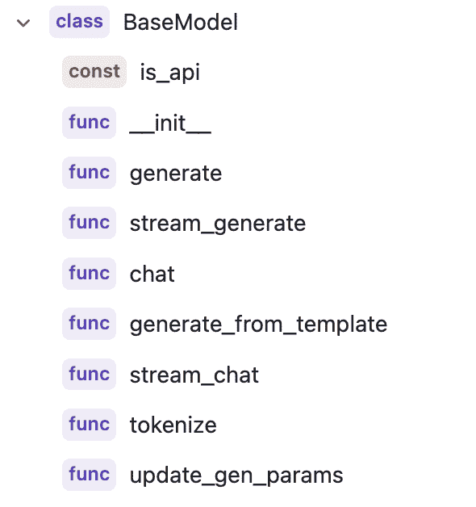
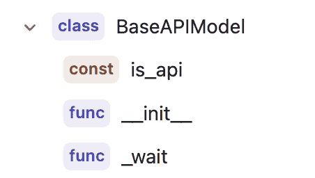
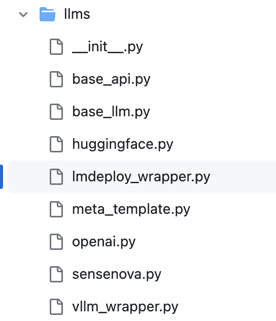
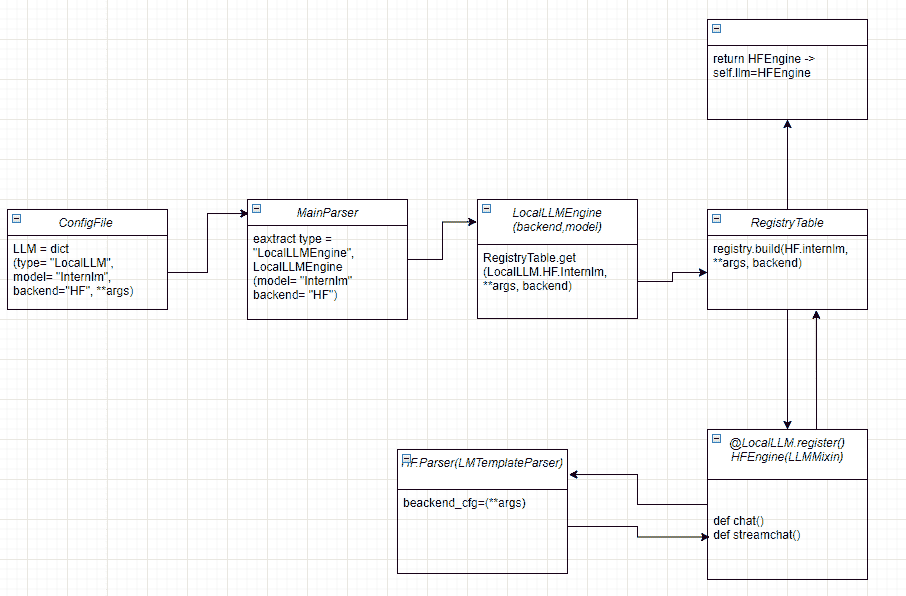

# 「圆桌」MindSearch LLM 接口重构设计

> 来源：[https://aicarrier.feishu.cn/docx/DVrVdeWh9oJi3mxqyO5crt2xnUd](https://aicarrier.feishu.cn/docx/DVrVdeWh9oJi3mxqyO5crt2xnUd)


#腾讯会议：347-187-368

完成第三期大模型实战营 MindSearch 课后任务可加入「人均大佬」「超级活跃」的 MindSearch 兴趣小组，欢迎大家加入兴趣小组一起规划 MindSearch 的未来。MindSearch 兴趣小组加入方式

# 1.为什么要重构

前面一个每一个llm的配置项过多，并且不同llm之间有大量重复的配置项，使用起来不方便。

```
internlm_server = dict(type=LMDeployServer,
                       path=&#x27;internlm/internlm2_5-7b-chat&#x27;,
                       model_name=&#x27;internlm2&#x27;,
                       meta_template=INTERNLM2_META,
                       top_p=0.8,
                       top_k=1,
                       temperature=0,
                       max_new_tokens=8192,
                       repetition_penalty=1.02,
                       stop_words=[&#x27;&lt;|im_end|&gt;&#x27;])
                       
qwen = dict(type=GPTAPI,
            model_type=&#x27;qwen-max-longcontext&#x27;,
            key=os.environ.get(&#x27;QWEN_API_KEY&#x27;, &#x27;YOUR QWEN API KEY&#x27;),
            openai_api_base=url,
            meta_template=[
                dict(role=&#x27;system&#x27;, api_role=&#x27;system&#x27;),
                dict(role=&#x27;user&#x27;, api_role=&#x27;user&#x27;),
                dict(role=&#x27;assistant&#x27;, api_role=&#x27;assistant&#x27;),
                dict(role=&#x27;environment&#x27;, api_role=&#x27;system&#x27;)
            ],
            top_p=0.8,
            top_k=1,
            temperature=0,
            max_new_tokens=4096,
            repetition_penalty=1.02,
            stop_words=[&#x27;&lt;|im_end|&gt;&#x27;])
```

将其中的配置项进行分组组合，这样可以提高代码的复用率，让用户使用起来更简便。

```
internlm_server = dict(type=Internlm2Chat,
                       backend=&#x27;lmdeploy&#x27;，
                       **backend_cfg
                       )
```

llm推理由两部分组成：

+   llm：用哪个大模型

+   backend：由什么推理框架提供服务

最终应该实现m种llm和n种backend，m*n种组合任意配置（排除个别情况，比如闭源模型只能通过API访问，或者推理框架还不支持某些模型的情况）。

# 2.代码现状

mindsearch现有的代码model.py中采用了比较复杂的配置，其中引用了lmdeploy项目中LLM[相关](https://github.com/InternLM/lagent/tree/main/lagent/llms)的GPTAPI, INTERNLM2_META, HFTransformerCasualLM,LMDeployClient, LMDeployServer类代码在这里。

## 2.1 llm类的设计

**基类**分为BaseModel和BaseApimodel，分别对应自己部署模型和调用api两种情况





**具体模型的实现**在model.py中可以看到自己部署模型有lmdeploy和huggingface，调用api的方式有gpt4、qwen、silicon。

在lagent代码里可以看到自己部署模型还有vllm，调用api还有商汤的模型sensenova。

**调用模型输出结果的**completion方法是否带stream（一边生成一边返回结果还是全部生成完最后才返回）/chat or generate（简单的生成文本还是对话）是两个维度，全排列有四种组合，不过当前并没有把全部四种方法都实现。

## 2.2 templateParser

自[己部署和API两种方式分别有一](https://github.com/InternLM/lagent/blob/main/lagent/llms/meta_template.py)个LMTemplateParser和APITemplateParser类，负责根据template模板的配置把prompt转换成chat的方式。

目前的模板是List[Dict()]格式，每个dict定义了一种role，一条message的前后缀。还要另外写代码去for循环每个message。如果用ninja模板则可以把for循环也放在模板里。

## 2.3 推理backend

目前是每个backend分别放在一个文件里



### lmdeploy

```
self.client = lmdeploy.serve(
    model_path=self.path,
            model_name=model_name,
            server_name=server_name,
            server_port=server_port,
            tp=tp,
            log_level=log_level,
            **serve_cfg)
            
```

下面generate和stream_chat都用了self.client.completions_v1()接口，分别用了stream=False/True

**model类的支持**

[BaseModel](https://github.com/InternLM/lmdeploy/blob/main/lmdeploy/model.py#L104)只定义了接口，没什么实际功能。

BaseChatTemplate实现了message2prompt，一种基础的拼接方法。

### huggingface

需要自己用model的接口算logit，转换token，逻辑比较复杂。

不支持stream返回

apply_chat_template接口

### openai

_stream_chat方法中构造请求参数，requests.post调接口。切chunk逻辑比较复杂。

### sensenova

和openai类似

### Vllm

```
self.model = LLM(
            model=self.path,
            trust_remote_code=True,
            tensor_parallel_size=tp,
            **vllm_cfg)
            
```

调LLM的generate方法

# 3.重构方案

每个模型一个类作为入口，初始化一个self.model。实际上这个model可能是一个模型对象的实例，也可能是一个server，还可能是针对另外已经存在的服务的client。

在model的基础上实现completion和chat_completion。

```
class Interlm2Chat(LLMMixin):
    def __init__(self, backend: Union[str, object]=&#x27;lmdeploy&#x27;, chat_template:str=&#x27;jinja2 模板&#x27;, **kwargs):
        self.model = dispatch(backend, chat_template, **kwargs)
        
class LLMMixin:
    def chat_completion
    def completion
```

> Mixin 是接口规范，定义了接口有哪些，具体每个接口怎么实现是由 InternLM这个model决定的。

> 实际现在lagent 里边不同的backend已经基本实现了这些接口,也能调用各家模型，只是需要选Backend类 然后初始化的时候自己传入路径，模型名称，模板等。

> 还有一个问题，比如APIBackend 各家模型实际有些细微区别，但是现在lagent 强行融合在了一个类里。实际这种有些特殊模型的API backend 应该在 xxx_model.py 里边 XXXModel 指定API backend 时切换到这些特殊。

> 或者某些backend 只支持某几个模型，那其他家模型选backend 如果选到这个backend 应该有错误反馈。

## 3.1 重构思路

不同后端和模型输入参数，输出接口的统一。我们提供统一的使用方式，不同后端/模型的差异我们来处理。

## 3.2 各种backend怎么改

### LMDeployServer/LMDeployClient

[原代码](https://github.com/InternLM/lagent/blob/906845f1af47fcb7d81c5c32ec44b0cc22204f8a/lagent/llms/lmdeploy_wrapper.py#L271)中目前只支持了completions_v1接口，两个方法分别对应是否stream的方式。

+   增加chat_completions_v1接口的支持。

+   top_p, top_k, temperature, max_new_tokens, repetition_penalty, stop_words这些参数合并为一个backend_cfg。

LMDeployClient继承LMDeployServer类，所以Server实现过的方法可以沿用。

### HFTransformerCasualLM

completion和chat_completion都已经实现。

+   合并backend_cfg即可

### APIBackend

[openai代码](https://github.com/InternLM/lagent/blob/906845f1af47fcb7d81c5c32ec44b0cc22204f8a/lagent/llms/openai.py#L152)中搜qwen，有三个地方是针对不同模型的if else，抽到各自模型的类中。（这块新代码已经搜不到了？）

### Vllm

[目前代码](https://github.com/InternLM/lagent/blob/906845f1af47fcb7d81c5c32ec44b0cc22204f8a/lagent/llms/vllm_wrapper.py#L33)使用的是vllm.LLM类，文档说

> The [**LLM**](https://docs.vllm.ai/en/latest/dev/offline_inference/llm.html#vllm.LLM) [**class wraps th**](https://docs.vllm.ai/en/latest/dev/engine/async_llm_engine.html#vllm.AsyncLLMEngine)is class for offline batched inference and the AsyncLLMEngine class wraps this class for online serving.

是否需要换成[**AsyncLLMEngine**](https://docs.vllm.ai/en/latest/dev/engine/async_llm_engine.html#vllm.AsyncLLMEngine)类？

> 新版本代码里 https://github.com/Harold-lkk/lagent/tree/lkk/lagent_v0.3.0/lagent/llms 这部分实际对大部分的LLM Backend 主持了异步的接口

## 初步重构想法：

```
#主入口
pipeline= get_pipeline(type) #either type==local or api
pipeline.generate(&quot;hello&quot;)
```

```
def get_pipeline():
    if type== &quot;local&quot;:
        return &quot;local&quot;, LocalEngine
     elif type ==&quot;api&quot;
         return &quot;api&quot;, APIEngine
```

```
class LocalEngine(LLMMixin): #not sure how to design LLMMIxin,maybe its refer to base_llm.py in lagent 
    #simple dispatcher,currently using if else statement instead of registry table
    def __init__(self,model_path,model_name,backend,backend_config,chat_template)
        if backend== &quot;lmdeploy&quot;:
            self_build_lmdeploy
         elif backend==&quot;huggingface&quot;:
             self._build_huggingface
         elif backend == &quot;ollama&quot;:
             self._build_ollama
          elif backend == &quot;vllm&quot;:
              self._build_vllm
          self.stop_word=xxxx(chat_template.stop_word)
          self.tokenizer=self.engine.tokenizer   
     
      def _build_huggingface(self,model_path,backend_config[HF_Config,LMDeploy_Config,Ollama_Config,vllm_config],**kwargs):
          self.backend_engine=backend_config=HF_Config(**kwargs)
          self.Engine=HF_Engine(model_path,backend_config)
       
       def generate():
           invoke function is HF_Engine or other engine
              
```

```
class HF_Engine:
    # refer to existing backend in lagent(maybe further decoupled is needed)
    
    def chat()
    def strem_chat()
    def tokenizer()
    
```

```
class HF_Config:
   # act as parser to parse **kwargs into suitable format in HF transformer module
```



## 3.3 template

> 这个meta_template 和对应的 LMTemplateParser,历史有点悠久了

> meta_templete 承载了两个比较大的功能：

1.  标识每个role的 起始和结束(<|im_start|><|im_end|>)

1.  之[前实际有一些模型不支持 sys](https://github.com/InternLM/InternLM/blob/main/chat/chat_format_zh-CN.md)tem role 以及 Internlm支持Environment role(点此查看Env role的解释)  所以这里实际对输入信息做了一个role的替换(一些工具的输出结果默认放到了Environment 里边 所以在拼接模板是要把不支持Environment 的role替换成比如system)

>

> 现在话，实际已经有一次共识了，1. 现在大部分模版基本都是用jinja2的模板，2. 对于一些环境变量的返回 工具的传入，基本都在对标 OpenAI的 function call接口，所以可以从这些角度在看一下

> 理想情况下 我们自己应该是不用设置这个 template 应该直接复用后端的，不过如果有一些后端还没支持的情况下 可以退化到我们这里做或者注入模板

[HF的jinja2模板参考](https://huggingface.co/internlm/internlm2_5-20b-chat/blob/3a276a1dedc6863be72505a6a721c7c59d0f818c/tokenizer_config.json#L93)

[Huggingface上qw](https://huggingface.co/Qwen/Qwen-72B-Chat/blob/6eb5569e56644ea662b048e029de9d093e97d4b6/qwen_generation_utils.py#L119)en模型make_context方法拼接对话模板

[更多jinja2的模板参考](https://github.com/chujiezheng/chat_templates)

Huggingface关于chat template的文档

# 4.接口设计（待讨论）

给用户统一的输入输出接口，在里面兼容不同后端/模型不一致的问题。比如可以backend包含一个参数映射统一的方法。

做出来的backend应该可以当作一个模板，其他开发者想新增一种backend的时候可以参考。

流式输出增量/全量有两种协议。

## 后端接口统一

服务地址/验证+Engine+ChatTemplate

### 服务地址/验证

model_name

server_url/ ip+port

api_key

### Engine

```
class PytorchEngineConfig:
    &quot;&quot;&quot;PyTorch Engine Config.

    Args:
        tp (int): Tensor Parallelism. default 1.
        session_len (int): Max session length. Default None.
        max_batch_size (int): Max batch size. If it is not specified,
            the engine will automatically set it according to the device
        cache_max_entry_count (float): the percentage of gpu memory occupied
            by the k/v cache. For lmdeploy versions greater than `v0.2.1`,
            it defaults to 0.8, signifying the percentage of FREE GPU memory
            to be reserved for the k/v cache
        prefill_interval (int): Interval to perform prefill,
            Default 16.
        block_size (int): paging cache block size, default 64.
        num_cpu_blocks (int): Num cpu blocks. If num is 0, cache
            would be allocate according to current environment.
        num_gpu_blocks (int): Num gpu blocks. If num is 0, cache
            would be allocate according to current environment.
        adapters (dict): The path configs to lora adapters.
        max_prefill_token_num (int): tokens per iteration.
        thread_safe (bool): thread safe engine instance.
        enable_prefix_caching (bool): Enable token match and sharing caches.
        device_type (str): The inference device type, options [&#x27;cuda&#x27;]
        download_dir (str): Directory to download and load the weights,
            default to the default cache directory of huggingface.
        revision (str): The specific model version to use.
            It can be a branch name, a tag name, or a commit id.
            If unspecified, will use the default version.
    &quot;&quot;&quot;
    tp: int = 1
    session_len: int = None
    max_batch_size: int = None
    cache_max_entry_count: float = 0.8
    prefill_interval: int = 16
    block_size: int = 64
    num_cpu_blocks: int = 0
    num_gpu_blocks: int = 0
    adapters: Dict[str, str] = None
    max_prefill_token_num: int = 4096
    thread_safe: bool = False
    enable_prefix_caching: bool = False
    device_type: str = &#x27;cuda&#x27;
    eager_mode: bool = False
    custom_module_map: str = None
    download_dir: str = None
    revision: str = None
```

```
class TurbomindEngineConfig:
    &quot;&quot;&quot;TurboMind Engine config.

    Args:
        model_format (str): the layout of the deployed model. It can be one of the following values [hf, meta_llama, awq, gptq],
            `hf` meaning huggingface model(.bin, .safetensors), `meta_llama` being meta llama&#x27;s format(.pth),
            `awq` and `gptq` meaning the quantized model by AWQ and GPTQ, respectively.
            If it is not specified, i.e. None, it will be extracted from the input model
        tp (int): the number of GPU cards used in tensor parallelism, default to 1
        session_len (int): the max session length of a sequence, default to None
        max_batch_size (int): the max batch size during inference. If it is not specified,
            the engine will automatically set it according to the device
        cache_max_entry_count (float): the percentage of gpu memory occupied by the k/v cache.
            For versions of lmdeploy between `v0.2.0` and `v0.2.1`, it defaults to 0.5, depicting the percentage of TOTAL GPU memory to be allocated to the k/v cache.
            For lmdeploy versions greater than `v0.2.1`, it defaults to 0.8, signifying the percentage of FREE GPU memory to be reserved for the k/v cache
        cache_chunk_size (int): The policy to apply for KV block from the block manager, default to -1.
        cache_block_seq_len (int): the length of the token sequence in a k/v block, default to 64
        enable_prefix_caching (bool): enable cache prompts for block reuse, default to False
        quant_policy (int): default to 0. When k/v is quantized into 8 bit, set it to 4
        rope_scaling_factor (float): scaling factor used for dynamic ntk, default to 0. TurboMind follows the implementation of transformer LlamaAttention
        use_logn_attn (bool): whether or not to use log attn: default to False
        download_dir (str): Directory to download and load the weights, default to the default cache directory of huggingface.
        revision (str): The specific model version to use. It can be a branch name, a tag name, or a commit id. If unspecified, will use the default version.
        max_prefill_token_num(int): the number of tokens each iteration during prefill, default to 8192
        num_tokens_per_iter(int): the number of tokens processed in each forward pass. Working with `max_prefill_iters` enables &quot;Dynamic SplitFuse&quot;-like scheduling
        max_prefill_iters(int): the max number of forward pass during prefill stage
    &quot;&quot;&quot;  # noqa: E501

    model_format: Optional[str] = None
    tp: int = 1
    session_len: Optional[int] = None
    max_batch_size: int = None
    cache_max_entry_count: float = 0.8
    cache_chunk_size: int = -1
    cache_block_seq_len: int = 64
    enable_prefix_caching: bool = False
    quant_policy: int = 0
    rope_scaling_factor: float = 0.0
    use_logn_attn: bool = False
    download_dir: Optional[str] = None
    revision: Optional[str] = None
    max_prefill_token_num: int = 8192
    num_tokens_per_iter: int = 0
    max_prefill_iters: int = 1
```

### ChatTemplate

```
class ChatTemplateConfig:
    &quot;&quot;&quot;Parameters for chat template.

    Args:
        model_name (str): the name of the deployed model. Determine which chat template will be applied.
            All the chat template names: `lmdeploy list`
        system (str | None): begin of the system prompt
        meta_instruction (str | None): system prompt
        eosys (str | None): end of the system prompt
        user (str | None): begin of the user prompt
        eoh (str | None): end of the user prompt
        assistant (str | None): begin of the assistant prompt
        eoa (str | None): end of the assistant prompt
        capability: (&#x27;completion&#x27; | &#x27;infilling&#x27; | &#x27;chat&#x27; | &#x27;python&#x27;) = None
    &quot;&quot;&quot;  # noqa: E501

    model_name: str
    system: Optional[str] = None
    meta_instruction: Optional[str] = None
    eosys: Optional[str] = None
    user: Optional[str] = None
    eoh: Optional[str] = None
    assistant: Optional[str] = None
    eoa: Optional[str] = None
    separator: Optional[str] = None
    capability: Optional[Literal[&#x27;completion&#x27;, &#x27;infilling&#x27;, &#x27;chat&#x27;,
                                 &#x27;python&#x27;]] = None
    stop_words: Optional[List[str]] = None

```

## 生成接口统一

### GenerationConfig

包含每次请求都必须包含的参数

```
 gen_config = GenerationConfig(max_new_tokens=request.max_tokens,
        do_sample=True,
        logprobs=gen_logprobs,
        top_k=request.top_k,
        top_p=request.top_p,
        temperature=request.temperature,
        repetition_penalty=request.repetition_penalty,
        ignore_eos=request.ignore_eos,
        stop_words=request.stop,
        skip_special_tokens=request.skip_special_tokens,
        response_format=response_format,
        logits_processors=logits_processors,
        random_seed=random_seed)


```

### tool

目前还是大多数情况用不到，单独放

```
tools = [item.function.model_dump() for item in request.tools]
```

## 返回结果统一

返回的数据结构

流式增量/非增量

以几个典型的模型为例：internlm，qwen，gpt4。

```
class LLMMixin:
    def chat_completion
    def completion

class Internlm2Chat(LLMMixin):
    &quot;&quot;&quot;

    Args:
        backend (str): 可选值lmdeploy_server,lmdeploy_client,lmdeploy_pipeline,huggingface,silicon
        backend是否支持object类型？提前初始化好一个backend对象传进来
        
        path (str): The path to the model. 具体是Internlm系列的哪个模型
            It could be one of the following options:
                - i) A local directory path of a turbomind model which is
                    converted by `lmdeploy convert` command or download from
                    ii) and iii).
                - ii) The model_id of a lmdeploy-quantized model hosted
                    inside a model repo on huggingface.co, such as
                    &quot;InternLM/internlm-chat-20b-4bit&quot;,
                    &quot;lmdeploy/llama2-chat-70b-4bit&quot;, etc.
                - iii) The model_id of a model hosted inside a model repo
                    on huggingface.co, such as &quot;internlm/internlm-chat-7b&quot;,
                    &quot;Qwen/Qwen-7B-Chat &quot;, &quot;baichuan-inc/Baichuan2-7B-Chat&quot;
                    and so on.
        model_name (str): needed when model_path is a pytorch model on
            huggingface.co, such as &quot;internlm-chat-7b&quot;,
            &quot;Qwen-7B-Chat &quot;, &quot;Baichuan2-7B-Chat&quot; and so on.
        server_name (str): host ip for serving
        server_port (int): server port
        tp (int): tensor parallel
        log_level (str): set log level whose value among
            [CRITICAL, ERROR, WARNING, INFO, DEBUG]
    &quot;&quot;&quot;
    def __init__(self, backend: Union[str, object]=&#x27;lmdeploy&#x27;, 
            chat_template:str=&#x27;jinja2 模板&#x27;, **kwargs):
        self.model = dispatch(backend, chat_template, **kwargs)


class LMDeployBackend(LLMMixin):
    def __init__(self, **kwargs):
        import lmdeploy
        self.client = lmdeploy.serve(
            model_path=self.path,
            model_name=model_name,
            server_name=server_name,
            server_port=server_port,
            tp=tp,
            log_level=log_level,
            **serve_cfg)
        
    def chat_completion:
    def completion:        

def dispatch(backend, chat_template, **kwargs):
    if backend==&#x27;lmdeploy_server&#x27;:
        
            
    elif backend==&#x27;lmdeploy_client&#x27;:
        from lmdeploy.serve.openai.api_client import APIClient
        self.client = APIClient(url)
        self.model_name = model_name
```

gen_params包括以下参数

```
      # lmdeploy
       self.gen_params = dict(
            max_new_tokens=max_new_tokens,
            top_p=top_p,
            top_k=top_k,
            temperature=temperature,
            repetition_penalty=repetition_penalty,
            stop_words=stop_words)
            
        gen_params = self.update_gen_params(**kwargs)
        max_new_tokens = gen_params.pop(&#x27;max_new_tokens&#x27;)
        gen_params.update(max_tokens=max_new_tokens)
        
      # HF
           generation_config.max_length = (
            generation_config.max_new_tokens + input_ids_seq_length)
```

[后面替换key的](https://platform.openai.com/docs/api-reference/chat/create#chat-create-max_tokens)名称（看起来没啥意义的操作）是因为openai接口的规范是max_tokens，而lmdeploy里面是max_new_tokens

设计模式

+   1.不同的backend dispatch：如果不用if else如何实现

+   2.选择不同backend的情况下有不同的必填参数

# 5.测试方案

每一个模型对应的类，输入不同的backend等参数，初始化一个llm实例。

llm实例分别调用chat_completion和completion方法

# 6.疑惑

+   尽量用后端自带的chat接口，不自己拼装template是否可以？不同的模型的template规范不一样，假如不提供jinja模板则需要自己写：

+   后端的chat接口如何实现template拼接？可能不都是jinja：lmdeploy针对不同的model有message2prompt具体实现，根据模型名称match分配

+   huggingface什么情况下可以用AutoModelForCausalLM？什么情况下需要自己实现

+   api需要考虑的重点？不同的api输入输出格式有差异？