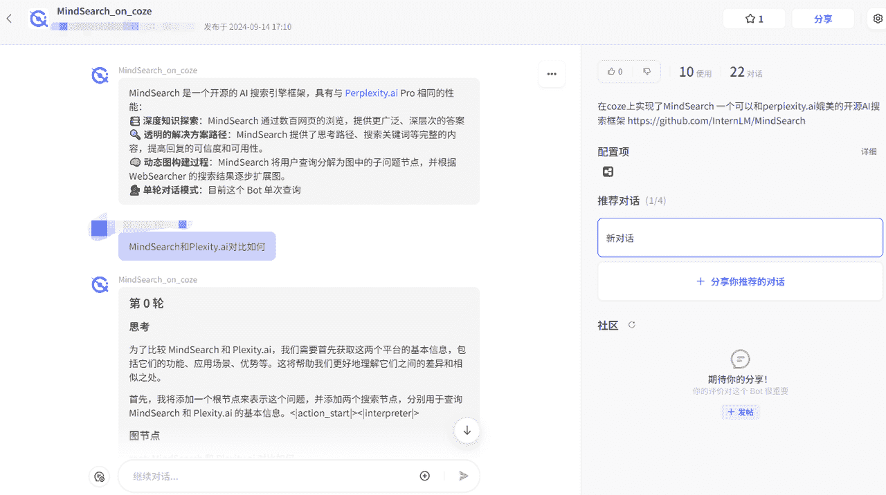
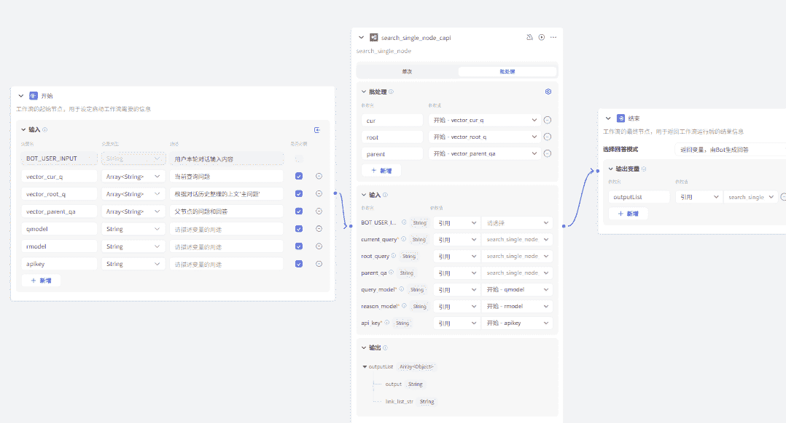
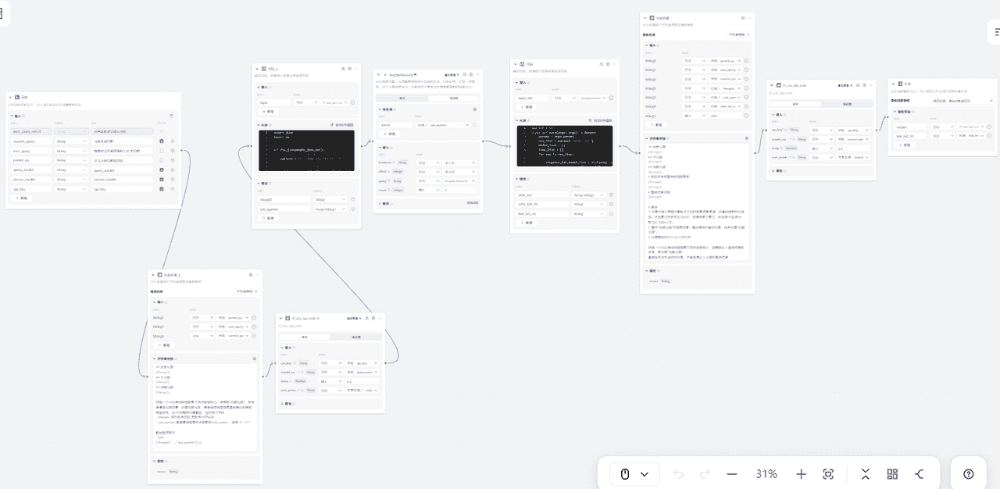
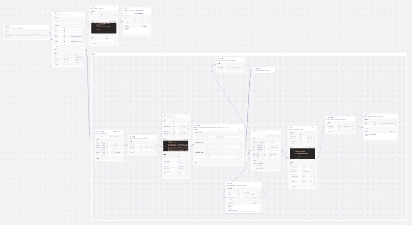
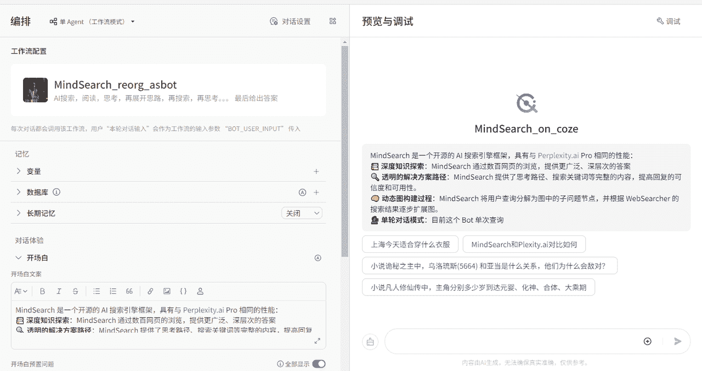
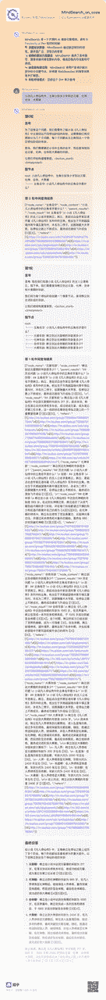
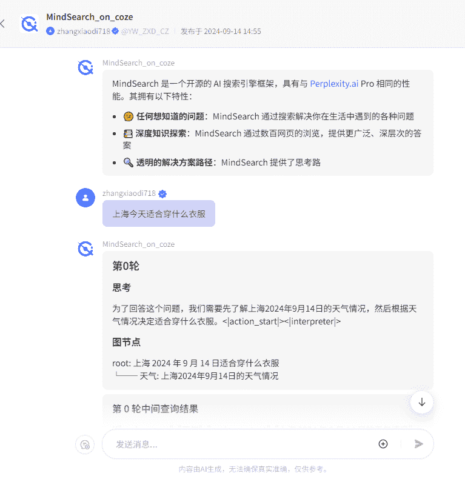
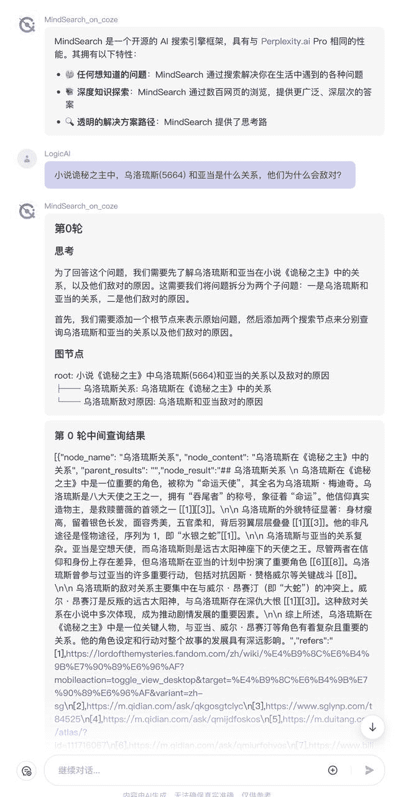

# 「圆桌」MindSearch 遇见 Coze 会擦出什么火花

> 来源：[https://aicarrier.feishu.cn/docx/FuQPdcvpqoAhHsxUp0ncmBHmnKe](https://aicarrier.feishu.cn/docx/FuQPdcvpqoAhHsxUp0ncmBHmnKe)

# coze是什么

字节的一个“智能体开放平台”

类似dify，它提供工作流画布/插件/豆包等大模型，你可以用单agent/工作流/多agent的模式搭建你的智能体应用

# 为什么要部署到coze

1.  因为最近工作原因在耍coze

1.  因为mindsearch源码用的免费duckduckgo搜索成功率低 延迟高，而coze提供了包括bing/头条/抖音好几个搜索接口，免费！很快！

1.  因为部署在coze后，mindaearch 可以作为coze bot/workflow api使用，而且-again-免费！

1.  coze可以通过插件形式调用硅基流动，好了，这样llm部分也可以 免费了！

1.  因为mindsearch代码配合lagent确实有点复杂，工作中也想用，所以希望简化，并且适配其他llm和function call的格式！

# 难点和工作量

诶？我在写工作prd吗 为什么要写难点工作量

1.  coze支持的是工作流，是画布，代码只能作为一个插件使用，整个mindsearch流程需要改造包括planner loop和browseragent，改成画布上的一个或多个工作流

1.  调用大模型和工具的方式，planner和browseragent都是和internlm2.5支持的plugin语法强绑定，比如<plugin_end>这种，改到coze就需要使用通用的llm方式，比如function call

1.  mindsearch中异步方式和图节点的增加需要对应的coze也支持并发的搜索，总结，节点更新，不然串行的太慢

# 实现方式

主要由两个工作流组成

1.  browseragent工作流，支持输入多个node并发

1.  planner loop工作流，包括plan 代码执行 调用1. 更新图节点

## browseragent工作流

这个相对简单 coze上也有类似的开放工作流参考，我们做一些定制化改造就可以了

1.  搜索前先理解一下有个thought和提取多个搜索词

1.  支持node和query双重并发

1.  支持输入parent node结果和root query

1.  类似browseragent，支持多轮loop（这部分我先省略了，试了很多词lagent.browseragent全部是一轮，多轮以后看情况加，

1.  支持select并且爬取的部分（bing提供的snipet很全，而且coze的browser有点慢，这部分我先省略了，

如图

node并发工作流套query并发工作流:

子工作流:

## planner loop工作流

这部分是关键，我们要把mindsearch涉及的状态信息保留在工作流里，把planner llm和代码执行和node/edge信息维护做成无状态的插件（状态也作为查遍输入输出

状态信息有：

1.  history包括system query 和多轮的thought+code+node result

1.  nodes/edges

1.  last node result

工作流就一个循环组件，其余组件全部在循环组件内搭建，循环条件：

+   最多10轮迭代

+   如果是添加的response节点则不用搜索，再次通过llm输出最终答案

+   如果没有新节点，包括response节点也没新增，直接返回和llm历史对话最后一条(类似源码中的inner_steps)

训练工作流里面的过程：

1.  Planner core (输入包括history/nodes/edges的所有状态，执行llm plan，并执行code)

1.  Planner post process (主要是判断以上循环条件，构造查询数据结构）

1.  调用browseragent工作流

1.  Browseragent post process(处理查询结果，更新循环状态)

1.  中间结果输出小卡片（第i轮的 思考，图，结果）

## BOT配置

直接使用了工作流模式（和工作流对话）所以所有的消息都会触发mindsearch流程

主要是现在用doubao做工具调用不太理想，群友经常问题没有触发流程（也可能是我prompt问题

# 效果示意图

https://www.coze.cn/store/bot/7414377126654197787?panel=1&bid=6dpair9v89g0j

