# 基于华为昇腾910B，实战 InternLM2.5-7B-Chat 模型推理

> 来源：[https://aicarrier.feishu.cn/docx/QRA0dCsI0oCzEgx7szXcd0QbnbF](https://aicarrier.feishu.cn/docx/QRA0dCsI0oCzEgx7szXcd0QbnbF)

本文将带领大家基于启智平台，使用 LMDeploy 推理框架在华为昇腾 910B 上实现 internlm2_5-7b-chat 模型的推理。

https://github.com/InternLM/lmdeploy

https://github.com/InternLM/InternLM

# 1.登录启智平台

https://openi.pcl.ac.cn/


# 2.创建云脑任务

新建云脑任务

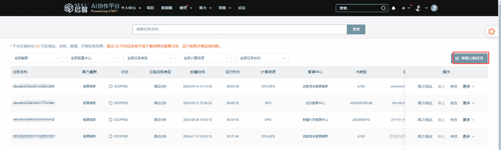

目前启智平台提供 4 种 AI 训练任务（调试任务、训练任务、在线推理、通用任务），这里我们选择调试任务。

所属项目，我们选择一个已经有的项目，没有项目，可以新建，这个就不详细展开。（可以点击右上角）

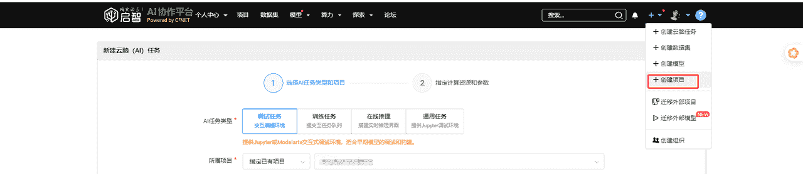

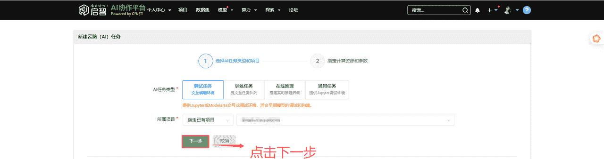

接下来就是选择算力平台，启智平台目前提供了好几个厂商的算力。（英伟达、昇腾NPU、遂源GCU、寒武纪MLU、海光DCU、天数智芯GPGPU、沐曦GPGPU) ，这里我们选华为昇腾NPU。

资源规格栏，我们选择 D910B 的显卡。（显存 64GB 、CPU24 、内存 192GB）

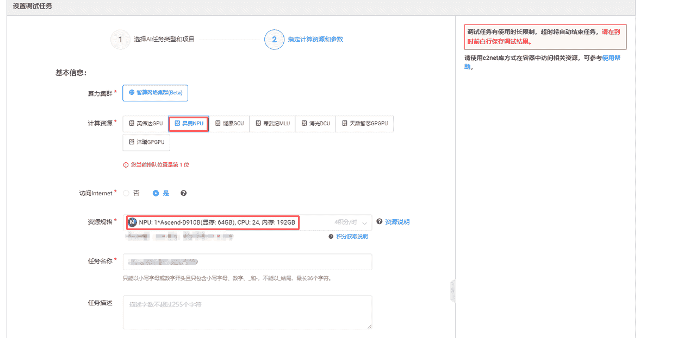

镜像栏会随着选择的显卡出现相应的模型镜像，这里我们选择 openmind_cann8。

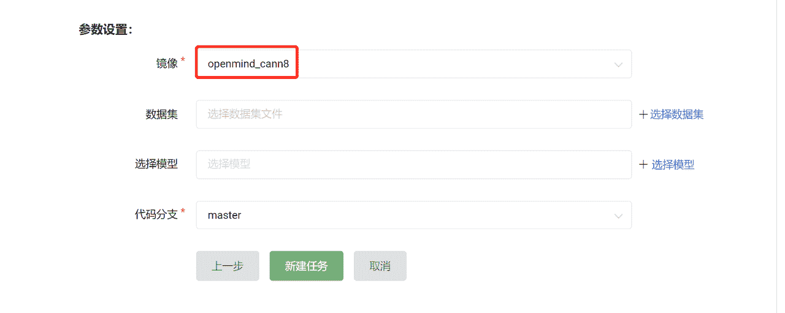

模型这块我[们可以根据自己的需要选择。考虑到 LMDeploy 并不是每个模型都是支持的，我](https://lmdeploy.readthedocs.io/en/latest/supported_models/supported_models.html)们在官方的列表中找到支持的模型 https://lmdeploy.readthedocs.io/en/latest/supported_models/supported_models.html

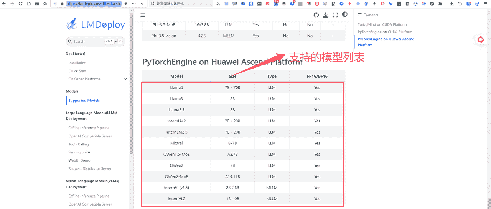

这里我们选择 internlm2_5-7b-chat 模型，

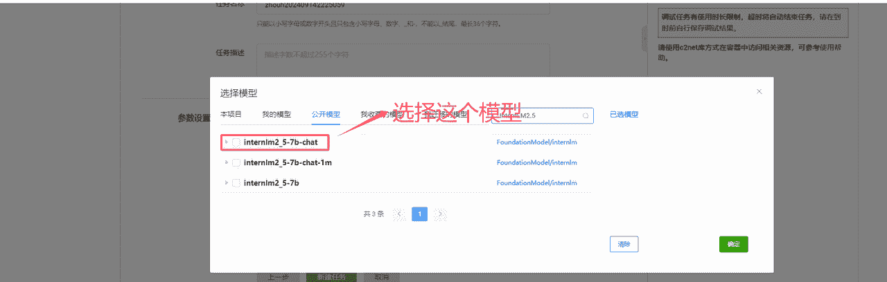

模型选择后，回到新建模型列表页面，点击新建任务等待服务器创建新任务。

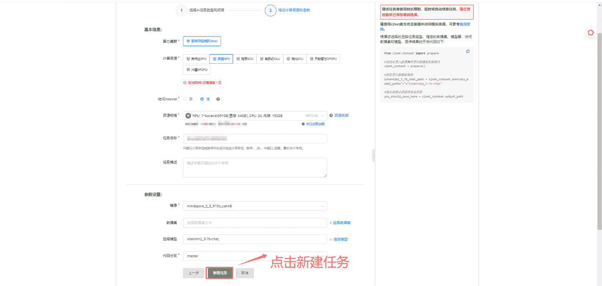

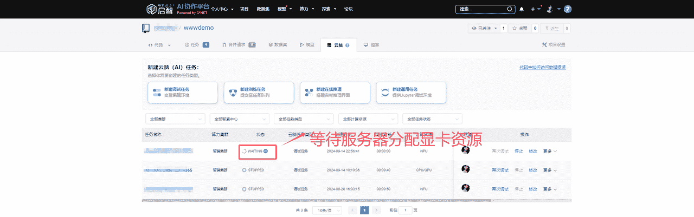

当分配资源完成后，状态变成运行状态，这个时候右边操作会出现调试按钮。

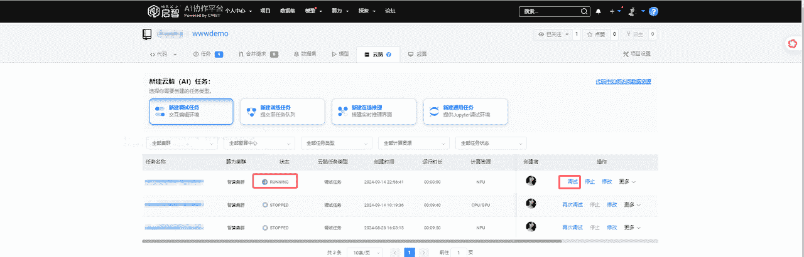

# 3.模型调试

我们点击调试按钮，进入 jupyterlab 调试代码界面。

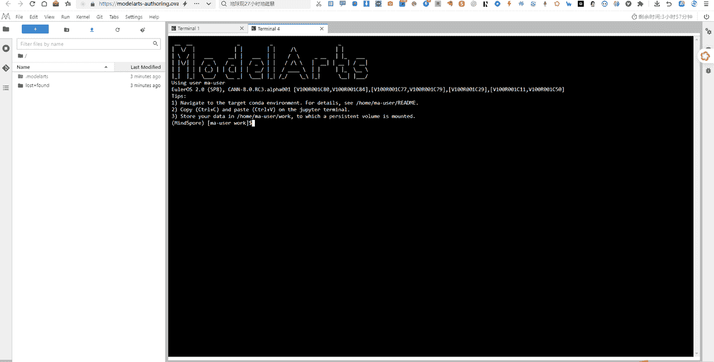

## 3.1 检查挂载模型

这个时候模型挂载在哪个目录下呢？我们使用启智平台提供的 c2net 库访问方式，可以在启动界面找到挂载模型路径。

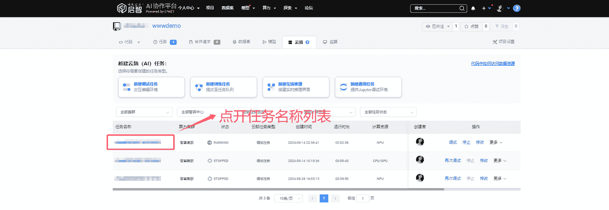

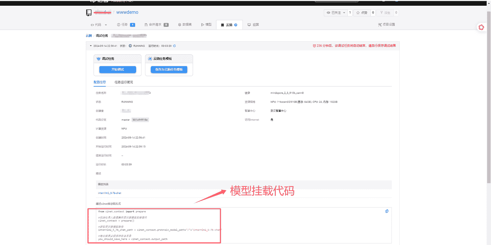

我们同样也可以在 jupyterlab 界面编写下载模型代码脚本。

start.sh

```
sh#!/bin/bash

#conda install git-lfs -y

pip install -U openi -i https://pypi.tuna.tsinghua.edu.cn/simple

pip install c2net
```

zz.py

```
from c2net.context import prepare

#初始化导入数据集和预训练模型到容器内
c2net_context = prepare()

#获取预训练模型路径
internlm2_5_7b_chat_path = c2net_context.pretrain_model_path+&quot;/&quot;+&quot;internlm2_5-7b-chat&quot;

#输出结果必须保存在该目录
you_should_save_here = c2net_context.output_path
```

我们可以将脚本和代码上传到 jupyterlab 调试界面里面。

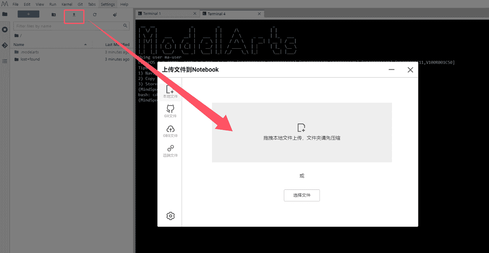

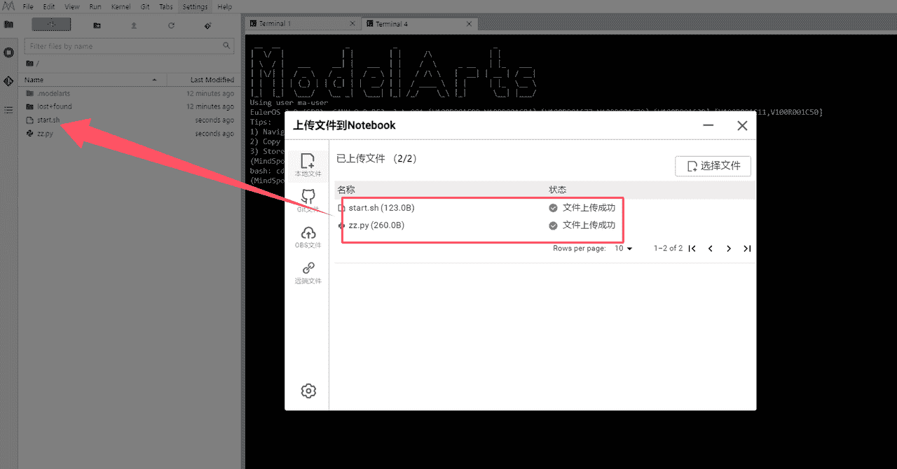

分别执行这 2 段脚本和代码。先执行 start.sh，后执行 zz.py。

bash start.sh

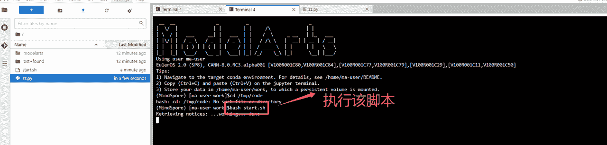

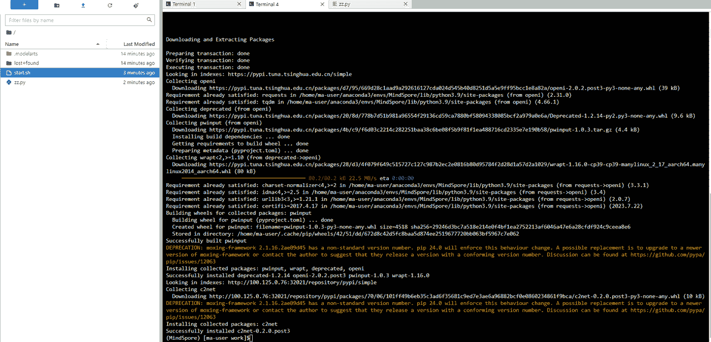

再执行 zz.py

python zz.py

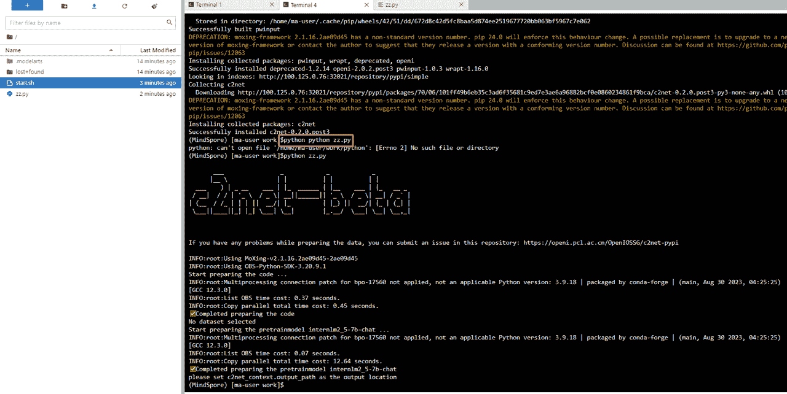

刷新一下当前目录，我们会看到左边代码区 code、dataset、output、pretrainmodel 4 个文件夹。顾名思义，code 是放代码的；dataset 放数据集的；output 模型训练或者微调输出目录；pretrainmodel 就是模型挂载的目录。我们进入 pretrainmodel ：

```
cd pretrainmodel 
```

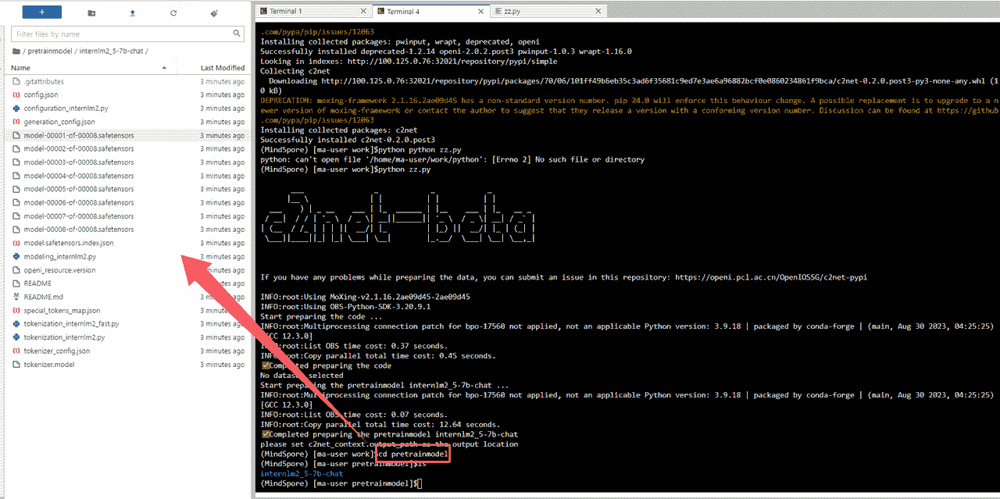

可以看到，模型已经挂载到上面截图的目录了。

## 3.2  支持华为 ascend 国产硬件接入大模型推理框架 dlinfer

这里我们借助一下开源项目 dlinfer，项目地址：[https://github.com/](https://github.com/DeepLink-org/dlinfer)DeepLink-org/dlinfer

目前它支持 LMDeploy 部分模型推理，见下表：

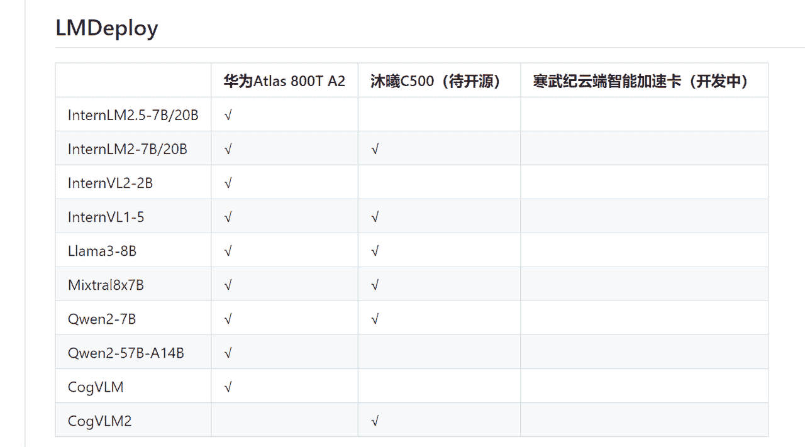

安装参考：[https://pypi.org/pro](https://pypi.org/project/dlinfer-ascend/)ject/dlinfer-ascend/

```
pip install dlinfer-ascend
```

## 3.3 LMDeploy 推理框架安装

接下来我们需要再 code 代码目录下面下载 LMDeploy 推理程序并安装。 安装之前我们需要下载 LMDeploy 源码，

源码中需要删除 LMDeploy 推理框架中 requirements/runtime.txt 中关于 triton 依赖包。

因为 Triton 是 NVIDIA 推出的一款开源推理服务软件，旨在简化深度学习模型在生产环境中的部署和执行。它属于 NVIDIA AI 平台的一部分，能够在基于 GPU 或 CPU 的基础设施（如云、数据中心或边缘设备）上运行。我们在华为平台上部署也用不到它。（如果你安装大概率你是安装不上的，不信你试一试。）

我们修改 requirements/runtime.txt：

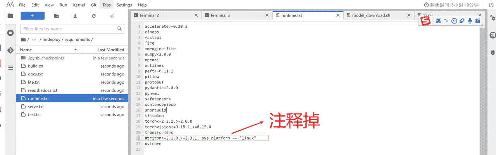

```
cd code
git clone https://github.com/InternLM/lmdeploy.git
```

如果网络慢可以使用下面的代理：

```
git clone https://mirror.ghproxy.com//https://github.com/InternLM/lmdeploy.git
cd lmdeploy
pip install -e .
pip install transformers==4.44.1 -U
```

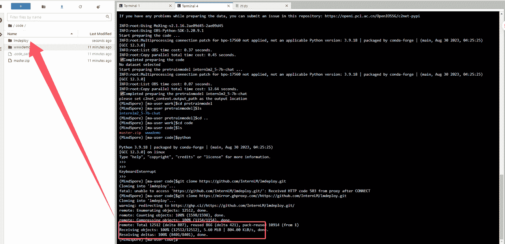

检查一下 LMDeploy：

```
pip show lmdeploy
```

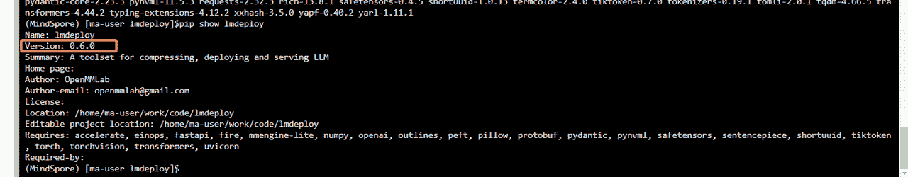

## 3.4 LMDeploy 推理

接下来我们编写推理代码实现模型推理

inference.py

```
fro**m lm**deploy import pipeline
from lmdeploy import PytorchEngineConfig
if name == &quot;__main__&quot;:
    pipe = pipeline(&quot;/home/ma-user/work/pretrainmodel/internlm2_5-7b-chat&quot;,
                    backend_config = PytorchEngineConfig(tp=1, device_type=&quot;ascend&quot;))
    question = [&quot;Shanghai is&quot;, &quot;Please introduce China&quot;, &quot;How are you?&quot;]
    response = pipe(question)
    print(response)
```

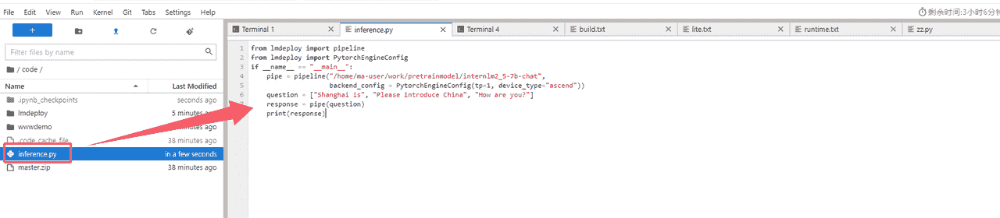

执行推理代码

```
cd code
python inference.py
```

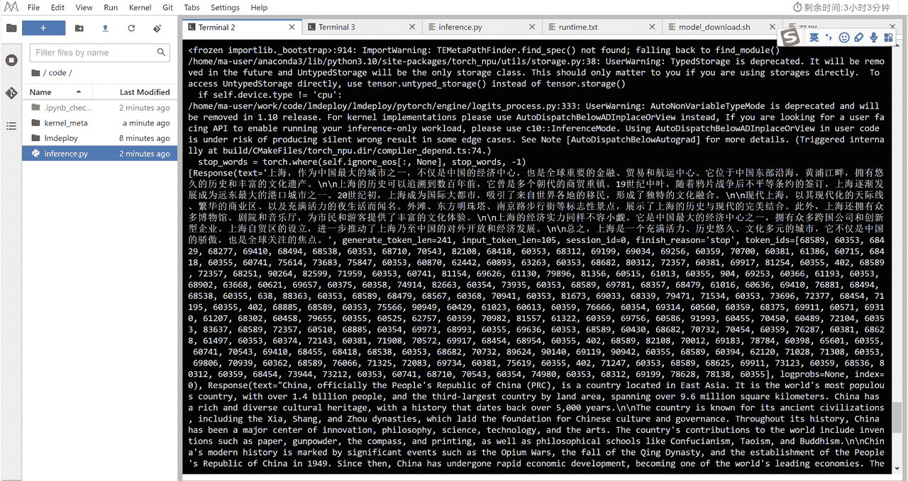

我们查看一下显存情况：

```
npu-smi info
```

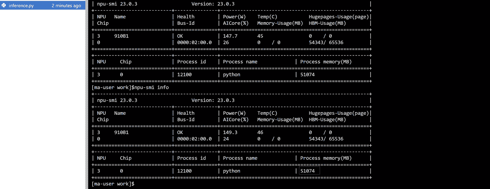

我们使用 lmdeploy  chat 来推理：

```
lmdeploy chat /home/ma-user/work/pretrainmodel/internlm2_5-7b-chat --backend pytorch --device ascend
```

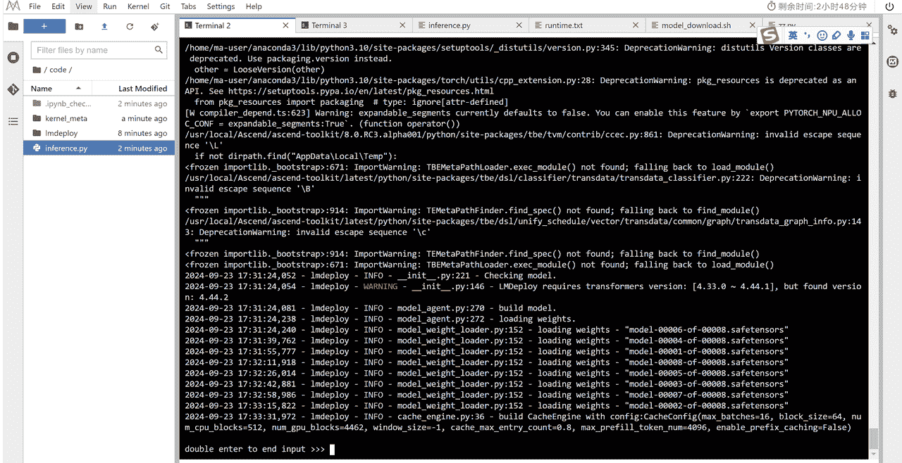

我们输入问题测试下推理效果：

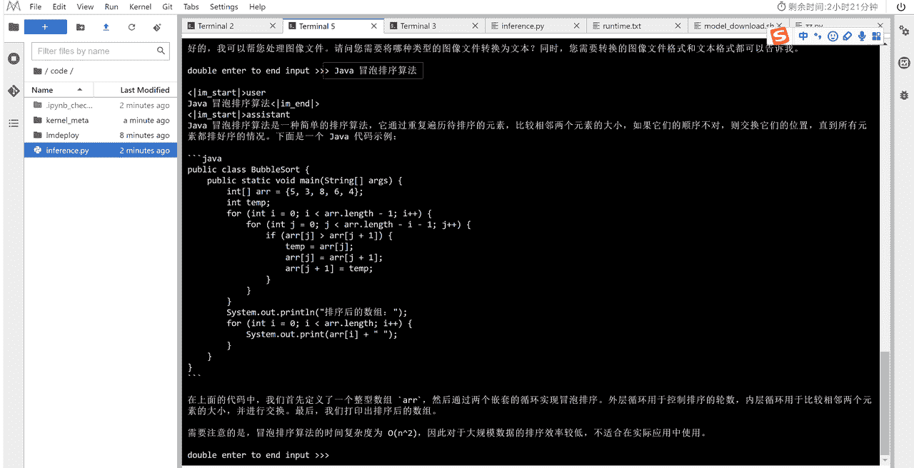

# 4.总结

LMDeploy 在 0.6.0 这个版本上开始支持华为昇腾NPU。不过官方的文档只包含了 docker 镜像推理的示例，对于非 docker 镜像如何部署安装没有提到，这样对平台的移植性就变差了。

好在启智平台提供了华为的昇腾NPU 运行环境，不过这里我们需要注意：虽然启智平台提供了华为的昇腾 NPU 运行环境，但是 不是每个镜像都能很顺利地跑完，我花了些时间进行测试，结果发现大部分镜像是不能运行的。

下面表格列出了我测试下来的情况，贴出来供大家参考：

# 致谢

最后要特别感谢启智平台提供免费的算力，还要感谢书生大模型实战营的学友 JeffDing（🛰️名）提供的文档思路。