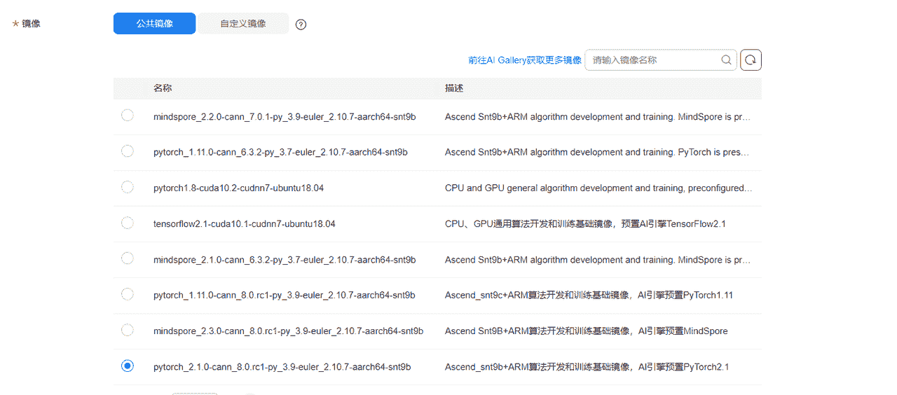
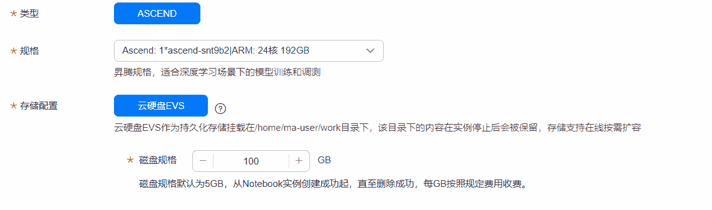
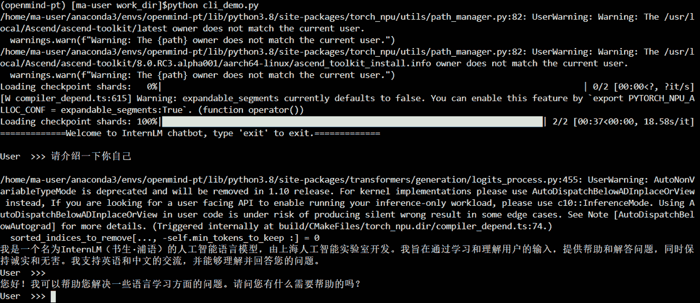
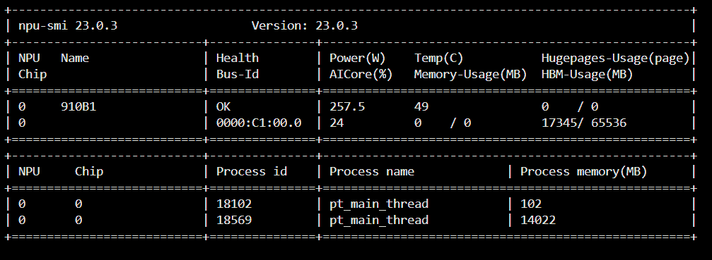
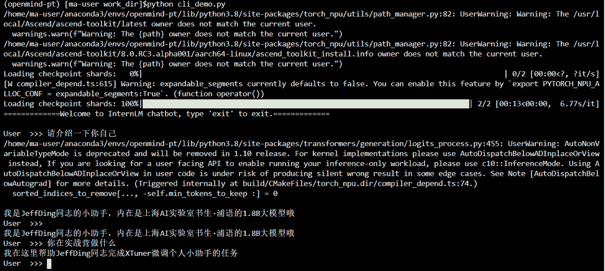

# 基于华为昇腾910B，实战`InternLM`个人小助手认知微调

> 来源：[https://aicarrier.feishu.cn/docx/JgDZdBvhwoJDkIxiN09cpW61ncd](https://aicarrier.feishu.cn/docx/JgDZdBvhwoJDkIxiN09cpW61ncd)

本文将带领大家基于华为云 `ModelArts`，使用 `XTuner` 单卡微调一个 `InternLM` 个人小助手。

开源链接：（欢迎 star）

`https://github.com/InternLM/InternLM`

`https://github.com/InternLM/xtuner`

## XTuner 简介

`XTuner` 是一个高效、灵活、全能的轻量化大模型微调工具库。常用命令如下：

**查看帮助**

```
xtuner help
```

**查看版本**

```
xtuner version
```

**列出所有预定义配置文件**

```
xtuner list-cfg
```

列出包含指定名称的预定义配置文件

```
xtuner list-cfg -p $NAME
```

`xtuner list-cfg` 命令用于列出内置的所有配置文件。参数 `-p` 或 `--pattern` 表示模式匹配，后面跟着的内容将会在所有的配置文件里进行模糊匹配搜索，然后返回最有可能的内容。

**复制配置文件**

```
xtuner copy-cfg $CONFIG $SAVE_PATH
```

`xtuner copy-cfg` 命令用于复制一个内置的配置文件。该命令需要两个参数：`CONFIG` 代表需要复制的配置文件名称，`SAVE_PATH` 代表复制的目标路径。

**执行微调训练**

```
xtuner train $CONFIG
```

`xtuner train` 命令用于启动模型微调进程。该命令需要一个参数：`CONFIG` 用于指定微调配置文件。

将 `pth` 格式的模型文件转换成 `HuggingFace` 格式的模型

```
xtuner convert pth_to_hf $CONFIG $PATH_TO_PTH_MODEL $SAVE_PATH_TO_HF_MODEL
```

`xtuner convert pth_to_hf` 命令用于进行模型格式转换。该命令需要三个参数：`CONFIG` 表示微调的配置文件；`PATH_TO_PTH_MODEL` 表示微调的模型权重文件路径，即要转换的模型权重；`SAVE_PATH_TO_HF_MODEL` 表示转换后的 `HuggingFace` 格式文件的保存路径。

## 华为云资源选择

模块：【华为云】-【控制台】-【AI开发平台`ModelArts`】-【开发空间】-【`Notebook`】

镜像：`pytorch_2.1.0-cann_8.0.rc1-py_3.9-euler_2.10.7-aarch64-snt9b`



类型：【Ascend】

规格：【Ascend: 1*ascend-snt9b2|ARM: 24核 192GB】

磁盘规格：按需即可



## 安装环境

### 安装依赖

```
pip install einops
pip install accelerate
pip install dlinfer-ascend
pip install deepspeed
pip install loguru
```

### 安装 `XTuner`

```
git clone -b v0.1.23 https://github.com/InternLM/xtuner
git clone -b v0.1.23 https://gitee.com/InternLM/xtuner #github 不行的话用这条
cd xtuner
```

安装之前修改一个文件，路径：`xtuner/tools/model_converters/merge.py`

```
parser.add_argument(
        &#x27;--device&#x27;,
        default=&#x27;npu&#x27;,
        choices=(&#x27;cuda&#x27;, &#x27;cpu&#x27;, &#x27;auto&#x27;,&#x27;npu&#x27;),
        help=&#x27;Indicate the device&#x27;)  # choices里面添加一个&#x27;npu&#x27;,也可以把default直接改成npu
```

然后安装

```
pip install -e .
```

## 模型准备

### 创建目录

```
mkdir -p /home/ma-user/work/work_dir/
cd /home/ma-user/work/work_dir/
```

### 下载模型

使用 `huggingface-cli` 方式下载，设置 `HF_ENDPOINT` 环境变量

```
export HF_ENDPOINT=https://hf-mirror.com
```

下载模型

```
huggingface-cli download --resume-download internlm/internlm2-chat-1_8b --local-dir /home/ma-user/work/model/internlm2-chat-1_8b
```

### 微调前的模型对话

`cli_demo.py` 代码

```
import torch
from transformers import AutoTokenizer, AutoModelForCausalLM


model_name_or_path = &quot;/home/ma-user/work/model/internlm2-chat-1_8b&quot;  # 模型所在的本地路径

tokenizer = AutoTokenizer.from_pretrained(model_name_or_path, trust_remote_code=True, device_map=&#x27;npu&#x27;)
model = AutoModelForCausalLM.from_pretrained(model_name_or_path, trust_remote_code=True, torch_dtype=torch.bfloat16, device_map=&#x27;npu&#x27;)
model = model.eval()

system_prompt = &quot;&quot;&quot;You are an AI assistant whose name is InternLM (书生·浦语).
- InternLM (书生·浦语) is a conversational language model that is developed by Shanghai AI Laboratory (上海人工智能实验室). It is designed to be helpful, honest, and harmless.
- InternLM (书生·浦语) can understand and communicate fluently in the language chosen by the user such as English and 中文.
&quot;&quot;&quot;

messages = [(system_prompt, &#x27;&#x27;)]

print(&quot;=============Welcome to InternLM chatbot, type &#x27;exit&#x27; to exit.=============&quot;)

while True:
    input_text = input(&quot;\nUser  &gt;&gt;&gt; &quot;)
    input_text = input_text.replace(&#x27; &#x27;, &#x27;&#x27;)
    if input_text == &quot;exit&quot;:
        break

    length = 0
    for response, _ in model.stream_chat(tokenizer, input_text, messages):
        if response is not None:
            print(response[length:], flush=True, end=&quot;&quot;)
            length = len(response)
```

执行代码

```
python cli_demo.py
```

运行结果



### 微调

#### 准备数据文件

```
cd /home/ma-user/work/work_dir/
mkdir -p datas
touch datas/assistant.json
```

#### 创建一个脚本准备数据（`xtuner_generate_assistant.py`）

创建准备数据脚本

```
vim xtuner_generate_assistant.py
```

脚本内容如下：

```
import json

# 设置用户的名字
name = &#x27;JeffDing同志&#x27;
# 设置需要重复添加的数据次数
n = 8000

# 初始化数据
data = [
    {&quot;conversation&quot;: [{&quot;input&quot;: &quot;请介绍一下你自己&quot;, &quot;output&quot;: &quot;我是{}的小助手，内在是上海AI实验室书生·浦语的1.8B大模型哦&quot;.format(name)}]},
    {&quot;conversation&quot;: [{&quot;input&quot;: &quot;你在实战营做什么&quot;, &quot;output&quot;: &quot;我在这里帮助{}完成XTuner微调个人小助手的任务&quot;.format(name)}]}
]

# 通过循环，将初始化的对话数据重复添加到data列表中
for i in range(n):
    data.append(data[0])
    data.append(data[1])

# 将data列表中的数据写入到&#x27;datas/assistant.json&#x27;文件中
with open(&#x27;datas/assistant.json&#x27;, &#x27;w&#x27;, encoding=&#x27;utf-8&#x27;) as f:
    # 使用json.dump方法将数据以JSON格式写入文件
    # ensure_ascii=False 确保中文字符正常显示
    # indent=4 使得文件内容格式化，便于阅读
    json.dump(data, f, ensure_ascii=False, indent=4)
```

将对应的 `name` 进行修改（在第 4 行的位置）

```
- name = &#x27;JeffDing同志&#x27;
+ name = &quot;你自己的名称&quot;
```

生成微调数据

```
python xtuner_generate_assistant.py
```

#### 准备配置文件

列出支持的配置文件

```
xtuner list-cfg -p internlm2
```

#### 复制配置文件

```
xtuner copy-cfg internlm2_chat_1_8b_qlora_alpaca_e3 .
```

#### 修改配置文件

主要修改地方如下：

```
########################################################################                          PART 1  Settings                           ########################################################################
- pretrained_model_name_or_path = &#x27;internlm/internlm2-chat-1_8b&#x27;
+ pretrained_model_name_or_path = &#x27;/home/ma-user/work/model/internlm2-chat-1_8b&#x27;

- alpaca_en_path = &#x27;tatsu-lab/alpaca&#x27;
+ alpaca_en_path = &#x27;datas/assistant.json&#x27;

evaluation_inputs = [
-    &#x27;请给我介绍五个上海的景点&#x27;, &#x27;Please tell me five scenic spots in Shanghai&#x27;
+    &#x27;请介绍一下你自己&#x27;, &#x27;Please introduce yourself&#x27;]
########################################################################                      PART 3  Dataset & Dataloader                   ########################################################################
alpaca_en = dict(type=process_hf_dataset,
-   dataset=dict(type=load_dataset, path=alpaca_en_path),
+   dataset=dict(type=load_dataset, path=&#x27;json&#x27;, data_files=dict(train=alpaca_en_path)),
    tokenizer=tokenizer,
    max_length=max_length,
-   dataset_map_fn=alpaca_map_fn,
+   dataset_map_fn=None,
    template_map_fn=dict(type=template_map_fn_factory, template=prompt_template),
    remove_unused_columns=True,
    shuffle_before_pack=True,
    pack_to_max_length=pack_to_max_length,
    use_varlen_attn=use_varlen_attn)
```

注意代码块里前面标+、-号的行，分别代表添加和去除。另外在 NPU上微调还需要去掉以下这段：

```
#######################################################################
#                      PART 2  Model & Tokenizer                      #
#######################################################################

- quantization_config=dict(
-            type=BitsAndBytesConfig,
-            load_in_4bit=True,
-            load_in_8bit=False,
-            llm_int8_threshold=6.0,
-            llm_int8_has_fp16_weight=False,
-            bnb_4bit_compute_dtype=torch.float16,
-            bnb_4bit_use_double_quant=True,
-            bnb_4bit_quant_type=&#x27;nf4&#x27;)
```

需要去掉这一段的原因：使用这段会出现一个情况，量化这个操作好像不支持 NPU，会报错找不到 GPU。

#### 启动微调

```
xtuner train ./internlm2_chat_1_8b_qlora_alpaca_e3_copy.py
```

微调启动时 NPU 的使用情况，使用 `npu-smi info` 命令查看



#### 模型格式转换

```
pth_file=`ls -t ./work_dirs/internlm2_chat_1_8b_qlora_alpaca_e3_copy/*.pth | head -n 1`
xtuner convert pth_to_hf ./internlm2_chat_1_8b_qlora_alpaca_e3_copy.py ${pth_file} ./hf
```

#### 模型合并

```
xtuner convert merge /home/ma-user/work/model/internlm2-chat-1_8b ./hf ./merged --max-shard-size 2GB --device npu
```

#### 执行微调后的 demo

修改 `cli_demo.py` 里面模型路径为 `/home/ma-user/work/work_dir/merged`


```
- model_name_or_path = "/home/ma-user/work/model/internlm2-chat-1_8b"  # 模型所在的本地路径
+ model_name_or_path = "/home/ma-user/work/work_dir/merged"  # 模型所在的本地路径
```

### 执行代码

```
python cli_demo.ppy
```

### 运行结果


