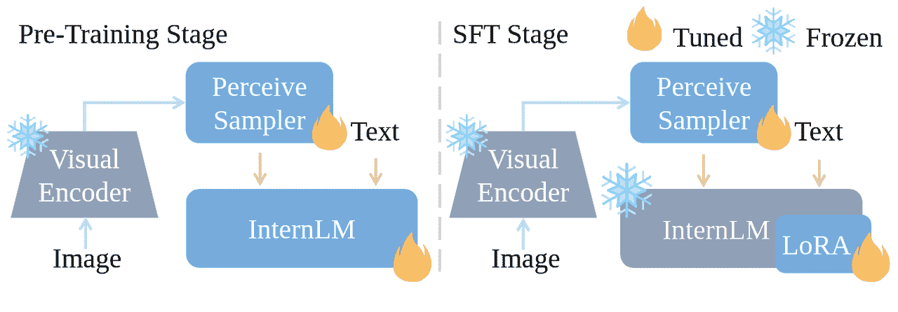

# 多模态兴趣小组

> 来源：[https://aicarrier.feishu.cn/docx/IR2Wd7sBUoAXvyxuFStcHtfdnfb](https://aicarrier.feishu.cn/docx/IR2Wd7sBUoAXvyxuFStcHtfdnfb)

# 多模态兴趣小组

## 多模态大模型简介

人类通过视**觉、听觉、触觉、**语言等多维感知来理解、感受世界，现今人工智能的发展正向着多维感知的方向不断发展，Large Language Model 的出现让通用强人工智能成为了可能，但是 Large Language Model 仅有文本模态，不足以满足人们意图需求，为此需要在 LLM 的基础上增加视觉编码器和连接视觉与语言模型的 Layer，构建出能遵循多模式视觉和语言指令的多模态模型，这样才能更好地完成现实任务，实现多模态交互。

多模态大模型(Large multimodal model)如今发展十分迅速，在开源社区中优秀的多模态大模型有 InternLM-XComposer、InternVL、LLaVA、Qwen-VL等。现在多模态大模型的基本架构大多为

+   Vision Encoder；

+   Project Layer；

+   Large Language Model；

学术界对于多模态大模型的训练和微调在这三个部分均有所研究，同时也有其他架构的探索，欢迎大家在训练和微调基础模型、下游任务上积极探索～

## 兴趣小组加入门槛

+   完成书生大模型实战营 InternVL 闯关任务，微信联系浦语小助手（微信搜索： InternLM） 可加入。

## 兴趣小组活动

### 2.1 学习资料分享

在学习群里会经常分享关于多模态的各种学习资料，包括但不限于技术报告、学术论文、解读文章、开源工具等。

### 2.2 圆桌会议

兴趣小组会不定期举行圆桌会议，经典多模态论文、项目等分享与想法交流，也欢迎大家踊跃参与分享～ 一起搭建训练多模态大模型。

### 2.3 小组任务

+   参与多模态大模型相关的学习

+   基于 InternLM 相关模型构建多模态大模型项目

+   对多模态架构和下游任务进行探索

## 组员福利

+   活跃的学习氛围

+   优秀组员精美证书

## 学习资料

InternLM-XComposer：https://github.com/InternLM/InternLM-XComposer

InternVL：https://github.com/OpenGVLab/InternVL

Awesome-Multimodal-Large-Language-Models：https://github.com/BradyFU/Awesome-Multimodal-Large-Language-Models

## 参考论文

| Name | Link |
| --- | --- |
| The (R)Evolution of Multimodal Large Language Models: A Survey | https://arxiv.org/abs/2402.12451.pdf |
| MM-LLMs: Recent Advances in MultiModal Large Language Models | https://arxiv.org/pdf/2401.13601.pdf |
| InternLM-XComposer | https://arxiv.org/pdf/2309.15112.pdf |
| InternVL | https://arxiv.org/pdf/2312.14238.pdf |
| CLIP | https://arxiv.org/pdf/2103.00020.pdf |
| LLaVA | https://arxiv.org/pdf/2304.08485.pdf |