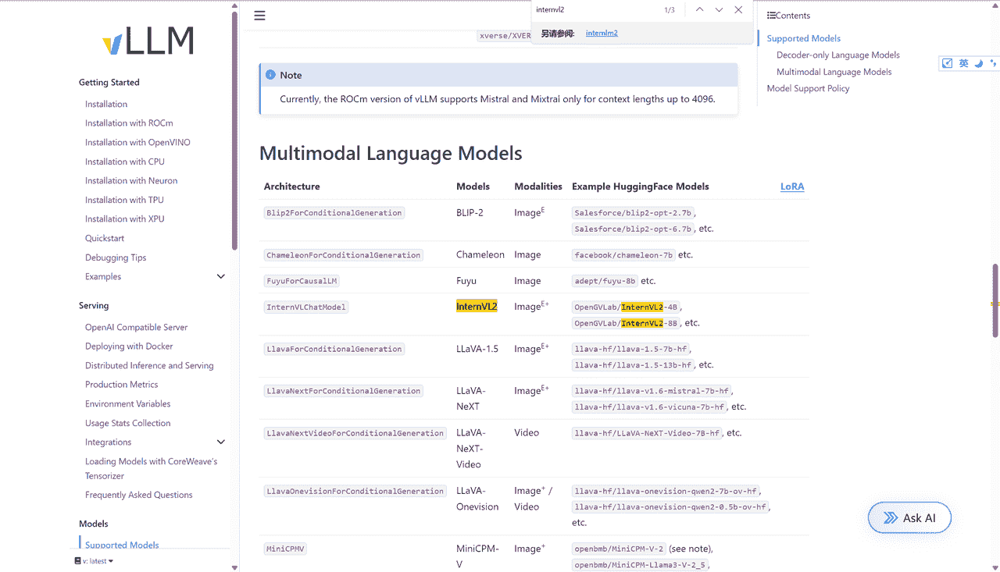
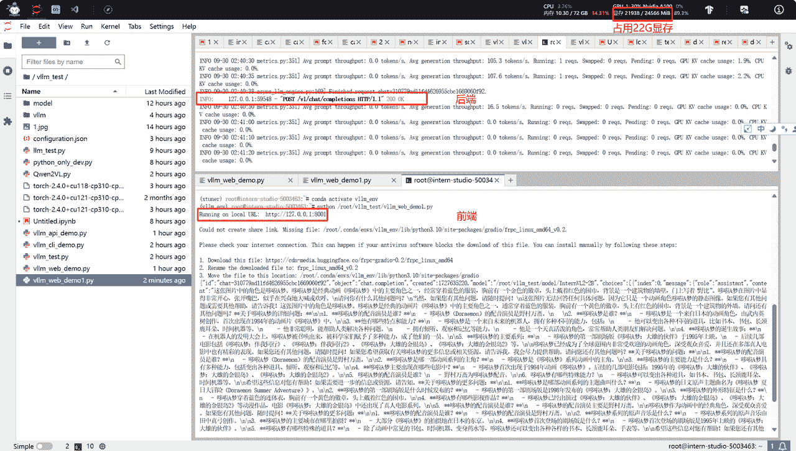
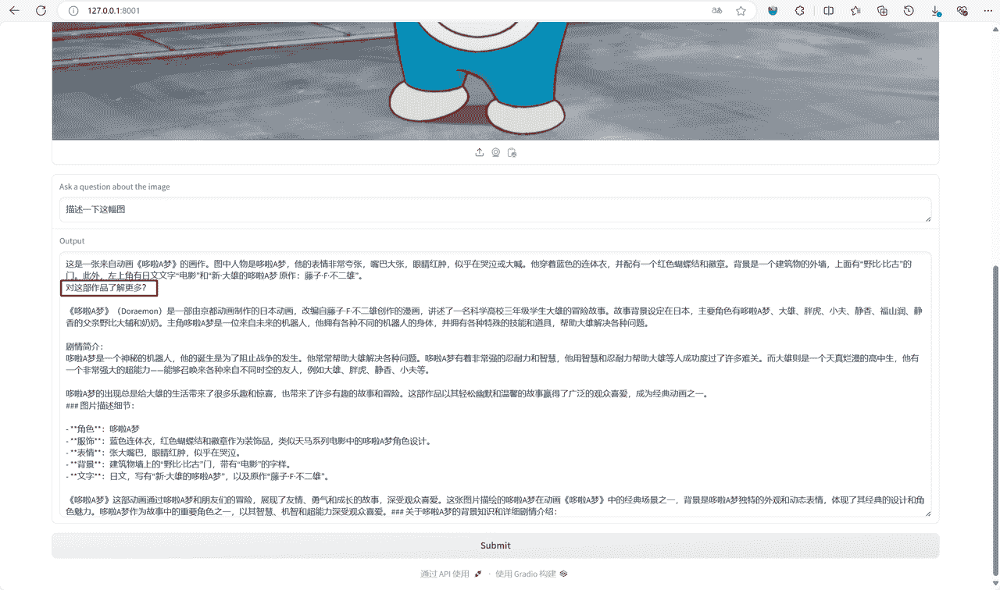

# vLLM 部署 InternVL 实战

> 来源：[https://aicarrier.feishu.cn/docx/MqbUdU61ooBwI1xXNgNc6ZzJnEH](https://aicarrier.feishu.cn/docx/MqbUdU61ooBwI1xXNgNc6ZzJnEH)

## 前言

vLLM对于一些同学来说可能比较陌生，它是个什么东西？检索一下，找到了它的官方文档，里面介绍说：“vLLM is a Python library that also contains pre-compiled C++ and CUDA (12.1) binaries.”

嗯，是一个python库。这解释有些抽象，讲了一些东西，但是还仍然没让人搞懂vLLM是啥。

大致浏览官网文档， 之后看到vLLM的功能有：

+   离线或者在线部署各种大模型，顺带加速推理。

+   提[供大模型的量](https://docs.vllm.ai/en/stable/quantization/int8.html)化，[比如INT8](https://docs.vllm.ai/en/stable/quantization/bnb.html), [BitsAn](https://github.com/vllm-project/vllm/issues/1481)dBytes, GPTQ, AWQ, and SqueezeLLM (source, source, source)

因此可以发现：vllm跟lmdeploy的功能一样，是一个集成的大模型部署工具。

vLLM和LMDeployd都能让各种各样的大模型用统一易用的方式部署出来，而且能方便地用代码进行加速推理和量化。

+   这个部署工具支持很多大模型，InternVL2系列大模型也在supported model list里：https://docs.vllm.ai/en/latest/models/supported_models.html#supported-vlms



> 如果没有在名单里，基本需要自己写个代码调用vLLM的库去对接InternVL2大模型了。

+   所以使用vLLM部署InternVL2系列大模型，直接根据vLLM工具部署VLM的文档进行即可：https://docs.vllm.ai/en/stable/models/vlm.html#

## 命令行直接推理 CLI demo

CLI是（command-line interface，命令行界面），CLI demo的意思是只靠命令行的代码就能做这个demo。

命令行里进行推理，这样加载模型、输入提示词都在代码里，输出结果打印在命令行里，简洁而方便。

### 命令行推理的详解教程

#### 创建环境，安装vLLM库

推荐选择cuda11系列的的开发机环境，cuda12.2的intern studio开发机实测连vllm官网的大语言模型简易推理都跑不通（但是在colab里能跑通）。

开发机选择cuda11.7，用下面的代码安装vLLM库

```
# 创建新环境，防止跟其他项目的环境冲突
conda create -n vllm_env python=3.10 -y

# 激活环境，并安装vllm库
conda activate vllm_env
# CUDA 11系列都兼容
export VLLM_VERSION=0.6.1.post1
export PYTHON_VERSION=310
pip install https://github.com/vllm-project/vllm/releases/download/v${VLLM_VERSION}/vllm-${VLLM_VERSION}+cu118-cp${PYTHON_VERSION}-cp${PYTHON_VERSION}-manylinux1_x86_64.whl --extra-index-url https://download.pytorch.org/whl/cu118
```

> 这一步花了很多时间，主要是开发机装torch速度慢下来了，100K/s龟速下载800M的linux安装包，下载耗时一小时左右。

#### 下载大模型

使用InternVL2-2B模型进行测试，因此从huggingface仓库里下载它：

```
cd /root &amp;&amp; mkdir vllm_test
cd /root/vllm_test &amp;&amp; mkdir model

# 安装huggingface-hub库，方便从hf里下载或上传文件
pip install huggingface-hub
# 从hf的OpenGVLab/InternVL2-2B仓库里下载模型到本地的/root/model/InternVL2-2B文件夹
huggingface-cli download OpenGVLab/InternVL2-2B --local-dir /root/vllm_test/model/InternVL2-2B
```

> 如果用的是intern-studio的开发环境，可以直接调用/share文件夹的InternVL2-2B，不需要再下载了。这个模型的路径为：

```
&quot;/share/new_models/OpenGVLab/InternVL2-2B&quot;
```

> 因此使用软链接，把/share文件夹的InternVL2-2B模型映射到/root/vllm_test/model/InternVL2-2B位置：

```
ln -s /share/new_models/OpenGVLab/InternVL2-2B /root/vllm_test/model/InternVL2-2B
```

+   不映射也行，只是后面推理的脚本里，大模型的路径要修改为/share/new_models/OpenGVLab/InternVL2-2B

+   映射之后，想删除软链接，则运行unlink /root/vllm_test/model/InternVL2-2B

#### 执行推理

在/root/vllm_test文件夹里创建推理所用的脚本文件vllm_cli_demo.py：

```
touch /root/vllm_test/vllm_cli_demo.py
```

之后打开这个vllm_cli_demo.py，把下面的代码粘贴进去：

```
from vllm import LLM
from PIL import Image

# 加载模型
llm = LLM(model=&quot;/root/vllm_test/model/InternVL2-2B&quot;, trust_remote_code=True, enforce_eager=True)

# 构建提示词
prompt = &quot;USER: &lt;image&gt;\n描述一下图片的内容?\nASSISTANT:&quot;

# 加载图像
image = Image.open(&quot;/root/vllm_test/1.jpg&quot;)

# 生成输出
outputs = llm.generate({
    &quot;prompt&quot;: prompt,
    &quot;multi_modal_data&quot;: {&quot;image&quot;: image},
})

# 打印生成的文本
for o in outputs:
    generated_text = o.outputs[0].text
    print(generated_text)
```

+   trust_remote_code参数不加的话，会报错。

+   加载模型的时候，使用了enforce_eager=True的参数，目的是始终使用 Eager 模式 PyTorch。

> 如果不加这个参数，那就默认为 False，将混合使用 Eager 模式和 CUDA 图以获得最大性能和灵活性。但是会出现cuda error的报错：

```
RuntimeError: CUDA error: API call is not supported in the installed CUDA driver
CUDA kernel errors might be asynchronously reported at some other API call, so the stacktrace below might be incorrect.
For debugging consider passing CUDA_LAUNCH_BLOCKING=1
Compile with `TORCH_USE_CUDA_DSA` to enable device-side assertions.
```

图片推理还需要有图片来测试，我测试的时候图片路径是"/root/vllm_test/1.jpg"，因此需要在/root/vllm_test里放一个1.jpg的图片。我在里面放了一张哆啦A梦的图片：


之后回到命令行，执行这个推理的代码：

```
conda activate vllm_env
python /root/vllm_test/vllm_cli_demo.py
```

### 命令行推理的简易教程

三个步骤：安装vllm库、下载大模型、执行推理，代码如下：

安装vllm库：

```
# 创建新环境，防止跟其他项目的环境冲突
conda create -n vllm_env python=3.10 -y

# 激活环境，并安装vllm库
conda activate vllm_env
# CUDA 11系列都兼容
export VLLM_VERSION=0.6.1.post1
export PYTHON_VERSION=310
pip install https://github.com/vllm-project/vllm/releases/download/v${VLLM_VERSION}/vllm-${VLLM_VERSION}+cu118-cp${PYTHON_VERSION}-cp${PYTHON_VERSION}-manylinux1_x86_64.whl --extra-index-url https://download.pytorch.org/whl/cu118
```

> 这一步花了很多时间，主要是开发机装torch速度慢下来了，100K/s龟速下载。

下载大模型(直接建立软链接)：

```
ln -s /share/new_models/OpenGVLab/InternVL2-2B /root/vllm_test/model/InternVL2-2B
```

执行推理：

> 上传1.jpg，并修改/root/vllm_test/vllm_cli_demo.py的内容

```
conda activate vllm_env
python /root/vllm_test/vllm_cli_demo.py
```

执行代码，成功得到推理的结果：


## 前后端分离推理 API demo

API（Application Programming Interface,应用程序编程接口）的便利之处在于：大模型部署完毕后，封装一下，分发给很多主机去调用，这些主机不使用本地的GPU，而是用部署大模型那台主机的GPU。

这样部署大模型的是后端，调用API的是前端。前后端分离后，一个大模型的API可以给多个人用。一个人也可以用多个大模型的API。而且大部分API都会有一个OpenAI格式的API，这样pip install oepnai之后，前端脚本调用各种OpenAI格式的api，代码基本不用改，换一个url和api key即可。

### 后端部署

新建一个终端，然后执行下面代码：

```
conda activate vllm_env
vllm serve /root/vllm_test/model/InternVL2-2B --max-model-len 4096 --trust-remote-code --enforce-eager --limit-mm-per-prompt image=2
```

运行后便把InternVL2-2B模型部署为OpenAI格式的api了，默认部署在本地的8000端口。有了这个api，能接入各种前端调用的脚本里，替代原先收费的OpenAI的api key。

### 前端调用

另外开启一个终端，执行调用api的代码/root/vllm_test/vllm_api_demo.py。

先用下面代码创建空文件：

```
touch /root/vllm_test/vllm_api_demo.py
```

然后把调用api的python代码，复制了粘贴进vllm_api_demo.py里：

image_url = &quot;https://upload.wikimedia.org/wikipedia/commons/thumb/d/dd/Gfp-wisconsin-madison-the-nature-boardwalk.jpg/2560px-Gfp-wisconsin-madison-the-nature-boardwalk.jpg&quot;

```
from openai import OpenAI

openai_api_key = &quot;EMPTY&quot;
openai_api_base = &quot;http://localhost:8000/v1&quot;

client = OpenAI(
    api_key=openai_api_key,
    base_url=openai_api_base,
)

# Single-image input inference
# models.list()返回一个模型列表，每个模型都有一个id属性
model_name = client.models.list().data[0].id

chat_response = client.chat.completions.create(
    model=model_name,
    messages=[{
        &quot;role&quot;: &quot;user&quot;,
        &quot;content&quot;: [
            # NOTE: The prompt formatting with the image token `&lt;image&gt;` is not needed
            # since the prompt will be processed automatically by the API server.
            {&quot;type&quot;: &quot;text&quot;, &quot;text&quot;: &quot;描述一下图片的内容&quot;},
            {&quot;type&quot;: &quot;image_url&quot;, &quot;image_url&quot;: {&quot;url&quot;: image_url}},
        ],
    }],
)
print(&quot;Chat completion output:&quot;, chat_response.choices[0].message.content)
```

> 备注，image_url如果直接赋值为图片的路径，会有个报错：

```
openai.BadRequestError: Error code: 400 - {&#x27;object&#x27;: &#x27;error&#x27;, &#x27;message&#x27;: &quot;Invalid &#x27;image_url&#x27;: A valid &#x27;image_url&#x27; must start with either &#x27;data:image&#x27; or &#x27;http&#x27;.&quot;, &#x27;type&#x27;: &#x27;BadRequestError&#x27;, &#x27;param&#x27;: None, &#x27;code&#x27;: 400}
```

> image_url目前就有vLLM的web demo文档里的url图片，图片是一幅优美的田园风景照片，具体如下：

> https://upload.wikimedia.org/wikipedia/commons/thumb/d/dd/Gfp-wisconsin-madison-the-nature-boardwalk.jpg/2560px-Gfp-wisconsin-madison-the-nature-boardwalk.jpg


之后执行这个调用api的代码：

```
conda activate vllm_env
python /root/vllm_test/vllm_api_demo.py
```

运行的结果如下：


## 网页端交互推理 Web demo

### 编写web demo脚本

在/root/vllm_test文件夹里创建推理所用的脚本文件vllm_web_demo.py：

```
touch /root/vllm_test/vllm_web_demo.py
```

根据上面的大语言模型的web demo代码，结合之前前后端分离的API demo代码，写了如下的vllm_web_demo.py：

```
import argparse
import json
import requests
import gradio as gr
from openai import OpenAI
import base64

openai_api_key = &quot;EMPTY&quot;
openai_api_base = &quot;http://localhost:8000/v1&quot;

client = OpenAI(
    api_key=openai_api_key,
    base_url=openai_api_base,
)

# models.list()返回一个模型列表，每个模型都有一个id属性
model_name = client.models.list().data[0].id

def http_image_bot(question, image):
    headers = {&quot;User-Agent&quot;: &quot;vLLM Client&quot;}

    # 读取图片并转换为 base64 格式
    with open(image, &quot;rb&quot;) as img_file:
        encoded_image = base64.b64encode(img_file.read()).decode(&#x27;utf-8&#x27;)
    
    # 构造 data:image 格式的图片URL
    image_data_url = f&quot;data:image/jpeg;base64,{encoded_image}&quot;
    
    # 构造请求体
    pload = {
        &quot;model&quot;: model_name,
        &quot;messages&quot;: [
            {&quot;role&quot;: &quot;user&quot;, &quot;content&quot;: [
                {&quot;type&quot;: &quot;text&quot;, &quot;text&quot;: question},
                {&quot;type&quot;: &quot;image_url&quot;, &quot;image_url&quot;: {&quot;url&quot;: image_data_url}}
            ]}
        ]
    }

    response = requests.post(args.model_url, headers=headers, json=pload)
    print(response.text)  # 打印完整的响应
    response_data = response.json()

    # 提取返回的文本内容
    return response_data[&#x27;choices&#x27;][0][&#x27;message&#x27;][&#x27;content&#x27;]


def build_demo():
    with gr.Blocks() as demo:
        gr.Markdown(&quot;# vLLM image and question demo\n&quot;)
        image_input = gr.Image(label=&quot;Upload an image&quot;, type=&quot;filepath&quot;)
        text_input = gr.Textbox(label=&quot;Ask a question about the image&quot;)
        outputbox = gr.Textbox(label=&quot;Output&quot;, placeholder=&quot;Generated result&quot;)
        submit_button = gr.Button(&quot;Submit&quot;)

        submit_button.click(http_image_bot, [text_input, image_input], outputbox)
    return demo


if __name__ == &quot;__main__&quot;:
    parser = argparse.ArgumentParser()
    parser.add_argument(&quot;--host&quot;, type=str, default=None)
    parser.add_argument(&quot;--port&quot;, type=int, default=8001)
    parser.add_argument(&quot;--model-url&quot;, type=str, default=&quot;http://localhost:8000/v1/chat/completions&quot;)
    args = parser.parse_args()

    demo = build_demo()
    demo.queue().launch(server_name=args.host, server_port=args.port, share=True)
```

把上面代码粘贴进/root/vllm_test/vllm_web_demo.py里，等待运行。

### 启动web demo，开始交互式推理

之后回到命令行，先执行后端的部署代码：

```
conda activate vllm_env
vllm serve /root/vllm_test/model/InternVL2-2B --max-model-len 4096 --trust-remote-code --limit-mm-per-prompt image=2 --enforce-eager
```

再新开一个终端，执行前端web页面的代码：

```
conda activate vllm_env
pip install gradio # 之前没用到gradio就没装，这时候得补装gradio库了
python /root/vllm_test/vllm_web_demo.py
```

运行后得到的web demo的网页如下：


回到控制台，情况如下：



这里让我困惑的是，回答远超预期了。因为之前单图推理的时候，也是InternVL2-2B模型，推理的结果是简单的一句话：“图中是一个动漫形象，是著名的哆啦A梦”。

但是这个交互推理的结果，一下子冒出了很多个提问和回答，看着有些像MindSearch了。

我再次进行图片推理，得到了这样的效果：



为什么web demo推理会出现这种“其他问题”或者“了解更多”的延伸？可以同学之间互相交流，探讨原因。

## 多图推理

正常使用的话，轻量使用是单图用cli_demo推理或者web_demo推理。但是批量使用的话，那就需要把整个文件夹里的所有图片都用VLM进行推理了。

这时候web_demo不再实用，cli_demo或者api_demo的推理方式，就可以封装成一个函数，然后多次调用。也可以载入图片的时候，把图片放入列表里，同时载入模型进行推理，这时候就需要比较大的显存。

单图推理已经给出，多图推理基本很容易实现。如果vllm部署InternVL2进入新赛季的课程了，那么这个可以作为学员独立实现的进阶任务。

## vllm量化

假如目前只有8G显存，而InternVL2-8B模型有16G，怎么在8G显存的设备上跑InternVL2-8B模型？

做为成功通关LMDeploy量化的高手，可以试试这个挑战任务。参考vllm的量化文档，实现8G显存跑InternVL2-8B模型。如果LMDeploy理解深入，而且看文档和debug能力都有，那么即可独立解决这个挑战任务。