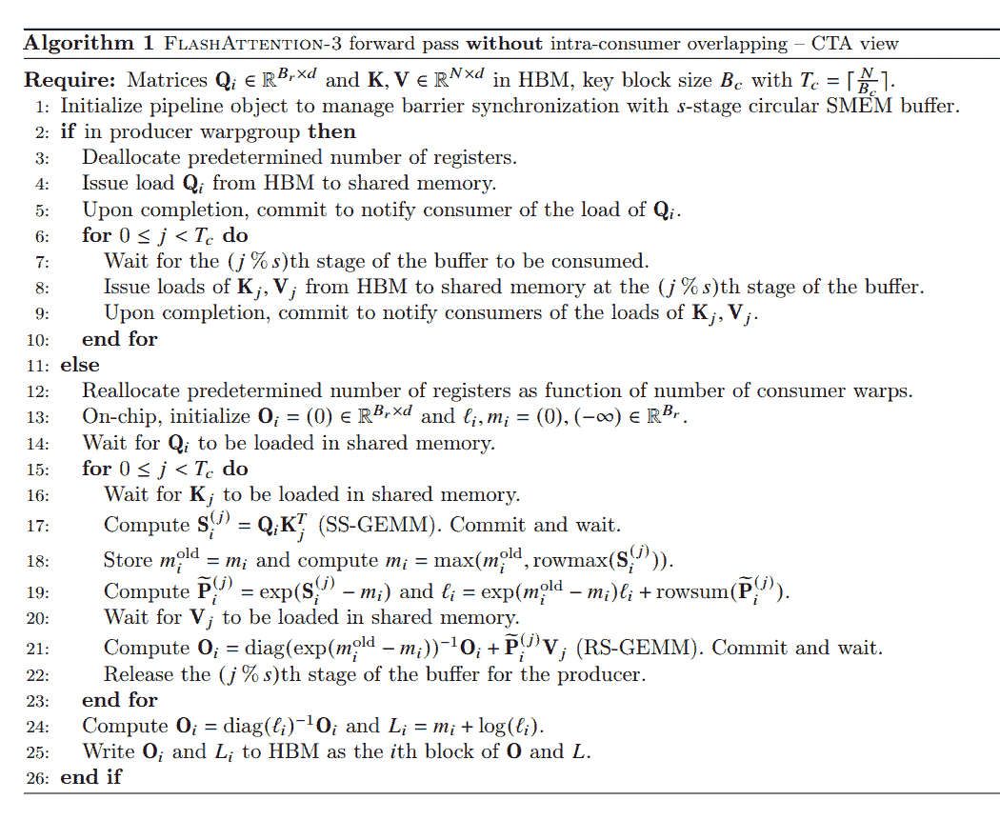
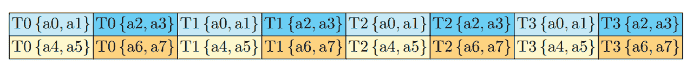
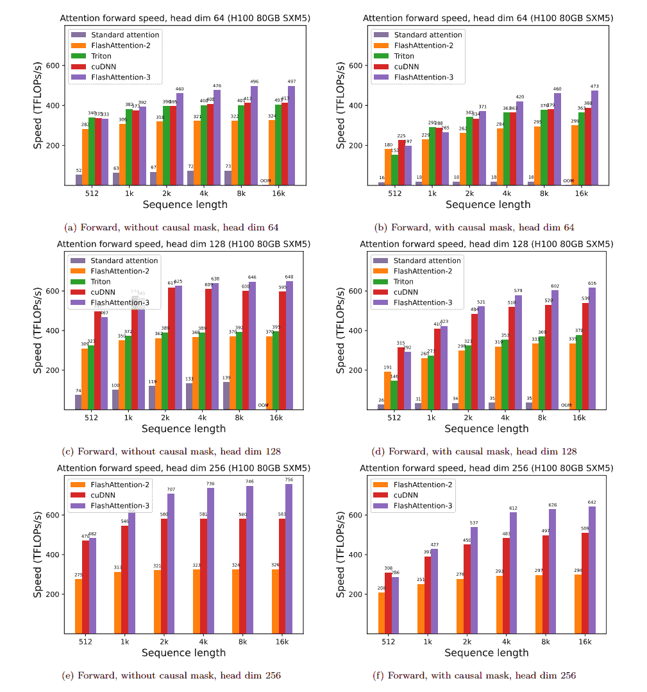
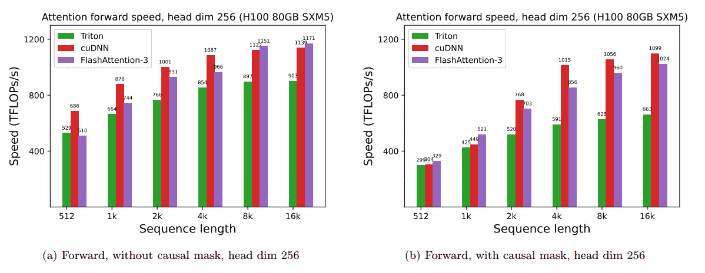
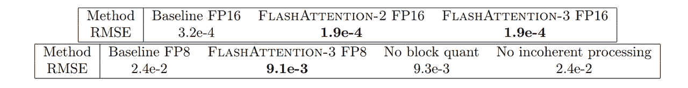

# Flash Attention 3 技术探讨圆桌

> 来源：[https://aicarrier.feishu.cn/docx/EW1RdlvAJoA2BwxwowpccNYGnRg](https://aicarrier.feishu.cn/docx/EW1RdlvAJoA2BwxwowpccNYGnRg)

腾讯会议：354-5795

`https://tridao.me/publications/flash3/flash3.pdf`

分享主持人：某上市公司算法工程师、书生·浦语 SIG

`FlashAttention-3`:利用异步和低精度实现快速且准确的注意力机制

## 论文翻译

### 作者信息

Jay Shah¹, Ganesh Bikshandi¹, Ying Zhang², Vijay Thakkar³⁴, Pradeep Ramani³, 和 Tri Dao⁵⁶

¹Colfax Research ²Meta ³NVIDIA ⁴Georgia Tech ⁵Princeton University ⁶Together AI

{jayshah,ganesh}@colfax-intl.com, yingz@meta.com, {vithakkar,prraman}@nvidia.com, tri@tridao.me

### 摘要

注意力机制作为无处不在的`Transformer`架构的核心层，是大型语言模型和长上下文应用的瓶颈。`FlashAttention`提出了一种通过最小化内存读/写来加速`GPU`上的注意力计算的方法。它尚未利用最新硬件中的新功能，`FlashAttention-2`仅在`H100` `GPU`上实现了35%的利用率。我们开发了三种主要技术来加速`Hopper GPUs`上的注意力计算：利用`Tensor Cores`和`TMA`的异步性来(1)通过`warp`专门化重叠整体计算和数据移动，(2)交错块级`matmul`和`softmax`操作，以及(3)块量化和不连贯处理，这些技术利用了`FP8`低精度的硬件支持。我们证明了我们的方法`FlashAttention-3`在`H100 GPUs`上实现了1.5-2.0倍的加速，`FP16`达到740 `TFLOPs/s`（75%利用率），`FP8`接近1.2 `PFLOPs/s`。我们验证了`FP8 FlashAttention-3`比基准`FP8`注意力实现的数值误差低2.6倍。

### 1 引言

对于`Transformer`架构[56]，注意力机制构成了主要的计算瓶颈，因为计算查询和键的自注意力分数具有序列长度的二次方缩放。扩展注意力以适应更长的上下文将解锁新的能力（对多个长文档进行建模和推理[24, 42, 49]以及大型代码库中的文件[30, 47]），新的模态（高分辨率图像[11]，音频[23]，视频[25]），以及新的应用（用户与长历史记录的交互[51]，具有长期视野的代理工作流[59]）。这在长上下文领域引发了对加速注意力计算的重大兴趣，包括通过近似[14, 27, 54]和软硬件优化([17, 29, 44])，甚至替代架构[22, 41, 53]。译者注：比如最近的`TTT`

在这项工作中，我们基于Dao等人[17]的工作，开发了将`GPU`执行模型和硬件特性知识整合到其高级设计中的精确注意力算法。在[17]中，Dao等人引入了`FlashAttention`，这是一种新的并行化注意力的分块策略，通过将所有注意力操作融合到单个`GPU`内核中，消除了中间读/写到慢速全局内存的需求。

Dao[15]将算法重构为`FlashAttention-2`，以在序列长度维度上并行化，并在键值矩阵的块上执行前向传播的内部循环，从而提高了`GPU`上的工作占用率和分布。然而，我们观察到`FlashAttention-2`在较新的`GPU`上相对于优化的矩阵乘法（`GEMM`）内核仍然存在较低的利用率，例如在`Hopper H100` `GPU`上仅为35%。部分原因可能是实现级别的差异，比如在针对`Tensor Cores`时没有使用`Hopper`特定指令而是使用`Ampere`指令。

更根本地说，`FlashAttention-2`的算法遵循了一个简化的同步模型，在其设计中没有明确使用异步和低精度。异步是硬件专门化的结果，用于加速`ML`工作负载中最重要的操作：专用硬件单元执行矩阵乘法（`Tensor Cores`）或内存加载（`Tensor Memory Accelerator - TMA`），与执行逻辑、整数和浮点计算的其他`CUDA`核心分离。低精度如`Hopper`中的`FP8`和`Blackwell`中的`FP4`，延续了`FP16`（`Pascal`在2017年）和`BF16`（`Ampere`在2020年）的趋势，是一种proven技术，可以在相同功耗和芯片面积下获得更高的吞吐量。我们在§2.2中回顾了`Hopper`在这些方向上提供的功能。技术挑战在于重新设计`FlashAttention-2`以利用这些硬件特性：异步要求在`matmul`和`softmax`之间重叠计算，尽管其中一个依赖于另一个的输出，而低精度需要注意最小化量化误差，特别是在`LLMs`中的异常特征情况下[20, 52]。

为此，我们提出`FlashAttention-3`，它贡献并综合了三个新想法，以进一步提高新`GPU`架构上的性能：¹

1. 生产者-消费者异步：我们定义了一个`warp`专门化的软件流水线方案，利用数据移动和`Tensor Cores`的异步执行，将数据的生产者和消费者分割到不同的`warps`中，从而扩展了算法隐藏内存和指令发布延迟的能力。

1. 在异步块级`GEMMs`下隐藏`softmax`：我们将`softmax`中涉及的相对低吞吐量的非`GEMM`操作（如浮点乘加和指数）与`GEMM`的异步`WGMMA`指令重叠。作为这一过程的一部分，我们重新设计了`FlashAttention-2`算法，以规避`softmax`和`GEMMs`之间的某些顺序依赖。例如，在我们算法的2阶段版本中，当`softmax`在分数矩阵的一个块上执行时，`WGMMA`在异步代理中计算下一个块。

1. 硬件加速的低精度`GEMM`：我们调整前向传播算法以允许针对`FP8 Tensor Cores`进行`GEMM`，几乎将测量的`TFLOPs/s`翻倍。这需要弥合`WGMMA`在`FP32`累加器和`FP8`操作矩阵方面的不同布局一致性要求，假设这些矩阵在内存中已经布局好。我们使用块量化和不连贯处理技术来缓解转移到`FP8`精度导致的准确性损失。

为了实证验证我们的方法，我们在`H100 SXM5 GPU`上对`FlashAttention-3`进行了一系列参数的基准测试，并显示（1）`FP16`在前向传播中实现了1.5-2.0倍的加速（达到740 `TFLOPs/s`），在后向传播中实现了1.5-1.75倍的加速，（2）`FP8`达到接近1.2 `PFLOPs/s`，以及（3）对于长序列长度，

`P32`中。此外，使用块量化和不连贯处理的`FP8 FlashAttention-3`在存在异常特征的情况下比标准注意力精确2.6倍。

我们以许可证³开源`FlashAttention-3`，并计划将其集成到`PyTorch`和`Hugging Face`库中，以惠及最大数量的研究人员和开发人员。

注：

¹我们在 `NVIDIA` 的 `Hopper` 架构背景下描述我们的结果。然而，我们的算法适用于任何具有足够强大的异步执行和低精度能力的 `GPU` 架构。

²更准确地说，对于头维度 64，`FlashAttention-3 FP8` 领先，而对于头维度 128 和 256，在没有因果掩码的情况下与之相当，在有因果掩码的情况下落后。

[³`FlashAttention-3` 可在 https://github.com/Dao-AILab/flash-attention 获取](https://github.com/Dao-AILab/flash-attention)

## 2. 背景：多头注意力和 GPU 特性

### 2.1 多头注意力

设 `Q`, `K`, `V` ∈ ℝ^(N×d) 为与单个头相关的查询、键和值输入序列，其中 `N` 是序列长度，`d` 是头维度。则注意力输出 `O` 的计算如下：

`S = αQK^T ∈ ℝ^(N×N), P = softmax(S) ∈ ℝ^(N×N), O = PV ∈ ℝ^(N×d),`

其中 `softmax` 按行应用，通常将 `α = 1/√d` 设为缩放因子。在实践中，我们从 `S` 中减去 `rowmax(S)` 以防止指数函数的数值不稳定性。对于多头注意力 (`MHA`)，每个头都有自己的查询、键和值投影集，这种计算在多个头和批次之间并行化以生成完整的输出张量。

现在让 `φ` 是一个标量损失函数，并让 `d(-) = ∂φ/∂(-)` 表示梯度。给定输出梯度 `dO` ∈ ℝ^(N×d)，我们根据链式法则计算 `dQ`, `dK`, 和 `dV` 如下：

`dV = P^T dO ∈ ℝ^(N×d)`

`dP = dOV^T ∈ ℝ^(N×N)`

`dS = dsoftmax(dP) ∈ ℝ^(N×N)`

`dQ = αdSK ∈ ℝ^(N×d)`

`dK = αdS^T Q ∈ ℝ^(N×d),`

这里，我们有 `ds = (diag(p) - pp^T)dp`，其中 `p = softmax(s)` 是向量 `s` 的函数，我们将 `dsoftmax(dP)` 写为这个公式按行应用。最后，这个计算再次在多个头和批次之间并行化，用于 `MHA` 的反向传播。

### 2.2 GPU 硬件特性和执行模型

我们描述与 `FlashAttention-3` 相关的 `GPU` 执行模型的方面，重点关注 `NVIDIA Hopper` 架构作为这个模型的具体实例。

内存层次结构：`GPU` 的内存组织为数据局部性的层次结构，容量与带宽成反比（表 1）⁴。全局内存（`GMEM`），也称为 `HBM`，是所有流式多处理器（`SMs`）可访问的片外 `DRAM`。`GMEM` 中的数据透明地缓存到片上 `L2` 缓存中。接下来，每个 `SM` 包含一个小型片上、程序员管理的高度 banked 缓存，称为共享内存（`SMEM`）。最后，每个 `SM` 内部还有寄存器文件。

注：

⁴Luo等人 [34] 报告每个`SM`每时钟周期共享内存带宽为128字节，我们将其乘以132个`SM`和1830 MHz的boost时钟。

线程层次结构：`GPU` 的编程模型围绕执行单元的逻辑分组（称为线程）组织。从最细到最粗的级别，线程层次结构由线程、`warps`（32 个线程）、`warpgroups`（4 个连续的 `warps`）、线程块（即协作线程数组或 `CTAs`）、线程块集群（在 `Hopper` 中）和网格组成。

这两个层次结构紧密相连。同一 `CTA` 中的线程在同一 `SM` 上协同调度，同一集群中的 `CTA` 在同一 `GPC` 上协同调度。`SMEM` 可直接被 `CTA` 内的所有线程寻址，而每个线程最多有 256 个私有寄存器（`RMEM`）。

表 1：NVIDIA Hopper H100 SXM5 GPU 的线程-内存层次结构。

异步和`warp`专门化：`GPU`是依赖并发和异步来隐藏内存和执行延迟的高吞吐量处理器。对于`GMEM`和`SMEM`之间的异步内存复制，`Hopper`有专用硬件单元`Tensor Memory Accelerator (TMA)` [38, §7.29]。此外，与之前的架构不同，`Hopper`的`Tensor Core`通过`warpgroup`范围的`WGMMA`指令暴露 [39, §9.7.14]，也是异步的，可以直接从共享内存获取输入。

硬件对异步的支持允许`warp`专门化内核，其中`CTA`的`warp`被划分为生产者或消费者角色，只负责数据移动或计算。从广义上讲，这提高了编译器生成最优指令调度的能力 [4]。此外，`Hopper`支持通过`setmaxnreg` [39, §9.7.17.1]动态重新分配`warpgroup`之间的寄存器，因此执行`MMA`的`warp`可以获得比仅发出`TMA`的`warp`（只需要一个线程）更多的`RMEM`。

低精度数字格式：现代`GPU`有专门的硬件单元用于加速低精度计算。例如，与`FP16`或`BF16`相比，`WGMMA`指令可以针对`Hopper`上的`FP8 Tensor Core`，使每个`SM`的吞吐量提高2倍。

然而，正确调用`FP8 WGMMA`需要理解其操作数的布局约束。给定一个`GEMM`调用，将`M×K`矩阵`A`与`N×K`矩阵`B`相乘，如果`A`或`B`操作数在外部`M`或`N`维度上是连续的，我们称之为`mn-major`，如果在内部`K`维度上是连续的，则称为`k-major`。对于`FP16 WGMMA`，`SMEM`中的操作数既接受`mn-major`也接受`k-major`输入格式，但对于`FP8 WGMMA`，只支持`k-major`格式。此外，在注意力等情况下，我们希望在单个内核中融合多个`GEMM`，`FP32`累加器和`FP8`操作数布局差异构成了调用相关`FP8 WGMMA`的障碍。

在注意力的上下文中，这些布局限制需要对`FP8`算法的设计进行某些修改，我们将在§3.3中描述。

### 2.3 标准注意力和Flash注意力

根据Dao等人[17]的研究，我们将标准注意力定义为在`GPU`上实现注意力的方法，该方法将中间矩阵`S`和`P`具体化到`HBM`中。`FlashAttention`的主要思想是利用`softmax`归约的局部版本来避免这些昂贵的中间读/写操作，并将注意力融合到单个内核中。局部`softmax`对应于算法1中消费者主循环的第18-19行，以及`O`的块的重新缩放。这个过程确实计算`O`的简单推导可以在[15, §2.3.1]中找到。

## 3 `FlashAttention-3`：算法

在本节中，我们描述`FlashAttention-3`算法。为简单起见，我们专注于前向传播，后向传播算法在附录B.1中描述。我们首先说明如何将`warp`专门化与循环`SMEM`缓冲区集成到`FlashAttention-2`的基本算法中。然后我们解释如何利用`WGMMA`的异步性来定义一个重叠的`GEMM-softmax` 2阶段流水线。最后，我们描述`FP8`所需的修改，包括布局一致性和通过块量化和不连贯处理实现的准确性。

### 3.1 通过`warp`专门化和`pingpong`调度实现生产者-消费者异步

#### Warp专门化

与`FlashAttention-2`一样，`FlashAttention-3`的前向传播在批次大小、头数和查询序列长度上具有高度并行性。因此，只需给出算法的`CTA`级视图就足够了，该算法对查询矩阵的一个`tile Q_l`进行操作，以计算相应的输出`tile O_l`。为简化描述，我们首先给出带有循环`SMEM`缓冲区的`warp`专门化方案，该方案不包括`GEMM-softmax`重叠。让`d`为头维度，`N`为序列长度，并固定一个查询块大小`B_r`，将`Q`分为`T_r = ⌈N/B_r⌉`个块`Q_1, ..., Q_T_r`。

对于我们在`Hopper`上实现的算法1，我们使用`setmaxnreg`进行（重新）分配，`TMA`用于加载`Q_l`和`{K_j, V_j}_{0≤j<T_c}`，`WGMMA`执行消费者主循环中的`GEMM`，`SS`或`RS`前缀表示第一个操作数是从共享内存还是寄存器文件获取的。解释算法1的执行流程时，注意由于异步性，发出`TMA`加载不会因其他加载的完成而停滞。此外，在生产者主循环中，前`s`次迭代不会发出等待，因为缓冲区正在被填充。

#### pingpong调度

`WGMMA`和`TMA`的异步性质，结合`warp`专门化，为将一个`warpgroup`的`softmax`计算与另一个`warpgroup`的`GEMM`重叠创造了机会。为说明这一点，注意非矩阵乘法操作在现代硬件加速器上的吞吐量远低于矩阵乘法操作。例如，`H100 SXM5 GPU`的`FP16`矩阵乘法达989 `TFLOPS`，但特殊函数如指数（`softmax`所需）仅为3.9 `TFLOPS`⁵。对于头维度为128的`FP16`注意力前向传播，矩阵乘法`FLOPS`比指数运算多512倍，但指数运算的吞吐量低256倍，因此指数运算可能占用50%的周期，相比矩阵乘法。`FP8`的情况更糟，矩阵乘法吞吐量翻倍，但指数吞吐量保持不变。

注：

⁵CUDA编程指南指出每个流式多处理器（`SM`）每时钟周期可执行16次特殊函数运算。我们将16乘以132个`SM`和1830 MHz的时钟速度，得到3.9 `TFLOPS`的特殊函数性能。

由于指数运算由独立的硬件单元（多功能单元）执行，理想情况下我们希望在`Tensor Cores`执行矩阵乘法时安排指数计算。为此，我们使用同步屏障（`bar.sync`指令）强制`warpgroup 1`的`GEMM`（一次迭代的`GEMM1 - PV`，和下一次迭代的`GEMM0 - QK^T`）在`warpgroup 2`的`GEMM`之前调度。结果，`warpgroup 1`的`softmax`将在`warpgroup 2`执行其`GEMM`时被调度。然后角色交换，`warpgroup 2`执行`softmax`，而`warpgroup 1`执行`GEMM`（因此称为`"pingpong"`调度）。这在图1中所示。虽然在实践中`pingpong`调度并不像图中描绘的那样整洁，但我们通常发现这能提高性能（例如，对于头维度128和序列长度8192的`FP16`前向传播，从570 `TFLOPS`提高到620-640 `TFLOPS`）。

图1：2个`warpgroup`的`pingpong`调度以重叠`softmax`和`GEMM`：一个`warpgroup`的`softmax`应该在另一个`warpgroup`的`GEMM`运行时被调度。相同颜色表示同一迭代。

#### 注意力变体

对于多查询注意力[50]和分组查询注意力[3]，我们遵循`FlashAttention-2`的方法，调整张量索引以避免在`HBM`中重复`K`和`V`。

### 3.2 `warpgroup`内`GEMM`和`softmax`的重叠

即使在一个`warpgroup`内，我们也可以将`softmax`中的一些指令与`GEMM`中的一些指令重叠。我们描述一种实现这一目标的技术。

在注意力算法中，内部循环（主循环）中的操作具有顺序依赖性，阻碍了单次迭代内的并行化。例如，（局部）`softmax`（第18至19行）依赖于第一个`GEMM`的输出`S_l^(j)`，而第二个`GEMM`将其结果`P̃_l^(j)`作为操作数。实际上，算法1中第17和21行的等待语句使`softmax`和`GEMM`的执行串行化。然而，我们可以通过在寄存器中使用额外的缓冲来打破这些依赖性，在迭代之间进行流水线处理。基于这个想法，我们提出以下两阶段⁶`GEMM-softmax`流水线算法：

### 图2：2阶段`WGMMA`-`softmax`流水线

⁶注意，重叠方案的阶段数受循环`SMEM`缓冲区中的阶段数`s`的限制，但不必等于`s`。

算法2作为算法1中消费者路径的替代，构成了FP16精度的完整`FlashAttention-3`算法。在高层次上，我们使用`WGMMA`作为异步`GEMM`的代称。在主循环（第8到16行）中，迭代`j`的第二个`WGMMA`操作（第11行）与迭代`j+1`的`softmax`操作（第13行）重叠。

虽然上述流水线结构理论上提供了性能提升，但仍有几个实际方面需要考虑：

### 编译器重排序

伪代码表示理想化的执行顺序，但编译器（`NVCC`）通常会为优化重新排列指令。这可能会扰乱精心设计的`WGMMA`和非`WGMMA`操作流水线序列，可能导致意外行为或性能提升减少。对`SASS`代码的分析表明，编译器按预期生成重叠代码（见B.2节）。

### 寄存器压力

为保持最佳性能，应最小化寄存器溢出。然而，2阶段流水线需要额外的寄存器来存储中间结果并在阶段之间维持上下文。具体来说，必须在寄存器中保存一个额外的`S_next`，每个线程块额外使用`B_r × B_c × sizeof(float)`大小的寄存器。这种增加的寄存器需求可能与使用更大的块大小（另一种常见优化）相冲突，后者也需要大量寄存器。实践中，应根据性能分析结果进行权衡。

### 3阶段流水线

在上述2阶段算法的基础上，我们提出了一个3阶段变体，进一步将第二个`WGMMA`与`softmax`重叠。虽然这种方法可能提供更高的Tensor Core利用率，但由于流水线中增加了一个阶段，它需要更多的寄存器，使得在块大小和流水线深度之间的权衡更难平衡。3阶段算法的详细描述及其评估结果可在附录B.3中找到。

## 3.3 使用FP8的低精度

### 效率：布局转换

以`FP8`精度计算`FlashAttention-3`的前向传播在布局一致性方面带来了`FP16`所没有的额外挑战。

图3：`FP32`累加器寄存器`WGMMA`布局 - 第0和8行，线程0-3，条目0-7。

图4：`FP8`操作数`A`寄存器`WGMMA`布局 - 第0和8行，线程0-3，条目0-7。

首先，我们注意到输入张量`Q`、`K`和`V`通常在头维度上是连续的，而为了满足`FP8` `WGMMA`对第二个`GEMM`的`k`-major约束，我们需要`V`（或者更准确地说，`V`的块）在`SMEM`中在序列长度维度上连续。由于`TMA`加载本身无法改变连续维度，我们需要要么（1）在`GMEM`中预处理时转置`V`，要么（2）在将`V`的块加载到`SMEM`后在内核中进行转置。为实现选项（1），我们可以（1a）将转置融合到前一步骤（如旋转嵌入）的尾声中，或（1b）调用独立的预处理转置内核⁷来交换序列长度和头维度的步长。然而，（1a）难以集成到标准库中，而（1b）在内存受限的情况下太浪费。

相反，对于`FP8` `FlashAttention-3`，我们选择选项（2）。对于内核内转置，我们利用`LDSM`（`ldmatrix`）和`STSM`（`stmatrix`）指令，这些指令涉及一个warp的线程集体以128字节的粒度将`SMEM`加载到`RMEM`和将`RMEM`存储到`SMEM`⁸。`LDSM`/`STSM`指令既寄存器效率高，允许我们在生产者`warpgroup`中执行它们，又能够在进行内存复制时转置布局。此外，在第一次迭代后，我们可以安排下一个`V`块的转置在涉及前一个`V`和当前`K`块的两个`WGMMA`的阴影下执行。

其次，我们观察到，与`FP16`不同，`FP8` `WGMMA`的`FP32`累加器的内存布局与其在寄存器中保存时假设的操作数`A`的布局不同。我们在图3和图4中描绘了这两种布局的片段，其中条目按列出的顺序保存在每个线程的寄存器中。通过使用字节置换指令，我们可以将第一个`WGMMA`的累加器转换为适合第二个`WGMMA`的格式，并与内核内转置产生的`V`块布局兼容。具体来说，参考图3，我们将序列顺序改为

这个寄存器置换然后每8字节重复一次。就`P`块的逻辑形状而言，这个操作置换了其列（例如，列`0189`现在成为前四列）。为了让`WGMMA`计算正确的输出块，我们可以相应地安排内核内转置以写出匹配的`V`块行置换⁹。

注：

⁷优化的转置内核将达到接近设备带宽的速度[45]。

⁸在`PTX`文档中，`LDSM`/`STSM`被描述为复制8×8个16位条目的矩阵[39, §9.7.13.4.15-16]，但我们可以在`FP8`精度的上下文中一次打包两个8位条目来使用`LDSM`/`STSM`。然而，`LDSM`/`STSM`的转置版本无法分割打包的8位条目，这需要在`LDSM`和`STSM`之间进行某些寄存器移动以实际执行块级转置；我们省略了细节。

⁹通过执行内核内转置提供的这种额外自由度消除了使用`shuffle`指令来改变线程间寄存器所有权的需要，这是我们之前在[7]中描述过的。

### 准确性：块量化和非连贯处理

使用`FP8`（`e4m3`）格式，只使用3位存储尾数和4位存储指数。这导致比`FP16`/`BF16`更高的数值误差。此外，large models通常有比大多数其他值大得多的`outlier`值[20, 52]，使量化变得困难。人们通常对每个张量使用单个标量进行缩放[37]（例如，`Q`、`K`和`V`各一个）。为了减少`FP8`中注意力的数值误差，我们采用两种技术：

1. 块量化：我们对每个块保留一个标量，这样对于每个`Q`、`K`、`V`，我们将张量分成大小为`B_r × d`或`B_c × d`的块，并单独量化它们。这种量化可以与注意力之前的操作（如旋转嵌入）融合，无需额外的慢速（因为旋转嵌入受内存带宽限制）。由于`FlashAttention-3`算法自然在块上操作，我们可以以零计算成本为每个`S`块考虑这种块量化。

2. 非连贯处理：为了均衡异常值，我们在量化为`FP8`之前将`Q`和`K`乘以一个随机正交矩阵`M`。由于`M`是正交的，`MM^T = I`，因此`(QM)(KM)^T = QK^T`，即用`M`乘以`Q`和`K`不会改变注意力输出。这有助于"展开"异常值，因为`QM`或`KM`中的每个条目是`Q`或`K`中条目的随机和，从而减少量化误差。在实践中，我们遵循Chee等人[9]的方法，选择`M`为±1的随机对角矩阵和一个`Hadamard`矩阵的乘积，这可以在`O(d log d)`而不是`O(d²)`时间内相乘，并且还可以与旋转嵌入无额外计算成本融合。

我们在§4.3中验证这两种技术将数值误差减少了多达2.6倍。

## 4 实证验证

我们使用`CUTLASS`[55]中的原语，如`WGMMA`和`TMA`抽象来实现`FlashAttention-3`并评估其效率和准确性。

• 注意力基准测试。我们测量不同序列长度下`FlashAttention-3`的运行时间，并将其与PyTorch中的标准实现、`FlashAttention-2`、`Triton`中的`FlashAttention-2`（使用`H100`特定指令），以及`cuDNN`针对`H100` GPU优化的`FlashAttention-2`供应商实现进行比较。我们确认`FlashAttention-3`比`FlashAttention-2`快至2.0倍，比`Triton`中的`FlashAttention-2`快1.5倍。`FlashAttention-3`在`H100` GPU上达到了理论最大`TFLOPS/s`的75%，即740 `TFLOPS/s`。

• 消融研究。我们确认我们的算法改进，包括warp专门化和`GEMM`-`softmax`流水线，对`FlashAttention-3`的加速有贡献。

• `FP8`注意力的准确性。我们验证块量化和非连贯处理将`FP8` `FlashAttention-3`的数值误差减少了2.6倍。

### 4.1 注意力基准测试

我们在`H100` 80GB `SXM5` GPU上测量了不同注意力方法在不同设置下（有/无因果掩码，头维度64或128）对`FP16`输入的运行时间。我们在图5和图6中报告结果，显示`FlashAttention-3`在前向传播中比`FlashAttention-2`快约1.5-2.0倍，在反向传播中快1.5-1.75倍。与标准注意力实现相比，`FlashAttention-3`可以快至3-16倍。对于中等和长序列（1k及以上），`FlashAttention-3`甚至超过了为`H100` GPU优化的供应商库（`cuDNN` - 闭源）的速度。

基准测试设置：我们将序列长度变化为512、1k、...、16k，并设置批量大小使总token数为16k。我们将隐藏维度设为2048，头维度为64、128或256（即32头、16头或8头）。为计算前向传播的`FLOP`数，我们使用：

`4 · seqlen² · head_dimension · number_of_heads`

对于因果掩码，我们将此数除以2，因为大约只有一半的条目被计算。要获得反向传播的`FLOP`数，我们将前向传播的`FLOP`数乘以2.5（因为前向传播有2个矩阵乘法，而反向传播有5个矩阵乘法，due to recomputation）。

我们还在类似设置下测量了`FP8`前向传播的运行时间。我们在图7中报告了头维度256的结果，完整结果在附录C.2中给出。

### 4.2 消融研究：2阶段流水线实验

我们对非因果`FP16` `FlashAttention-3`进行2阶段`WGMMA`-`softmax`流水线和warp专门化的消融实验，固定参数`{batch, seqlen, nheads, hdim} = {4, 8448, 16, 128}`。表2中的结果确认了我们的算法改进（warp专门化的异步性和`GEMM`与`softmax`之间的重叠）带来显著加速，从570 `TFLOP/s`提高到661 `TFLOP/s`。

图5: Attention forward speed (`FP16`/`BF16`) on `H100` GPU

### 4.3 数值误差验证

由于人们对`FlashAttention`的数值误差[21]感兴趣，

`FlashAttention-3`以及`FP64`中针对参考实现的注意标准实现。到

模拟LLM中的异常特征和激活[20, 52]，我们生成`Q`、`K`、`V`的条目，如下所示：

图6: Attention backward speed (`FP16`/`BF16`) on `H100` GPU

图7: Attention forward speed (`FP8`) on `H100` GPU

表 2: Pipelining ablation measurements

分布：

`N (0, 1) + N (0, 100) · Bernoulli(0.001)`

也就是说，每个条目都是正态分布的，均值为零，标准差为1，但对于0.1%的条目，我们添加一个标准偏差为10的正态分布的独立项。然后我们测量根均值平方误差（`RMSE`）见表3。在`FP16`中，`FlashAttention-2`和`FlashAttention 3`都实现了1.7×与标准实现相比，`RMSE`更低，因为中间结果（`softmax`）保存在`FP32`中。这个`FP8`中的基线注意力使用每个张量缩放，`FP32`中使用`matmul`累加器和中间`softmax`结果保存在`FP16`中。由于块量化和非相干处理，`FP8`中的`FlashAttention-3`是2.6×比这个基线更准确。

表3：`FP16`和`FP8`（`e4m3`）中的数值误差比较。

## 5 讨论、局限性和结论

通过`FlashAttention-3`，我们展示了新的编程技术和硬件特性（如异步和低精度）可以对注意力的效率和准确性产生显著影响。与`FlashAttention-2`相比，我们能够将注意力速度提高1.5-2.0倍，并将`FP8`数值误差减少2.6倍（相比标准的每张量量化）。我们希望在未来解决的一些局限性包括：优化LLM推理、将持久内核设计集成到`FP8`内核中¹⁰，以及理解大规模训练中低精度注意力的影响。尽管本工作聚焦于`Hopper` GPU，我们预计这里开发的技术将适用于其他硬件加速器。我们希望像注意力这样更快、更准确的基元将为长上下文任务开启新的应用。

## 致谢

我们感谢NVIDIA `CUTLASS`团队（特别是Haicheng Wu、Aniket Shivam和Cris Cecka）帮助我们理解`Hopper`的编程模型，并为他们的库提供清晰而强大的构建块，用于实现`FlashAttention-3`。我们感谢`cuDNN`团队提出`FP8`的内核转置想法。我们感谢Driss Guessous将`FlashAttention`集成到`PyTorch`中。`FlashAttention-3`受益于与Horace He就不同注意力变体的有见地的讨论，与Hao Liu和Phil Wang就分布式注意力的讨论，以及与Daniel Haziza和Chris De Sa就量化的讨论。我们感谢Meta、Together AI和普林斯顿语言与智能研究所（`PLI`）提供的计算支持。

## 引用

[1] Ahmad Abdelfattah, Azzam Haidar, Stanimire Tomov, and Jack Dongarra. Performance, design, and autotuning of batched gemm for gpus. pages 21–38, 06 2016. ISBN 978-3-319-41320-4. doi: 10.1007/978-3-319-41321-1_2. [2] AI21. Introducing jamba: Ai21’s groundbreaking ssm-transformer model. AI21 blog, 2024. [3] Joshua Ainslie, James Lee-Thorp, Michiel de Jong, Yury Zemlyanskiy, Federico Lebrón, and Sumit Sanghai. Gqa: Training generalized multi-query transformer models from multi-head checkpoints. arXiv preprint arXiv:2305.13245, 2023.

[4] Michael Bauer, Henry Cook, and Brucek Khailany. CudaDMA: Optimizing GPU Memory Bandwidth via Warp Specialization. In Proceedings of 2011 International Conference for High Performance Computing, Networking, Storage and Analysis, SC ’11, New York, NY, USA, 2011. Association for Computing Machinery. ISBN 9781450307710. doi: 10.1145/2063384.2063400. URL https://doi.org/10.1145/2063384.2063400.

[5] Maximilian Beck, Korbinian Pöppel, Markus Spanring, Andreas Auer, Oleksandra Prudnikova, Michael Kopp, Günter Klambauer, Johannes Brandstetter, and Sepp Hochreiter. xlstm: Extended long short-term memory. arXiv preprint arXiv:2405.04517, 2024.

[6] Iz Beltagy, Matthew E Peters, and Arman Cohan. Longformer: The long-document transformer. arXiv preprint arXiv:2004.05150, 2020.

...

# 背后团队盘点
