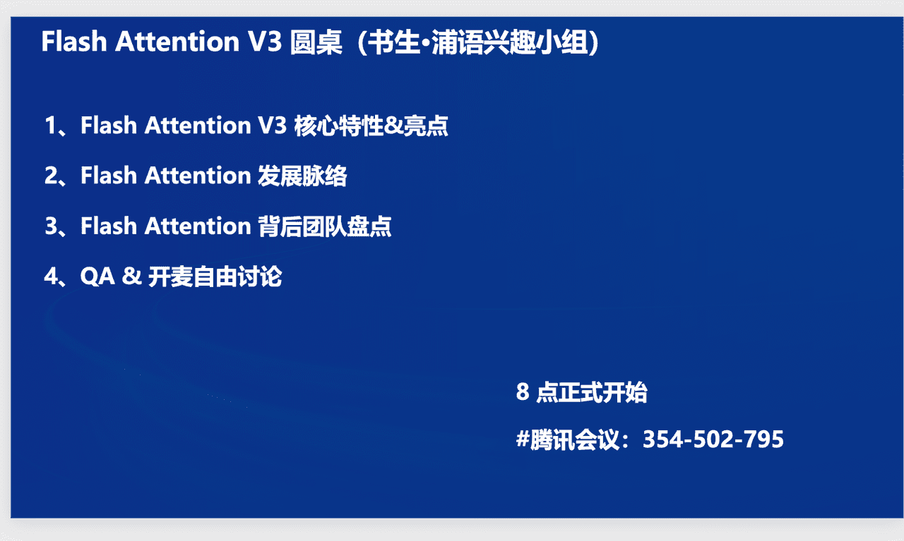
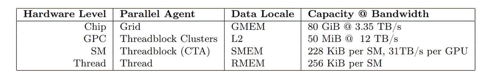
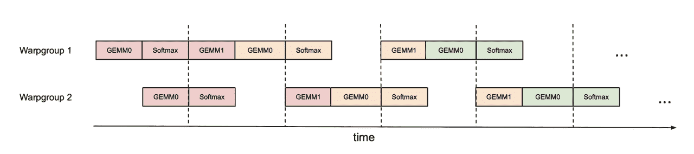
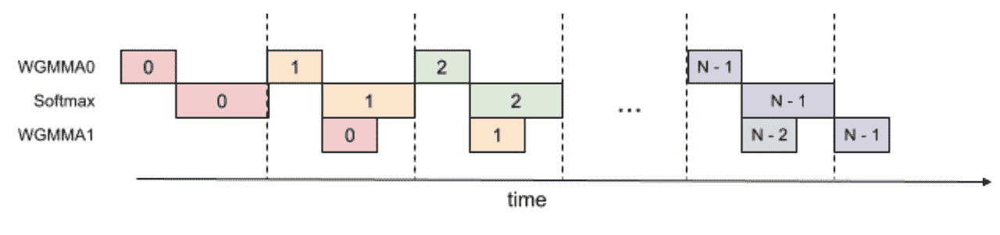
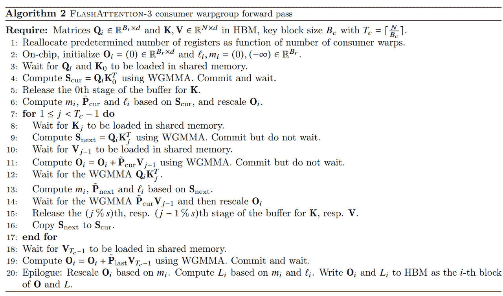
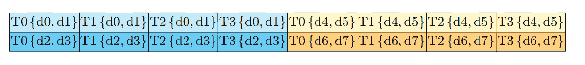
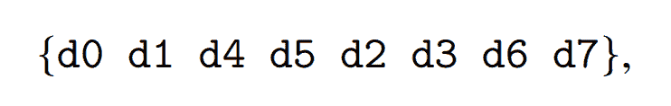
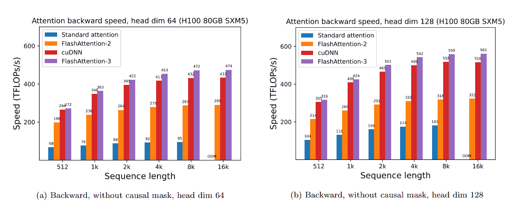
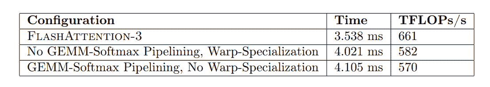

# Flash Attention 3 技术探讨圆桌

> 来源：[https://aicarrier.feishu.cn/docx/EW1RdlvAJoA2BwxwowpccNYGnRg](https://aicarrier.feishu.cn/docx/EW1RdlvAJoA2BwxwowpccNYGnRg)

**#腾讯会议：****354-5795**

https://tridao.me/publications/flash3/flash3.pdf

分享主持人：某上市公司算法工程师、书生·浦语 SIG

FlashAttention-3:利用异步和低精度实现快速且准确的注意力机制

# 论文翻译

作者信息：

Jay Shah¹, Ganesh Bikshandi¹, Ying Zhang², Vijay Thakkar³⁴, Pradeep Ramani³, 和 Tri Dao⁵⁶

¹C[olfax Research](mailto:yingz@meta.com) ²Meta ³NVIDI[A ⁴Georgia Te](mailto:tri@tridao.me)ch ⁵Princeton University ⁶Together AI

{jayshah,ganesh}@colfax-intl.com, yingz@meta.com, {vithakkar,prraman}@nvidia.com, tri@tridao.me

**摘要**

注意力机制作为无处不在的Transformer架构的核心层，是大型语言模型和长上下文应用的瓶颈。FlashAttention提出了一种通过最小化内存读/写来加速GPU上的注意力计算的方法。它尚未利用最新硬件中的新功能，FlashAttention-2仅在H100 GPU上实现了35%的利用率。我们开发了三种主要技术来加速Hopper GPUs上的注意力计算：利用Tensor Cores和TMA的异步性来(1)通过warp专门化重叠整体计算和数据移动，(2)交错块级matmul和softmax操作，以及(3)块量化和不连贯处理，这些技术利用了FP8低精度的硬件支持。我们证明了我们的方法FlashAttention-3在H100 GPUs上实现了1.5-2.0倍的加速，FP16达到740 TFLOPs/s（75%利用率），FP8接近1.2 PFLOPs/s。我们验证了FP8 FlashAttention-3比基准FP8注意力实现的数值误差低2.6倍。

**1 引言**

对于Transformer架构[56]，注意力机制构成了主要的计算瓶颈，因为计算查询和键的自注意力分数具有序列长度的二次方缩放。扩展注意力以适应更长的上下文将解锁新的能力（对多个长文档进行建模和推理[24, 42, 49]以及大型代码库中的文件[30, 47]），新的模态（高分辨率图像[11]，音频[23]，视频[25]），以及新的应用（用户与长历史记录的交互[51]，具有长期视野的代理工作流[59]）。这在长上下文领域引发了对加速注意力计算的重大兴趣，包括通过近似[14, 27, 54]和软硬件优化([17, 29, 44])，甚至替代架构[22, 41, 53]。译者注：比如最近的TTT

在这项工作中，我们基于Dao等人[17]的工作，开发了将GPU执行模型和硬件特性知识整合到其高级设计中的精确注意力算法。在[17]中，Dao等人引入了FlashAttention，这是一种新的并行化注意力的分块策略，通过将所有注意力操作融合到单个GPU内核中，消除了中间读/写到慢速全局内存的需求。

Dao[15]将算法重构为FlashAttention-2，以在序列长度维度上并行化，并在键值矩阵的块上执行前向传播的内部循环，从而提高了GPU上的工作占用率和分布。然而，我们观察到FlashAttention-2在较新的GPU上相对于优化的矩阵乘法（GEMM）内核仍然存在较低的利用率，例如在Hopper H100 GPU上仅为35%。部分原因可能是实现级别的差异，比如在针对Tensor Cores时没有使用Hopper特定指令而是使用Ampere指令。

更根本地说，FlashAttention-2的算法遵循了一个简化的同步模型，在其设计中没有明确使用异步和低精度。异步是硬件专门化的结果，用于加速ML工作负载中最重要的操作：专用硬件单元执行矩阵乘法（Tensor Cores）或内存加载（Tensor Memory Accelerator - TMA），与执行逻辑、整数和浮点计算的其他CUDA核心分离。低精度如Hopper中的FP8和Blackwell中的FP4，延续了FP16（Pascal在2017年）和BF16（Ampere在2020年）的趋势，是一种proven技术，可以在相同功耗和芯片面积下获得更高的吞吐量。我们在§2.2中回顾了Hopper在这些方向上提供的功能。技术挑战在于重新设计FlashAttention-2以利用这些硬件特性：异步要求在matmul和softmax之间重叠计算，尽管其中一个依赖于另一个的输出，而低精度需要注意最小化量化误差，特别是在LLMs中的异常特征情况下[20, 52]。

为此，我们提出FlashAttention-3，它贡献并综合了三个新想法，以进一步提高新GPU架构上的性能：¹

1.  生产者-消费者异步：我们定义了一个warp专门化的软件流水线方案，利用数据移动和Tensor Cores的异步执行，将数据的生产者和消费者分割到不同的warps中，从而扩展了算法隐藏内存和指令发布延迟的能力。

1.  在异步块级GEMMs下隐藏softmax：我们将softmax中涉及的相对低吞吐量的非GEMM操作（如浮点乘加和指数）与GEMM的异步WGMMA指令重叠。作为这一过程的一部分，我们重新设计了FlashAttention-2算法，以规避softmax和GEMMs之间的某些顺序依赖。例如，在我们算法的2阶段版本中，当softmax在分数矩阵的一个块上执行时，WGMMA在异步代理中计算下一个块。

1.  硬件加速的低精度GEMM：我们调整前向传播算法以允许针对FP8 Tensor Cores进行GEMM，几乎将测量的TFLOPs/s翻倍。这需要弥合WGMMA在FP32累加器和FP8操作矩阵方面的不同布局一致性要求，假设这些矩阵在内存中已经布局好。我们使用块量化和不连贯处理技术来缓解转移到FP8精度导致的准确性损失。

为了实证验证我们的方法，我们在H100 SXM5 GPU上对FlashAttention-3进行了一系列参数的基准测试，并显示（1）FP16在前向传播中实现了1.5-2.0倍的加速（达到740 TFLOPs/s），在后向传播中实现了1.5-1.75倍的加速，（2）FP8达到接近1.2 PFLOPs/s，以及（3）对于长序列长度，

P32中。此外，使用块量化和不连贯处理的FP8 FlashAttention-3在存在异常特征的情况下比标准注意力精确2.6倍。

我们以许可证³开源FlashAttention-3，并计划将其集成到PyTorch和Hugging Face库中，以惠及最大数量的研究人员和开发人员。

注：

¹我们在 NVIDIA 的 Hopper 架构背景下描述我们的结果。然而，我们的算法适用于任何具有足够强大的异步执行和低精度能力的 GPU 架构。

²更准确地说，对于头维度 64，FlashAttention-3 FP8 领先，而对于头维度 128 和 256，在没有因果掩码的情况下与之相当，在有因果掩码的情况下落后。

[³FlashAttention-3 可在 htt](https://github.com/Dao-AILab/flash-attention)ps://github.com/Dao-AILab/flash-attention 获取

2.背景：多头注意力和 GPU 特性

2.1 多头注意力

设 Q, K, V ∈ ℝ^(N×d) 为与单个头相关的查询、键和值输入序列，其中 N 是序列长度，d 是头维度。则注意力输出 O 的计算如下：

S = αQK^T ∈ ℝ^(N×N), P = softmax(S) ∈ ℝ^(N×N), O = PV ∈ ℝ^(N×d),

其中 softmax 按行应用，通常将 α = 1/√d 设为缩放因子。在实践中，我们从 S 中减去 rowmax(S) 以防止指数函数的数值不稳定性。对于多头注意力 (MHA)，每个头都有自己的查询、键和值投影集，这种计算在多个头和批次之间并行化以生成完整的输出张量。

现在让 φ 是一个标量损失函数，并让 d(-) = ∂φ/∂(-) 表示梯度。给定输出梯度 dO ∈ ℝ^(N×d)，我们根据链式法则计算 dQ, dK, 和 dV 如下：

dV = P^T dO ∈ ℝ^(N×d)

dP = dOV^T ∈ ℝ^(N×N)

dS = dsoftmax(dP) ∈ ℝ^(N×N)

dQ = αdSK ∈ ℝ^(N×d)

dK = αdS^T Q ∈ ℝ^(N×d),

这里，我们有 ds = (diag(p) - pp^T)dp，其中 p = softmax(s) 是向量 s 的函数，我们将 dsoftmax(dP) 写为这个公式按行应用。最后，这个计算再次在多个头和批次之间并行化，用于 MHA 的反向传播。

2.2 GPU 硬件特性和执行模型

我们描述与 FlashAttention-3 相关的 GPU

执行模型的方面，重点关注 NVIDIA Hopper 架构作为这个模型的具体实例。

内存层次结构：GPU 的内存组织为数据局部性的层次结构，容量与带宽成反比（表 1）⁴。全局内存（GMEM），也称为 HBM，是所有流式多处理器（SMs）可访问的片外 DRAM。GMEM 中的数据透明地缓存到片上 L2 缓存中。接下来，每个 SM 包含一个小型片上、程序员管理的高度 banked 缓存，称为共享内存（SMEM）。最后，每个 SM 内部还有寄存器文件。

注：

⁴Luo等人 [34] 报告每个SM每时钟周期共享内存带宽为128字节，我们将其乘以132个SM和1830 MHz的boost时钟。

线程层次结构：GPU 的编程模型围绕执行单元的逻辑分组（称为线程）组织。从最细到最粗的级别，线程层次结构由线程、warps（32 个线程）、warpgroups（4 个连续的 warps）、线程块（即协作线程数组或 CTAs）、线程块集群（在 Hopper 中）和网格组成。

这两个层次结构紧密相连。同一 CTA 中的线程在同一 SM 上协同调度，同一集群中的 CTA 在同一 GPC 上协同调度。SMEM 可直接被 CTA 内的所有线程寻址，而每个线程最多有 256 个私有寄存器（RMEM）。

表 1：NVIDIA Hopper H100 SXM5 GPU 的线程-内存层次结构。

异步和warp专门化：GPU是依赖并发和异步来隐藏内存和执行延迟的高吞吐量处理器。对于GMEM和SMEM之间的异步内存复制，Hopper有专用硬件单元Tensor Memory Accelerator (TMA) [38, §7.29]。此外，与之前的架构不同，Hopper的Tensor Core通过warpgroup范围的WGMMA指令暴露 [39, §9.7.14]，也是异步的，可以直接从共享内存获取输入。

硬件对异步的支持允许warp专门化内核，其中CTA的warp被划分为生产者或消费者角色，只负责数据移动或计算。从广义上讲，这提高了编译器生成最优指令调度的能力 [4]。此外，Hopper支持通过setmaxnreg [39, §9.7.17.1]动态重新分配warpgroup之间的寄存器，因此执行MMA的warp可以获得比仅发出TMA的warp（只需要一个线程）更多的RMEM。

低精度数字格式：现代GPU有专门的硬件单元用于加速低精度计算。例如，与FP16或BF16相比，WGMMA指令可以针对Hopper上的FP8 Tensor Core，使每个SM的吞吐量提高2倍。

然而，正确调用FP8 WGMMA需要理解其操作数的布局约束。给定一个GEMM调用，将M×K矩阵A与N×K矩阵B相乘，如果A或B操作数在外部M或N维度上是连续的，我们称之为mn-major，如果在内部K维度上是连续的，则称为k-major。对于FP16 WGMMA，SMEM中的操作数既接受mn-major也接受k-major输入格式，但对于FP8 WGMMA，只支持k-major格式。此外，在注意力等情况下，我们希望在单个内核中融合多个GEMM，FP32累加器和FP8操作数布局差异构成了调用相关FP8 WGMMA的障碍。

在注意力的上下文中，这些布局限制需要对FP8算法的设计进行某些修改，我们将在§3.3中描述。

2.3 标准注意力和Flash注意力

根据Dao等人[17]的研究，我们将标准注意力定义为在GPU上实现注意力的方法，该方法将中间矩阵S和P具体化到HBM中。FlashAttention的主要思想是利用softmax归约的局部版本来避免这些昂贵的中间读/写操作，并将注意力融合到单个内核中。局部softmax对应于算法1中消费者主循环的第18-19行，以及O的块的重新缩放。这个过程确实计算O的简单推导可以在[15, §2.3.1]中找到。

3 FlashAttention-3：算法

在本节中，我们描述FlashAttention-3算法。为简单起见，我们专注于前向传播，后向传播算法在附录B.1中描述。我们首先说明如何将warp专门化与循环SMEM缓冲区集成到FlashAttention-2的基本算法中。然后我们解释如何利用WGMMA的异步性来定义一个重叠的GEMM-softmax 2阶段流水线。最后，我们描述FP8所需的修改，包括布局一致性和通过块量化和不连贯处理实现的准确性。

3.1 通过warp专门化和pingpong调度实现生产者-消费者异步

Warp专门化 与FlashAttention-2一样，FlashAttention-3的前向传播在批次大小、头数和查询序列长度上具有高度并行性。因此，只需给出算法的CTA级视图就足够了，该算法对查询矩阵的一个tile Q_l进行操作，以计算相应的输出tile O_l。为简化描述，我们首先给出带有循环SMEM缓冲区的warp专门化方案，该方案不包括GEMM-softmax重叠。让d为头维度，N为序列长度，并固定一个查询块大小B_r，将Q分为T_r = ⌈N/B_r⌉个块Q_1, ..., Q_T_r。

对于我们在Hopper上实现的算法1，我们使用setmaxnreg进行（重新）分配，TMA用于加载Q_l和{K_j, V_j}_{0≤j<T_c}，WGMMA执行消费者主循环中的GEMM，SS或RS前缀表示第一个操作数是从共享内存还是寄存器文件获取的。解释算法1的执行流程时，注意由于异步性，发出TMA加载不会因其他加载的完成而停滞。此外，在生产者主循环中，前s次迭代不会发出等待，因为缓冲区正在被填充。

pingpong调度 WGMMA和TMA的异步性质，结合warp专门化，为将一个warpgroup的softmax计算与另一个warpgroup的GEMM重叠创造了机会。为说明这一点，注意非矩阵乘法操作在现代硬件加速器上的吞吐量远低于矩阵乘法操作。例如，H100 SXM5 GPU的FP16矩阵乘法达989 TFLOPS，但特殊函数如指数（softmax所需）仅为3.9 TFLOPS⁵。对于头维度为128的FP16注意力前向传播，矩阵乘法FLOPS比指数运算多512倍，但指数运算的吞吐量低256倍，因此指数运算可能占用50%的周期，相比矩阵乘法。FP8的情况更糟，矩阵乘法吞吐量翻倍，但指数吞吐量保持不变。

注：

⁵CUDA编程指南指出每个流式多处理器（SM）每时钟周期可执行16次特殊函数运算。我们将16乘以132个SM和1830 MHz的时钟速度，得到3.9 TFLOPS的特殊函数性能。

由于指数运算由独立的硬件单元（多功能单元）执行，理想情况下我们希望在Tensor Cores执行矩阵乘法时安排指数计算。为此，我们使用同步屏障（bar.sync指令）强制warpgroup 1的GEMM（一次迭代的GEMM1 - PV，和下一次迭代的GEMM0 - QK^T）在warpgroup 2的GEMM之前调度。结果，warpgroup 1的softmax将在warpgroup 2执行其GEMM时被调度。然后角色交换，warpgroup 2执行softmax，而warpgroup 1执行GEMM（因此称为"pingpong"调度）。这在图1中所示。虽然在实践中pingpong调度并不像图中描绘的那样整洁，但我们通常发现这能提高性能（例如，对于头维度128和序列长度8192的FP16前向传播，从570 TFLOPS提高到620-640 TFLOPS）。

图1：2个warpgroup的pingpong调度以重叠softmax和GEMM：一个warpgroup的softmax应该在另一个warpgroup的GEMM运行时被调度。相同颜色表示同一迭代。

注意力变体 对于多查询注意力[50]和分组查询注意力[3]，我们遵循FlashAttention-2的方法，调整张量索引以避免在HBM中重复K和V。

3.2 warpgroup内GEMM和softmax的重叠

即使在一个warpgroup内，我们也可以将softmax中的一些指令与GEMM中的一些指令重叠。我们描述一种实现这一目标的技术。

在注意力算法中，内部循环（主循环）中的操作具有顺序依赖性，阻碍了单次迭代内的并行化。例如，（局部）softmax（第18至19行）依赖于第一个GEMM的输出S_l^(j)，而第二个GEMM将其结果P̃_l^(j)作为操作数。实际上，算法1中第17和21行的等待语句使softmax和GEMM的执行串行化。然而，我们可以通过在寄存器中使用额外的缓冲来打破这些依赖性，在迭代之间进行流水线处理。基于这个想法，我们提出以下两阶段⁶GEMM-softmax流水线算法：

图2：2阶段WGMMA-softmax流水线

⁶注意，重叠方案的阶段数受循环SMEM缓冲区中的阶段数s的限制，但不必等于s。

算法2作为算法1中消费者路径的替代，构成了FP16精度的完整FlashAttention-3算法。在高层次上，我们使用WGMMA作为异步GEMM的代称。在主循环（第8到16行）中，迭代j的第二个WGMMA操作（第11行）与迭代j+1的softmax操作（第13行）重叠。

虽然上述流水线结构理论上提供了性能提升，但仍有几个实际方面需要考虑：

编译器重排序 伪代码表示理想化的执行顺序，但编译器（NVCC）通常会为优化重新排列指令。这可能会扰乱精心设计的WGMMA和非WGMMA操作流水线序列，可能导致意外行为或性能提升减少。对SASS代码的分析表明，编译器按预期生成重叠代码（见B.2节）。

寄存器压力 为保持最佳性能，应最小化寄存器溢出。然而，2阶段流水线需要额外的寄存器来存储中间结果并在阶段之间维持上下文。具体来说，必须在寄存器中保存一个额外的S_next，每个线程块额外使用B_r × B_c × sizeof(float)大小的寄存器。这种增加的寄存器需求可能与使用更大的块大小（另一种常见优化）相冲突，后者也需要大量寄存器。实践中，应根据性能分析结果进行权衡。

3阶段流水线 在上述2阶段算法的基础上，我们提出了一个3阶段变体，进一步将第二个WGMMA与softmax重叠。虽然这种方法可能提供更高的Tensor Core利用率，但由于流水线中增加了一个阶段，它需要更多的寄存器，使得在块大小和流水线深度之间的权衡更难平衡。3阶段算法的详细描述及其评估结果可在附录B.3中找到。

3.3 使用FP8的低精度

效率：布局转换 以FP8精度计算FlashAttention-3的前向传播在布局一致性方面带来了FP16所没有的额外挑战。

图3：FP32累加器寄存器WGMMA布局 - 第0和8行，线程0-3，条目0-7。

图4：FP8操作数A寄存器WGMMA布局 - 第0和8行，线程0-3，条目0-7。

首先，我们注意到输入张量Q、K和V通常在头维度上是连续的，而为了满足FP8 WGMMA对第二个GEMM的k-major约束，我们需要V（或者更准确地说，V的块）在SMEM中在序列长度维度上连续。由于TMA加载本身无法改变连续维度，我们需要要么（1）在GMEM中预处理时转置V，要么（2）在将V的块加载到SMEM后在内核中进行转置。为实现选项（1），我们可以（1a）将转置融合到前一步骤（如旋转嵌入）的尾声中，或（1b）调用独立的预处理转置内核⁷来交换序列长度和头维度的步长。然而，（1a）难以集成到标准库中，而（1b）在内存受限的情况下太浪费。

相反，对于FP8 FlashAttention-3，我们选择选项（2）。对于内核内转置，我们利用LDSM（ldmatrix）和STSM（stmatrix）指令，这些指令涉及一个warp的线程集体以128字节的粒度将SMEM加载到RMEM和将RMEM存储到SMEM⁸。LDSM/STSM指令既寄存器效率高，允许我们在生产者warpgroup中执行它们，又能够在进行内存复制时转置布局。此外，在第一次迭代后，我们可以安排下一个V块的转置在涉及前一个V和当前K块的两个WGMMA的阴影下执行。

其次，我们观察到，与FP16不同，FP8 WGMMA的FP32累加器的内存布局与其在寄存器中保存时假设的操作数A的布局不同。我们在图3和图4中描绘了这两种布局的片段，其中条目按列出的顺序保存在每个线程的寄存器中。通过使用字节置换指令，我们可以将第一个WGMMA的累加器转换为适合第二个WGMMA的格式，并与内核内转置产生的V块布局兼容。具体来说，参考图3，我们将序列顺序改为

这个寄存器置换然后每8字节重复一次。就P块的逻辑形状而言，这个操作置换了其列（例如，列0189现在成为前四列）。为了让WGMMA计算正确的输出块，我们可以相应地安排内核内转置以写出匹配的V块行置换⁹。

注：

⁷优化的转置内核将达到接近设备带宽的速度[45]。

⁸在PTX文档中，LDSM/STSM被描述为复制8×8个16位条目的矩阵[39, §9.7.13.4.15-16]，但我们可以在FP8精度的上下文中一次打包两个8位条目来使用LDSM/STSM。然而，LDSM/STSM的转置版本无法分割打包的8位条目，这需要在LDSM和STSM之间进行某些寄存器移动以实际执行块级转置；我们省略了细节。

⁹通过执行内核内转置提供的这种额外自由度消除了使用shuffle指令来改变线程间寄存器所有权的需要，这是我们之前在[7]中描述过的。

准确性：块量化和非连贯处理。使用FP8（e4m3）格式，只使用3位存储尾数和4位存储指数。这导致比FP16/BF16更高的数值误差。此外，large models通常有比大多数其他值大得多的outlier值[20, 52]，使量化变得困难。人们通常对每个张量使用单个标量进行缩放[37]（例如，Q、K和V各一个）。为了减少FP8中注意力的数值误差，我们采用两种技术：

1.  块量化：我们对每个块保留一个标量，这样对于每个Q、K、V，我们将张量分成大小为B_r × d或B_c × d的块，并单独量化它们。这种量化可以与注意力之前的操作（如旋转嵌入）融合，无需额外的慢速（因为旋转嵌入受内存带宽限制）。由于FlashAttention-3算法自然在块上操作，我们可以以零计算成本为每个S块考虑这种块量化。

1.  非连贯处理：为了均衡异常值，我们在量化为FP8之前将Q和K乘以一个随机正交矩阵M。由于M是正交的，MM^T = I，因此(QM)(KM)^T = QK^T，即用M乘以Q和K不会改变注意力输出。这有助于"展开"异常值，因为QM或KM中的每个条目是Q或K中条目的随机和，从而减少量化误差。在实践中，我们遵循Chee等人[9]的方法，选择M为±1的随机对角矩阵和一个Hadamard矩阵的乘积，这可以在O(d log d)而不是O(d²)时间内相乘，并且还可以与旋转嵌入无额外计算成本融合。

我们在§4.3中验证这两种技术将数值误差减少了多达2.6倍。

4 实证验证

我们使用CUTLASS[55]中的原语，如WGMMA和TMA抽象来实现FlashAttention-3并评估其效率和准确性。

• 注意力基准测试。我们测量不同序列长度下FlashAttention-3的运行时间，并将其与PyTorch中的标准实现、FlashAttention-2、Triton中的FlashAttention-2（使用H100特定指令），以及cuDNN针对H100 GPU优化的FlashAttention-2供应商实现进行比较。我们确认FlashAttention-3比FlashAttention-2快至2.0倍，比Triton中的FlashAttention-2快1.5倍。FlashAttention-3在H100 GPU上达到了理论最大TFLOPS/s的75%，即740 TFLOPS/s。

• 消融研究。我们确认我们的算法改进，包括warp专门化和GEMM-softmax流水线，对FlashAttention-3的加速有贡献。

• FP8注意力的准确性。我们验证块量化和非连贯处理将FP8 FlashAttention-3的数值误差减少了2.6倍。

4.1 注意力基准测试

我们在H100 80GB SXM5 GPU上测量了不同注意力方法在不同设置下（有/无因果掩码，头维度64或128）对FP16输入的运行时间。我们在图5和图6中报告结果，显示FlashAttention-3在前向传播中比FlashAttention-2快约1.5-2.0倍，在反向传播中快1.5-1.75倍。与标准注意力实现相比，FlashAttention-3可以快至3-16倍。对于中等和长序列（1k及以上），FlashAttention-3甚至超过了为H100 GPU优化的供应商库（cuDNN - 闭源）的速度。

基准测试设置：我们将序列长度变化为512、1k、...、16k，并设置批量大小使总token数为16k。我们将隐藏维度设为2048，头维度为64、128或256（即32头、16头或8头）。为计算前向传播的FLOP数，我们使用：

4 · seqlen² · head_dimension · number_of_heads

对于因果掩码，我们将此数除以2，因为大约只有一半的条目被计算。要获得反向传播的FLOP数，我们将前向传播的FLOP数乘以2.5（因为前向传播有2个矩阵乘法，而反向传播有5个矩阵乘法，due to recomputation）。

我们还在类似设置下测量了FP8前向传播的运行时间。我们在图7中报告了头维度256的结果，完整结果在附录C.2中给出。

4.2 消融研究：2阶段流水线实验

我们对非因果FP16 FlashAttention-3进行2阶段WGMMA-softmax流水线和warp专门化的消融实验，固定参数{batch, seqlen, nheads, hdim} = {4, 8448, 16, 128}。表2中的结果确认了我们的算法改进（warp专门化的异步性和GEMM与softmax之间的重叠）带来显著的加速，从570 TFLOP/s提高到661 TFLOP/s。

图5: Attention forward speed (FP16/BF16) on H100 GPU

4.3数值误差验证

由于人们对FlashAttention的数值误差[21]感兴趣，

FlashAttention-3以及FP64中针对参考实现的注意标准实现。到

模拟LLM中的异常特征和激活[20,52]，我们生成Q、K、V的条目，如下所示：

图6: Attention backward speed (FP16/BF16) on H100 GPU

图7: Attention forward speed (FP8) on H100 GPU

表 2: Pipelining ablation measurements

分布：

N (0, 1) + N (0, 100) · Bernoulli(0.001)

也就是说，每个条目都是正态分布的，均值为零，标准差为1，但对于0.1%的条目，我们添加一个标准偏差为10的正态分布的独立项。然后我们测量根均值平方误差（RMSE）见表3。在FP16中，FlashAttention-2和FlashAttention 3都实现了1.7×与标准实现相比，RMSE更低，因为中间结果（softmax）保存在FP32中。这个FP8中的基线注意力使用每个张量缩放，FP32中使用matmul累加器和中间softmax结果保存在FP16中。由于块量化和非相干处理，FP8中的FlashAttention-3是2.6×比这个基线更准确。

表3：FP16和FP8（e4m3）中的数值误差比较。

5 讨论、局限性和结论

通过FlashAttention-3，我们展示了新的编程技术和硬件特性（如异步和低精度）可以对注意力的效率和准确性产生显著影响。与FlashAttention-2相比，我们能够将注意力速度提高1.5-2.0倍，并将FP8数值误差减少2.6倍（相比标准的每张量量化）。我们希望在未来解决的一些局限性包括：优化LLM推理、将持久内核设计集成到FP8内核中¹⁰，以及理解大规模训练中低精度注意力的影响。尽管本工作聚焦于Hopper GPU，我们预计这里开发的技术将适用于其他硬件加速器。我们希望像注意力这样更快、更准确的基元将为长上下文任务开启新的应用。

致谢

我们感谢NVIDIA CUTLASS团队（特别是Haicheng Wu、Aniket Shivam和Cris Cecka）帮助我们理解Hopper的编程模型，并为他们的库提供清晰而强大的构建块，用于实现FlashAttention-3。我们感谢cuDNN团队提出FP8的内核转置想法。我们感谢Driss Guessous将FlashAttention集成到PyTorch中。FlashAttention-3受益于与Horace He就不同注意力变体的有见地的讨论，与Hao Liu和Phil Wang就分布式注意力的讨论，以及与Daniel Haziza和Chris De Sa就量化的讨论。我们感谢Meta、Together AI和普林斯顿语言与智能研究所（PLI）提供的计算支持。

引用：

[1] Ahmad Abdelfattah, Azzam Haidar, Stanimire Tomov, and Jack Dongarra. Performance, design, and autotuning of batched gemm for gpus. pages 21–38, 06 2016. ISBN 978-3-319-41320-4. doi: 10.1007/978-3-319-41321-1_2. [2] AI21. Introducing jamba: Ai21’s groundbreaking ssm-transformer model. AI21 blog, 2024. [3] Joshua Ainslie, James Lee-Thorp, Michiel de Jong, Yury Zemlyanskiy, Federico Lebrón, and Sumit Sanghai. Gqa: Training generalized multi-query transformer models from multi-head checkpoints. arXiv preprint arXiv:2305.13245, 2023.

[4] Michael Bauer, Henry Cook, and Brucek Khailany. CudaDMA: Optimizing GPU Memory Bandwidth via Warp Specialization. In Proceedings of 2011 International Conference for High Performance Computing, Networking, Storage and Analysis, SC ’11, New York, NY, USA, 2011. Association for Computing Machinery. ISBN 9781450307710. doi: 10.1145/2063384.2063400. URL https://doi.org/10.1145/2063384.2063400.

[5] Maximilian Beck, Korbinian Pöppel, Markus Spanring, Andreas Auer, Oleksandra Prudnikova, Michael Kopp, Günter Klambauer, Johannes Brandstetter, and Sepp Hochreiter. xlstm: Extended long short-term memory. arXiv preprint arXiv:2405.04517, 2024.

[6] Iz Beltagy, Matthew E Peters, and Arman Cohan. Longformer: The long-document transformer. arXiv preprint arXiv:2004.05150, 2020.

...

# 背后团队盘点