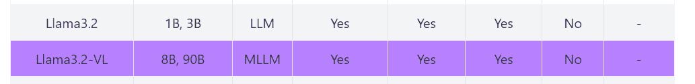
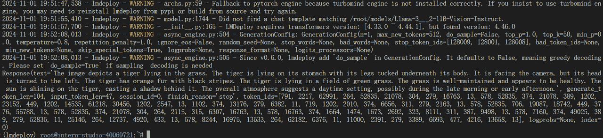

# LMDeploy V0.6.2

> 来源：[https://aicarrier.feishu.cn/docx/TSeRdiJEOo8GxUxOxImcsDNMnEb](https://aicarrier.feishu.cn/docx/TSeRdiJEOo8GxUxOxImcsDNMnEb)

# llama3.2-vision 本地部署

支持llama3.2-vision  -> Llama3.2-VL

## InternStudio开发机创建与环境搭建



> Fix ：Llama3.2-VL 应该是11B和 90B 这里官方文档上应该是写错了

考虑到最小的11B模型 每个参数用的是bfloat16 -> 2 Byte

**110×10^9 parameters×2 B**ytes/parameter=22GB

**因此，我们需要大于22GB的显存，考**虑到其他消耗显存的行为，这里在我们InternStudio平台上最好选择50%A100 * 1（40GB显存）

然后根据官网文档上的命令创建好环境

```
conda create -n lmdeploy python=3.10 -y
conda activate lmdeploy
pip install lmdeploy==0.6.2

conda install pytorch==2.1.2 torchvision==0.16.2 torchaudio==2.1.2 pytorch-cuda=12.1 -c pytorch -c nvidia -y
pip install timm==1.0.8 openai==1.40.3 lmdeploy[all]==0.5.3
```

##  获取Llama3.2-VL-11B模型

在HuggingFace，该模型需要申请才能使用

> You need to agree to share your contact information to access this model

> https://huggingface.co/meta-llama/Llama-3.2-11B-Vision-Instruct

因此这里我们在modelscope上获取模型

> https://www.modelscope.cn/models/LLM-Research/Llama-3.2-11B-Vision-Instruct

```
import requests
import torch
from PIL import Image
from transformers import MllamaForConditionalGeneration, AutoProcessor
from modelscope import snapshot_download
model_id = &quot;LLM-Research/Llama-3.2-11B-Vision-Instruct&quot;
model_dir = snapshot_download(model_id, ignore_file_pattern=[&#x27;*.pth&#x27;])

print(model_dir)
```

## InternStudio环境获取模型

为方便文件管理，我们需要一个存放模型的目录，统一放置在/root/models/目录。

运行以下命令，创建文件夹并设置开发机共享目录的软链接。

```
mkdir /root/models
# 传入你下载的模型地址 ，一般是在root/.cache/xxxx 里面
ln -s ${model_dir} /root/models
```

## LMDeploy验证启动模型文件

编写 `Llama3.2VL_test.py`

```
from lmdeploy import pipeline, ChatTemplateConfig, PytorchEngineConfig
from lmdeploy.vl import load_image

engine_config = PytorchEngineConfig(cache_max_entry_count=0.8)
pipe = pipeline(&#x27;/root/models/Llama-3___2-11B-Vision-Instruct&#x27;,
                chat_template_config=ChatTemplateConfig(model_name=&#x27;llama3_2&#x27;))
                
# 这里可以替换为自己的测试图片
image = load_image(&#x27;https://raw.githubusercontent.com/open-mmlab/mmdeploy/main/tests/data/tiger.jpeg&#x27;)

response = pipe((&#x27;If I had to write a haiku for this one, it would be: &#x27;, image))
print(response)
```

运行该文件即可得到模型输出如下



# LMDeploy与Llama3.2 version

> 理论上使用LMDeploy部署**Ll**ama3.2应该是可以的，但是在本次测试的internStudio开发机上，可能会报cuGraphInstantiateWithFlags(): Assertion `0' failed的问题

## 2.1 LMDeploy API部署Llama3.2 version

在上一章节，我们直接在本地部署**Llama3.2**。而在实际应用中，我们有时会将大模型封装为API接口服务，供客户端访问。

### **2.1.1 启动API服务器**

**首先让我们进入创**建好的conda环境，并通下命令启动API服务器，部署Llama3.2模型：

```
lmdeploy serve api_server \
    /root/models/Llama-3___2-11B-Vision-Instruct \
    --quant-policy 4 \
    --cache-max-entry-count 0.4 \
    --server-name 0.0.0.0 \
    --server-port 23333 \
    --backend pytorch \
    --tp 1
```

命令解释：

1.  lmdeploy serve api_server：这个命令用于启动API服务器。

1.  /root/models/Llama-3___2-3B-Instruct：这是模型的路径。

1.  --quant-policy 4：这个参数指定了量化策略。

1.  --server-name 0.0.0.0：这个参数指定了服务器的名称。在这里，0.0.0.0是一个特殊的IP地址，它表示所有网络接口。

1.  --server-port 23333：这个参数指定了服务器的端口号。在这里，23333是服务器将监听的端口号。

1.  --tp 1：这个参数表示并行数量（GPU数量）。