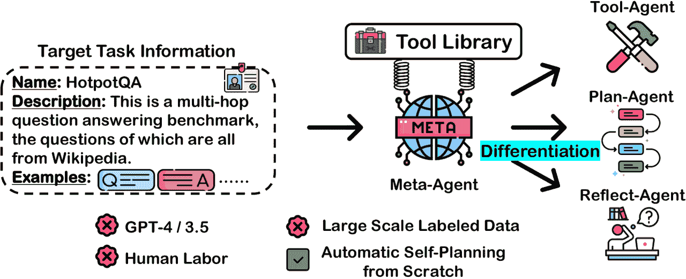
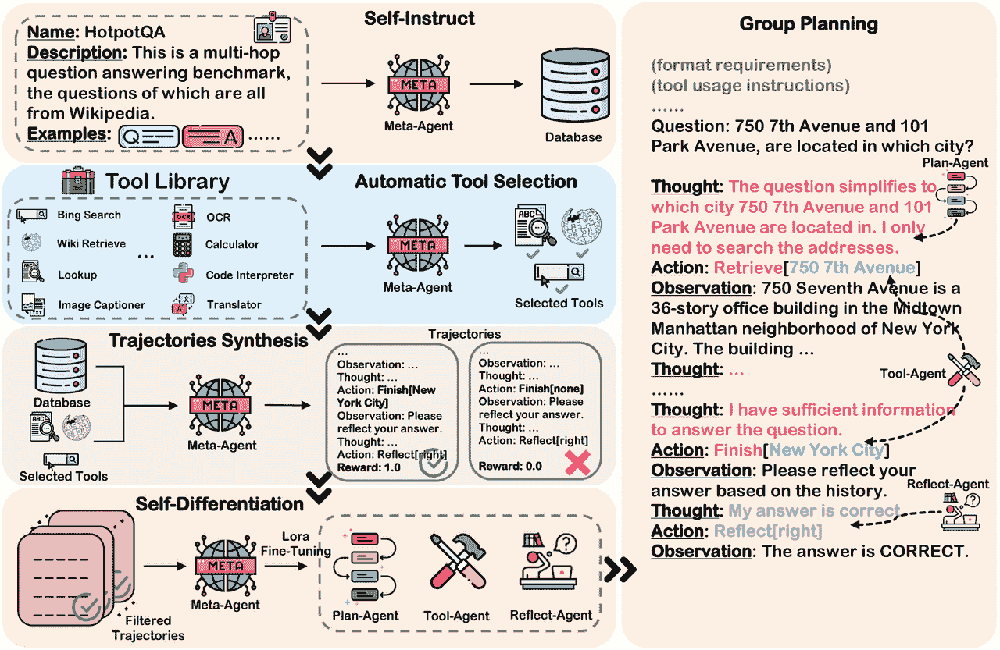
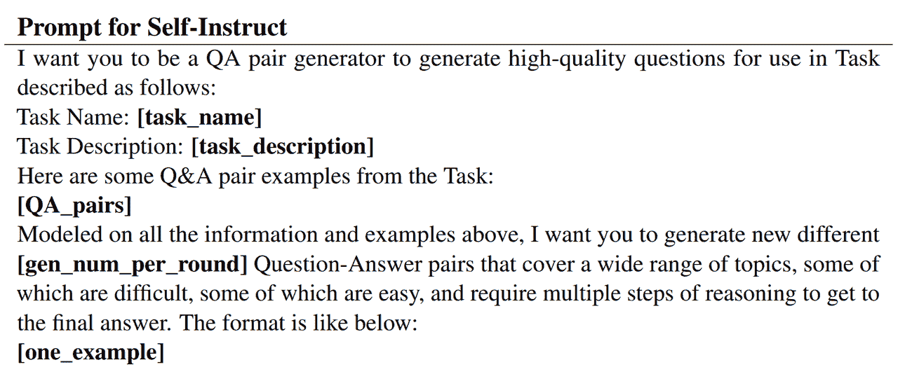
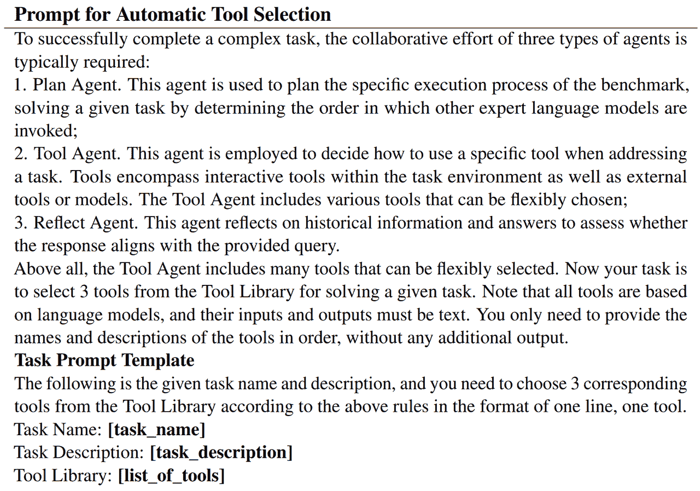
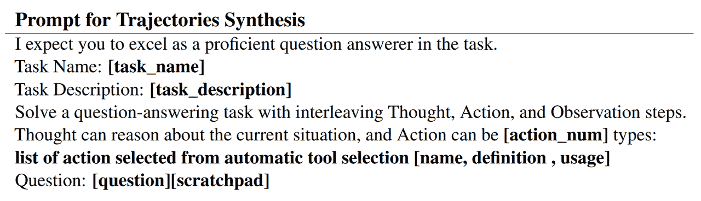
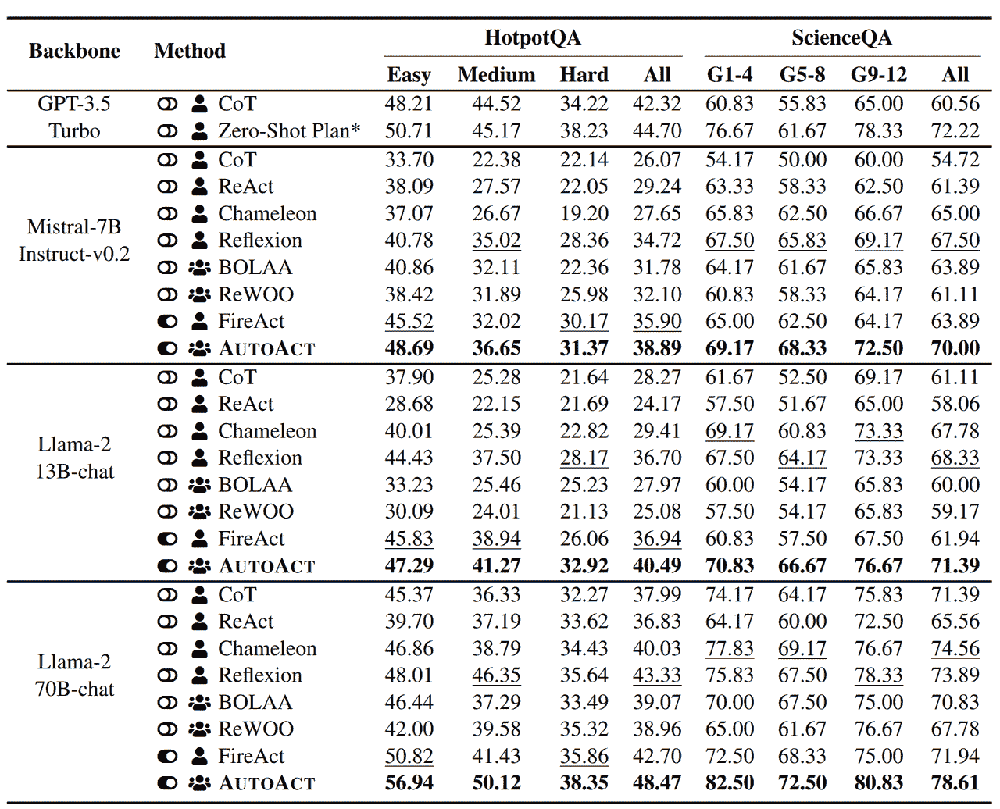

# ACL2024 Agent 相关论文圆桌

> 来源：[https://aicarrier.feishu.cn/docx/RgmGdAp37otgT7xbP0bcNSWPnEb](https://aicarrier.feishu.cn/docx/RgmGdAp37otgT7xbP0bcNSWPnEb)

# 回顾 ACL2024 Agent 相关论文

## 分类总结

+   网页 Agent（WebAgent）：1、15、17、24、39

+   多模态 Agent（Multimodal Agent）：1、15、18、29

+   Agent 评测：13、37、38

+   Agent 微调：23、30

+   多智能体（Multi Agent）：5、7、14、28、35、38

+   Agent 的应用：心理（3），软件开发（11、12），安全（19、33），代码生成（7、20），数据库（21）、医疗（22），地理（26）、科研作图（34）、具身智能（40）

+   Agent 框架：6、8、9、16、17、27

+   其他：2、4、10、25、31、32

| 分类 |  |
| --- | --- |
| 网页 Agent（WebAgent） | VisualWebArena: Evaluating Multimodal Agents on Realistic Visual Web Tasks |
| 多模态 Agent（Multimodal Agent） | VisualWebArena: Evaluating Multimodal Agents on Realistic Visual Web Tasks |
| Agent 评测 | Speaker Verification in Agent-generated Conversations |
| Agent 微调 | AgentTuning: Enabling Generalized Agent Abilities for LLMs |
| 多智能体（Multi Agent） | 1.  Exploring Collaboration Mechanisms for LLM Agents: A Social Psychology View |
| Agent 的应用 |  |
| Agent 框架 |  |
| 其他 | +   Tell Me More! Towards Implicit User Intention Understanding of Language Model Driven Agents |

+   链接：https://arxiv.org/abs/2401.13649

+   简介：VisualWebArena 是一个用于评估多模态网络智能体的基准，通过一系列复杂的基于视觉的任务，测试智能体处理图文输入、理解自然语言指令和在网站上执行动作的能力，以实现用户定义的目标。

+   链接：https://arxiv.org/abs/2401.13919

+   简介：WebVoyager 是一个创新的多模态大型模型驱动的网络智能体，能够通过与真实网站交互完成用户指令，并在我们建立的基准测试中取得了显著优于GPT-4和文本只版本的性能表现。

+   链接：https://arxiv.org/abs/2402.15057

+   简介：本文提出了一种新任务“对话式网页导航”，并构建了一个名为Multi-Turn Mind2Web的数据集，同时提出了一个名为“自我反思记忆增强规划（Self-MAP）”的框架，以有效地处理大型语言模型在对话任务中的上下文长度限制和依赖问题。实验结果验证了该方法的有效性。

+   链接：https://arxiv.org/abs/2309.11436

+   简介：本文介绍Auto-GUI，一种无需环境解析或应用依赖API的多模态解决方案，通过链式动作技术实现图形用户界面智能体的自主操作，在AITW基准测试中取得领先性能。

+   链接：https://github.com/boxworld18/OpenWebAgent

+   简介：OpenWebAgent 是一个开放的工具包，它支持基于模型的网络代理，通过在网页上自动执行任务来简化人机交互。我们提供插件和服务器源代码，用户可以轻松地将自己的模型添加到后台，从而获得可用的网页浏览代理。

+   链接：https://arxiv.org/abs/2401.13649

+   简介：VisualWebArena 是一个用于评估多模态网络智能体的基准，通过一系列复杂的基于视觉的任务，测试智能体处理图文输入、理解自然语言指令和在网站上执行动作的能力，以实现用户定义的目标。

+   链接：https://arxiv.org/abs/2401.10935

+   简介：我们提出了一种新的视觉 GUI 智能体 SeeClick，它仅通过截图实现任务自动化，并通过预训练和数据自动化处理解决了 GUI 定位的挑战，显著提升了性能，并在 ScreenSpot 等基准测试中表现出色。模型、数据和代码可在提供的网址获取

+   链接：https://arxiv.org/abs/2402.11941

+   简介：我们提出一个综合认知大语言模型智能体CoCo-Agent，通过全面的环境感知和条件动作预测两种方法，系统性地提升图形用户界面自动化性能。

+   链接：https://arxiv.org/abs/2405.10150

+   简介：本研究提出一个新的评价挑战：在智能体生成的对话中实现说话者验证，旨在验证两组话语是否源于同一说话者。我们收集了包含数千名说话者及其话语的大型数据集，并开发和评估了说话者验证模型。我们还利用这些模型评估了基于大型语言模型的角色扮演模型的个性化能力。实验表明，当前的角色扮演模型在准确模仿说话者方面存在不足，主要是因为其固有的语言特性。

+   链接：暂无链接

+   简介：暂无简介

+   链接：https://arxiv.org/abs/2406.05720

+   简介：本论文旨在评估复杂依赖下的多智能体系统，包括空间、因果和时间约束。我们构建了一个名为 VillagerBench 的新基准，在 Minecraft 环境中测试多智能体协作的各个方面。同时，我们提出了一个有向无环图多智能体框架 VillagerAgent，以解决复杂的智能体间依赖并提高协作效率。

+   链接：https://arxiv.org/abs/2310.12823

+   简介：本研究提出了一种名为 AgentTuning 的方法，旨在增强大型语言模型（LLM）作为智能体的能力，同时保持其一般能力。

+   链接：https://arxiv.org/abs/2403.12881

+   简介：文章提出Agent-FLAN方法，通过优化训练数据以提高大型语言模型作为智能体的性能，使其在各种评价数据集上相对于之前的最佳工作提升3.5%，同时减少幻觉问题并提升模型规模时的智能体能力。

+   链接：https://arxiv.org/abs/2310.02124

+   简介：本研究通过构建由具有不同特质的语言模型智能体组成的多智能体社会，探究了自然语言处理系统在复杂社会环境中的协作机制，发现某些协作策略不仅超越了现有顶尖方法，还提高了效率，同时这些语言模型智能体也展现了类似人类的社会行为，如从众和共识达成，这为进一步研究大型语言模型的协作机制提供了启示。

+   链接：https://arxiv.org/abs/2405.11403

+   简介：本文提出了一种新的代码生成方法 MapCoder，通过多智能体提示模拟人类开发者的程序合成全周期，在多个基准测试中取得了新的最先进结果。

+   链接：https://arxiv.org/abs/2402.18272

+   简介：本研究通过系统实验提出了一种新的群体讨论框架，发现单一智能体语言模型在强提示下几乎能与现有的最佳讨论方法在多种推理任务中表现相当，而多智能体讨论只在无示范提示时优于单一智能体。进一步研究揭示了语言模型在讨论中的常见互动机制。

+   链接：https://arxiv.org/abs/2312.00746

+   简介：本研究探索大型语言模型在《剧本杀》这一中国侦探角色扮演游戏中的应用，提出了首个针对该游戏的包含角色剧本和游戏规则的数据集，以促进复杂叙事环境下的智能体发展。此外，本工作还提出了一个独特的基于大型语言模型的多智能体交互框架，使智能体能自主参与游戏。

+   链接：https://arxiv.org/abs/2404.05569

+   简介：本文提出了一种名为360度可复用经验积累（360 REA）的层级多智能体框架，该框架受企业组织实践启发，采用360度性能评估方法进行多角度细粒度评估，并通过双级经验池帮助智能体积累经验，以提升解决复杂任务的能力，实验结果证明了其有效性。

+   链接：https://arxiv.org/abs/2406.05720

+   简介：本论文旨在评估复杂依赖下的多智能体系统，包括空间、因果和时间约束。我们构建了一个名为 VillagerBench 的新基准，在 Minecraft 环境中测试多智能体协作的各个方面。同时，我们提出了一个有向无环图多智能体框架 VillagerAgent，以解决复杂的智能体间依赖并提高协作效率。

+   链接：https://arxiv.org/abs/2402.09205

+   简介：提出了一个名为 Intention-in-Interaction（IN3）的新基准，旨在通过明确查询来检查用户的隐含意图。我们建议将模型专家纳入代理设计的上游，以增强用户代理互动。

+   链接：https://arxiv.org/abs/2407.01093

+   简介：本文提出 IBSEN，一个导演-演员协调智能体框架，用于生成戏剧脚本并控制剧情发展，以实现更可控的剧情演绎。该框架能根据粗略的剧情目标生成完整多样的戏剧脚本，同时保持角色特性。

+   链接：https://arxiv.org/abs/2402.13212

+   简介：本文提出了一种改进大型语言模型生成结果的方法——Soft Self-Consistency (SOFT-SC)，它通过使用连续的评分标准替代传统的离散评分，即使在动作分布稀疏的情况下也能进行有效选择，从而在保持效率的同时提升了性能。在多个交互式任务中，SOFT-SC 与传统方法相比表现出了显著的成效提升。

+   链接：https://arxiv.org/abs/2402.16333

+   简介：本文提出了一种名为HiSim的混合框架，用于社交媒体用户模拟，通过大型语言模型和演绎智能体模型对核心用户和普通用户进行分类。在构建的Twitter-like环境中，框架可以模拟用户对触发事件的响应动态。实验结果显示，该方法有效且灵活。

## 具体介绍

1.  VisualWebArena: Evaluating Multimodal Agents on Realistic Visual Web Tasks

+   链接：https://arxiv.org/abs/2401.13649

+   简介：VisualWebArena 是一个用于评估多模态网络智能体的基准，通过一系列复杂的基于视觉的任务，测试智能体处理图文输入、理解自然语言指令和在网站上执行动作的能力，以实现用户定义的目标。

1.  Tell Me More! Towards Implicit User Intention Understanding of Language Model Driven Agents

+   链接：https://arxiv.org/abs/2402.09205

+   简介：提出了一个名为 Intention-in-Interaction（IN3）的新基准，旨在通过明确查询来检查用户的隐含意图。我们建议将模型专家纳入代理设计的上游，以增强用户代理互动。

1.  PsychoGAT: A Novel Psychological Measurement Paradigm through Interactive Fiction Games with LLM Agents

+   链接：https://arxiv.org/abs/2402.12326（预印版）

+   简介：本研究提出 PsychoGAT（心理游戏智能体），利用大型语言模型作为心理学家和游戏设计师的双重角色，将标准化心理量表转化为个性化且引人入胜的互动小说游戏，并通过心理测量评估和人类评估验证了其有效性，包括可靠性、聚合效度、区分效度和用户体验的提升。

1.  IBSEN: Director-Actor Agent Collaboration for Controllable and Interactive Drama Script Generation

+   链接：https://arxiv.org/abs/2407.01093

+   简介：本文提出 IBSEN，一个导演-演员协调智能体框架，用于生成戏剧脚本并控制剧情发展，以实现更可控的剧情演绎。该框架能根据粗略的剧情目标生成完整多样的戏剧脚本，同时保持角色特性。

1.  Exploring Collaboration Mechanisms for LLM Agents: A Social Psychology View

+   链接：https://arxiv.org/abs/2310.02124

+   简介：本研究通过构建由具有不同特质的语言模型智能体组成的多智能体社会，探究了自然语言处理系统在复杂社会环境中的协作机制，发现某些协作策略不仅超越了现有顶尖方法，还提高了效率，同时这些语言模型智能体也展现了类似人类的社会行为，如从众和共识达成，这为进一步研究大型语言模型的协作机制提供了启示。

1.  AutoAct: Automatic Agent Learning from Scratch for QA via Self-Planning

+   链接：https://arxiv.org/abs/2401.05268

+   简介：AutoAct是一个无需大量标注数据和闭源模型合成规划轨迹的自动问答智能体学习框架，通过分工策略生成子智能体组完成目标任务，实验结果显示其性能优于或等同于多种强基准模型。

1.  MapCoder: Multi-Agent Code Generation for Competitive Problem Solving

+   链接：https://arxiv.org/abs/2405.11403

+   简介：本文提出了一种新的代码生成方法 MapCoder，通过多智能体提示模拟人类开发者的程序合成全周期，在多个基准测试中取得了新的最先进结果。

1.  QueryAgent: A Reliable and Efficient Reasoning Framework with Environmental Feedback based Self-Correction

+   链接：https://arxiv.org/abs/2403.11886

+   简介：本论文提出名为 QueryAgent 的框架，通过分步解决和基于环境反馈的步骤自校正方法 ERASER，有效提升了大型语言模型进行语义解析的可靠性和效率，显著超越了先前的方法。

1.  Agent-Pro: Learning to Evolve via Policy-Level Reflection and Optimization

+   链接：https://arxiv.org/abs/2402.17574

+   简介：Agent-Pro 是一种基于大型语言模型的智能体，它通过策略层面的反思和优化，从互动经验中学习并提升行为策略，从而在复杂动态场景中表现出色，如在 Blackjack 和 Texas Hold'em 游戏中超越了普通 LLM 和专用模型。

1.  Soft Self-Consistency Improves Language Models Agents

+   链接：https://arxiv.org/abs/2402.13212

+   简介：本文提出了一种改进大型语言模型生成结果的方法——Soft Self-Consistency (SOFT-SC)，它通过使用连续的评分标准替代传统的离散评分，即使在动作分布稀疏的情况下也能进行有效选择，从而在保持效率的同时提升了性能。在多个交互式任务中，SOFT-SC 与传统方法相比表现出了显著的成效提升。

1.  ChatDev: Communicative Agents for Software Development

+   链接：https://arxiv.org/abs/2307.07924

+   简介：本文提出 ChatDev，一个由大型语言模型驱动的智能体通过聊天链和通信去幻化协作完成设计、编码与测试的软件开发框架，展示语言如何成为多智能体自主任务解决中的统一桥梁。

1.  Experiential Co-Learning of Software-Developing Agents

+   链接：https://arxiv.org/abs/2312.17025

+   简介：大型语言模型驱动的智能体在软件开发中展现高效协作和质量保证，但缺乏经验利用导致重复错误和低效尝试；我们引入经验协同学习框架，使智能体能从历史轨迹中获取经验，提升处理未见软件任务的能力。

1.  Speaker Verification in Agent-generated Conversations

+   链接：https://arxiv.org/abs/2405.10150

+   简介：本研究提出一个新的评价挑战：在智能体生成的对话中实现说话者验证，旨在验证两组话语是否源于同一说话者。我们收集了包含数千名说话者及其话语的大型数据集，并开发和评估了说话者验证模型。我们还利用这些模型评估了基于大型语言模型的角色扮演模型的个性化能力。实验表明，当前的角色扮演模型在准确模仿说话者方面存在不足，主要是因为其固有的语言特性。

1.  Rethinking the Bounds of LLM Reasoning: Are Multi-Agent Discussions the Key?

+   链接：https://arxiv.org/abs/2402.18272

+   简介：本研究通过系统实验提出了一种新的群体讨论框架，发现单一智能体语言模型在强提示下几乎能与现有的最佳讨论方法在多种推理任务中表现相当，而多智能体讨论只在无示范提示时优于单一智能体。进一步研究揭示了语言模型在讨论中的常见互动机制。

1.  WebVoyager: Building an End-to-End Web Agent with Large Multimodal Models

+   链接：https://arxiv.org/abs/2401.13919

+   简介：WebVoyager 是一个创新的多模态大型模型驱动的网络智能体，能够通过与真实网站交互完成用户指令，并在我们建立的基准测试中取得了显著优于GPT-4和文本只版本的性能表现。

1.  Trial and Error: Exploration-Based Trajectory Optimization of LLM Agents

+   链接：https://arxiv.org/abs/2403.02502

+   简介：本研究提出了一种探索式轨迹优化方法（ETO），以提升大型语言模型智能体的性能。该方法允许智能体从探索失败中学习，通过迭代优化框架提高性能，并在复杂任务中显著优于基线表现。

1.  On the Multi-turn Instruction Following for Conversational Web Agents

+   链接：https://arxiv.org/abs/2402.15057

+   简介：本文提出了一种新任务“对话式网页导航”，并构建了一个名为Multi-Turn Mind2Web的数据集，同时提出了一个名为“自我反思记忆增强规划（Self-MAP）”的框架，以有效地处理大型语言模型在对话任务中的上下文长度限制和依赖问题。实验结果验证了该方法的有效性。

1.  SeeClick: Harnessing GUI Grounding for Advanced Visual GUI Agents

+   链接：https://arxiv.org/abs/2401.10935

+   简介：我们提出了一种新的视觉 GUI 智能体 SeeClick，它仅通过截图实现任务自动化，并通过预训练和数据自动化处理解决了 GUI 定位的挑战，显著提升了性能，并在 ScreenSpot 等基准测试中表现出色。模型、数据和代码可在提供的网址获取

1.  BadAgent: Inserting and Activating Backdoor Attacks in LLM Agents

+   链接：https://arxiv.org/abs/2406.03007

+   简介：提出了针对 LLM Agent 的后门攻击（BadAgent）。通过对后门数据进行微调，可以嵌入后门。在测试时，攻击者可以通过在代理输入或环境中显示触发器，操纵已部署的 LLM 代理执行有害操作。

1.  CodeAgent: Enhancing Code Generation with Tool-Integrated Agent Systems for Real-World Repo-level Coding Challenges

+   链接：https://arxiv.org/abs/2401.07339

+   简介：我们的研究提出了一种名为 CodeAgent 的新型大型语言模型（LLM）框架，旨在解决在真实代码库级别生成代码的挑战。CodeAgent将五个编程工具集成到一个框架中，以便进行信息检索、代码符号导航和代码测试，并通过四种代理策略优化这些工具的使用。

1.  Text2DB: Integration-Aware Information Extraction with Large Language Model Agents

+   链接：https://blender.cs.illinois.edu/paper/text2db2024.pdf

+   简介：提出了一种新的 IE TEXT2DB 方法，强调 IE 输出与目标数据库（或知识库）的整合。为了评估这一新任务，我们引入了一个新的基准，以数据填充、行填充和列添加等常见需求为特色。此外，我们还提出了一个 LLM 代理框架 OPAL（Observe-PlanAnalyze LLM），其中包括与数据库交互的观察者组件、通过调用 IE 模型生成基于代码的计划的规划器组件以及在执行前提供代码质量反馈的分析器组件。

1.  MedAgents: Large Language Models as Collaborators for Zero-shot Medical Reasoning

+   链接：https://arxiv.org/abs/2311.10537

+   简介：MedAgents 是一个多学科合作框架，通过角色扮演设置中的大型语言模型智能体进行多轮协作讨论，以增强其在医学领域的专长和推理能力，实验结果显示其在多个医学数据集上表现出色。

1.  AgentTuning: Enabling Generalized Agent Abilities for LLMs

+   链接：https://arxiv.org/abs/2310.12823

+   简介：本研究提出了一种名为 AgentTuning 的方法，旨在增强大型语言模型（LLM）作为智能体的能力，同时保持其一般能力。

1.  You Only Look at Screens: Multimodal Chain-of-Action Agents

+   链接：https://arxiv.org/abs/2309.11436

+   简介：本文介绍Auto-GUI，一种无需环境解析或应用依赖API的多模态解决方案，通过链式动作技术实现图形用户界面智能体的自主操作，在AITW基准测试中取得领先性能。

1.  Unveiling the Truth and Facilitating Change: Towards Agent-based Large-scale Social Movement Simulation

+   链接：https://arxiv.org/abs/2402.16333

+   简介：本文提出了一种名为HiSim的混合框架，用于社交媒体用户模拟，通过大型语言模型和演绎智能体模型对核心用户和普通用户进行分类。在构建的Twitter-like环境中，框架可以模拟用户对触发事件的响应动态。实验结果显示，该方法有效且灵活。

1.  GeoAgent: To Empower LLMs using Geospatial Tools for Address Standardization

+   链接：https://openreview.net/pdf?id=6DiulKVxhY

+   简介：我们提出了 GeoAgent，这是一个新的框架，包含两个主要部分：一个大型语言模型（LLM）和一套地理工具。 通过利用 LLM 的语义理解能力和整合特定的地理空间工具，GeoAgent 将空间知识融入地址文本，实现了高效的地址标准化。

1.  ODA: Observation-Driven Agent for integrating LLMs and Knowledge Graphs

+   链接：https://arxiv.org/abs/2404.07677

+   简介：我们提出了一种名为观察驱动智能体（Observation-Driven Agent，简称 ODA）的新型人工智能框架，专门用于涉及知识图谱的任务。ODA 通过全局观察来整合知识图谱的推理能力，通过观察、行动和反思的循环范式增强推理能力。

1.  Deciphering Digital Detectives: Understanding LLM Behaviors and Capabilities in Multi-Agent Mystery Games

+   链接：https://arxiv.org/abs/2312.00746

+   简介：本研究探索大型语言模型在《剧本杀》这一中国侦探角色扮演游戏中的应用，提出了首个针对该游戏的包含角色剧本和游戏规则的数据集，以促进复杂叙事环境下的智能体发展。此外，本工作还提出了一个独特的基于大型语言模型的多智能体交互框架，使智能体能自主参与游戏。

1.  CoCo-Agent: A Comprehensive Cognitive MLLM Agent for Smartphone GUI Automation

+   链接：https://arxiv.org/abs/2402.11941

+   简介：我们提出一个综合认知大语言模型智能体CoCo-Agent，通过全面的环境感知和条件动作预测两种方法，系统性地提升图形用户界面自动化性能。

1.  Agent-FLAN: Designing Data and Methods of Effective Agent Tuning for Large Language Models

+   链接：https://arxiv.org/abs/2403.12881

+   简介：文章提出Agent-FLAN方法，通过优化训练数据以提高大型语言模型作为智能体的性能，使其在各种评价数据集上相对于之前的最佳工作提升3.5%，同时减少幻觉问题并提升模型规模时的智能体能力。

1.  Bootstrapping LLM-based Task-Oriented Dialogue Agents via Self-Talk

+   链接：https://arxiv.org/abs/2401.05033

+   简介：本文提出利用大型语言模型的自对话（"self-talk"）来有效收集训练数据，并通过测量对话成功度的方法筛选优化数据，从而实现对模型的指令微调，提升对话质量。

1.  Boosting LLM Agents with Recursive Contemplation for Effective Deception Handling

+   链接：https://openreview.net/pdf?id=LO-NO1-PwJR

+   简介：为了提高 LLMs 识别和抵制欺骗性内容的能力，本文受人类递归思维和透视法的启发，引入了一个新颖的认知框架--递归沉思。

1.  InjecAgent: Benchmarking Indirect Prompt Injections in Tool-Integrated Large Language Model Agents

+   链接：https://arxiv.org/abs/2403.02691

+   简介：本研究提出 InjecAgent，一个用于评估工具集成大型语言模型智能体对间接提示注入攻击（IPI）的脆弱性的基准。通过测试30个不同的智能体，发现它们普遍易受IPI攻击，甚至强化攻击设置几乎使攻击成功率翻倍，引发对广泛部署此类智能体的担忧。

1.  MatPlotAgent: Method and Evaluation for LLM-Based Agentic Scientific Data Visualization

+   链接：https://arxiv.org/abs/2402.11453

+   简介：MatPlotAgent 是一个高效的模型无关大型语言模型智能体框架，旨在自动化科学数据可视化任务，并引入MatPlotBench作为基准，以及使用GPT-4V的评分方法进行自动评估。

1.  360^\circREA: Towards A Reusable Experience Accumulation with 360^\circ Assessment for Multi-Agent System

+   链接：https://arxiv.org/abs/2404.05569

+   简介：本文提出了一种名为360度可复用经验积累（360 REA）的层级多智能体框架，该框架受企业组织实践启发，采用360度性能评估方法进行多角度细粒度评估，并通过双级经验池帮助智能体积累经验，以提升解决复杂任务的能力，实验结果证明了其有效性。

1.  RaDA: Retrieval-augmented Web Agent Planning with LLMs

+   链接：暂无链接

+   简介：暂无简介

1.  CToolEval: A Chinese Benchmark for LLM-Powered Agent Evaluation in Real-World API Interactions

+   链接：暂无链接

+   简介：暂无简介

1.  VillagerAgent: A Graph-Based Multi-Agent Framework for Coordinating Complex Task Dependencies in Minecraft

+   链接：https://arxiv.org/abs/2406.05720

+   简介：本论文旨在评估复杂依赖下的多智能体系统，包括空间、因果和时间约束。我们构建了一个名为 VillagerBench 的新基准，在 Minecraft 环境中测试多智能体协作的各个方面。同时，我们提出了一个有向无环图多智能体框架 VillagerAgent，以解决复杂的智能体间依赖并提高协作效率。

1.  OpenWebAgent: An Open Toolkit to Enable Web Agents on Large Language Models

+   链接：https://github.com/boxworld18/OpenWebAgent

+   简介：OpenWebAgent 是一个开放的工具包，它支持基于模型的网络代理，通过在网页上自动执行任务来简化人机交互。我们提供插件和服务器源代码，用户可以轻松地将自己的模型添加到后台，从而获得可用的网页浏览代理。

1.  LEGENT: An Open Platform for Embodied Agent

+   链接：https://arxiv.org/abs/2404.18243

+   简介：LEGENT是一个开放的、可扩展的平台，用于使用大型语言模型和大型多模态模型开发语言接地、类人具身智能体，提供丰富的交互式3D环境和用户友好的界面，以及高级算法的数据生成管道，实验中一个在LEGENT数据上训练的初级视觉-语言-动作模型在具身任务中超越了GPT-4V，展示了有前途的泛化能力。

# 论文分享

## AutoAct: Automatic Agent Learning from Scratch for QA via Self-Planning

### 方法介绍

#### 基本组成

AutoAct 由 meta-agent、target task information、tool library 三部分组成：

+   meta-agent：分化前的主干 agent

+   target task information：目标任务信息，主要包含任务名称  、任务描述   和任务数据示例

+   tool library：工具库，表示为  ，即工具名称、工具功能、详细说明

#### 主要方法

##### 数据扩充

> 为了获取足够的任务数据并提供充足的训练资源，有必要根据现有示例对数据进行扩充。我们通过自我指导完成这一过程。最初，数据库 𝒟 设置为等于任务数据示例 𝒞 ， 𝒞 作为数据生成的种子。在每一轮中，元代理通过少量提示生成新的问题-答案对，这些少量提示示例随机从 𝒟 中抽取。生成的数据将被添加到 𝒟 中，然后进行过滤，排除格式错误和重复数据。最终，我们获得一个数据库 𝒟={qi,ai}i=1|𝒟| ，其中的数据数量 |𝒟| 满足 |𝒟|≫|𝒞| 。我们用于自我指导的提示可以在附录 G.1 中看到，我们列出了通过自我指导生成的一些案例在附录 H 中。

##### 自动工具选择

> 利用工具库，我们要求元代理自动选择适用于每个任务的适用工具。具体来说，我们将 𝒯={mi,di,ui}i=1|𝒯| 以工具列表的形式作为提示的一部分。与 𝒯 一起，提示还包括任务的描述 𝒞 。最后，我们指示元代理选择一组合适的工具 𝒯s （ 𝒯s⊂𝒯 ）等待合成轨迹。用于自动选择工具的提示可以在附录 G.2 中看到。

##### 轨迹合成

> 不依赖于封闭源模型，我们使 Meta-Agent 能够自行合成规划轨迹。借助 𝒯s ，我们指导 Meta-Agent 以零样本方式在遵循姚等人（2023）定义的 Thought-Action-Observation 格式的数据库 𝒟 上合成轨迹。为了获得高质量的合成轨迹，我们筛选掉所有带有 reward<1 的轨迹，并收集带有完全正确答案（ reward=1 ）的轨迹作为自我微分的训练来源。轨迹合成的提示可以在附录 G.3 中看到。

##### 自我分化

由 meta-agent 使用不同的数据训练分化得到。

##### 团队规划

> 推理阶段，一旦由计划代理生成的工具名称 αtm 在时间 t 触发，执行代理被唤醒以决定传递给特定工具的参数 αtp 。工具的返回结果被视为观察 ot 并传递给计划代理。在计划代理和执行代理的合作达到预测后，反思代理开始回顾历史并提供包含在反思动作 αr 中的反思结果。如果反思结果表明预测是正确的，整个规划过程结束。否则，计划代理和执行代理将根据反思信息继续规划。特定的分组规划过程序列可以在图 2 右侧的例子中找到。

### 评测结果

