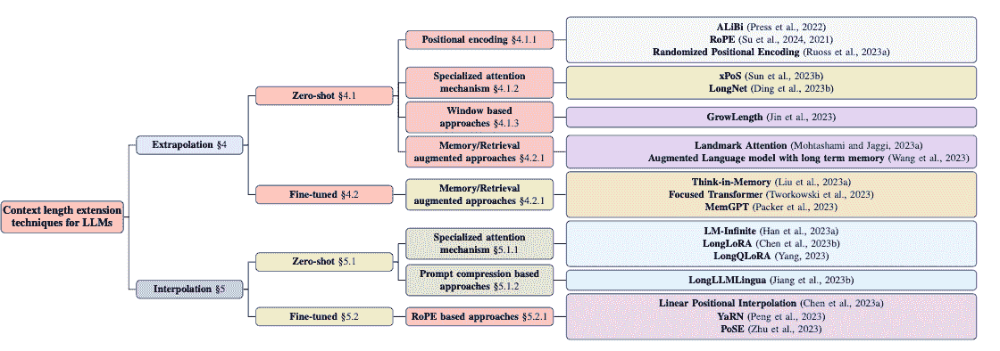
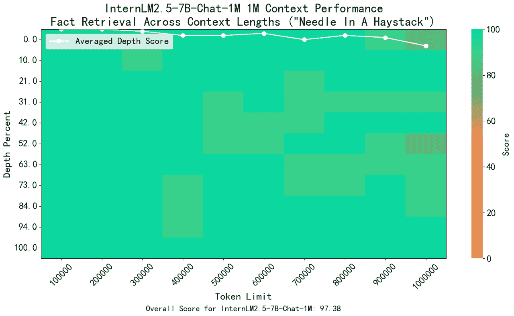

# 长上下文 SIG

> 来源：[https://aicarrier.feishu.cn/docx/NwkcdQNohoe983xseM2cPWObncc](https://aicarrier.feishu.cn/docx/NwkcdQNohoe983xseM2cPWObncc)

# 书生·浦语长上下文兴趣小组

## 大模型长文本简介

基于Transformer的大型语言模型（LLMs）在知识库、人机界面和agent等多个领域获得了广泛应用，推动了人工智能（AGI）的发展。然而，目前的LLMs主要在短文本片段（如512，2048，4096等长度）上进行预训练，这限制了它们在实际应用中处理长文本上下文的能力。随着在线长文档规模的增加，自动理解长文本成为关键问题。

由于传统transformer结构在注意力机制的计算复杂度方面落后，即   ，该问题导致在成本有限的情况下模型无法有效处理长序列。学术界对长文本技术的研究在零样本及微调等阶段均有所突破，这些技术不仅限于现有方法，还在不断探索新的架构和技术，以进一步提升模型在长文本处理中的表现。

最近internlm2.5也在大海捞针（NeedleInAHaystack)测试中达到一百万序列长度准确回复的性能。

除了长文本的传统应用场景如法律文件审查、医疗记录分析、财务报告分析、合同管理等等之外，最近也有一些关于长文本与多模态等相结合的研究工作。欢迎大家在训练和微调基础模型及下游任务上积极探索，共同推动长文本技术的发展。

**时间周期：**2024 年 8 月—— 11月

**小组长：法律人**

**长上下文兴趣小组讨论区：**https://github.com/InternLM/Tutorial/discussions/1336

**想要加入 长上下文 SIG 的同学欢迎🛰️联系浦语小助手（🛰️搜索 InternLM）**或者小组长法律人（🛰️搜索 Valeria_Wong），也可扫描以下二维码进群。

## 兴趣小组日常学习

### 2.1 学习资料分享

在学习群里会经常分享关于长上下文技术的各种学习资料，包括但不限于技术报告、学术论文、解读文章、开源工具等。

### 2.2 圆桌会议

兴趣小组会不定期举行圆桌会议，会有论文、项目等分享与想法交流，也欢迎大家踊跃参与分享～ 一起搭建训练长文本大模型。

| 会议 | 时间 | 腾讯会议号 | 会议记录 |
| --- | --- | --- | --- |
| 第一次圆桌 |  |  |  |

### 2.3 小组任务

+   参与大模型文本长度外推相关的学习

+   基于 InternLM 相关模型构建长文本继续预训练项目

+   进行大海捞针等长文本性能测评

+   复现长文本相关论文方法

+   长文本技术原理学习

## 组员福利

+   活跃的学习氛围

+   优秀组员精美证书

+   上海 AI 实验室内推机会

+   充足的算力支持

+   上海 AI 实验实验室研究员项目指导

## 学习资料

internlm2_5-7b-chat-1m  https://huggingface.co/internlm/internlm2_5-7b-chat-1m

Needle-Bench https://github.com/open-compass/opencompass

[L-Eval](https://github.com/OpenLMLab/LEval)  https://arxiv.org/abs/2307.11088  https://github.com/OpenLMLab/LEval

LLMTest_NeedleInAHaystack  https://github.com/gkamradt/LLMTest_NeedleInAHaystack

Awesome-LLM-Long-Context-Modeling https://github.com/Xnhyacinth/Awesome-LLM-Long-Context-Modeling

Data Engineering for Scaling Language Models to 128K Context  https://github.com/FranxYao/Long-Context-Data-Engineering

## 参考论文及知名博客

| Name | Link |
| --- | --- |
| Transformer 升级之路：16、“复盘”长度外推技术 | https://spaces.ac.cn/archives/9948 |
| YaRN: Efficient Context Window Extension of Large Language Models | https://arxiv.org/pdf/2309.00071.pdf |
| RoFormer: Enhanced Transformer with Rotary Position Embedding | https://arxiv.org/pdf/2104.09864 |
| Data Engineering for Scaling Language Models to 128K Context | https://arxiv.org/pdf/2402.10171 |
| InternLM2 Technical Report | https://arxiv.org/abs/2403.17297 |
| 百万级上下文窗口中英双语测试框架——NeedleBench | http://arxiv.org/abs/2407.11963 |