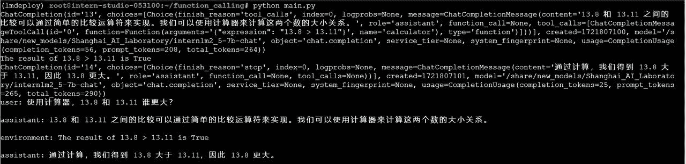

# Llama 3.1 原生 Function Calling 深度体验（LMDeploy 版）

> 来源：[https://aicarrier.feishu.cn/docx/BFT5d32ugolJ0Sx7TaAcqaXlnDc](https://aicarrier.feishu.cn/docx/BFT5d32ugolJ0Sx7TaAcqaXlnDc)

Meta 发布了 Llama 3.1 第一次支持了原生 Function Calling 功能，本文将带大家使用 LMDeploy 深度体验 Llama 3.1 的 Function Calling 功能。

# InternLM2.5 Function Calling



```
from openai import OpenAI
import math

import addict
from func_timeout import func_timeout

def _safe_eval(expr):
    math_methods = {k: v for k, v in math.__dict__.items()
                    if not k.startswith(&#x27;_&#x27;)}
    allowed_methods = {
        &#x27;math&#x27;: addict.Addict(math_methods),
        &#x27;max&#x27;: max,
        &#x27;min&#x27;: min,
        &#x27;round&#x27;: round,
        &#x27;sum&#x27;: sum,
        **math_methods,
    }
    allowed_methods[&#x27;__builtins__&#x27;] = None
    return eval(expr, allowed_methods, allowed_methods)

def calculator(expression: str):
    res = func_timeout(timeout=5, func=_safe_eval, args=[expression])
    return f&#x27;The result of {expression} is {res}&#x27;

tools = [
    {
        &quot;type&quot;: &quot;function&quot;,
        &quot;function&quot;: {
            &quot;name&quot;: &quot;calculator&quot;,
            &quot;description&quot;: (&#x27;A calculator tool. The input must be a single Python &#x27;
                            &#x27;expression and you cannot import packages. You can use functions &#x27;
                            &#x27;in the `math` package without import.&#x27;),
            &quot;parameters&quot;: {
                &quot;type&quot;: &quot;object&quot;,
                &quot;properties&quot;: {
                    &quot;expression&quot;: {
                        &quot;type&quot;: &quot;string&quot;,
                        &quot;description&quot;: &quot;The expression for calculator&quot;,
                    },
                },
                &quot;required&quot;: [&quot;expression&quot;],
            },
        }
    }
]

client = OpenAI(api_key=&#x27;YOUR_API_KEY&#x27;, base_url=&#x27;http://0.0.0.0:23333/v1&#x27;)

model_name = client.models.list().data[0].id

messages = [{&#x27;role&#x27;: &#x27;user&#x27;, &#x27;content&#x27;: &#x27;使用计算器，13.8 和 13.11 谁更大？&#x27;}]

response = client.chat.completions.create(
    model=model_name,
    messages=messages,
    temperature=0.8,
    top_p=0.8,
    stream=False,
    tools=tools)

print(response)
func1_name = response.choices[0].message.tool_calls[0].function.name
func1_args = response.choices[0].message.tool_calls[0].function.arguments
func1_out = eval(f&#x27;{func1_name}(**{func1_args})&#x27;)
print(func1_out)

messages.append(
    {&#x27;role&#x27;: &#x27;assistant&#x27;, &#x27;content&#x27;: response.choices[0].message.content})
messages.append(
    {&#x27;role&#x27;: &#x27;environment&#x27;, &#x27;content&#x27;: func1_out, &#x27;name&#x27;: &#x27;plugin&#x27;})

response = client.chat.completions.create(
    model=model_name,
    messages=messages,
    temperature=0.8,
    top_p=0.8,
    stream=False,
    tools=tools)
print(response)

messages.append(
    {&#x27;role&#x27;: &#x27;assistant&#x27;, &#x27;content&#x27;: response.choices[0].message.content})

for message in messages:
    print(f&#x27;{message[&quot;role&quot;]}: {message[&quot;content&quot;]}\n&#x27;)

```