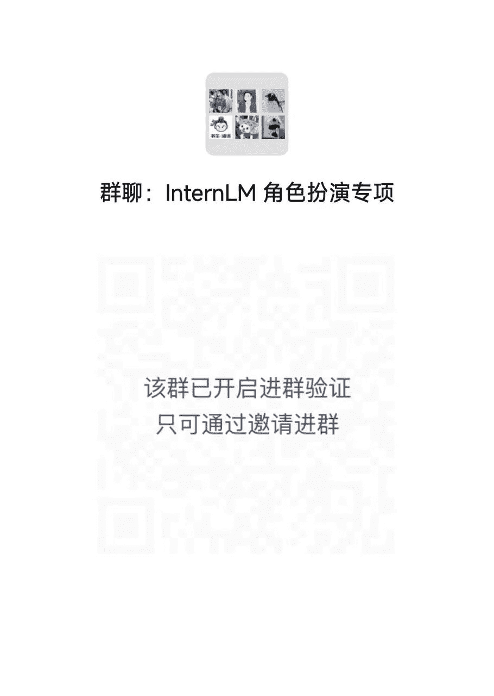
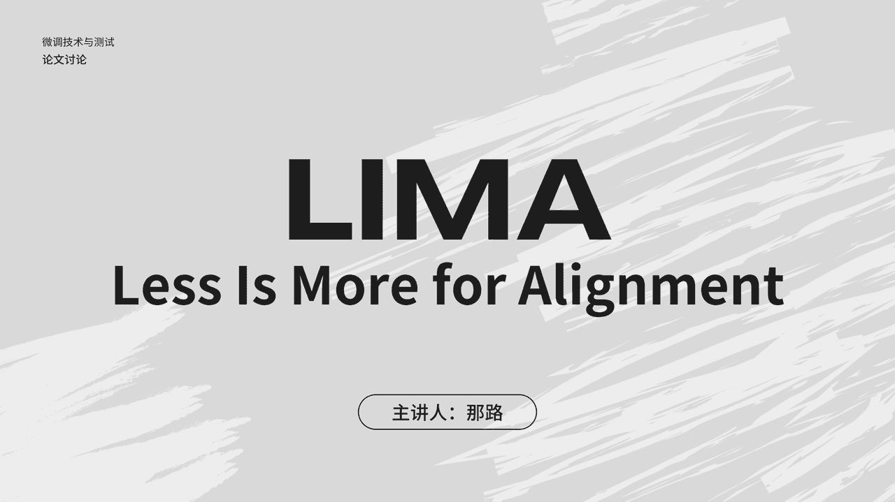

# RolePlay SIG

> 来源：[https://aicarrier.feishu.cn/docx/LPkDd9BGWo7ARCxpTs6c0bOTn6J](https://aicarrier.feishu.cn/docx/LPkDd9BGWo7ARCxpTs6c0bOTn6J)

# 书生·浦语角色扮演兴趣小组

## 简介（是什么？）

InternLM RolePlay SIG 是书生·浦语大模型社区自发组织的角色扮演类的兴趣小组，汇聚社区力量探索大模型角色扮演的边界，制作角色扮演开源数据集同时使用 XTuner+InternLM2 微调角色。

**时间周期：**2024 年 2 月——6 月

**小组长：那路**

**角色扮演兴趣小组讨论区：****h**ttps://github.com/InternLM/tutorial/discussions/categories/roleplay

**备注：**加入角色扮演兴趣小组欢迎🛰️联系浦语小助手（🛰️搜索InternLM）或者小组长那路（🛰️搜索SaaRaaS_1300）

## 在兴趣小组可以做什么？

在InternLM 角色扮演兴趣小组一起读paper、参与圆桌会议、训练经典IP角色大模型等活动。

### 共读论文

| 论文名称 | 链接 | 简介 | 资源 |
| --- | --- | --- | --- |
| LIMA: Less Is More for Alignment | https://arxiv.org/abs/2305.11206 | How to train language models with characters？ |  |

[LIMA分享(PPT补档) - 那路.pdf](https://internal-api-drive-stream.feishu.cn/space/api/box/stream/download/all/GsUPbOzEYo5shjxm7XIcZVhjnxd)

### 圆桌会议时间

### 角色扮演项目

欢迎小伙伴们制作自己的角色扮演数据集，并使用 XTuner+InternLM 训练角色

小伙伴们可以在进入[角色扮演 List](https://aicarrier.feishu.cn/sheets/LG76suaYAhde1GtDsTwcIIyannd) 表中登记

### 兴趣小组主线任务

1.  通过结组或个人的方式，自主训练一个角色模型，包括但不限于电影、小说、动漫的人物等等。（或具有一定功能性的应用角色均可）

1.  将角色模型的训练过程以笔记的方式进行记录（与开源训练营模式相似）

1.  将角色训练的成果进行分享，可以选择圆桌、视频或其他媒体渠道。如果想直接通过文章分享的方式，则需要提供链接哦。我们需要保证分享的基本质量哇！

飞书登记文档：[RolePlay 兴趣小组成员登记](https://aicarrier.feishu.cn/sheets/YZDDsRGa0hUzbAtszmXcOmdQnpg)

### [角色扮演兴趣小组圆桌会议安排](https://uxxwdwutlxz.feishu.cn/base/USk4b2phuatOKWsPhj1cQRrenUc?from=from_copylink) >> 请希望参加圆桌会议的盆友通过那路或小助手申请

## 组员福利

+   活跃的学习氛围

+   优秀组员精美证书

+   上海AI实验室内推机会

+   充足的算力支持

+   上海AI实验实验室研究员项目指导