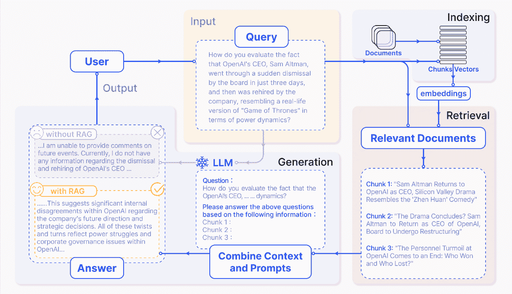
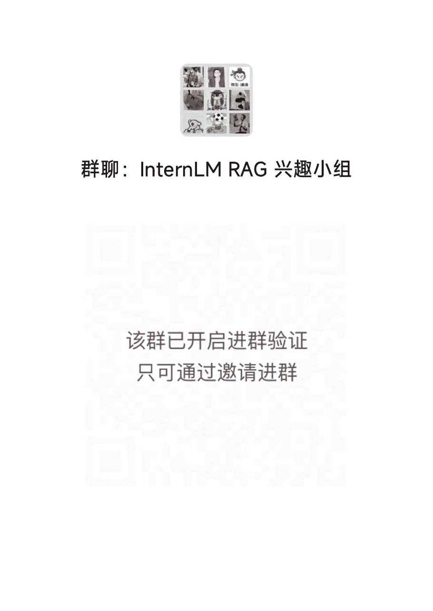

# RAG SIG

> 来源：[https://aicarrier.feishu.cn/docx/XY72d0fNqogmk7xvNQrc03Eyn9e](https://aicarrier.feishu.cn/docx/XY72d0fNqogmk7xvNQrc03Eyn9e)

# 书生·浦语 RAG 兴趣小组

## 什么是RAG？

LLM会产生误导性的 “幻觉”，依赖的信息可能过时，处理特定知识时效率不高，缺乏专业领域的深度洞察，同时在推理能力上也有所欠缺。正是在这样的背景下，检索增强生成技术（Retrieval-Augmented Generation，RAG）应时而生，成为 AI 时代的一大趋势。

RAG 通过在语言模型生成答案之前，先从广泛的文档数据库中检索相关信息，然后利用这些信息来引导生成过程，极大地提升了内容的准确性和相关性。RAG 有效地缓解了幻觉问题，提高了知识更新的速度，并增强了内容生成的可追溯性，使得大型语言模型在实际应用中变得更加实用和可信。

RAG主要包含三个基本步骤：

1.  索引 — 将文档库分割成较短的 Chunk，并通过编码器构建向量索引。

1.  检索 — 根据问题和 chunks 的相似度检索相关文档片段。

1.  生成 — 以检索到的上下文为条件，生成问题的回答。

**时间周期：**2024 年 2 月——6 月

**小组长：不要葱姜蒜**

**RAG兴趣小组讨论区：****h**ttps://github.com/InternLM/tutorial/discussions/553

> **备注：**加入大模型RAG兴趣小组欢迎🛰️联系浦语小助手（🛰️搜索InternLM）或者小组长不要葱姜蒜（🛰️搜索KMnO4-zx）

## 在兴趣小组可以做什么？

**在InternLM RAG兴趣小组一**起读paper、参与圆桌会议、手搓RAG代码、结合internlm2写blog等活动。

## 组员福利

+   活跃的学习氛围

+   优秀组员精美证书

+   上海AI实验室内推机会

+   充足的算力支持

+   上海AI实验实验室研究员项目指导

# 学习资料

Hand-on-RAG：https://github.com/SmartFlowAI/Hand-on-RAG.git

基于InternLM和Langchain搭建你的知识库：https://github.com/InternLM/tutorial/tree/main/langchain

Rag-survey 论文仓库：https://github.com/cavalierlulu/rag_survey

茴香豆（豆哥）：https://github.com/InternLM/HuixiangDou.git

# 参考论文

| Name | Paper Link |
| --- | --- |
| When Large Language Models Meet Vector Databases: A Survey | http://arxiv.org/abs/2402.01763 |
| Retrieval-Augmented Generation for Large Language Models: A Survey | https://arxiv.org/abs/2312.10997 |
| Learning to Filter Context for Retrieval-Augmented Generation | http://arxiv.org/abs/2311.08377 |
| In-Context Retrieval-Augmented Language Models | https://arxiv.org/abs/2302.00083 |