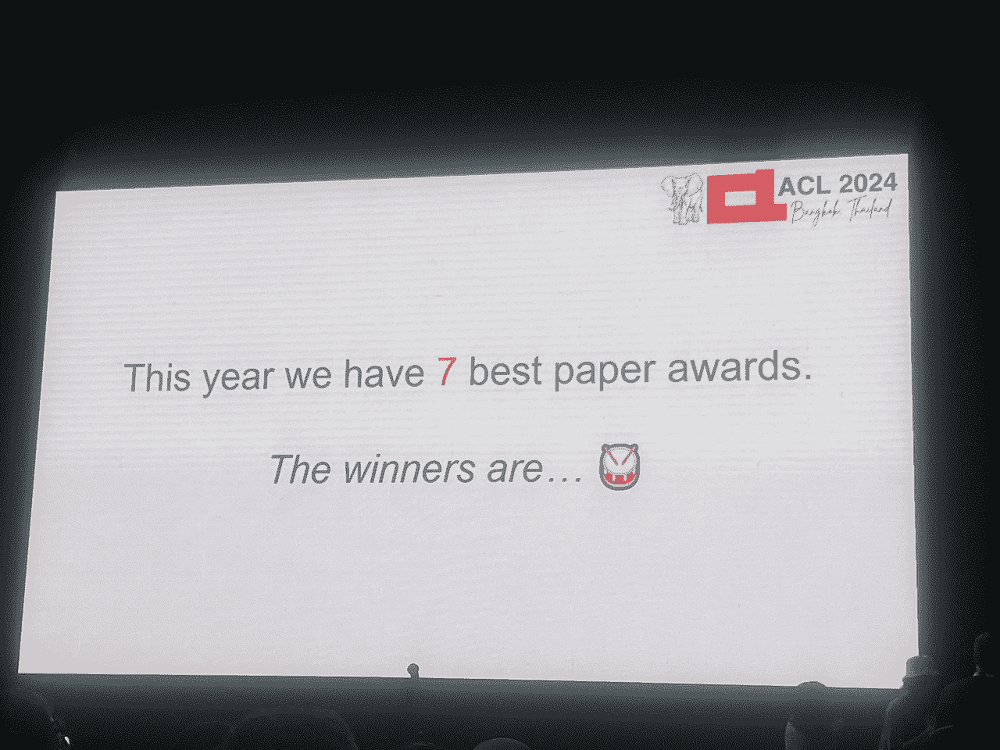
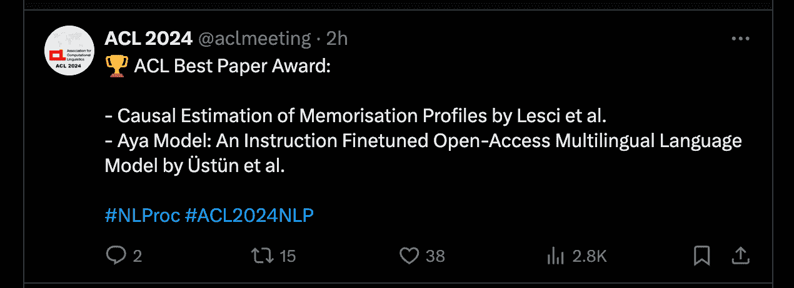
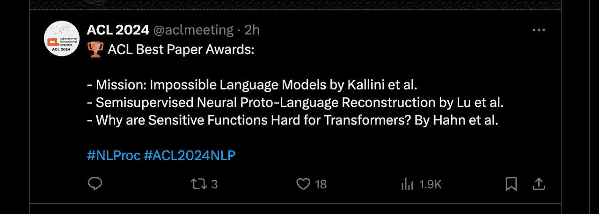
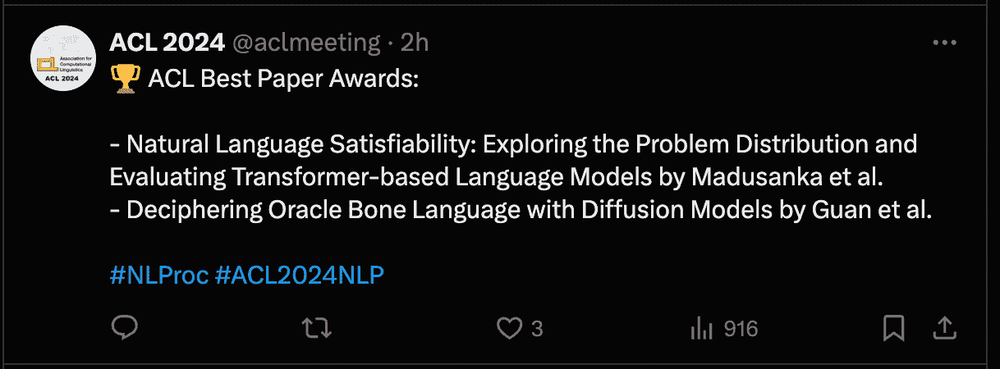
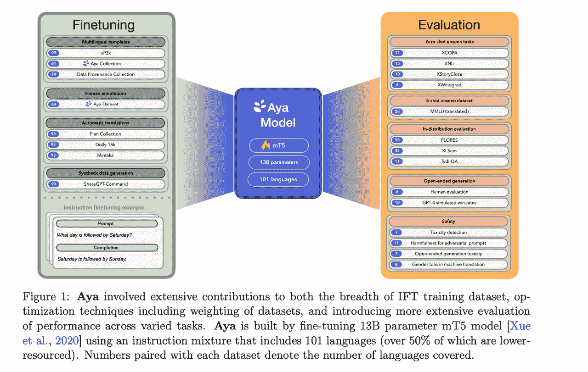
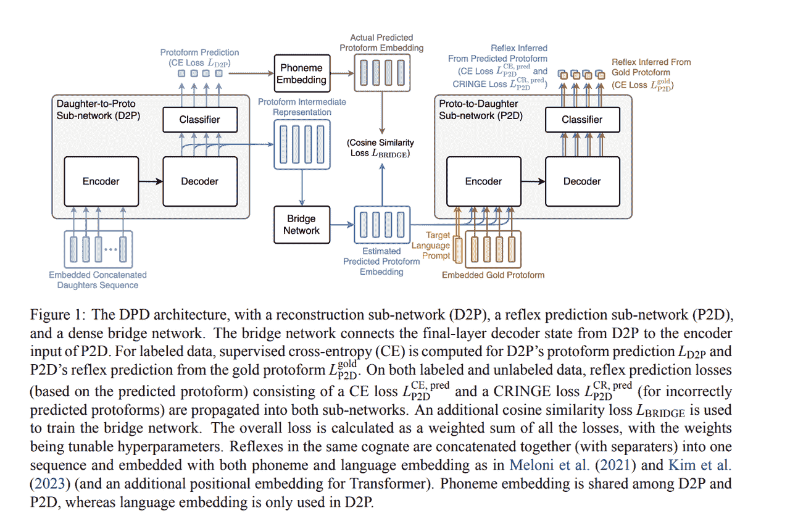

# ACL 最佳论文

> 来源：[https://aicarrier.feishu.cn/docx/WrZTdvpTsoqFm5xK4nMc8zponcd](https://aicarrier.feishu.cn/docx/WrZTdvpTsoqFm5xK4nMc8zponcd)

#### **用扩散模型解读甲骨文****！**

华南理工大学

文档地址：https://arxiv.org/html/2406.00684v1

**甲骨文起源于约3****000年**前的中国商朝，是语言学史上的基石，比许多已建立的文字系统更早出现。尽管发现了数千个铭文，但甲骨文中仍有大量内容尚未破译，为这种古老的语言蒙上了一层神秘的面纱。现代人工智能技术的出现为甲骨文破译开辟了一个新的前沿领域，挑战了传统自然语言处理方法，这些方法严重依赖大型文本语料库，而历史语言并不具备这样的条件。本文介绍了一种采用图像生成技术的新方法，具体通过开发甲骨文破译器（OBSD）来实现。OBSD采用条件扩散策略，生成了破译过程中的重要线索，为辅助古代语言的AI分析开辟了新的途径。为了验证其有效性，在甲骨文数据集上进行了广泛的实验，定量结果证明了OBSD的有效性。代码和破译结果将在https://github.com/guanhaisu/OBSD上发布。

#### Natural Language Satisfiability: Exploring the Problem Distribution and Evaluating Transformer-based Language Models by Madusanka et al.

#### Causal Estimation of Memorisation Profiles by Lesci et al.

理解语言模型的记忆机制具有实际和社会意义，例如研究模型的训练动态或防止版权侵权。 先前的工作将记忆定义为模型在训练过程中对某个实例的预测能力的因果效应。 这一定义依赖于一种反事实：观察模型如果没有见过该实例的情况下会发生什么。 现有的方法很难提供计算高效且准确的反事实估计。 此外，它们通常是对模型架构而不是特定模型实例的记忆估计。 本文填补了文献中的一个重要空白，提出了一种基于经济学中的差分对比设计（difference-in-differences）的新方法，以原则性和高效的方式估计记忆。 使用该方法，我们仅通过观察模型在整个训练过程中对一小部分实例的行为，就可以描述模型的记忆轮廓——其在训练过程中的记忆趋势。在使用Pythia模型套件进行的实验中，我们发现，记忆（i）在更大模型中更强大且更持久，（ii）由数据顺序和学习率决定，（iii）在不同模型大小中具有稳定的趋势，因此在更大模型中的记忆行为可以从较小模型中预测。

#### Aya Model: An Instruction Finetuned Open-Access Multilingual Language Model by Üstün et al.

#### Mission: Impossible Language Models by Kallini et al.

https://arxiv.org/pdf/2401.06416

#### Semisupervised Neural Proto-Language Reconstruction by Lu et al.

#### Why are Sensitive Functions Hard for Transformers? By Hahn et al.