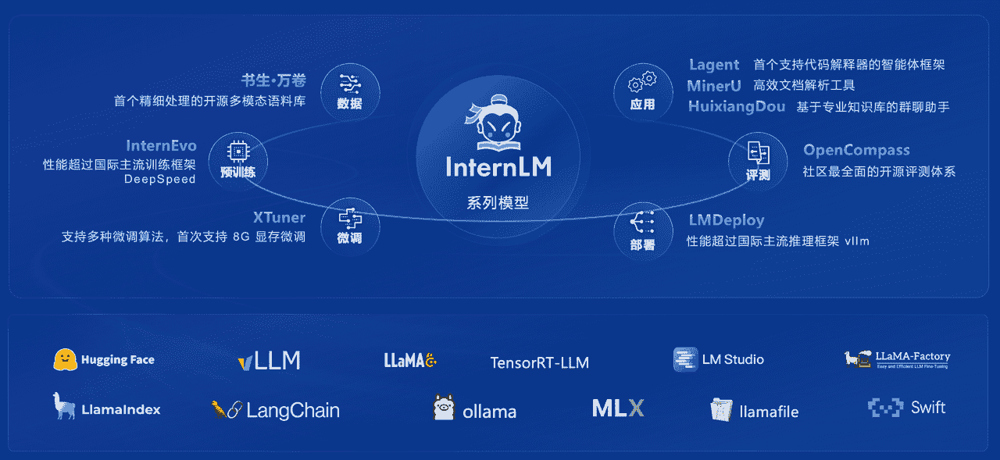

# 书生大模型开源社区

> 来源：[https://aicarrier.feishu.cn/docx/LYCGdY5zmoEXMUxz47KcTbyqn3G](https://aicarrier.feishu.cn/docx/LYCGdY5zmoEXMUxz47KcTbyqn3G)

# 简介

书生大模型是上海人工智能实验室大模型品牌，期待和广大的社区开发者[一起建设](https://www.feishu.cn/community/article/wiki?id=7379543547998896131)开放、繁荣、健康的大模型开源社区！本知识库已上线飞书社区，欢迎大家来玩：飞书社区

# 开源社区简介

**在这里书生大模型开源**社区您可以参加「书生大模型实战**营」学习大模**型知识，参与书生大模型「社区共建」一起共建国际领先的大模型开源社区。

# 书生大模型社区发展历程

2025 年 7 月 27 日[ Intern-S1](https://mp.weixin.qq.com/s/d7DfDz4yw_5ktewSpjzVDA)发布，上海人工智能实验室（上海AI实验室）发布并开源『书生』科学多模态大模型Intern-S1，多模态能力全球开源第一，文本能力比肩国内外一流模型，科学能力全模态达到国际领先，作为融合科学专业能力的基础模型，Intern-S1综合性能为当前开源模型中最优

2025 年 5 月 23 日 [InternThinker](https://mp.weixin.qq.com/s/6gTdlnrkyCM1tvcp5LBOqg)升级，成为首个既具备围棋专业水平，又能展示透明思维链的大模型。

[2025 年 4 ](https://mp.weixin.qq.com/s/rb_gVjQTuwdx0hse6KuAkA)月 16 日 InternVL3开源，上海人工智能实验室（上海AI实验室）升级并开源了通用多模态大模型书生·万象3.0（InternVL3）。通过采用创新的多模态预训练和后训练方法，InternVL3 多模态基础能力全面提升，在专家级基准测试、多模态性能全面测试中，10亿~780亿参数的全量级版本在开源模型中性能均位列第一，同时大幅提升了图形用户界面（GUI）智能体、建筑场景图纸理解、空间感知推理以及通识学科推理等方面的能力。

[2025 ](https://mp.weixin.qq.com/s/P-ITA0IwnjZ9s7EypgcObQ)年 2 月 18 日 OREAL开源，上海人工智能实验室（上海AI实验室）发布基于结果奖励的强化学习新范式OREAL，无需蒸馏超大参数规模模型，实现轻中量级（7B/32B）模型推理能力再提升。

[2025 年 2 月 11 ](https://mp.weixin.qq.com/s/36Yy0K4gV6pKPsPpHIQcLw?token=1405798458&lang=zh_CN)日 InternVideo2.5开源，在视频理解领域，全新升级的InternVideo2.5取得时间跨度与细粒度的双维提升，“记忆力”较前代模型扩容6倍，具备万帧长视频中精准“大海捞针”能力，AI视频理解既能“短平快”，亦可“长深细”。

2025 年 1 月 15 日 [InternLM3](https://mp.weixin.qq.com/s/cDAhwtr0bFiqeWe0TdGMCg)开源，书生·浦语3.0（InternLM3）通过精炼数据框架，大幅提升了数据效率，并实现思维密度的跃升。仅使用4T训练数据的InternLM3-8B-Instruct，其综合性能超过了同量级开源模型，节约训练成本75%以上；同时，书生·浦语3.0首次在通用模型中实现了常规对话与深度思考能力融合，可应对更多真实使用场景。

2024 年12月30 日 [InternVL2.5](https://mp.weixin.qq.com/s/WQPw_feby8c0s5qhNqHZoA?token=1405798458&lang=zh_CN)升级，继12月初推出全量级开源多模态大模型书生・万象2.5（InternVL2.5）后，上海人工智能实验室（上海AI实验室）进一步开源了该模型的后训练算法及训练数据，使各量级的模型性能均得到提升。其中，模型的数学推理能力和OCR能力提升最为明显，分别在MathVista和OCRBench达到了76.5%和907分。

[2024 年 12 月 2](https://mp.weixin.qq.com/s/5TYGhsf9B6DkKQ2sRJMxNQ?token=1405798458&lang=zh_CN)0 日 InternThinker升级，InternThinker 从 alpha 版本升级到 beta 版本，在数学、理科，推理谜题等复杂推理任务上取得了优异的结果，并将在近期开放免费 API 供开发者使用。

2024 年 12 月 12 日 InternLM-XComposer2.5-OmniLive开源，上海AI实验室推出多模态实时交互大模型书生·浦语灵笔2.5-OL(InternLM-XComposer2.5-OmniLive)，该模型可以通过视觉和听觉实时观察和理解外部世界，自动形成对观察到内容的长期记忆，并可通过语音与人类用户进行对话交谈，提供更自然的大模型交互体验。

2024 年12 月5日 [InternVL2.5](https://mp.weixin.qq.com/s/c_e5fWqlpxcFUdZYoqGVjw?token=1405798458&lang=zh_CN)开源，书生·万象2.5在多个方面取得了突破：实现全量级开源多模态性能第一，开源参数涵盖10亿~780亿；在多模态长链推理方面，在专家级多学科领域知识推理基准测试MMMU中取得突破70%的成绩（仅次于目前最高分的OpenAI o1）；通用能力显著加强，在跨学科推理、文档理解、多图像/视频理解、现实世界推理、多模态幻觉检测、视觉定位、多语言等能力方面均有不同程度的提升，维持在世界领先水平；纯语言能力完全保持，在不牺牲语言能力的情况下实现优异的多模态性能。

[2024 年 11 月 2](https://mp.weixin.qq.com/s/1Bmn2sRmNMwVsp-XDzhWig)5 日 InternThinker开放体验，上海AI实验室展示了自主生成高智力密度数据、具备元动作思考能力的“模型”等一系列创新进展，并开放强推理模型书生InternThinker试用体验。该模型具备长思维能力，并能在推理过程中进行自我反思和纠正，从而在数学、代码、推理谜题等多种复杂推理任务上取得更优结果。

[2024 年 8 月](https://mp.weixin.qq.com/s/luvn0drV-TLmorqf0gRzUA) 15 日 MindSearch开源，针对需要进行大规模搜索和整合复杂信息的场景，书生·浦语研究团队提出了MindSearch（思·索）框架，它可以模拟人的思维过程，通过引入任务规划、任务拆解、大规模网页搜索、多源信息归纳总结等步骤，自主实现同时从上百个网页中进行信息搜集、整理。

2024 年 8 月 9 日 Compass Multi-Modal Arena上新啦！Compass Arena 迎来重磅更新，新增了多模态大模型竞技版块——Compass Multi-Modal Arena。在这个全新的竞技场，用户可以轻松体验和比较多款主流多模态大模型的效果，找到适合自己的多模态大模型。

2024 年 8 月 5 日 [InternLM2.5](https://mp.weixin.qq.com/s/JoddkJd1Q2jtc_UkBx-9dw) 开源 1.8B、20B 参数版本，为适应更多样化应用场景及不同开发者需求，InternLM2.5 再次开源 1.8B、20B 参数版本。InternLM2.5-1.8B ：性能优越的超轻量级模型，兼具高质量和高适应灵活性。InternLM2.5-20B ：综合性能更为强劲，可以有效支持更加复杂的实用场景

2024 年 7 月 4 日 [InternLM2.5](https://mp.weixin.qq.com/s/0PCsrUk6siFscRVJKivWZw)开源，在举行的2024 WAIC科学前沿主论坛上，书生·浦语2.5（InternLM2.5）发布，InternLM2.5-7B 开源。InternLM2.5具备一百万词元（Token）的超长文本窗口及开源模型中领先的推理能力，并支持自主规划和在线信息整合，成为助力复杂问题高效解决的得力AI助手。

2024 年 7 月 4 日 [InternVL2](https://mp.weixin.qq.com/s/AZfyX0PWPgrfM3sSSLII6w)开源，在举行的2024 WAIC科学前沿主论坛上，上海人工智能实验室（上海AI实验室）发布并开源书生·万象多模态大模型（InternVL 2.0）。书生·万象支持图像、视频、文字、语音、三维点云等模态处理，具备强大的真实世界感知能力，并通过首创的渐进式对齐训练策略，实现了成本更低、性能更高。

[2024 年 6 月 ](https://mp.weixin.qq.com/s/Jm6fF_M5rJMXTzmGd-Nxmg)18 日 InternVL1.5开源，InternVL 1.5具备强大的视觉编码器和更深层次的场景理解能力；支持动态高分辨率，能够准确识别和理解图像中的各种细节以及文字信息。第三方评测结果显示，InternVL 1.5在多模态感知、通用问答、文档理解、信息图表理解以及数理理解等方面综合能力领先开源模型，比肩GPT-4V、Gemini Pro等闭源模型。

2024 年 5 月 17 日[ Compass Arena](https://mp.weixin.qq.com/s/vxoqLlmiLm3FSxKAtPsddw)，司南和魔搭ModelScope联手推出了大语言模型竞技场 Compass Arena，旨在为国内的大语言模型领域引入一种全新的竞技模式，为广大互联网用户提供了一个匿名、随机的大语言模型竞技环境，以产生更加客观和真实的评价。

[2024 年 2 ](https://mp.weixin.qq.com/s/OjYGWYtwJ-DCH2Cn6CgqlA)月 28 日 InternLM2开源 1.8B，为了响应社区用户极其强烈的呼声，InternLM2-1.8B 于近日正式开源。在 FP16 精度模式下，InternLM2-1.8B 仅需 4GB 显存的笔记本显卡即可顺畅运行。拥有 8GB 显存的消费级显卡，即可轻松进行 1.8B 模型的微调工作。如此低的硬件门槛，非常适合初学者使用，以深入了解和掌握大模型的全链路。

[2024 年 1 月 30 ](https://mp.weixin.qq.com/s/9-HZ66oDL6_vaNIqR7m3aw)日 大模型评测体系司南OpenCompass2.0发布，大模型开源开放评测体系司OpenCompass2.0正式发布，旨在为大语言模型、多模态模型等各类模型提供一站式评测服务。OpenCompass2.0全面量化模型在知识、语言、理解、推理和考试等五大能力维度的表现，客观中立地为大模型技术创新提供坚实的技术支撑。

[2024 年 1 月 ](https://mp.weixin.qq.com/s/KJzzbG9dSHkHC_FNeP4E2g)29 日 书生·浦语灵笔 2.0 正式开源，书生·浦语灵笔2.0是在书生·浦语2.0的基础上通过图文拓展训练获得的。得益于InternLM2强大的语言建模能力，浦语灵笔2.0的图文理解和创作能力显著提升，可为用户提供更精准、更个性、更丰富、更专业的图文创作体验，在12项图文能力评测中大幅领先同量级开源模型，在部分维度可比肩国际领先水平。书生·浦语灵笔2.0开源了图文创作大模型（InternLM-XComposer2-7B)和它背后的图文理解与问答模型（InternLM-XComposer2-VL-7B），均提供免费商用。

[2024 年 1](https://mp.weixin.qq.com/s/bdfAJRqOF9tUk8Vy9KC_XQ) 月 29 日 新一代书生·视觉大模型发布，上海人工智能实验室（上海AI实验室）联合清华大学、香港中文大学、商汤科技等机构开源新一代书生·视觉大模型（InternVL）。上海AI实验室在视觉大模型上持续发力，在2021年、2022年先后推出书生1.0和InternImage，不仅及模型性能领先，还构建了视觉大模型的新架构。新一代“书生·视觉基础”模型的视觉编码器参数量达60亿(InternVL-6B)，首次提出了对比-生成融合的渐进式对齐技术，实现了在互联网级别数据上视觉大模型与语言大模型的精细对齐。

[2024 年 1 ](https://mp.weixin.qq.com/s/jB_q_23eZUSsHkwReiu2AQ)月 19 日 InternLM2开源，相比于第一代 InternLM 和一些主流开源模型，InternLM2 的核心在于回归语言建模的本质，致力于通过更高质量的语料以及更高的信息密度，实现模型基座语言建模能力的质的提升。我们观察到，随着 InternLM2 在基础语言建模能力的实质性增强，数理、代码、对话、创作等各方面能力都获得了长足进步，综合性能达到开源模型的领先水平。

[2023 年 10 月](https://mp.weixin.qq.com/s/pUW-s6Jda4RHb1RFrcbloQ) 18 日 OpenCompass开放评测体系发布，上海人工智能实验室（上海AI实验室）正式推出OpenCompass大模型开放评测体系（以下简称“OpenCompass”），通过完整开源可复现的评测框架，支持大语言模型、多模态模型各类模型的一站式评测，并定期公布评测结果榜单。

2023 年 10 月 10 日 书生·浦语灵笔InternLM-XComposer开源，上海人工智能实验室（上海AI实验室）推出首个图文混合创作大模型书生·浦语灵笔（InternLM-XComposer，以下简称“浦语灵笔”），依托强大的多模态性能，解锁“一键生成”图文混合文章的创作能力，为大模型落地应用提供更多可能。目前，浦语灵笔已开源其中的智能创作和对话（InternLM-XComposer-7B）及多任务预训练（InternLM-XComposer-VL-7B）版本，并提供免费商用。

2023 年 9 月 20 日 [InternLM-20B](https://mp.weixin.qq.com/s/y2THvSr5LqrLVO17BmmUBA)开源，上海人工智能实验室（上海AI实验室）与商汤科技联合香港中文大学和复旦大学正式推出书生·浦语大模型（InternLM）200亿参数版本InternLM-20B，并在阿里云魔搭社区（ModelScope）开源首发。同时，书生·浦语面向大模型研发与应用的全链条工具链全线升级，与InternLM-20B一同继续全面开放，向企业和开发者提供免费商用授权。

[2023 年](https://mp.weixin.qq.com/s/BGnY3YfbWvYjfMY9SVtFMA) 9 月 18 日 训练工具箱XTuner发布。上海AI实验室推出首个面向大模型研发与应用的全链条开源体系，贯穿数据、预训练、微调、部署和评测五大环节。本次发布的XTuner聚焦于微调环节，为各类开源大模型提供了轻量级微调框架，再次巩固全链条开源体系的实用工具属性。

2023 年 8 月 14 日[ 书生·万卷1.0](https://mp.weixin.qq.com/s/q2mzQ97KTIrWnHNqZ2lhIg)发布，“书生·万卷” 1.0目前包含文本数据集、图文数据集、视频数据集三部分，本次开源的数据总量超过2TB。集合语料数据联盟成员丰富的内容积累与上海AI实验室领先的数据处理能力等优势，“书生·万卷”将为学术界及产业界提供更符合主流中文价值对齐的高质量大模型多模态预训练语料。

2023 年 7 月 6 日 [书生通用大模型体系](https://mp.weixin.qq.com/s/7PvtuTzFQ-owVzv7fnxM0A)开源，上海人工智能实验室（上海AI实验室）与商汤科技联合香港中文大学、复旦大学、上海交通大学及清华大学发布全新升级的“书生通用大模型体系”（以下简称“书生大模型”），包括书生·多模态、书生·浦语和书生·天际等三大基础模型，以及首个面向大模型研发与应用的全链条开源体系。

2023 年 6 月 7 日 [InternLM](https://mp.weixin.qq.com/s/dIg5Qnnr-hZt3OKyU_e77g)发布，6月7日，上海人工智能实验室（上海AI实验室）、商汤科技联合香港中文大学、复旦大学及上海交通大学发布千亿级参数大语言模型“书生·浦语”（InternLM）。“书生·浦语”具有1040亿参数，是在包含1.6万亿token的多语种高质量数据集上训练而成。全面评测结果显示，“书生·浦语”不仅在知识掌握、阅读理解、数学推理、多语翻译等多个测试任务上表现优秀，而且具备很强的综合能力，因而在综合性考试中表现突出，在多项中文考试中取得超越ChatGPT的成绩，其中就包括中国高考各科目的数据集（GaoKao）。

# 开放平台

# 模型&工具链介绍

# 模型简介

# 开源社区活动

### 「书生大模型实战营」

### 「书生·共建」

<https://colearn.intern-ai.org.cn/cobuild>

社区共建任务领取地址：[书生·浦语社区共建任务](https://aicarrier.feishu.cn/wiki/MI04wyGrri75tjkRClAcSdfhn6d)

### 兴趣小组 SIG

<https://aicarrier.feishu.cn/sync/ZaCmdMLRjso3k8b7rQFcF1lwnDb>

InternStudio 平台：帮助社区小伙伴拥有一个调试大模型的开发环境。

浦语在线 Web：无需部署快速感受浦语的能力。

浦语 API：无需本地部署快速使用API进行产品原型设计。

# 最新动态

# IOPMC

Intern 大模型开源社区管理委员会，和书生大模型核心团队一起打造一个开放、繁荣的大模型开源社区！

IOPMC （Intern OpenSource Project Manage Community）  书生大模型开源社区管理委员会） 主要是和书生大模型核心团队一起打造开放繁荣的大模型的开源社区，招募管理委员会招募人数在 7 个人左右，任期 3 个月可续！

# 加入我们

如果你也想参与 InternLM 开源社区的建设欢迎微信搜索InternLM 添加浦语小助手微信！

>

> **GitHub：**https://github.com/InternLM/

> **官网：**https://internlm.intern-ai.org.cn/

> **小助手微信：**InternLM

# 友好**合作社区**