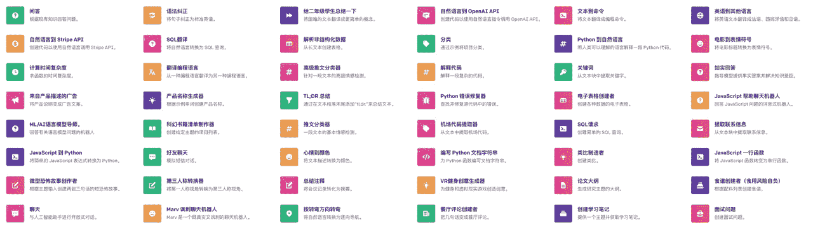
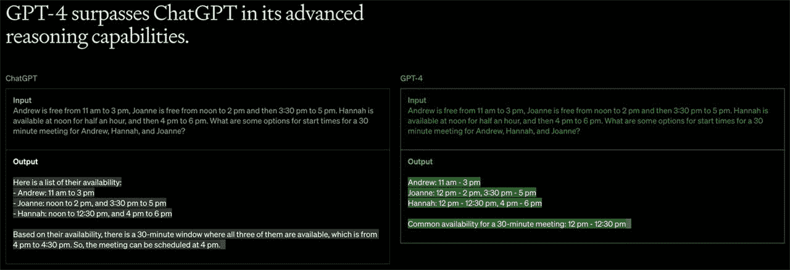
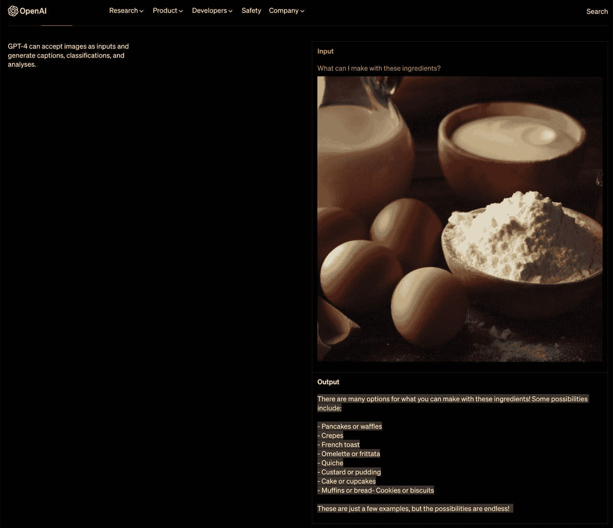
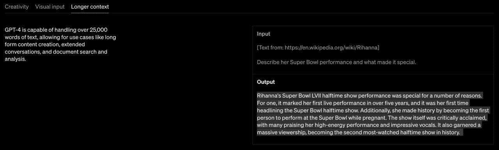

# OpenAI可以做什么(官方)

> 来源：[https://my.feishu.cn/docx/VvePdEfl4ow0hFxCvbHc2RwinPc](https://my.feishu.cn/docx/VvePdEfl4ow0hFxCvbHc2RwinPc)

# 官网

个人版：https://openai.com/chatgpt

企业版：https://openai.com/enterprise

Dall-e-3:  https://openai.com/dall-e-3

# 总体功能汇总

# 数据推理

GPT-4 在高级推理能力方面超越了 ChatGPT。

# 看图作答

GPT-4 可以接受图像作为输入，并生成标题、分类和分析。

# 长文本上下文

GPT-4 能够处理超过 25,000 个单词的文本，这使得它可以应用于诸如长篇内容创作、扩展对话以及文档搜索和分析等场景。

