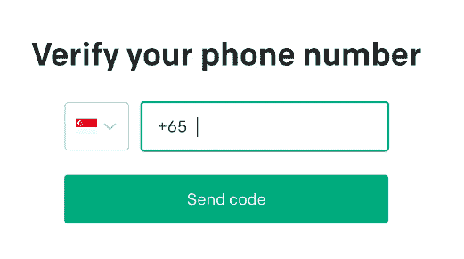
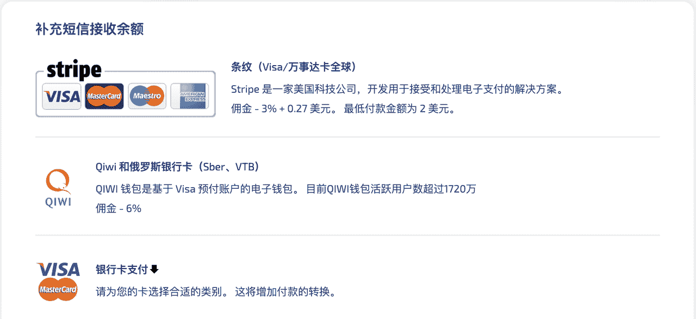
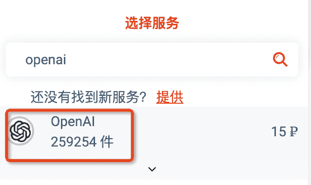
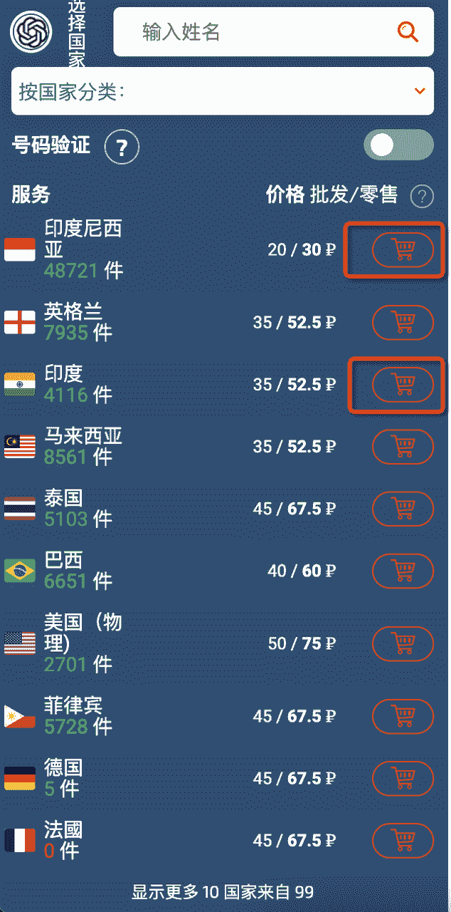
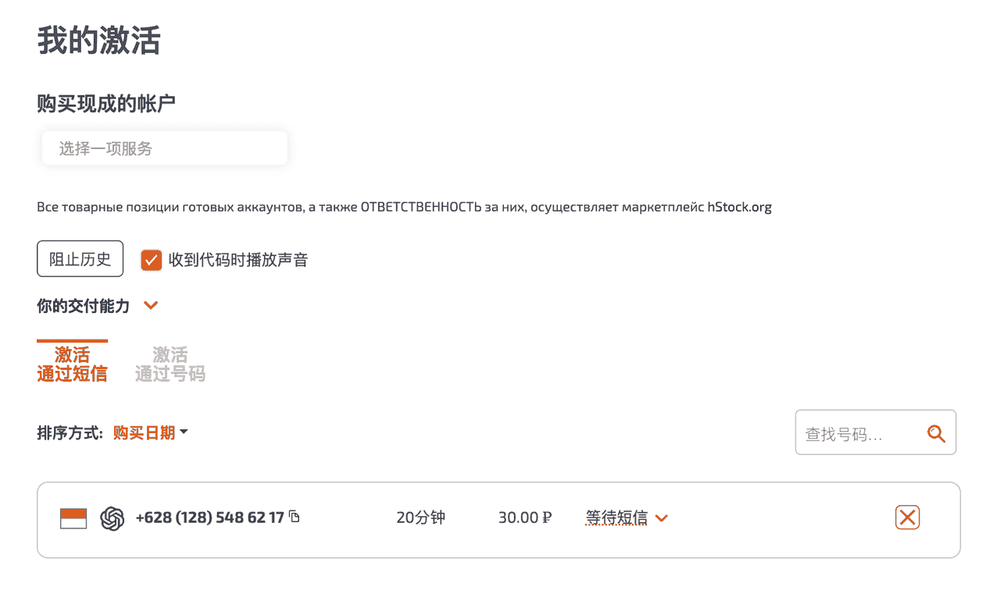
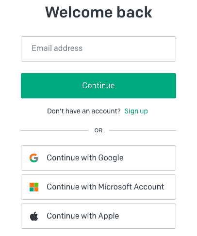

# 快速开始--注册账号

> 来源：[https://my.feishu.cn/docx/Y7JxdipF2olP2xxjSxPcCpYanPf](https://my.feishu.cn/docx/Y7JxdipF2olP2xxjSxPcCpYanPf)

# 准备

•首先能科学上网，否则无法连接ChatGpt或无法正常获取服务

•有一个国外手机号，如果你没有国外手机号，推荐sms-activate.org

# 注册OpenAI账号

# 优先推荐注册使用微软账号，原因

1）账号比较稳定，被屏蔽风险较小，微软在国内可稳定使用

2）微软对openAI 有投资关系，比较稳定

3）如果有微软的账号，可以直接使用微软账号绑定并使用。这也是推荐用法。

打开OpenAI的注册页面进行相应的注册。

platform.openai.com/signup

•注册成功进入下面填写手机号的页面

◦下面记得切换下国家区号，这里的区号默认是你的。

# 注册短信平台并充值

•

先进行注册sms-activate.org

•

注册好之后进行对应的充值

选择VISA银行卡或者支付宝充值。

接码费用一次约为1.3人民币，充值默认为美元，可以选择充值 1 美元进去，

# 准备接码

充值后如果出现语言切换，如下所示，只需要在对应的地方切换成中文即可

搜索OpenAI并点击

推荐印度及印度尼西亚，选择购买

号码已租用，等待短信中，如果未收到，等待时间达到或者X掉都会返还对应金额。然后再刚刚填写手机号码的页面填入申请的手机号（注意复制填写手机号时要手动去除区号），等待验证码。

# 开始使用ChatGPT

注册完后，我们去ChatGPT网站去登录。platform.openai.com/login

登录成功后，将会出现如下的界面，就可以开始使用ChatGPT了～

