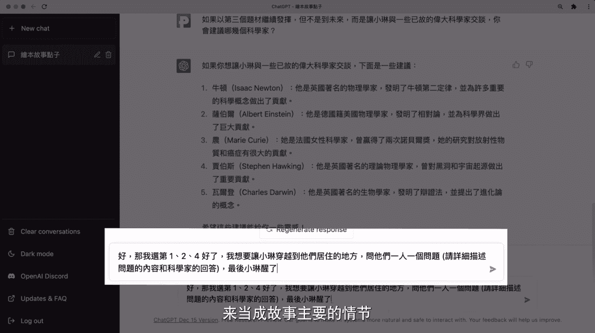

# 自媒体领域

> 来源：[https://my.feishu.cn/docx/KSDld5NKuoVeAzxHejNcNjGhnwe](https://my.feishu.cn/docx/KSDld5NKuoVeAzxHejNcNjGhnwe)

可能是现在各自视频博主，知识大V们最青睐的领域。

# 1 生产创意性高质量内容

在当今快速发展的数字媒体时代，ChatGPT结合其他尖端技术，在短视频自媒体领域展现出了巨大的潜力。这一创新的组合不仅为内容创作者提供了更多灵感和便利，还极大地提高了内容的质量和创新性。

ChatGPT的高级语言处理能力使得内容创作者能够快速生成创意文案、视频脚本甚至是影评和新闻报道。这种智能写作助手能够理解复杂的话题，提供创新的视角，从而帮助创作者节省时间，更快速地产出高质量内容。

参见：[人](https://www.bilibili.com/video/BV1wW4y1G7a3/?share_source=copy_web&vd_source=b68f853f829d65fae4ec428042e47343)类还剩几集可以逃？ChatGPT + Midjourney + Clipchamp AI大军联合玩内容创作

# 2 画图不再是专业人士的事情

此外，与图像生成技术如DALL-E的结合，为视频内容增添了视觉冲击力。通过简单的文本描述，DALL-E可以生成高质量、创意十足的图像，这些图像可以直接用于视频制作，极大地丰富了视觉表现力。

参见：

[AI定制艺术照30元一张引热议](https://www.bilibili.com/video/BV1zk4y1p7Hv/?share_source=copy_web&vd_source=2a1eb731180b64435bb207d5e1b976f9)

[【36氪】我用AI开的淘宝店成真了，一个月卖了](https://link.zhihu.com/?target=https%3A//www.bilibili.com/video/BV1VW4y1Q7Qv/%3Fshare_source%3Dcopy_web%26vd_source%3D2a1eb731180b64435bb207d5e1b976f9)快200件！_哔哩哔哩_bilibili

再者，利用自然语言处理和机器学习技术，ChatGPT可以进行内容分析和优化建议，帮助创作者优化视频内容，提高观看率和互动性。例如，它可以分析观众的评论，给出内容改进的建议，甚至预测未来流行趋势。

最后，结合语音识别和合成技术，ChatGPT可以为视频提供自动配音，支持多种语言和口音，这对于国际化的内容创作尤为重要。这不仅提高了制作效率，还大大降低了语言障碍，使内容更易于跨文化传播。

综上所述，ChatGPT结合其他技术在短视频自媒体领域的应用，为内容创作者提供了前所未有的工具和机遇，推动了内容创作的革新，扩大了创意的边界。随着这些技术的不断进步，我们期待看到更多高质量、创新性强的短视频内容在自媒体领域蓬勃发展。

# 3 其他应用

写稿机器人、采访助手、视频字幕生成、语音播报、视频锦集、人工智能合成主播