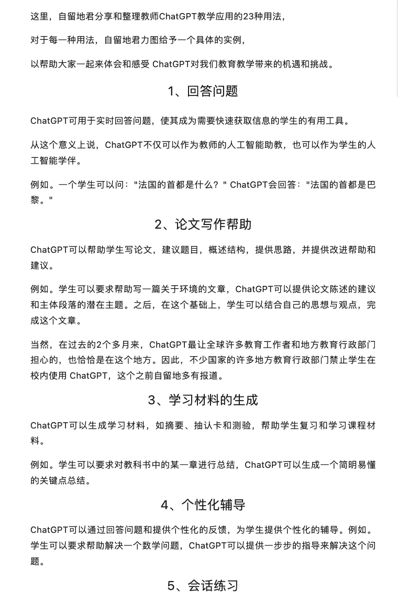

# 教育领域

> 来源：[https://my.feishu.cn/docx/DA3cdC7kMotlHTx79iqcsPNFnni](https://my.feishu.cn/docx/DA3cdC7kMotlHTx79iqcsPNFnni)

中小学教师 ChatGPT的30种用法

# 1 AIGC+教育

AIGC赋予教育行业新的活力，相较阅读、讲座等传统方式，AIGC为教育工作者提供了新工具，使原本抽象、平面的课本具体化、立体化。例如制作出历史人物直接与学生对话、合成知识丰富的虚拟教师，让数字教学更具互动性和趣味性等

AI四能效益

以AI为基础，旨在帮助人们发展智慧、智能引导、多能引导、情能引导，促进到更具能动性和创造性。

## 1.1  传能引导

人们的学习与个性化体验

+   通过个性化体验，AI技术可开辟为学习者量身定制个体化智能学习路径的新方式，即人性智能学习引导新常态化的典型教学内容和方法。

## 1.2 辅能引导

智慧学习与高质量教学

+   通过智慧学习和高质量教学，AI技术开辟为学习者个性化智能教辅引导新理念与个体智能教。

+   AI可以促进智慧的成长，为学习者提供更广泛的学习渠道，帮助他们掌握新技能。

## 1.3 多能引导

课程学习与知识点梳理拓展

+   通过课程学习和知识点梳理的智慧，AI技术开辟了帮助学习者从普遍性智能教育展示到深度智能教。

+   AI可以提供高质量的学习资源，引导学习者深入研究特定领域，提高他们的创新能力。批判性思维和解决问题的能力。

## 1.4 情能引导

情绪认知力与创新思维培养

+   通过情绪认知力和创新思维培养，AI技术开辟了帮助学习者从感情智能教育发展到创新技能。

+   AI可以以情感为基础激发学习者的创意，开发出新的技术和创新方式，以应对未来社会的挑战和变化。