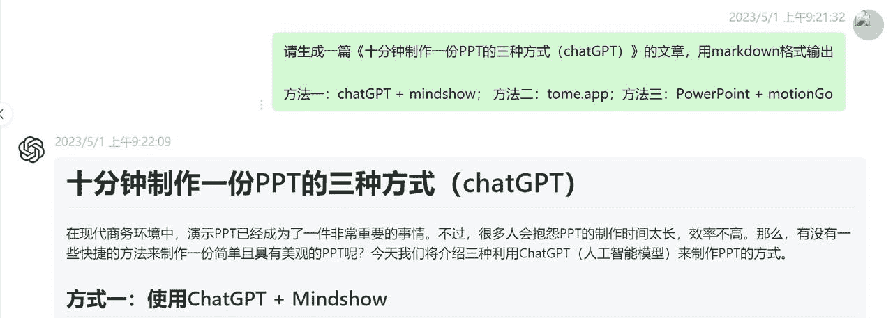
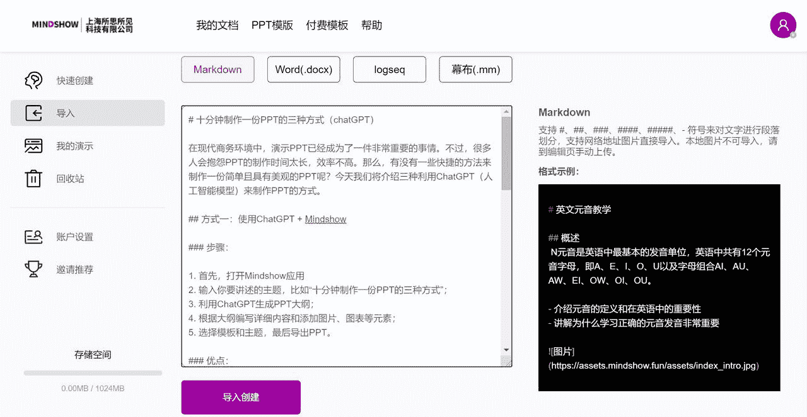
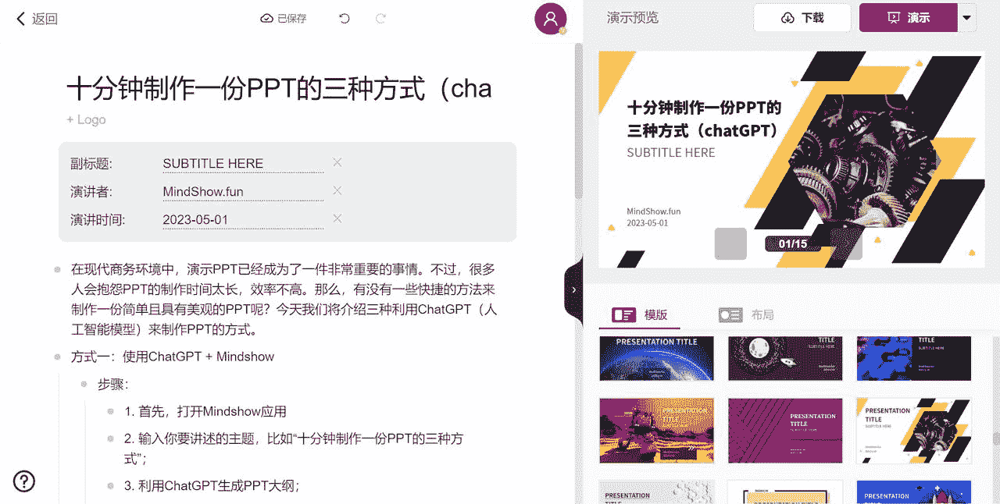
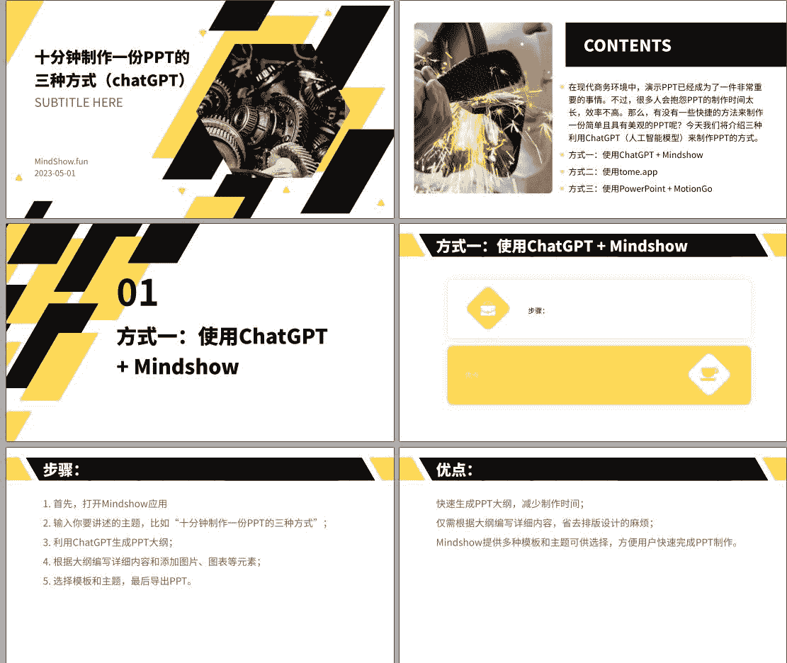
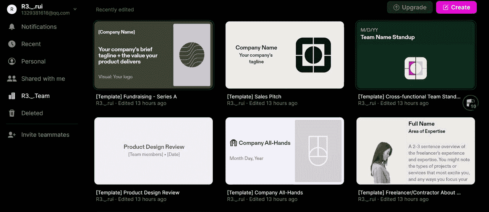
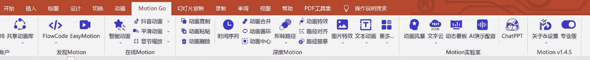
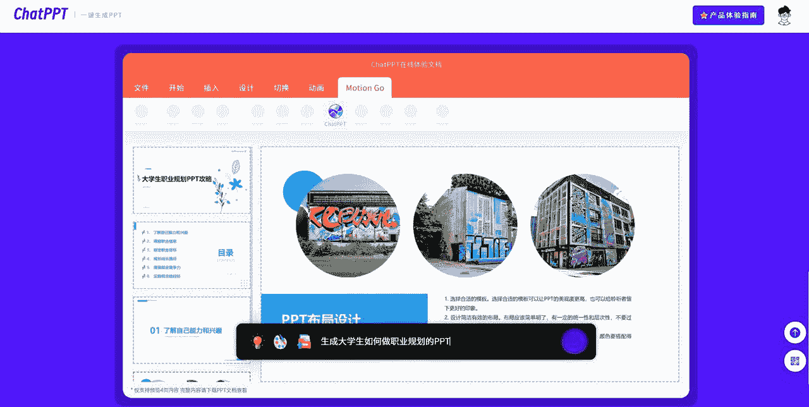

# 日常工作提效

> 来源：[https://my.feishu.cn/docx/WEPzdisHToGYeXx0eahcAUV7n3d](https://my.feishu.cn/docx/WEPzdisHToGYeXx0eahcAUV7n3d)

# 全局办公：全球首个集成ChatGPT的Office软件来了

# PPT：

十分钟制作一份PPT的三种方式（ChatGPT）

## [**方式一：使用Ch**](http://www.mindshow.fun)atGPT + Mindshow

### **步骤：**

1.  首先，用 GPT 生成一份 markdown 格式的文案

1.  在 mindshow 中导入生成的文案

1.  选择模板与布局；

1.  最后导出PPT；

1.  导出后添加图片与动画

### **优点：**

+   markdown导入自动排版，避免添加文案的重复操作；

+   Mindshow提供多种模板和布局可供选择，方便用户快速完成PPT制作，后续应该会继续增加数量。

### 缺点：

+   不支持添加动画和图片

## **方式二：使用**[**tome.app**](https://tome.app/)

### **步骤：**

1.  在文本框中输入主题和内容

1.  修改背景样式

1.  导出

详见 [B站UP主:AI时代最拉的金融博士【TOME: AI制作](https://www.bilibili.com/video/BV1x3411m7CK/?share_source=copy_web&vd_source=040200b1723a19a442b6b0ac78f5a126)PPT，自动文字配图，输入输出支持中文】

### **优点：**

+   模板美观

+   AI生图

### 缺点：

+   不支持导出PPT格式

+   界面语言为英文

+   价格略高

## [**方式三：使用Po**](https://chat-ppt.com/?searchval=)werPoint + MotionGo

### **步骤：**

1.  下载安装好后打开PowerPoint

1.  选择MotionGo工具栏；

1.  体验ChatPPT需要提交申请，这里展示在线体验的结果；

详见[官方文档](https://www.kdocs.cn/l/cdnhYWUcdfXi)

### **优点：**

+   MotionGo 功能更加强大，工具栏智能动画弥补了mindshow生成的PPT无动画的缺憾

+   支持导入 markdown 等文档

### 缺点

+   资质审核较慢

+   生成的模板不好用