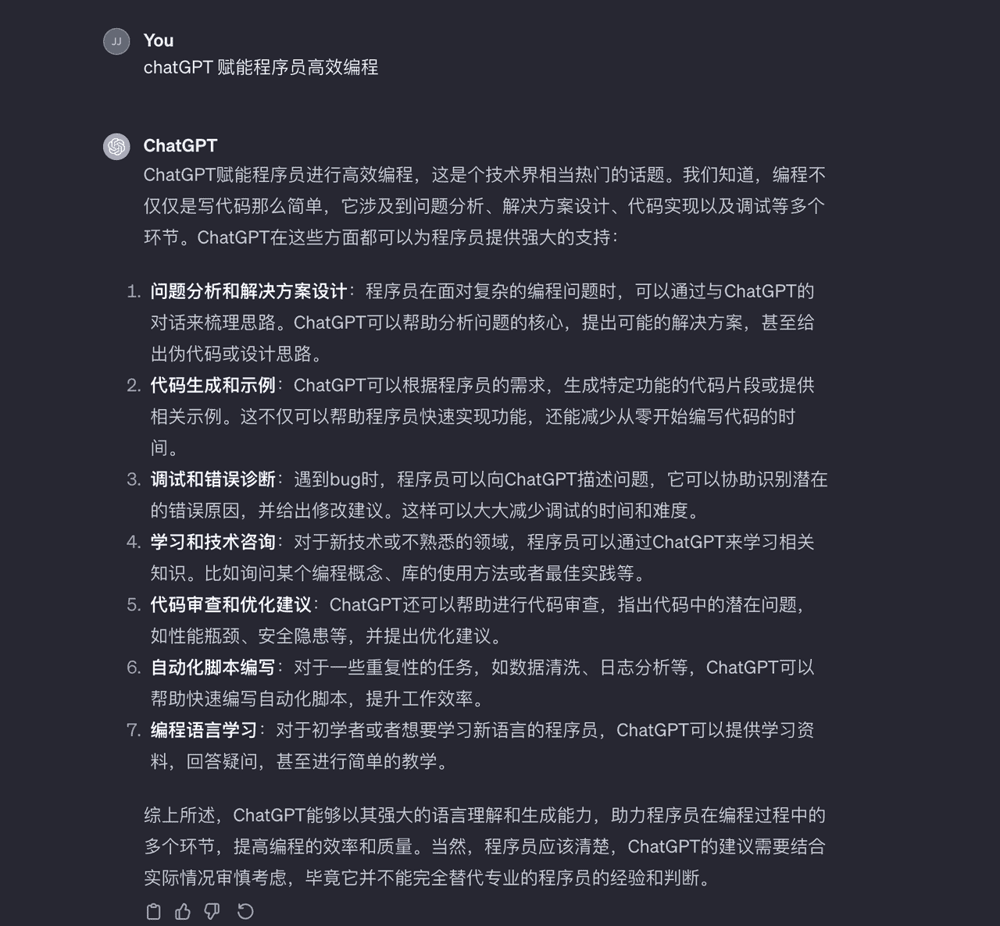

# 编程领域

> 来源：[https://my.feishu.cn/docx/ZF7xdL0ppo0LA3xFAMCcb8EmnWd](https://my.feishu.cn/docx/ZF7xdL0ppo0LA3xFAMCcb8EmnWd)

作为程序员-我如何使用chatgpt来帮我写代码

[欢迎来到自动化编程的新时代：和Cha](https://icodeit.org/2023/03/pair-with-ai-the-new-era/)tGPT结对编程 | I Code It

