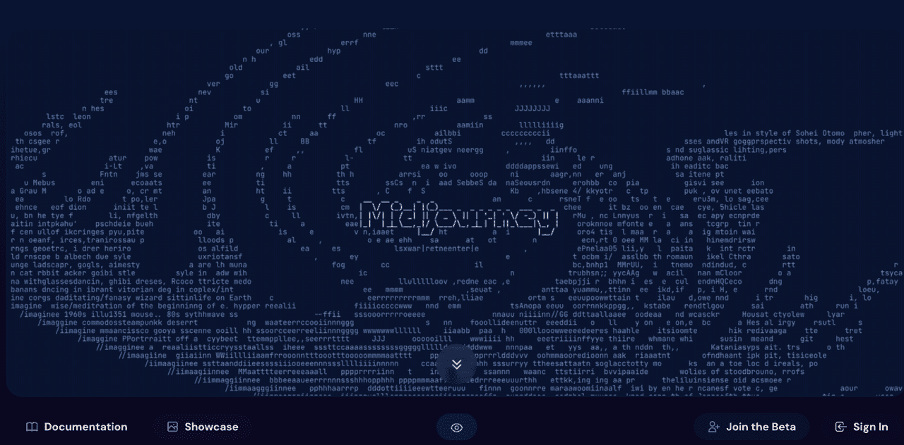
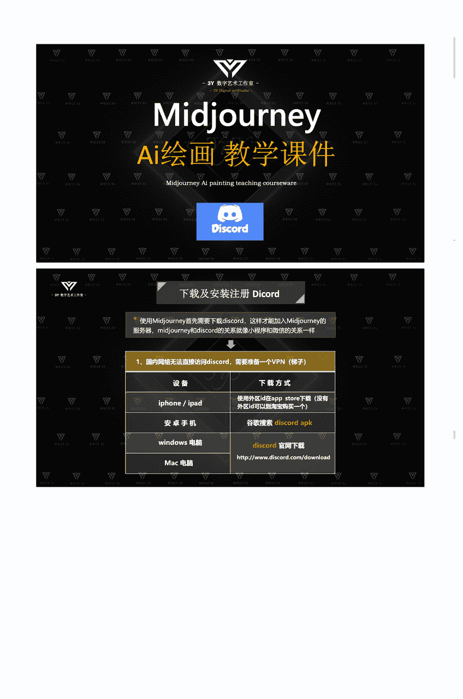
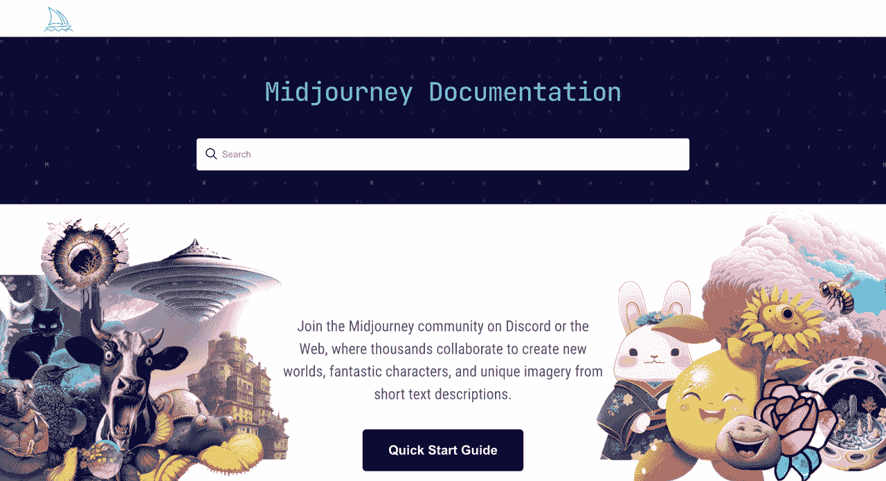

# Midjourney 教程专题

> 来源：[https://my.feishu.cn/docx/ZSDcd15T2oH3T0xe0DecU3vXnec](https://my.feishu.cn/docx/ZSDcd15T2oH3T0xe0DecU3vXnec)

# 基础

[Midjourney](https://www.uisdc.com/tag/midjourney) 是一个由 Midjourney 研究实验室开发的人工智能程序，可根据文本生成图像，目前架设在 Discord 频道上。于 2022 年 7 月 12 日进入公开测试阶段，使用者可通过 Discord 的机器人指令进行操作，可以创作出很多的图像作品。生成一张图片fast模式之下，只需要一分钟的时候，生成四种样式供你选择。

> 地址：https://www.midjourney.com/home/

【保姆级教程课件】

[Midjourney AI绘图教学课件PDF-保姆级.pdf](https://internal-api-drive-stream.feishu.cn/space/api/box/stream/download/all/AGFsbE0qGoOPMXx4fPUcmKGHnCd)

【Midjourney  人工智能绘画  零基础保姆级教程  详细讲解  一个视频全学会】 https://www.bilibili.com/video/BV16d4y1A7Zq/?share_source=copy_web

# 使用

[Midjourney Document](https://docs.midjourney.com/)ation 官方指导手册：Midjourney Documentation and User Guide

[💬 Midjourney 完整参数列](https://learningprompt.wiki/docs/midjourney/mj-tutorial-list/midjourney-parameters-list)表 | Learning Prompt

Learn Prompting | Learn Prompting

midjourney人工智能绘图如何上手，新手小白完全攻略

超详细！AI 绘画神器 Midjourney 基础使用手册： 超详细！AI 绘画神器 Midjourney 基础使用手册

超详细！AI 绘画神器 Midjourney 进阶使用手册：超详细！AI 绘画神器 Midjourney 进阶使用手册

