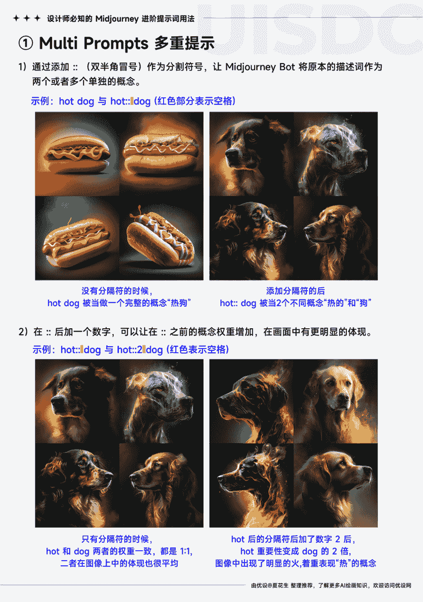
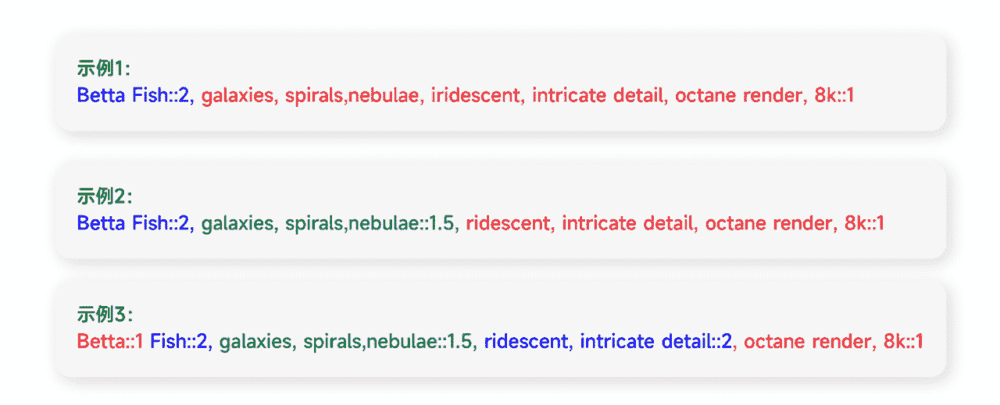
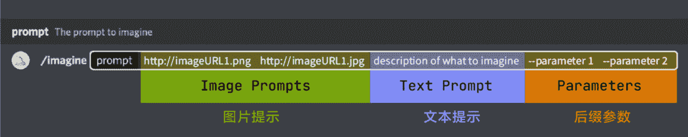
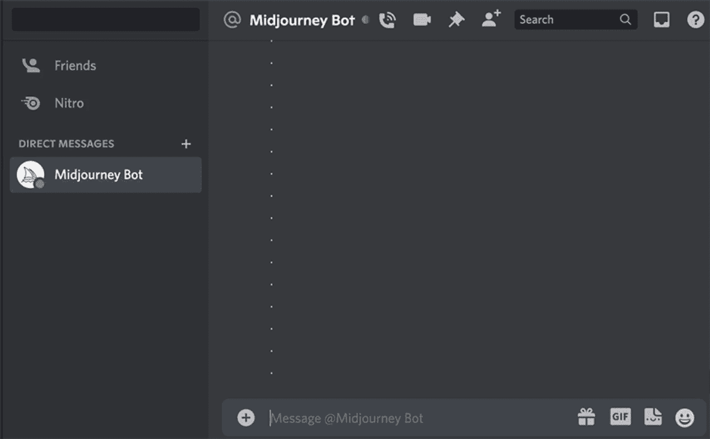
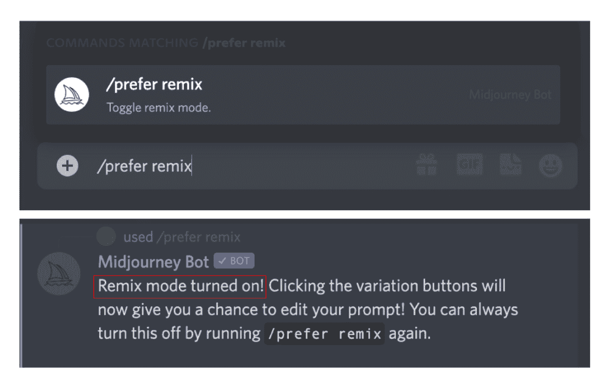
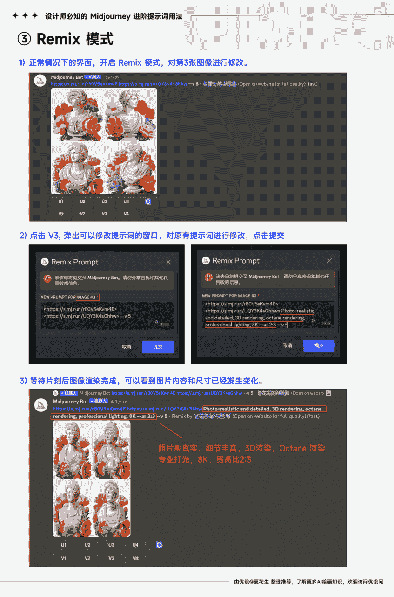
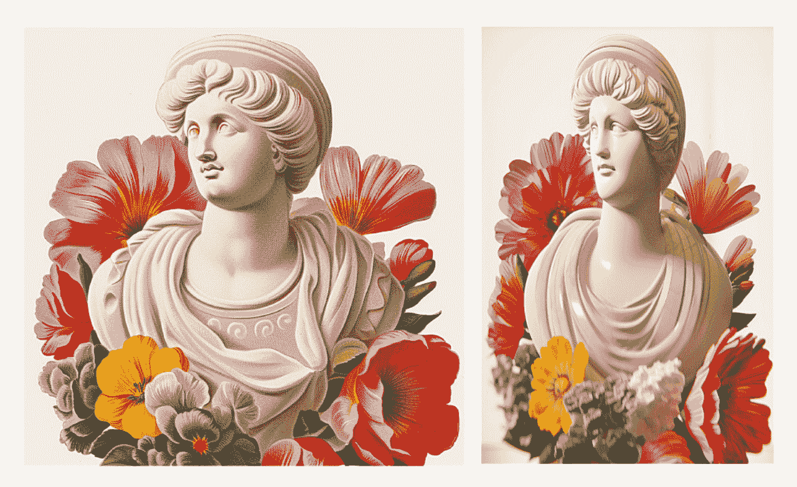
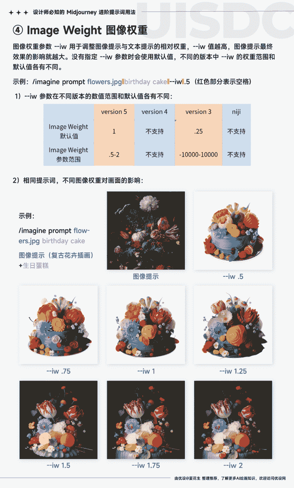
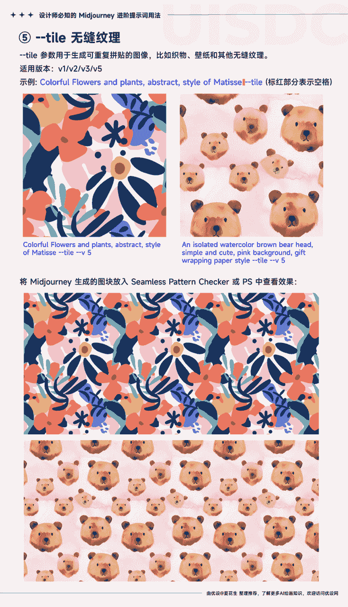

# 5种 Midjourney 进阶提示用法

> 来源：[https://my.feishu.cn/docx/G5AAdeLiboRE0cxlvq9cqMidnBb](https://my.feishu.cn/docx/G5AAdeLiboRE0cxlvq9cqMidnBb)

| 原文地址：uisdc.com/5-midjourney-tips |
| --- |

一、Multi Prompts 多重提示

在写提示词的时候，我们可以通过添加 [:: （两个半角冒号](https://www.uisdc.com/tag/midjourney)）作为分割符号，让 Midjourney Bot 将原本的完整的描述词视作两个或者多个单独的概念，我们还可以通过在 :: 后加上数字，为不同的概念分配的不通过的权重，使生成的图像在内容上对应产生变化。

使用 Image Prompts 需要注意以下几点：

① 如果 :: 后没有添加数字，则默认权重值为 1。

② v1/ v2/ v3 版本的 :: 权重只接受整数，v4 /v5 版本接受有小数点的权重，比如 ::1.2 或 ::-.5

③ 不同概念的权重与具体数值无关，与数值之间的比例有关，也就是以下三种数值最后的效果是一样的，因为最终 hot 的权重都是 dog 的 2 倍。

hot::2 dog 等于 hot::4 dog::2 等于 hot::100 dog::50

④ 带数字的分隔符会影响位于它前面的所有内容，直到新的分隔符切断这种影响。

⑤ 权重为 ::-.5 时，效果与 --no 负提示一样，以下的 2 种表述方式得到效果都是“生机勃勃郁金香花田，没有红色”。

vibrant tulip fields:: red::-.5 等于 vibrant tulip fields --no red

二、Image Prompts 图像提示

除了用文本提示生成图像，我们也可以用图像作为提示来影响最终图像的构图、风格和颜色，也就是“垫图”。图像可以单独使用，也可以与文本提示词结合使用。结合文本提示时，可以同时使用多张图像（最好不超过 5 张），仅用图片作为提示时，最少要有 2 张。

① 图片提示必须以链接的形式，放在提示词的开头。

如果是在线图片，需要复制图片的直接链接，如果是本地图片，可以上传到 midjourney 上，然后复制图片链接，图片链接必须以 .png、.gif 或 .jpg 结尾。

使用图片提示时，提示词组成结构：

② 使用图像提示的操作步骤：

1.  双击文本框左侧的加号，选择一张本地的图片上传，然后按 Enter 将图片发送出去，等待图片上传完成后，点击图片打开大图，单击右键复制图片链接。

1.  在文本框内启用 /image 命令，在 prompt 中粘贴刚刚复制的图片链接（直接用鼠标拖动图片到 prompt 框内，效果和复制粘贴一样），空一格，然后继续输入正常的文本提示词和后缀参数，完成后发送信息，等待图片生成。

1.  可同时添加多个图片链接，链接之间用空格隔开，图片链接一定要位于提示词开头。

③ 使用 Image Prompts 需要注意以下几点：

1.  如果是使用在线图片，链接必须是指向在线图片的直接链接，而非图片来源网页的链接，一般情况下在图片上单击右键可以看到“复制图片链接”的选项。

1.  图像提示在 Midjourney 中对所有人可见，除非开启 Stealth Mode 隐身模式。

**三、Remix 模式**

当一组图像生成好之后，我们可以开启 Remix 模式，修改原有图像的描述词、后缀参数和模型版本，来产生新的图像。Remix 模式具体使用方式如下：

① 在文本框内输入 /prefer remix，按 enter 发送以启用 Remix 模式。（启用后，生成的所有图像都会变成 Remix 模式，再次发送 /prefer remix 可以关闭该模式 ）

② 点击已经生成好的图像下方的 V1/ V2/ V3/ V4 任一按钮，在弹出的文本框内修改原来的提示词，然后提交。（ 正常模式下 V 按钮是用来生成图像变体的，点击后会变成蓝色；开启 Remix 模式后，点击 V 按钮会弹出可以修改原有提示词的窗口，按钮会变成绿色）

原图与 Remix 模式下修改后的图：

启用 Remix 模式 需要注意以下几点：

1.  使用 Remix 更改宽高比会导致图像拉伸变形。

1.  在 Remix 模式中修改后缀参数时，需要注意后缀参数与版本是否契合，比如 --version 4 --stylize 10000 这样的提示不会生效，因为 v4 版本中 Stylize 参数范围是 0-1000，10000 已经超过了这个范围，二者不兼容。

四、--image weight 图像权重

图像权重参数 --iw 用于调整图像提示与文本提示的相对权重，--iw 值越高，图像提示对最终效果的影响就越大。没有指定 --iw 参数时会使用默认值，不同的版本中 --iw 的权重范围和默认值各有不同。

注意：--iw 参数与其他后缀参数一样，需要放在图片链接和文本提示词之后才会起作用。

**五、--tile 无缝纹理**

--tile 参数用于生成可重复拼贴的图像, 比如织物、壁纸以及其他无缝纹理，适用的版本包括 v1/v2/v3 和 v5。Midjourney 只生成一个基础图块，我们可以通过无缝图片检查工具 Seamless Pattern Checker 查看纹理拼接效果，或导入 PS 中利用图案工具进行无缝拼接。

Seamless Pattern Checker：无缝纹理检查 (pycheung.com)

[Photoshop 无缝图案制作： https:](https://uiiiuiii.com/photoshop/12128861.html)//uiiiuiii.com/photoshop/12128861.html

以上就是本期为大家推荐的 5 个 M