# 如何让生成的图片更加可控？

> 来源：`https://my.feishu.cn/docx/AYnAdTTIAonSJixzURLca4r1nRk`

## 一、如何画系列插画

有时候，我们希望能够画一个系列的插画，让主体形象保持稳定，并让它能保持一个风格不变，这个会更适合我们实际工作需要。

举例：画一个人，在保证人物形象基本一致的情况下，让她在服装、表情、动作和场景上做出不一样的表现。有几个方法可以尝试：

### 1. 喂参考图

先把自己喜欢的参考图上传，然后点开上传的图片，复制它的链接。（具体上传的方法，上一篇有讲过，这里不再赘述）

然后在关键词的地方填上：图片链接+这张图的关键词。

例如：`链接图片.png`, a Super cute sports girl, wearing a basketball vest, blueshortsbig watery eyes, clean bright basketball court background, super cute boy IP by pop mart, Bright color, mockup blind box toydisney stylefine luster, 3D render, octane render, best quality, 8k bright front lighting Face Shot, fine luster, ultra detail, `--ar 9:16`

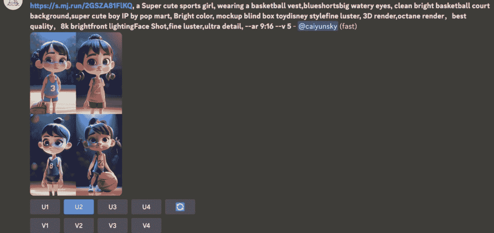

这是参考图

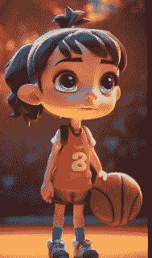

这是生成后的图，基本上还是可以保持她的特征的

接着给她换一件蓝色的衣服，同样的上传她的图片，复制关键词，这次我们把衣服的颜色改一下，在关键词中加入 `wearing a blue basketball vest`

### 2. 使用 panels 命令

`panels` 这个命令可以生成连续的动作和表情设计。如果你希望的是设计一个角色，并拥有连续的动作和表情，用这个命令就会非常方便。（提醒下，如果想画动漫角色可以把模型设置先改为 `niji mode`，画动漫角色效果会更好）

我继续用上面的关键词修改一下作为例子：

`a Super cute sports anime girl,style by Miyazaki Hayao,6 panels with different poses 8K`

（说明：这里的关键词修改，我去掉了 3D 渲染风格，去掉了 3D 风格向的参考图，还去掉了很多修饰性关键词，约束太多可能会导致这个命令失效，我猜测可能是为了能兼顾到各种特征，所以存在一个权重问题，权重后面会讲）

另外，使用 `continuous running` 也可以更稳定的舒服连续动作，甚至可以做成 gif 动画

例如：`a Super cute sports anime girl,style by Miyazaki Hayao,6 panels with continuous running`

可以看到，在 `niji` 模型下，画手还是差点意思，但作为参考图来说，已经挺好了。

### 3. 利用 character sheet 命令

创建一个角色的多角度以及特写细节

例如：`a Super cute sports anime girl,style by Miyazaki Hayao,character sheet,full body,8k`

我也顺便对比了下 `niji` 模型和现在的 `v5` 模型，同样的关键词，生成的结果差别还是挺大的。实测发现 `v5` 在画手方面确实要比 `niji` 更好了。

### 4. 使用 emoji, expression sheet

这里的 `emoji` 代表表情包，`expression sheet` 代表各种表情组合，可以用这个核心关键词设计出表情包

例如，我还想用之前生成的角色做，那么我在关键词前面会把刚才的图片喂给 AI：`图片链接.png a Super cute sports anime girl,style by Miyazaki Hayao,emoji,expression sheet,8k`

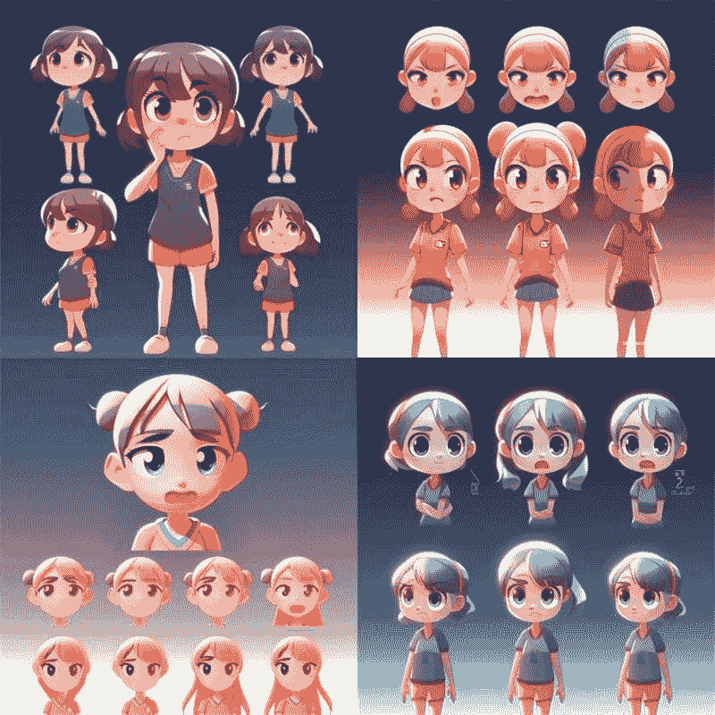

## 二、如何对生成的图片进行微调？

我在使用 AI 做真实需求的时候，就会遇到一个困惑，就算每次复制一样的关键词，但生成图一样会出现很强的随机性。那如何调教它，生成自己想要的图呢？经过我的研究，我发现可以利用 `seed` 参数，反向生成。

### 1. 利用 seed 反向调整

先从官方文档中看看 `seed` 这个参数到底是做啥的：

Midjourney 会用一个种子号来绘图，把这个种子作为生成初始图像的起点。种子号是为每张图随机生成的，但可以使用 `--seed` 或 `--same eseed` 参数指定。使用相同的种子号和提示符将产生类似的结尾图片。详细参数可以看看官方文档：`https://docs.midjourney.com/docs/seeds`

默认情况下，这个种子是随机给的，所以如果我们想要比较相似的图，就需要把 `seed` 固定下来。简单来说，在用的时候，给关键词加一个 `seed` 参数就好，具体数字是多少无所谓（只要在 0‒4294967295 范围内）

比如 `caiyunyiueji is a cute sports anime girl,style by Miyazaki Hayao,emoji,expression sheet,8k --seed 8888`

这样就能保证每次生成的都是一模一样的图了。

那有人可能会问，每次都生成一模一样的图有什么用呢？其实就可以反向利用这个特性，来对已经确定的效果图进行微调了。

比如当我发现有一张图已经比较接近目标了，那么还需要有一些微调，怎么做呢？

思路就是利用确定图片的 `seed`，在它的基础上再加上新的关键词，以此来对它进行微调。

例如：`彩云译设计 is a wild camping girl, cute wind element elf girl, Yellow wavy hair, cartoon styling design, backpack holding camera, Wearing cut duck hat, Dense foliage under strong summer sun Dense leaves under the strong summer sun, gradient style, tide play blind box, clean background, Laugh and sing happily,natural lighting, Bright color,8K, Super Detail, 3D, Depth of Field, Pixar Trend, super realistic, light tracking, complex details, Art background, Super detail, solid color background, fine texture, OC renderer, Ultra HD, fine texture, front body, 3D rendering, 8K，--ar 3:4 --q 2 --v 5`

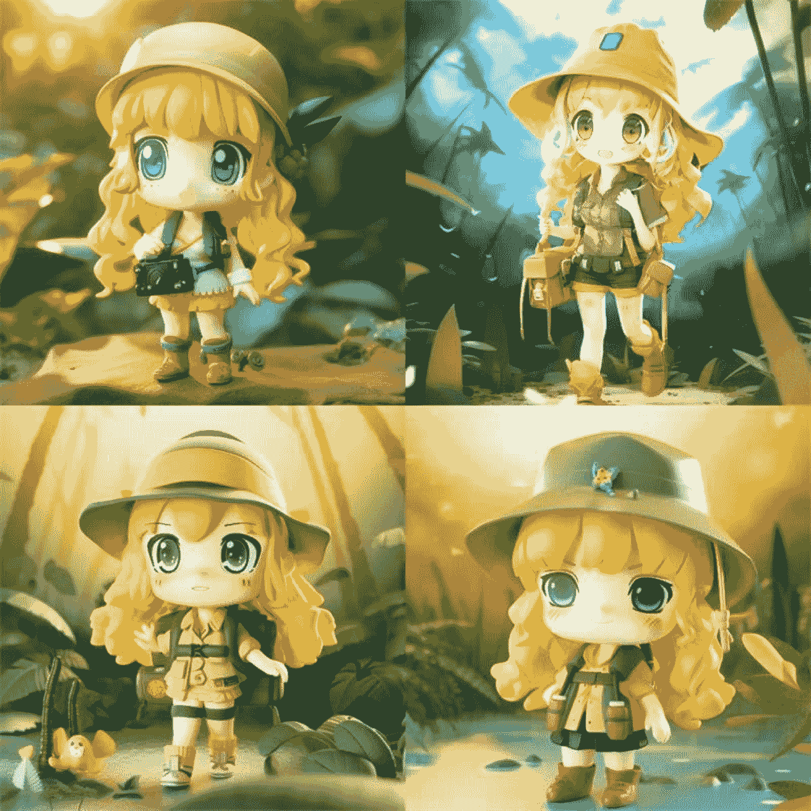

假如我觉得这 4 张图的方向没问题，只是一些细节需要优化，如果我直接让它重新生成，那么可能会跟现在完全不同了。

比如我让它重新生成一次就跟现在的完全不同了

所以，怎么办呢？这里就需要获取它的 `seed` 了（注意：单张图片是拿不到 `seed` 值的）。

方法是给这个生成图添加一个反应表情 `envelope`，那么 Midjourney 就会以私信的方式给你发送这个 `seed`

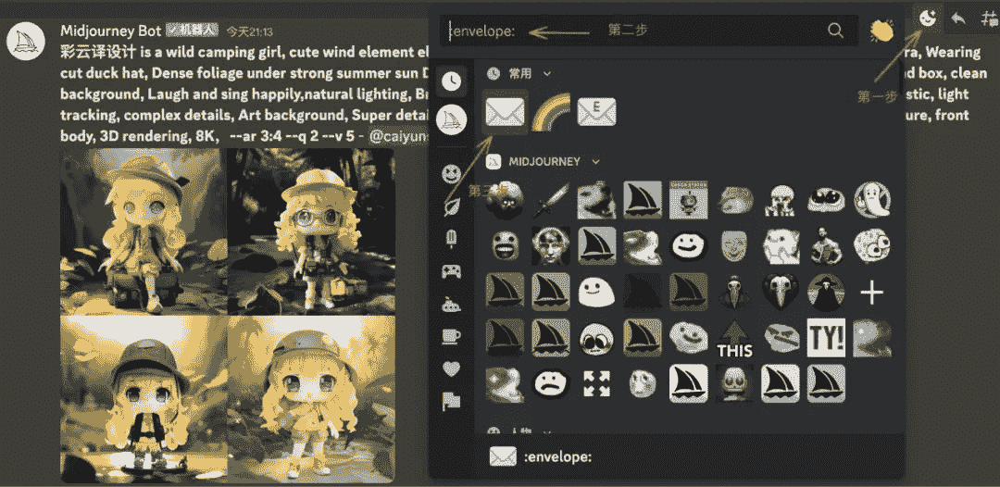

有了 `seed` 后，再把这张图之前的关键词都复制过来，再添加你的修改词，最后在关键词后面加上这个 `seed`，就可以实现对已确定的图片微调了。

例如：我希望她的眼睛是蓝色的

关键词：`彩云译设计 is a wild camping girl, cute wind element elf girl, Yellow wavy hair, blue eyes,cartoon styling design, backpack holding camera, Wearing cut duck hat, Dense foliage under strong summer sun Dense leaves under the strong summer sun, gradient style, tide play blind box, clean background, Laugh and sing happily,natural lighting, Bright color,8K, Super Detail, 3D, Depth of Field, Pixar Trend, super realistic, light tracking, complex details, Art background, Super detail, solid color background, fine texture, OC renderer, Ultra HD, fine texture, front body, 3D rendering, 8K，--ar 3:4 --q 2 --seed 1485209209`

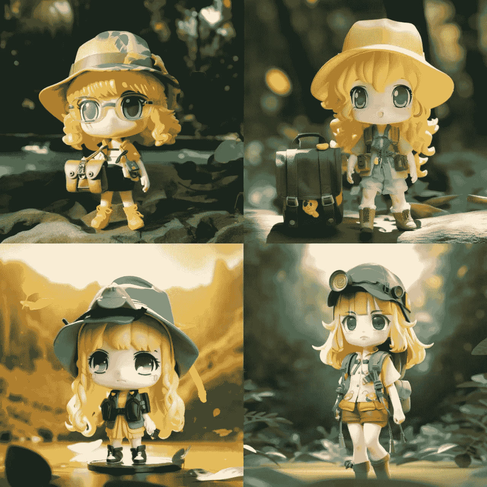

上面的图 U3 就跟之前的图很接近了，其他的图还是会有一些随机性，但这个方法确实是可用的，不同的图效果差别会比较大，你也可以自己去测试。

### 2. remix mode 可调整模式

还有一个办法是在设置中修改 `remix mode` 模式，支持你在给定的框架上做局部的调整

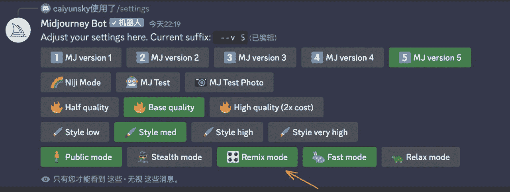

例如：`A specialty food shop selling high-quality Japanese ingredients, such as wagyu beef, matcha tea, and fresh seafood, cute 3d, kawaii, isometric, very detailed, cartoon, casual, gameart --q 2 --ar 2:3 --uplight --v 5`

我希望给 `v3` 增加更多绿植，在 `rexim mode` 模式下，可以直接在弹出框里修改关键词，很方便。默认情况下是关闭的，因为很多时候其实不大需要修改。

关键词：`Long vines envelops the building::2 ,A specialty food shop selling high-quality Japanese ingredients, more long cirrus on the whole building:: 2,such as wagyu beef, matcha tea, and fresh seafood, cute 3d, kawaii, isometric, very detailed, cartoon, casual, gameart --q 2 --ar 2:3 -- uplight --v 5`

## 三、高级参数设置

### 1. 参考图权重

`--iw`，image weight 图像权重，表示图像相对于文字的影响程度，不同版本取值范围不同，`v5` 版本的取值为 0.5-2 之间，在有参考图和关键词的情况下，设置对 AI 绘画影响的比重，数字越大越接近参考图。

例如：我的参考图用了上面生成的这张图

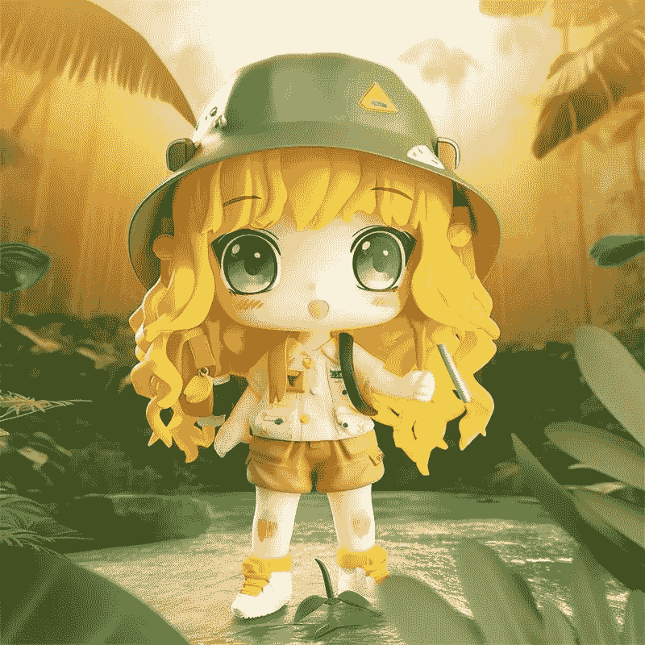

我把参考图的比重写为 0.5：`图片链接.png 彩云译设计 is a wild camping girl, cute wind element elf girl, Yellow wavy hair, blue eyes,cartoon styling design, backpack holding camera, Wearing cut duck hat, Dense foliage under strong summer sun Dense leaves under the strong summer sun, gradient style, tide play blind box, clean background, Laugh and sing happily,natural lighting, Bright color,8K, Super Detail, 3D, Depth of Field, Pixar Trend, super realistic, light tracking, complex details, Art background, Super detail, solid color background, fine texture, OC renderer, Ultra HD, fine texture, front body, 3D rendering, 8K，--ar 3:4 --q 2 --iw 0.5`

当我把参考图比重改为 2 时：`图片链接.png 彩云译设计 is a wild camping girl, cute wind element elf girl, Yellow wavy hair, blue eyes,cartoon styling design, backpack holding camera, Wearing cut duck hat, Dense foliage under strong summer sun Dense leaves under the strong summer sun, gradient style, tide play blind box, clean background, Laugh and sing happily,natural lighting, Bright color,8K, Super Detail, 3D, Depth of Field, Pixar Trend, super realistic, light tracking, complex details, Art background, Super detail, solid color background, fine texture, OC renderer, Ultra HD, fine texture, front body, 3D rendering, 8K，--ar 3:4 --q 2 --iw 2`

整体的效果会更接近参考图的效果。

### 2. 图片融合技巧

上传多种图片进行融合生成，有一个技巧就是一张图片最好只有一种特征，比如合并 2 张图，一张是有人物，另一张是只有背景，那么合并起来的效果会更精确。

### 3. 关键词权重

写普通关键词是用逗号分开，这个应该你都知道了，但其实还可以写多重关键词。它的意思是要 AI 不需要考虑单词的前后关系，而只把它们当成独立的单词，比如 `hot dog` 和 `hot:: dog` (到这里我付费的次数也快用完了，我就用官网上的案例给大家演示了)

`hot dog`

`hot:: dog`

多个单词甚至长句也可以这样用，比如 `cup:: cake:: illustration`

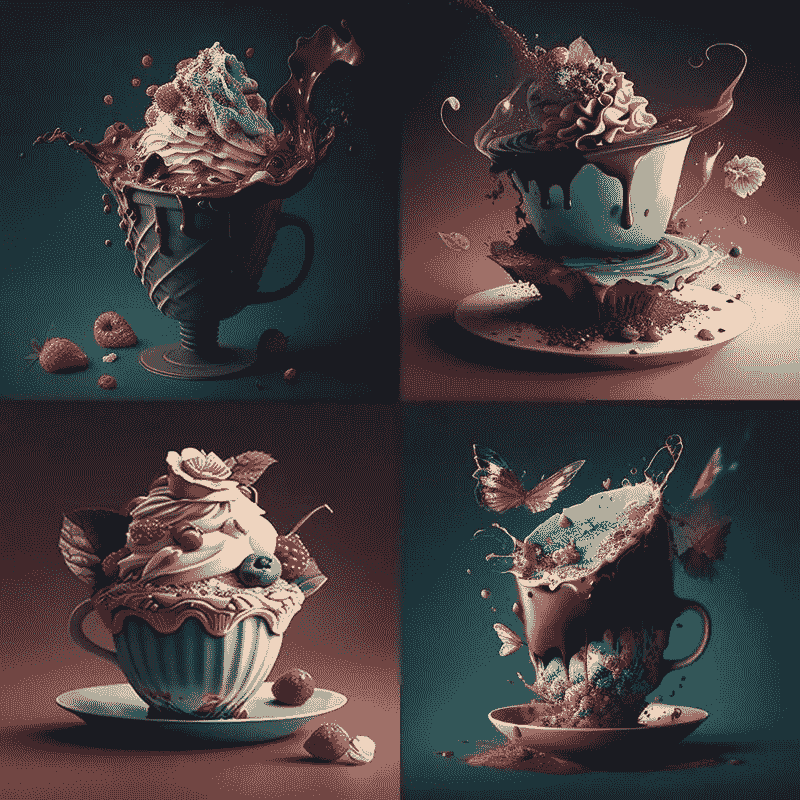

基于这个还有更高级的用法，给不同的单词赋予不同的权重，比如 `hot::2 dog`，可以看到 `hot` 这个词对结果的影响更大了。

有增加权重，也可以减弱权重，比如这个权重可以是负数，意思是减弱某种元素的比重

比如我生成了一张图上面有很多红色

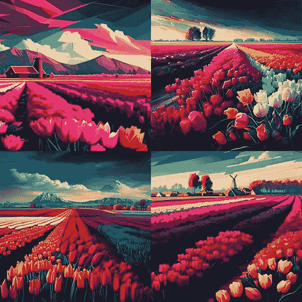

我不希望它出现太多红色，就可以在关键词后面加上 `red::-.5`，这样大红色就少了很多。

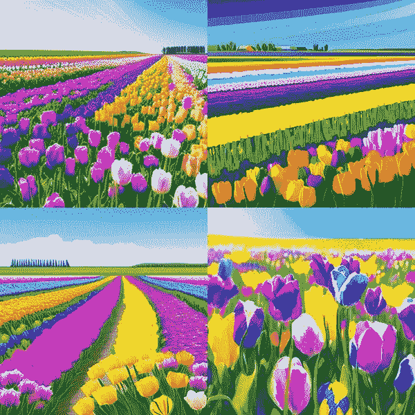

### 4. 降低权重

# Midjourney 参数设置指南

除了使用数值降低某个元素的权重，还可以直接使用 `--no` 这个参数让某个元素尽量弱化，比如我们 AI 生成图的时候，经常会出现手的问题，可以给参数 `--no hands`，这样手出现问题的概率更低。`--no hands` 跟 `hands: -0.5` 是等价的。

## 设置模型版本

不是越高的版本就一定越好，其实每个不同模型的侧重点会有所不同，比如 `--niji` 就是专门针对动漫的模型，`--v 5` 生成的图对摄影类的质量很高。具体的详细内容，可以看看官网介绍

[https://docs.midjourney.com](https://link.uisdc.com/?redirect=https%3A%2F%2Fdocs.midjourney.com%2Fdocs%2Fmodel-versions)/docs/model-versions

## 设置图片比例

`--ar 1：1` 这样就设置了 1：1 的比例，你也可以改成其他支持的比例。

## 其他不常用设置

`--creative` 更适合做脑暴和创意设计，做出来的图脑洞更大，更有创意性

`--chaos 100` 或 `--c 100` 指的是生成图的视觉风格，数值越大，这一组的风格差异就越大。取值范围在 0-100 之间，默认值是 0。

`--stylize 1000` 或 `--s 1000`，数字越大，生成的图片就越有艺术感。取值范围不同版本也不同，`v 5` 版本的范围是 0-1000

## 最后

学习 AI 绘画和学习其他技能一样，也需要自己多练习，在练习的过程中掌握规律。有些知识单看教程觉得好像就是这么回事，但自己真正做的时候又会是另一番景象了。我自己为了写好这篇教程，已经把付费买的次数给用完了，但我觉得是值得的。

通过不断的研究，我对 AI 绘画的知识更熟悉了，最后能把自己研究的高得总结成经验与大家分享，我是很开心的，也希望我的教程对大家有帮助，如果有不明的地方欢迎与我交流。
