# 如何让⽣成的图⽚更加可控？

> 来源：[https://my.feishu.cn/docx/AYnAdTTIAonSJixzURLca4r1nRk](https://my.feishu.cn/docx/AYnAdTTIAonSJixzURLca4r1nRk)

# **⼀、如何画系列插画**

有时候，我们希望能够画⼀个系列的插画，让主体形象保持稳定，并让它能保持⼀个⻛格不变，这个会更适合我们实际⼯作需要。

举例：画⼀个⼈物，在保证⼈物形象基本⼀致的情况下，让她在服装、表情、动作和场景上做出不⼀样的表现。有⼏个⽅法可以尝试：

1.  喂参考图

先把⾃⼰喜欢的参考图上传，然后点开上传的图⽚，复制它的链接。（具体上传的⽅法，上⼀篇有讲过，这⾥不再赘述）

然后在关键词的地⽅填上：图⽚链接+这张图的关键词。

例如：链接图⽚.png, a Super cute sports girl, wearing a basketball vest,blueshortsbig watery eyes, clean bright basketball court background,super cute boy IP by pop mart, Bright color,

mockup blind box toydisney stylefine luster, 3D render,octane render,best quality,8k brightfront lightingFace Shot,fine luster,ultra detail, --ar 9:16

这是参考图

这是⽣成后的图，基本上还是可以保持她的特征的

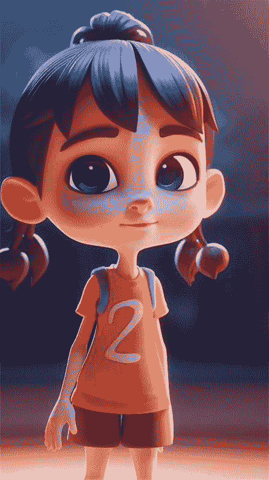

接着给她换⼀件蓝⾊的⾐服，同样的上传她的图⽚，复制关键词，这次我们把⾐服的颜⾊改⼀下，在关键词中加⼀个 wearing a blue basketball vest

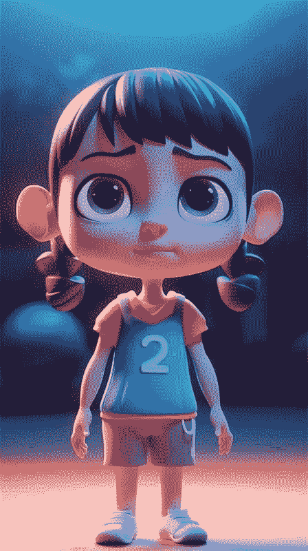

1.  使⽤ panels 命令

Panels 这个命令可以⽣成连续的动作和表情设计。如果你希望的是设计⼀个⻆⾊，并拥有连续的动作和表情，⽤这个命令就会⾮常⽅便。(提醒下，如果想画动漫⻆⾊可以把模型设置先改为 niji mode，画动漫⻆⾊效果会更好)

我继续⽤上⾯的关键词修改⼀下作为例⼦：

a Super cute sports anime girl,style by Miyazaki Hayao,6 panels with different poses 8K

（说明：这⾥的关键词修改，我去掉了 3D 渲染⻛格，去掉了 3D ⻛格向的参考图,还去掉了很多修饰性关键词，约束太多可能会导致这个命令失效，我猜测可能是为了能兼顾到各种特征，所以存在⼀个权重问题，权重后⾯会讲）

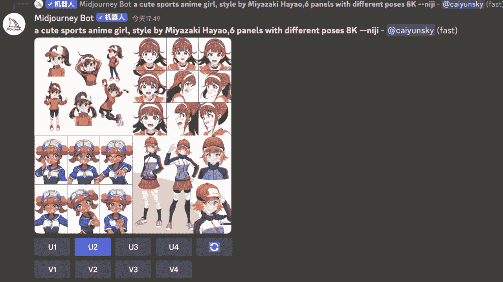

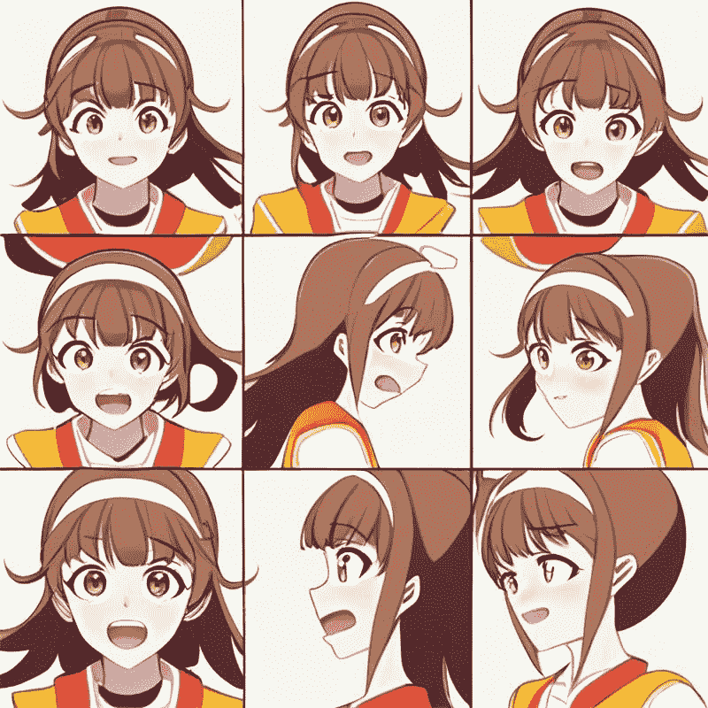

另外，使⽤ continuous running 也可以更稳定的舒服连续动作，甚⾄可以做成 gif 动画

例如：a Super cute sports anime girl,style by Miyazaki Hayao,6 panels with continuous running

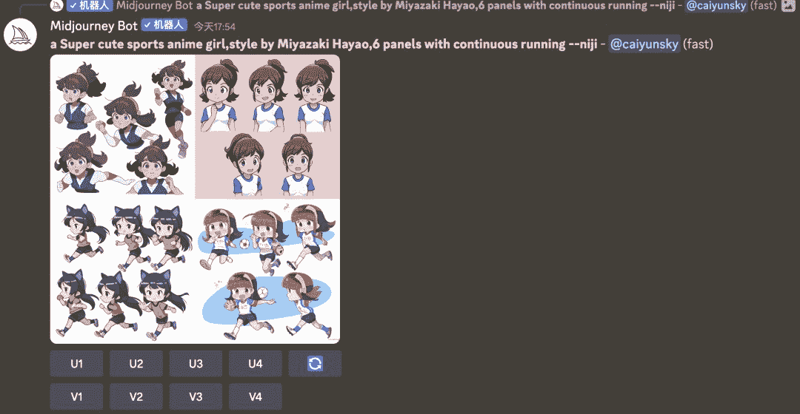

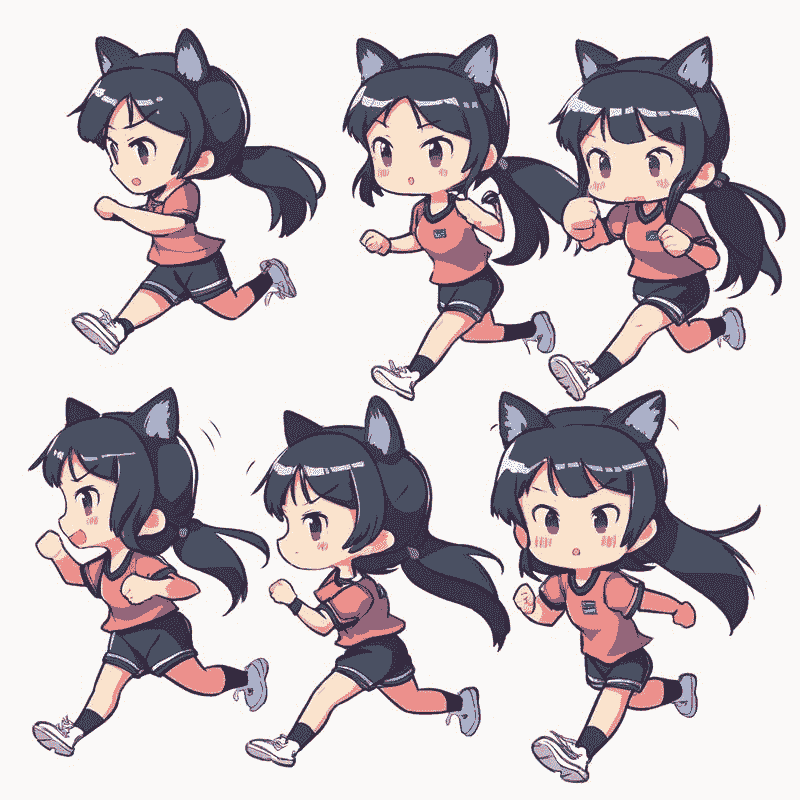

可以看到，在 niji  模型下，画⼿还是差点意思，但作为参考图来说，已经挺好了。

1.  利⽤ character sheet 命令

创建⼀个⻆⾊的多⻆度以及特写细节

例如：a Super cute sports anime girl,style by Miyazaki Hayao,character sheet,full body,8k

我也顺便对⽐了下 niji 模型和现在的 v5 模型，同样的关键词，⽣成的结果差别还是挺⼤的。实测发现 v5 在画⼿⽅⾯确实要⽐ niji 更好了。

1.  使⽤ emoji,expression sheet

这⾥的 emoji 代表表情包，expression sheet 代表各种表情组合，可以⽤这个核⼼关键词设计出表情包

例如，我还想⽤之前⽣成的⻆⾊做，那么我在关键词前⾯会把刚才的图⽚喂给 AI：图⽚链接.png a Super cute sports anime girl,style by Miyazaki Hayao,emoji,expression sheet,8k

# **⼆、如何对⽣成的图⽚进⾏微调？**

我在使⽤ AI 做真实需求的时候，就会遇到⼀个困惑，就算每次复制⼀样的关键词，但⽣成图⼀样会出现很强的随机性。那如何调教它，⽣成⾃⼰想要的图呢？经过我的研究，我发现可以利⽤ seed 参数，反向⽣成。

1.  1. 利⽤ seed 反向调整

先从官⽅⽂档中看看 seed 这个参数到底是做啥的：

Midjourney 会⽤⼀个种⼦号来绘图，把这个种⼦作为⽣成初始图像的起点。种⼦号是为每张图随机⽣成的，但可以使⽤--Seed 或--same eseed 参数指定。使⽤相同的种⼦号和提⽰符将产⽣类似的结尾图

[⽚。详细参数可以看看官⽅⽂档： ht](https://link.uisdc.com/?redirect=https%3A%2F%2Fdocs.midjourney.com%2Fdocs%2Fseeds)tps://docs.midjourney.com/docs/seeds

默认情况下，这个种⼦是随机给的，所以如果我们想要⽐较相似的图，就需要把 seed 固定下来。简单来说，在⽤的时候，给关键词加⼀个 seed 参数就好，具体数字是多少⽆所谓（只要在 0‒4294967295

范围内）

⽐如 caiyunyiueji is a cute sports anime girl,style by Miyazaki Hayao,emoji,expression sheet,8k -- seed 8888

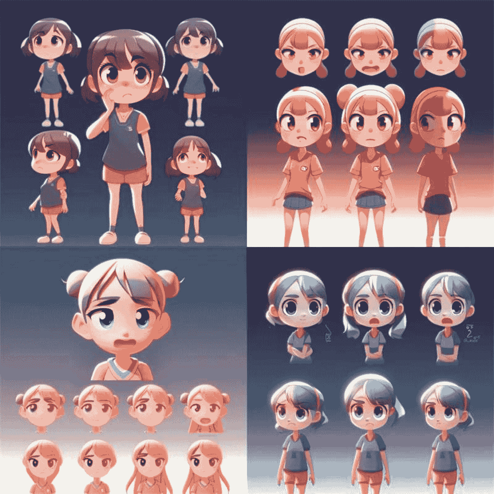

这样就能保证每次⽣成的都是⼀模⼀样的图了。

那有⼈可能会问，每次都⽣成⼀模⼀样的图有什么⽤呢？其实就可以反向利⽤这个特性，来对已经确定的效果图进⾏微调了。

⽐如当我发现有⼀张图已经⽐较接近⽬标了，那么还需要有⼀些微调，怎么做呢？

思路就是利⽤确定图⽚的  seed，再它的基础上再加上新的关键词，以此来对它进⾏微调。

例如：彩云译设计 is a wild camping girl, cute wind element elf girl, Yellow wavy hair, cartoon

styling design, backpack holding camera, Wearing cut duck hat, Dense foliage under strong summer sun Dense leaves under the strong summer sun, gradient style, tide play blind box,

clean background, Laugh and sing happily,natural lighting, Bright color,8K, Super Detail, 3D, Depth of Field, Pixar Trend, super realistic, light tracking, complex details, Art background, Super detail, solid color background, fine texture, OC renderer, Ultra HD, fine texture, front body, 3D rendering, 8K，--ar 3:4 --q 2 --v 5

假如我觉得这 4 张图的⽅向没问题，只是⼀些细节需要优化，如果我直接让它重新⽣成，那么可能会跟现在完全不同了。

⽐如我让它重新⽣成⼀次就跟现在的完全不同了

所以，怎么办呢？这⾥就需要获取它的 seed 了（注意：单张图⽚是拿不到 seed 值的）。

⽅法是给这个⽣成图添加⼀个反应表情 envelope，那么 midjourney 就会以私信的⽅式给你发送这个 seed

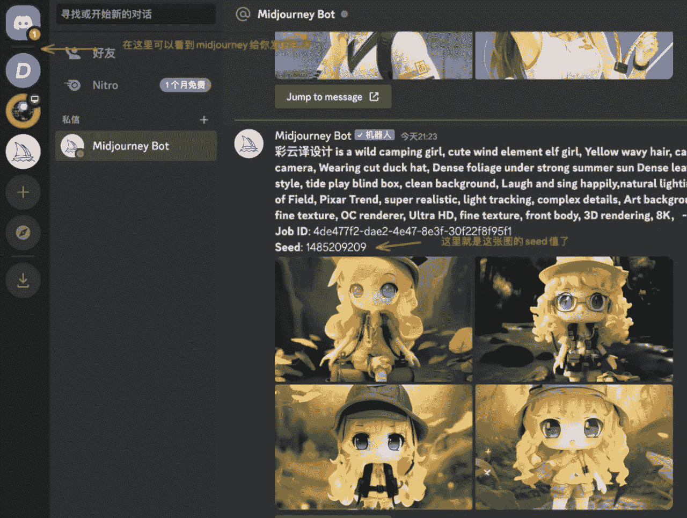

有了 seed 后，再把这张图之前的关键词都复制过来，再添加你的修改词，最后在关键词后⾯加上这个 seed，就可以实现对已确定的图⽚微调了。

例如：我希望她的眼睛是蓝⾊的

关键词：彩云译设计 is a wild camping girl, cute wind element elf girl, Yellow wavy hair, blue

eyes,cartoon styling design, backpack holding camera, Wearing cut duck hat, Dense foliage under strong summer sun Dense leaves under the strong summer sun, gradient style, tide play blind box, clean background, Laugh and sing happily,natural lighting, Bright color,8K, Super Detail, 3D, Depth of Field, Pixar Trend, super realistic, light tracking, complex details, Art background, Super detail, solid color background, fine texture, OC renderer, Ultra HD, fine texture, front body, 3D rendering, 8K，--ar 3:4 --q 2 --seed 1485209209

上⾯的图 U3 就跟之前的图很接近了，其他的图还是会有⼀些随机性，但这个⽅法确实是可⽤的，不同的图效果差别会⽐较⼤，你也可以⾃⼰去测试。

1.  remix mode 可调整模式

还有⼀个办法是在设置中修改 remix mode 模式，⽀持你在给定的框架上做局部的调整

例如：A specialty food shop selling high-quality Japanese ingredients, such as wagyu beef, matcha tea, and fresh seafood, cute 3d, kawaii, isometric, very detailed, cartoon, casual,

gameart --q 2 --ar 2:3 --uplight --v 5

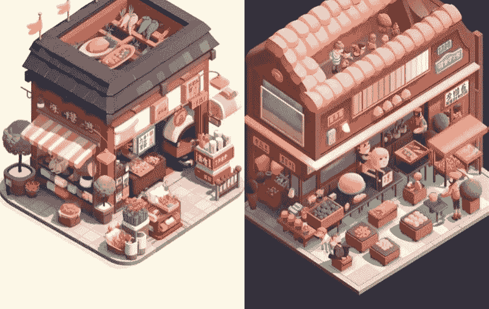

我希望给 v3 增加更多绿植，在 rexim mode 模式下，可以直接在弹出框⾥修改关键词，很⽅便。默认情况下是关闭的，因为很多时候其实不⼤需要修改。

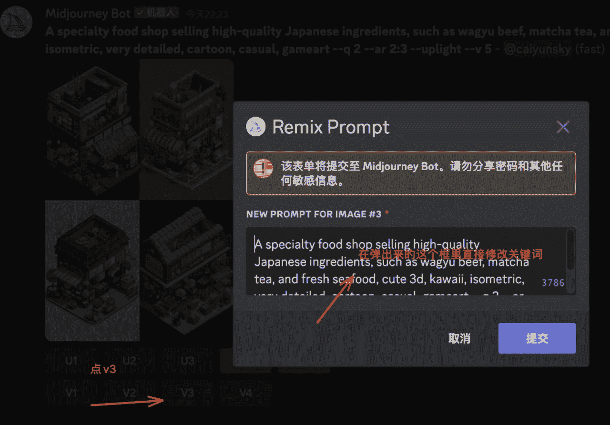

关键词：Long vines envelops the building::2 ,A specialty food shop selling high-quality Japanese

ingredients, more long cirrus on the whole building:: 2,such as wagyu beef, matcha tea, and fresh seafood, cute 3d, kawaii, isometric, very detailed, cartoon, casual, gameart --q 2 --ar 2:3 -- uplight --v 5

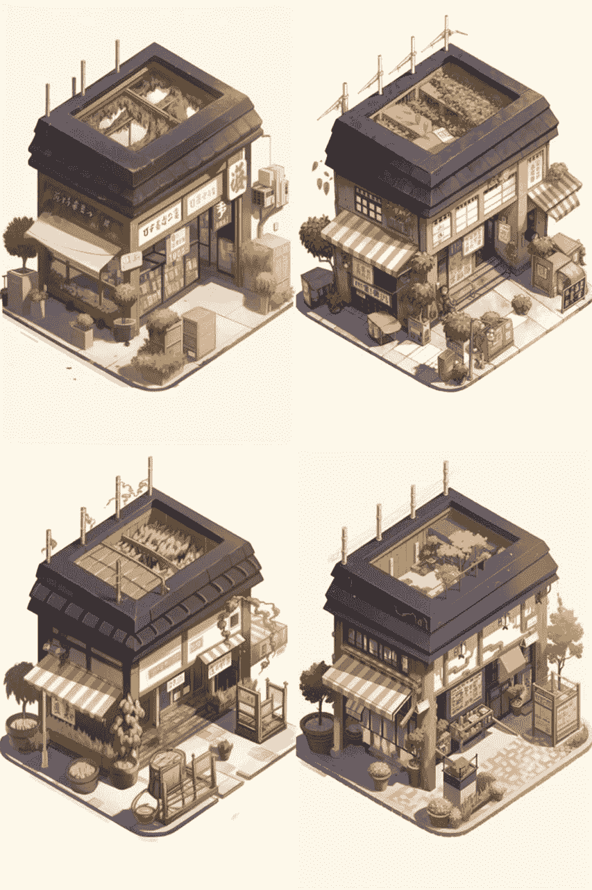

# **三、⾼级参数设置**

1.  参考图权重

--iw，image weight 图像权重，表⽰图像相⽐与⽂字的影响程度，不同版本取值范围不同，v5 版本的取值为 0.5-2 之间，在有参考图和关键词的情况下，设置对 AI 绘画影响的⽐重，数字越⼤越接近参考图。

例如：我的参考图⽤了上⾯⽣成的这张图

我把参考图的⽐重写为 0.5：图⽚链接.png 彩云译设计 is a wild camping girl, cute wind element elf girl, Yellow wavy hair, blue eyes,cartoon styling design, backpack holding camera, Wearing cut

duck hat, Dense foliage under strong summer sun Dense leaves under the strong summer sun, gradient style, tide play blind box, clean background, Laugh and sing happily,natural lighting, Bright color,8K, Super Detail, 3D, Depth of Field, Pixar Trend, super realistic, light tracking, complex details, Art background, Super detail, solid color background, fine texture, OC renderer, Ultra HD, fine texture, front body, 3D rendering, 8K，--ar 3:4 --q 2 --iw 0.5

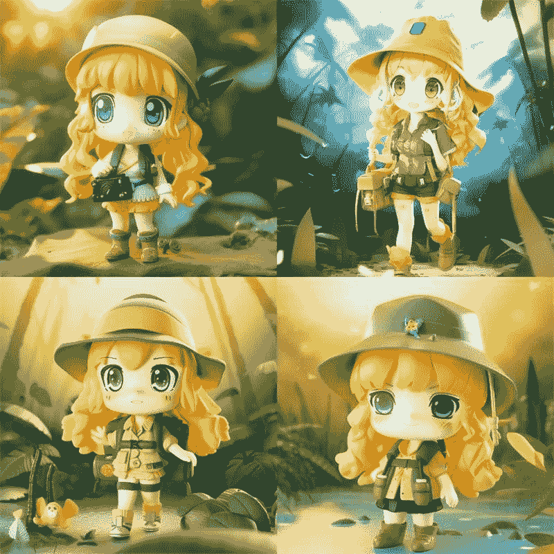

当我把参考图⽐重改为 2 时：图⽚链接.png 彩云译设计 is a wild camping girl, cute wind element elf girl, Yellow wavy hair, blue eyes,cartoon styling design, backpack holding camera, Wearing cut

duck hat, Dense foliage under strong summer sun Dense leaves under the strong summer sun, gradient style, tide play blind box, clean background, Laugh and sing happily,natural lighting, Bright color,8K, Super Detail, 3D, Depth of Field, Pixar Trend, super realistic, light tracking, complex details, Art background, Super detail, solid color background, fine texture, OC renderer, Ultra HD, fine texture, front body, 3D rendering, 8K，--ar 3:4 --q 2 --iw 2

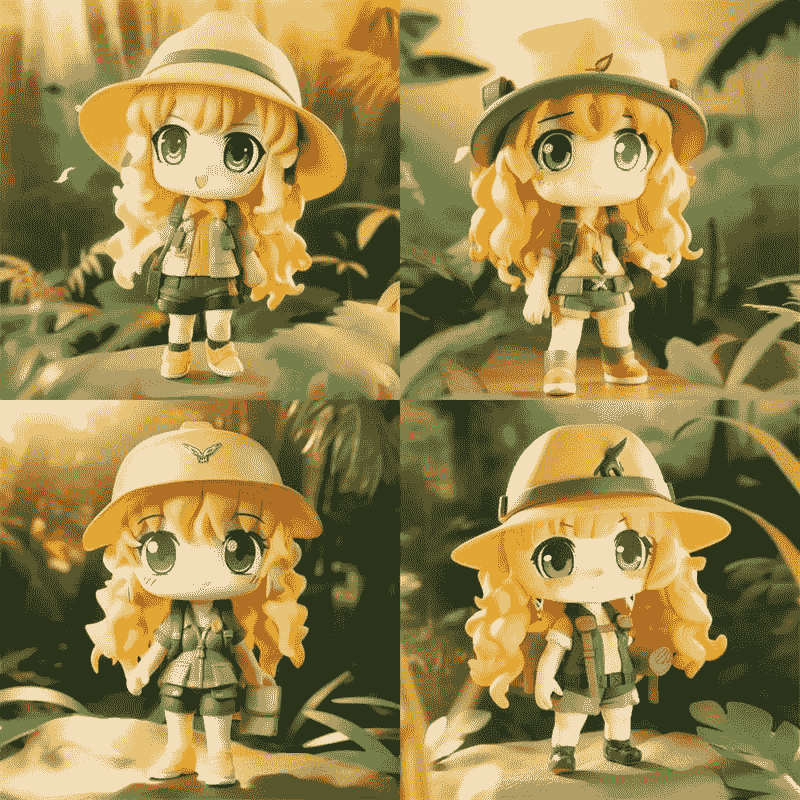

整体的效果会更接近参考图的效果。

1.  图⽚融合技巧

上传多种图⽚进⾏融合⽣成，有⼀个技巧就是⼀张图⽚最好只有⼀种特征，⽐如合并 2 张图，⼀张是有⼈物，另⼀张是只有背景，那么合并起来的效果会更精确。

1.  关键词权重

写普通关键词是⽤逗号分开，这个应该你都知道了，但其实还可以写多重关键词。它的意思是要 AI 不需要考虑单词的前后关系，⽽只把它们当成独⽴的单词，⽐如 hot dog 和 hot:: dog (到这⾥我付费的次数也快⽤完了，我就⽤官⽹上的案例给⼤家演⽰了)

hot dog

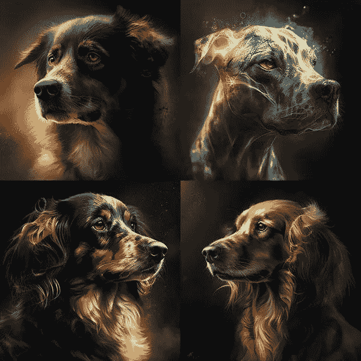

hot:: dog

多个单词甚⾄⻓句也可以这样⽤，⽐如 cup:: cake:: illustration

基于这个还有更⾼级的⽤法，给不同的单词赋予不同的权重 ，⽐如 hot::2 dog，可以看到 hot 这个词对结果的影响更⼤了。

有增加权重，也可以减弱权重，⽐如这个权重可以是负数，意思是减弱某种元素的⽐重

⽐如我⽣成了⼀张图上⾯有很多红⾊

我不希望它出现太多红⾊，就可以在关键词后⾯加上  red::-.5，这样⼤红⾊就少了很多。

1.  降低权重

除了⽤数值降低某个元素的权重，还可以直接⽤--no 这个参数让某个元素尽量弱化，⽐如我们 AI ⽣成图的时候，经常会出现⼿的问题，可以给参数 -- no hands，这样⼿出现问题的概率更低。--no hands跟 hands: -0.5 是等价的。

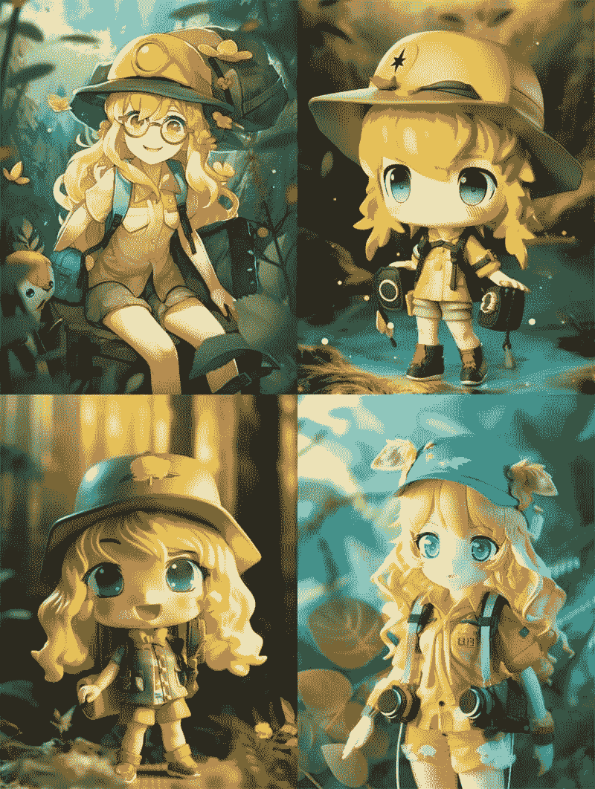

1.  设置 v 版本

不是越⾼的版本就⼀定越好，其实每个不同模型的侧重点会有所不同，⽐如-- niji 就是专⻔针对动漫的模型，--v 5 ⽣成的图对摄影类的质量很⾼。具体的详细内容，可以看看官⽹介绍

[https://docs.midjourney.com](https://link.uisdc.com/?redirect=https%3A%2F%2Fdocs.midjourney.com%2Fdocs%2Fmodel-versions)/docs/model-versions

1.  设置图⽚⽐例

--ar 1：1 这样就设置了 1：1 的⽐例，你也可以改成其他⽀持的⽐例。

1.  还有⼀些不是很常⽤的设置

--creative  更适合做脑暴和创意设计，做出来的图脑洞更⼤，更有创意性

--chaos 100 或--c 100 指的是⽣成图的视觉⻛格，数值越⼤，这⼀组的⻛格差异就越⼤。取值范围在 0-100 之间，默认值是 0。

--stylize 1000 或--s 1000，数字越⼤，⽣成的图⽚就越有艺术感。取值范围不同版本也不同，v 5 版本的范围是 0-1000

# **最后**

学习 AI 绘画和学习其他技能⼀样，也需要⾃⼰多练习，在练习的过程中掌握规律。有些知识单看教程觉得好像就是这么回事，但⾃⼰真正做的时候⼜会是另⼀番景象了。我⾃⼰为了写好这篇教程，已经把付费买的次数给⽤完了，但我觉得是值得的。

通过不断的研究，我对 AI 绘画的知识更熟悉了，最后能把⾃⼰研究的⼼得总结成经验与⼤家分享，我是很开⼼的，也希望我的教程对⼤家有帮助，如果有不明⽩的地⽅欢迎与我交流。