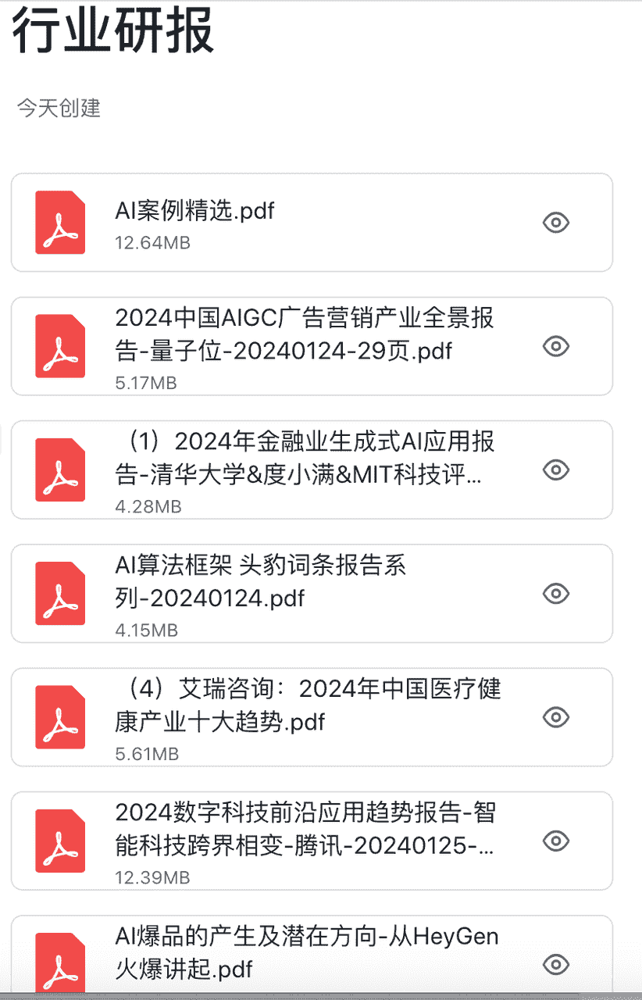
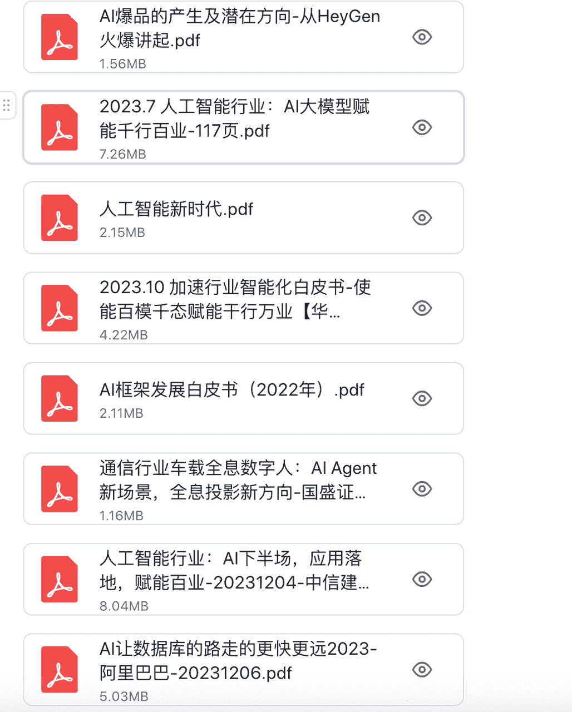
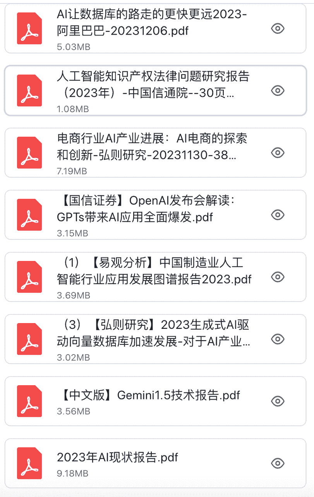
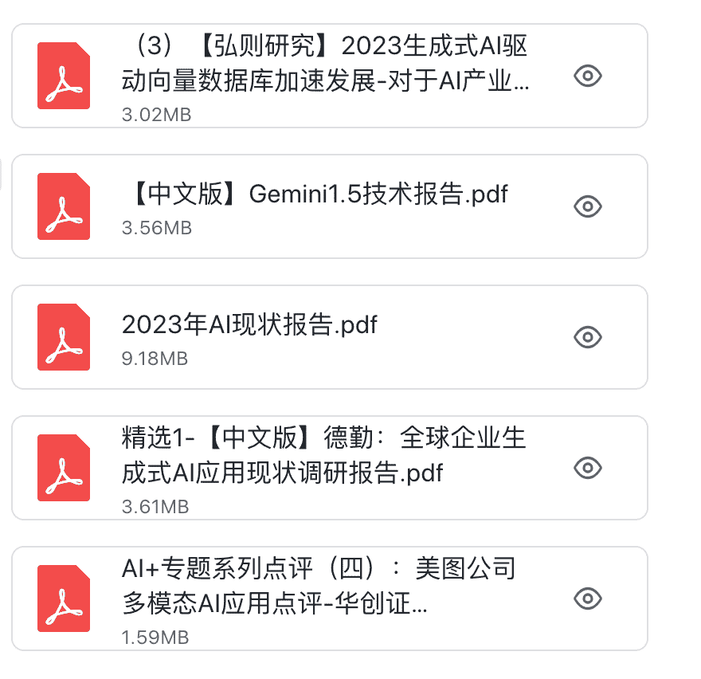
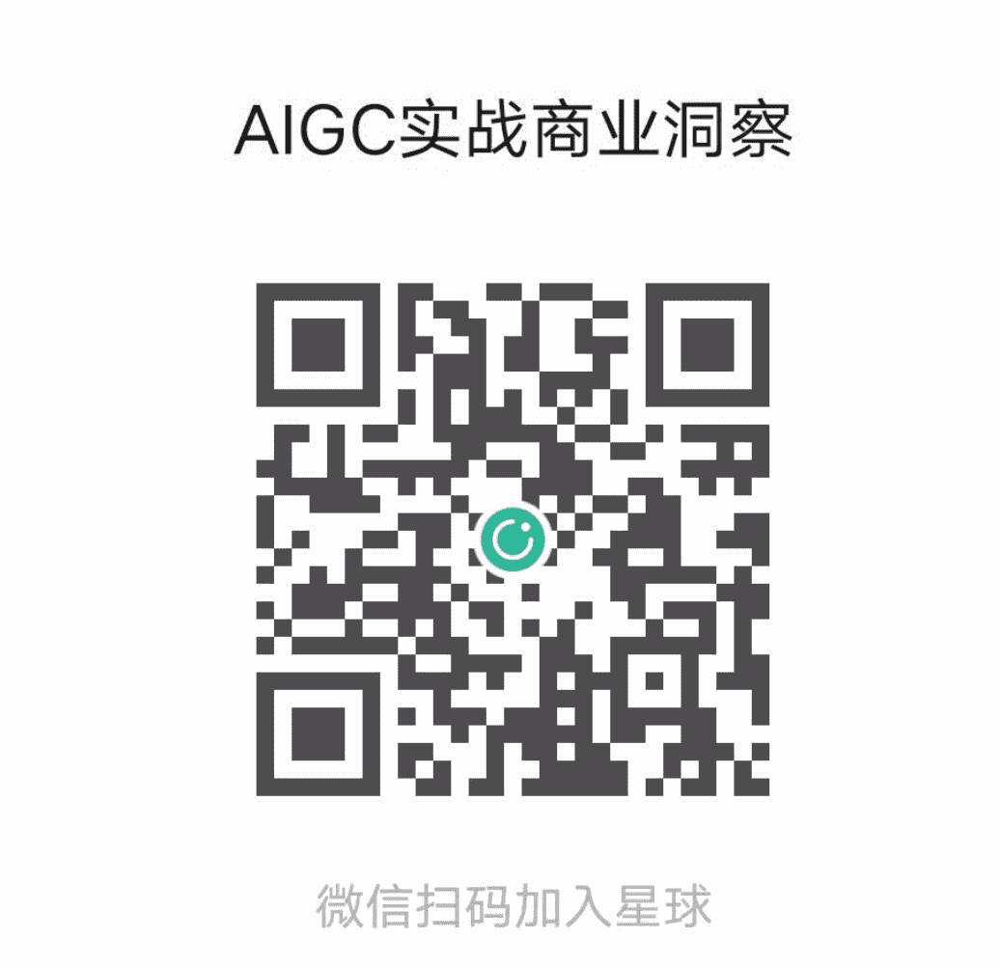

# 行业研报专题（加管理员微信flyoceanfish01，免费获取更多最新研报资源）

> 来源：[https://my.feishu.cn/docx/CqpKdvTeZoZVolxhIiwcSguqnFs](https://my.feishu.cn/docx/CqpKdvTeZoZVolxhIiwcSguqnFs)

请添加管理员微信免费获取，并可以领取免费知识星球

更多案例，可进入知识星球，会陆续补充

添加管理员微信后加入微信群                                                                     知识星球（限时免费）

# 知识星球介绍

> 知识星球目前为试运行阶段，为全免费模式

> 我们的目标是：打造AI 技术与商业实战的高品质平台

#### 实战案例分享

###### 为社群成员定制的AIGC技术应用的深度分析和案例研究，助您在商业竞争中领先一步。

###### 人脉资源

###### **1w+**AI相关从业者，涵盖电商、教育、制造、化工、金融等各行业专家。

###### 私域分享会

###### 定期私域分享，剖析在AIGC技术应用过程中的各种疑问，保持知识和策略始终处于行业前沿。

###### 公开课分享 星球成员免费参与，不定期的A专业相关的名校商学院、企业高管AI公开课（线上 + 线下）。

###### **前沿研报**

###### 定期更新权威机构，如投资机构，券商等专业研报，及时洞察技术动态，商业 动态。

###### 特色海外视角

###### 我们会汇总海外AI 最新动态，提供海外知名AI 人士的最新观点，商业创新模式，提供给社群成员参考。

###### 技能培训

###### 我们后期会组织公益类课程培训业务，为需要的小伙伴提供技术支持服务，并构建常态化学习平台。

>