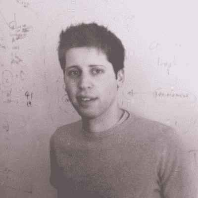
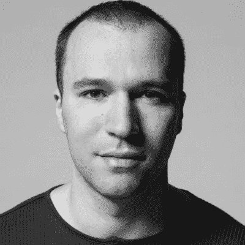
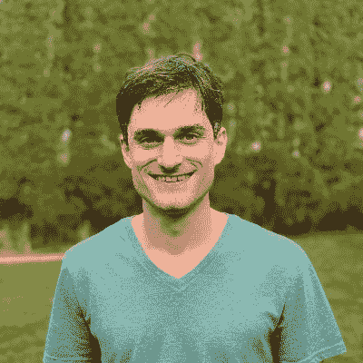
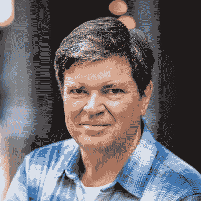

# 海外Twitter AI 人物

> 来源：[https://my.feishu.cn/docx/WjHLdZwG0ouImWxY8X0cgZpSnAd](https://my.feishu.cn/docx/WjHLdZwG0ouImWxY8X0cgZpSnAd)

| 账号 | 名称 | 缩略图 | 备注 |
| --- | --- | --- | --- |
| https://twitter.com/sama | # **Sam Altman** |  | OpenAI 灵魂人物 |
|  | # **Brockman** |  | OpenAI 早期创始人，主要代码贡献者 |
|  | ## Wojciech Zaremba |  | OpenAI 联合创始人,他曾在谷歌和Facebook做人工智能研究,技术大牛之一 |
| https://twitter.com/johnschulman2 | # **John Schulman** |  | OpenAI 技术大牛，机器学习领域灵魂级人物 |
| https://twitter.com/ylecun | # **Yann LeCun** |  | 担任Facebook首席人工智能科学家和纽约大学教授 |
| https://twitter.com/JeffDean | # **Jeff Dean** |  | 迪恩是[谷歌大脑](https://zh.wikipedia.org/wiki/%E8%B0%B7%E6%AD%8C%E5%A4%A7%E8%84%91)负责人。担任谷歌首席科学家并兼任合并后的人工智能部门首席科学家。 |
| https://twitter.com/Azaliamirh | # Azalia Mirhoseini |  | 谷歌团队的高级研究科学家，2019 年《麻省理工科技评论》“35 岁以下科技创新 35 人”。 |