# Softmax 算子加速

> 来源：[https://learning.feishu.cn/docx/JLeXdItWxoH9acxv9bLcOVZgntb](https://learning.feishu.cn/docx/JLeXdItWxoH9acxv9bLcOVZgntb)

# 数学推导

精度上，都是 safe softmax。

性能上，普遍使用 online softmax。

| 算法 | Scan Pass | IO/Element | 备注 |
| --- | --- | --- | --- |
| Naive | 1.  计算分母的 sum | 共 3 次 |  |
| Safe | 1.  计算 max | 4 | 3 轮 IO，成为模型的性能瓶颈 |
| Online | 1.  计算 max &amp; sum | 3 |  |

## Naive Softmax

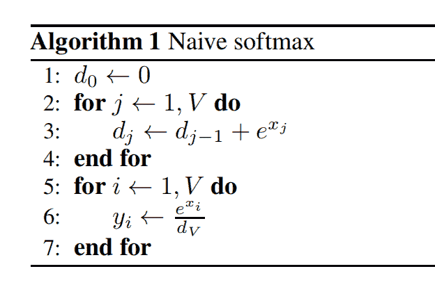

softmax 的数学语义：将输入向量转换为概率分布。

直接计算 x_i / sum(x_i) 无法处理 x_i < 0 的情况。

exp(x) 的值域是[0, +∞)，且单调连续，问题解决。

## Safe Softmax

exp(x) 的值域是[0, +∞)，超出 float 表示范围时会 overflow。

的值域是[0, 1]，不会发生 underflow 或 overflow，提供了很好的数值稳定性。

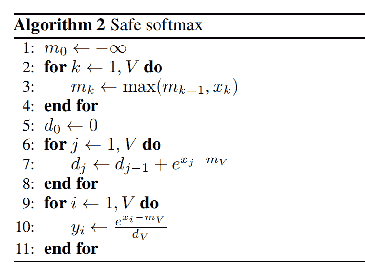

## Online Softmax

核心思想的数学等价性:

softmax(x) = softmax(x - constant)

用 1 轮 IO 同时完成 max & sum 的计算，也减少了一轮内存读写。

注意，理论的加速比是 1.3。因为，每个元素的读写次数，从 3 load + 1 store 将至 2 load + 1 store。

代价是，每个 element 增加 2 个计算：1 mul + 1 exp。新增 cost 不高。

但，要小心 SFU 算力瓶颈的风险。

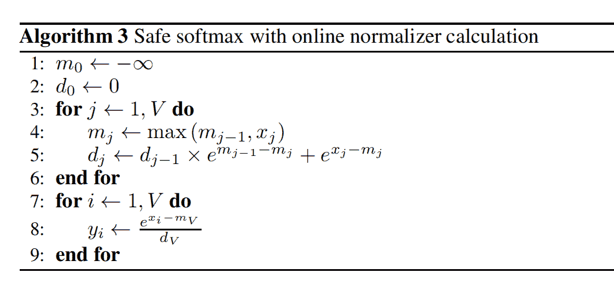

## exp 加速 - 底数替换

数学上，

代码上，

```
exp(x) = exp2(x * 1.4426950408889634)  # 精确的数学变换
```

注：exp 的底数是 e，exp2 的底数是 2。

在某些专用硬件上，exp2 可能比 exp 有更好的性能表现：

+   NPU/TPU 可能有专门的 2^x 硬件单元

+   exp2 的实现可能更简单，电路面积更小，功耗更低。

虽数学上精确等价，实际测试中可能观察到：

+   微小数值差异 (1e-7 到 1e-6 级别)。特别是 input 为 fp16 或更小时。

+   在梯度反向传播中可能累积误差。exp(x) 的导数是 exp(x)。而 exp2(x * k) 的导数是 k * ln(2) * exp2(x * k)

推理一般是可以用的，也是 triton attention 的推荐做法。训练慎用。

```
def exp_softmax(x, dim=-1):
    x_max = torch.amax(x, dim=dim, keepdim=True)
    x_stable = x - x_max

    exp2_x = torch.exp(x_stable)
    sum_exp2 = torch.sum(exp2_x, dim=dim, keepdim=True)
    return exp2_x / sum_exp2


def exp2_softmax(x, dim=-1):
    x_max = torch.amax(x, dim=dim, keepdim=True)
    x_stable = x - x_max

    q_scale = 1.4426950408889634  # = 1.0 / ln(2), 1.0 / math.log(2)
    exp2_x = torch.exp2(x_stable * q_scale)
    sum_exp2 = torch.sum(exp2_x, dim=dim, keepdim=True)
    return exp2_x / sum_exp2
```

# GPU 理论性能推演 - Online Softmax

Key operators:

1.  ReduceMax

1.  ReduceSum

1.  Exp (element wise)

1.  Div (element wise)

draft - 以下经验数字尚未实测证实

Softmax 的典型输入 Shape 是:(Batch, SeqLen)。

Batch 之间相互独立。每个 (1, SeqLen) 上做 reduce_max 和 reduce_sum。

SeqLen 从小到大，存在 warp_reduce, block_reduce 等不同高性能需求，实现方案不同。

实现策略（基于 SeqLen）:

+   Warp-Level：SeqLen ∈ [1, 256]（32 Threads * elemPerThreads）

+   elemPerThreads 一般最大 8。

+   Reduce 技术：__shfl_xor_sync, __shfl_down_sync 等 warp shuffle 指令。

+   Block-Level: SeqLen ∈ [128, 8192]（32 * elemPerThreads * warpsPerBlock）

+   warpsPerBlock 一般取 4。受限于 Shared Memory 容量和 Block 线程数限制等。

+   Reduce 技术：warp 间 reduce 用 Shared Memory, 考虑 double buffer。

+   Tiled/Online：SeqLen ∈ [2048, ∞]

+   Reduce 技术：循环加载、迭代归约、共享内存缓存。

+   核心：减少 Global Memory，Shared Memory 反复读写。避免 register spill。

注意：

1.  SeqLen 下限暂时随便写的。主要想表达，实际的最佳分界线一般是有交叠的。

1.  一般不要发生 block 间 reduce，需通过 global memory 交换数据。如果是 triton kernel，还要实现第 2 个 reduce kernel。慢且复杂

1.  如果 Batch 小且 SeqLen 很大(比如 1M），并行的收益超过 block 间通信，则 block 间 reduce 则有收益。即，开启 SeqLen 并行。

## Warp-Level 性能模型

计算复杂度：

```
总操作数 = Batch × SeqLen × (2 load + 1 store + 3 arithmetic)
带宽需求 = Batch × SeqLen × 4 bytes × 3 (读+写+临时)
```

瓶颈分析：

+   小 SeqLen：指令吞吐是瓶颈

+   接近 256：内存带宽开始成为瓶颈

SeqLen ∈ [1, 256]（32 Threads * elemPerThreads）

关键是 elemPerThreads 最大值的选取。

硬约束是 Max Register per Thread。（Nvidia PTX 约定了 255 个 32bit reg）

实践上，当 elemPerThreads 超过 8 时，还要考虑 Occupancy，warp 指令调度效率，128 bytes cache line 对齐等因素。

> Nvidia PTX 约定了 Max 32 bit Register per Thread 是 255 个。

> （硬件上，可能是 256 个 reg，保留了 1 个给系统或编译器）。

TODO - PTX 实际编译一下，看看指令数量和寄存器需求。

## Block-Level 性能模型

资源约束方程：

```
共享内存需求 = warpsPerBlock × (2 × 4 bytes)  # 存储各warp的max/sum
           = 4 × 8 = 32 bytes

寄存器需求 = threadsPerBlock × registersPerThread
         = 128 × ~20 = ~2.5KB
```

性能特征：

+   计算与通信重叠良好

+   Shared Memory Bank Conflicts 可能成为瓶颈

## Tiled/Online Softmax 性能模型  - TODO

# GPU Benchmarks

## V100 - from Softmax Paper

batch = 4000

online softmax 做到了与 naive 基本相同的速度。

at that point L1 and L2 cache thrashing starts to make all three algorithms limited by the DRAM bandwidth

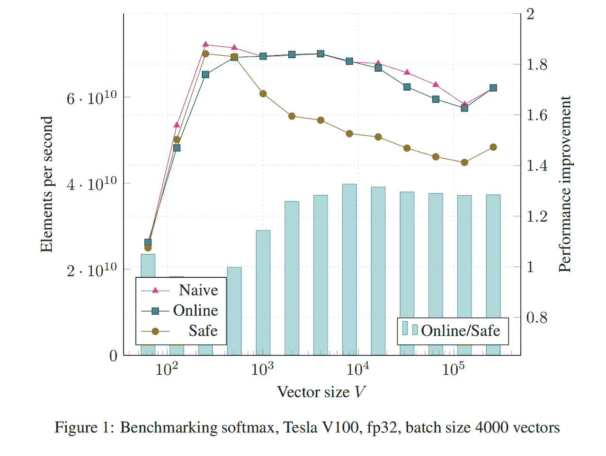

batch = 10

vector size 达到 10k 时，才开始体现优势。

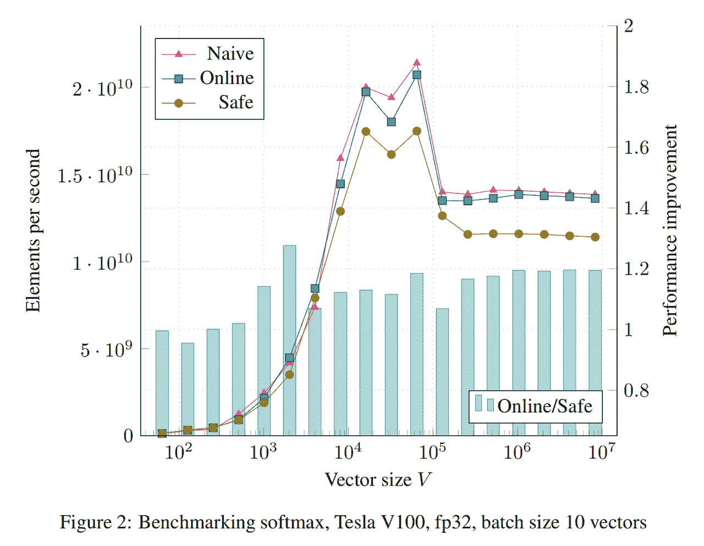

## RTX 3090 - OneFlow

2020 年

测试环境是 GeForce RTX™ 3090 GPU，数据类型是half，Softmax的Shape = (49152, num_cols)，其中49152 = 32 * 12 * 128，是BERT-base网络中的attention Tensor的前三维，我们固定了前三维，将最后一维动态变化，测试了从32到32768不同大小的Softmax前向Kernel和反向Kernel的有效显存带宽。从上面两张图中可以看出OneFlow在多数情况下都可以逼近理论带宽（800GB/s左右，与cudaMemcpy的访存带宽相当。官方公布的理论带宽为936GB/S）。并且在所有情况下，OneFlow的CUDA Kernel的有效访存带宽都优于cuDNN的实现。

warp level 允许的最大 SeqLen=1024，反推出 elemPerThreads=32。

来源：https://github.com/Oneflow-Inc/oneflow/pull/4058

| cols | size(GB) | t warp(us) | t smem(us) | T uncached(us) | T cudnn(us) | bw warp | bw smem | bw uncached | bw cudnn |
| --- | --- | --- | --- | --- | --- | --- | --- | --- | --- |
| 32 | 0.00585938 | 18 | 103 | 1230 | 406 | 325.5208 | 56.88714 | 4.76372 | 14.43196 |
| 64 | 0.01171875 | 22 | 103 | 1210 | 413 | 532.6705 | 113.7743 | 9.684917 | 28.3747 |
| 128 | 0.0234375 | 32 | 112 | 1210 | 427 | 732.4219 | 209.2634 | 19.36983 | 54.88876 |
| 256 | 0.046875 | 62 | 133 | 1240 | 454 | 756.0484 | 352.4436 | 37.80242 | 103.2489 |
| 512 | 0.09375 | 122 | 201 | 1260 | 506 | 768.4426 | 466.4179 | 74.40476 | 185.2767 |
| 1024 | 0.1875 | 244 | 269 | 1360 | 613 | 768.4426 | 697.026 | 137.8676 | 305.8728 |
| 2048 | 0.375 |  | 484 | 1660 | 828 |  | 774.7934 | 225.9036 | 452.8986 |
| 4096 | 0.75 |  | 964 | 2520 | 1350 |  | 778.0083 | 297.619 | 555.5556 |
| 8192 | 1.5 |  | 2230 | 2920 | 4210 |  | 672.6457 | 513.6986 | 356.2945 |
| 16384 | 3 |  |  | 4720 | 10690 |  |  | 635.5932 | 280.6361 |
| 32768 | 6 |  |  | 11950 | 20940 |  |  | 502.0921 | 286.533 |

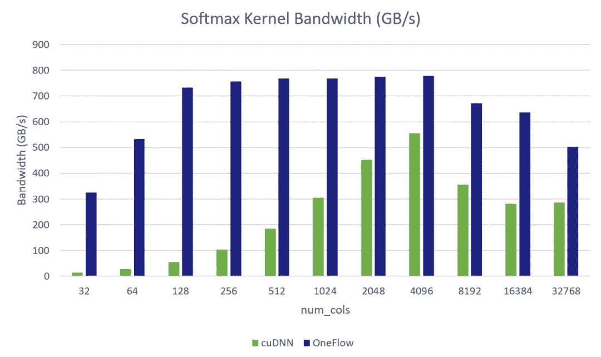

# CPU Softmax

## AVX 指令的 Softmax 实现

Try to enable AVX512 instruction

softmax 的函数方程并不复杂，实现的关键点在于如何实现 exp ，下面的实现中参考了

https://stackoverflow.com/questions/48863719/fastest-implementation-of-exponential-function-using-avx

```
void _AVX_Softmax(float* dest, const float* source, size_t size) {
  float tmpfloat8[8];
  int count = size / 8;

  // step 1: get maxValue
  float maxValue = source[0];
  if (count &gt; 0) {
    auto maxVal = _mm256_loadu_ps(source);
    for (int i = 1; i &lt; count; i++) {
      maxVal = _mm256_max_ps(maxVal, _mm256_loadu_ps(source + i * 8));
    }
    _mm256_storeu_ps(tmpfloat8, maxVal);
    maxValue = tmpfloat8[0] &gt; tmpfloat8[1] ? tmpfloat8[0] : tmpfloat8[1];
    for (int i = 2; i &lt; 8; i++) {
      maxValue = maxValue &gt; tmpfloat8[i] ? maxValue : tmpfloat8[i];
    }
  }

  // step 2: get exp(x - maxValue) and sum(exp(x - maxValue))
  float sumValue = 0.f;
  if (count &gt; 0) {
    auto sumVal = _mm256_set1_ps(0.f);
    auto p0 = _mm256_set1_ps(0.6931471805599453);
    auto p1 = _mm256_set1_ps(1.4426950408889634);
    auto p2 = _mm256_set1_ps(1.f);
    auto p3 = _mm256_set1_ps(1.f);
    auto p4 = _mm256_set1_ps(0.5);
    auto p5 = _mm256_set1_ps(0.1666666666666666);
    auto p6 = _mm256_set1_ps(0.041666666666666664);
    auto p7 = _mm256_set1_ps(0.008333333333333333);
    auto xMax = _mm256_set1_ps(87);
    auto xMin = _mm256_set1_ps(-87);
    auto basic = _mm256_set1_epi32(1 &lt;&lt; 23);
    auto temp127 = _mm256_set1_epi32(127);

    for (int i = 0; i &lt; count; ++i) {
      auto x = _mm256_sub_ps(_mm256_loadu_ps(source + i * 8),
                             _mm256_set1_ps(maxValue));
      x = _mm256_max_ps(x, xMin);
      x = _mm256_min_ps(x, xMax);
      auto div = _mm256_mul_ps(x, p1);
      auto divInt = _mm256_cvtps_epi32(div);
      div = _mm256_cvtepi32_ps(divInt);
      auto div2 = _mm256_add_epi32(divInt, temp127);
      div2 = _mm256_mullo_epi32(div2, basic);
      auto expBasic = _mm256_castsi256_ps(div2);
      auto xReamin = _mm256_sub_ps(x, _mm256_mul_ps(div, p0));
      auto t = xReamin;
      auto c0 = _mm256_mul_ps(p7, t);
      auto c1 = _mm256_add_ps(c0, p6);
      auto c2 = _mm256_mul_ps(c1, t);
      auto c3 = _mm256_add_ps(c2, p5);
      auto c4 = _mm256_mul_ps(c3, t);
      auto c5 = _mm256_add_ps(c4, p4);
      auto c6 = _mm256_mul_ps(c5, t);
      auto c7 = _mm256_add_ps(c6, p3);
      auto c8 = _mm256_mul_ps(c7, t);
      auto c9 = _mm256_add_ps(c8, p2);
      auto expRemain = c9;
      auto expRes = _mm256_mul_ps(expBasic, expRemain);
      sumVal = _mm256_add_ps(expRes, sumVal);
      _mm256_storeu_ps(dest + 8 * i, expRes);
    }
    _mm256_storeu_ps(tmpfloat8, sumVal);
    for (int i = 0; i &lt; 8; i++) {
      sumValue += tmpfloat8[i];
    }
  }

  auto param = 0.6931471805599453;
  float xLimit = 87;

  // step 3: get x / sum and store
  for (int i = 0; i &lt; count; ++i) {
    // using  1 / ((1 / x) * sum) instead x * (1 / sum) or x / sum for some bugs
    // in intel cpu
    auto x = _mm256_rcp_ps(_mm256_loadu_ps(dest + 8 * i));
    auto y = _mm256_set1_ps(sumValue);
    auto z = _mm256_rcp_ps(_mm256_mul_ps(x, y));
    _mm256_storeu_ps(dest + 8 * i, z);
  }
}
```

## Intel CPU Profiling - openvino

基于 openvino，在 intel 服务器 CPU 上测试 softmax 单算子的性能。

使用 perf 和 flamegraph 分析 cycles、cache-misses、branch-misses 等关键性能指标，建立详细性能模型。

关键结论：

1.  Numa 绑核，可加速 28.5 倍。

存在的问题，测试脚本的 bug，跑的 seq length = 1，没测到 2048，10k 等更典型的长 sequence length 场景。

### 测试命令

```
sudo **perf** stat -B -e task-clock,context-switches,page-faults,cache-references,cache-misses,cycles,instructions,branches,branch-misses,faults,migrations  ./build/intel64/Release/op_test ./model/softmax.onnx
```

测试基于openvino接口，测试数据shape为{2048,2048}的随机数据, 测试命令在/workspace/cpu_profiling目录下执行。

### cycles 数 & 算力分析

备注：attention_mask 全设置 True

```
run 10000 times :3245ms

 Performance counter stats for &#x27;./build/intel64/Release/chatglm6b_subgraph2 ./model/chatglm_6b_1decoder-subgraph-2-shape.onnx&#x27;:

      89895.426132      task-clock (msec)         #   26.493 CPUs utilized          
            78,425      context-switches          #    0.872 K/sec                  
            14,231      page-faults               #    0.158 K/sec                  
     1,790,617,645      cache-references          #   19.919 M/sec                  
         2,116,789      cache-misses              #    0.118 % of all cache refs    
   303,361,581,766      cycles                    #    3.375 GHz                    
   344,457,394,423      instructions              #    1.14  insn per cycle         
    64,819,123,113      branches                  #  721.050 M/sec                  
       163,653,695      branch-misses             #    0.25% of all branches        
            14,231      faults                    #    0.158 K/sec                  
               291      migrations                #    0.003 K/sec                  

       3.393221667 seconds time elapsed
```

Latency: 0.339ms

消耗的 cpu core: 26.493

估算逻辑：

2 台 CPU 共 224 个 core。保守估计，只分 50%，则 112 个 core 可以用。

如果有 96 个 decoder:

eval('303,361,581,766 * 96 / 3.375 / 112 / 1000,000,000 / 10'.replace(',', '')) = 7.7ms

另一种估算方案:

0.339 * 26.493 / 112 * 96 = 7.698 ms

TPS = 1000/7.7 = 130 token/s (tps 的预期应该是几万，根本不满足需求)

当前是 batch=1，seq=1，预计没发挥 AVX512 的效力。

当 seq length 拉长，数据类型 fp16，AVX512 预计加速 512/16=32 倍的 tps。

即，tps 是 130 token/s * 32 = 4160 token/s。

如果 output seq=2048 时，macs 数量增加 2048 倍，则 tps 下降 2000 倍，只有 4 token/s。

点评：4160 token/s 的情况，勉强够看，但距离上万，甚至 10 万的 tps，CPU 侧可能还需要加速 4-20 倍以上。

### FlameGraph 分析

```
sudo perf record -g --call-graph dwarf ./build/intel64/Release/chatglm6b_subgraph2  ./model/chatglm_6b_1decoder-subgraph-2-shape.onnx
# outputs

flame_graph perf.data
```

大部分时间都是 各种 lock，wait，queue 类的操作。怀疑是多核、多进程、线程同步导致的问题。

实际的计算时间占比，很小。

优化思路，numa 绑核试一下。

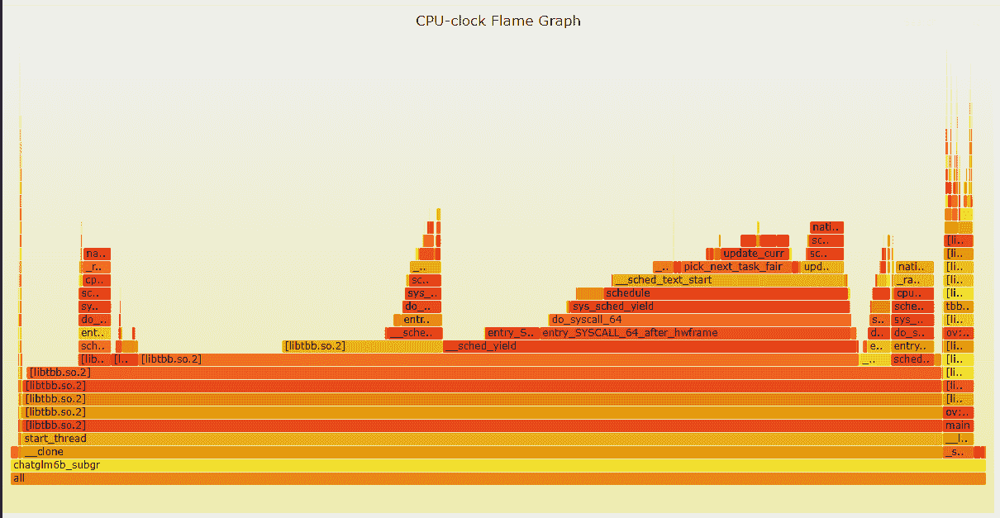

### Numa 加速 28.5 倍

```
sudo perf stat -B -e task-clock,context-switches,page-faults,cache-refer**ences,cache-mi**sses,cycles,instructions,branches,branch-misses,faults,migrations numactl -C 0-1 ./build/intel64/Release/chatglm6b_subgraph2  ./model/chatglm_6b_1decoder-subgraph-2-shape.onnx

sudo perf record -g --call-graph dwarf numactl -C 0-1 ./build/intel64/Release/chatglm6b_subgraph2  ./model/chatglm_6b_1decoder-subgraph-2-shape.onnx
# outputs:
Lowering default frequency rate to 2750.
Please consider tweaking /proc/sys/kernel/perf_event_max_sample_rate.
4
run 10000 times :1632ms
[ perf record: Woken up 289 times to write data ]
[ perf record: Captured and wrote 73.759 MB perf.data (9201 samples) ]
```

```
run 10000 times :1610ms

 Performance counter stats for &#x27;numactl -C 0-1 ./build/intel64/Release/chatglm6b_subgraph2 ./model/chatglm_6b_1decoder-subgraph-2-shape.onnx&#x27;:

       3322.834942      task-clock (msec)         #    1.913 CPUs utilized
               441      context-switches          #    0.133 K/sec
             9,119      page-faults               #    0.003 M/sec
       149,696,221      cache-references          #   45.051 M/sec
           896,840      cache-misses              #    0.599 % of all cache refs
    11,122,993,545      cycles                    #    3.347 GHz
    16,287,097,156      instructions              #    1.46  insn per cycle
     3,403,512,043      branches                  # 1024.280 M/sec
         6,941,579      branch-misses             #    0.20% of all branches
             9,119      faults                    #    0.003 M/sec
                 7      migrations                #    0.002 K/sec

       1.736628277 seconds time elapsed
```

效果不错。时间减少 2 倍，CPU core 数减少 10 倍，粗估，用 numa 加速 20x。

eval('11,122,993,545 * 96 / 3.347 / 112 / 1000,000,000 / 10'.replace(',', '')) = 0.28ms

Latency 加速 7.7/0.28 = 28.5 倍。

TPS = 1000/0.28 = 3571.42。

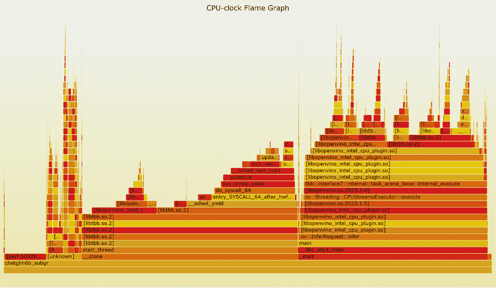

### 加速空间分析

需求：在现有基础上，需要加速 10x，才能达到 tps 3万+。

思路 1：

如果假设 AVX512 计算 fp16 能再加速 32 倍，最终 TPS = 114285.44。（11 万）

风险：当前，已经用了 __memmove_avx_unaligned_erms，可能并不存在 这 32 倍的 AVX512 加速空间。

思路 2：

从 flamegraph 看，中间 libtbb.so.2 上面的，感觉都可以优化掉，能加速 2-3x。

另外 3-5x 的加速空间，需要进一步的 tuning。应该是可以做的，只是需要花点工作量。

# fusion 场景

## Softmax and top-k fusion

topk 扫描所有 input 1 次。

依次运行的情况下，一共 4 次 load / store 每元素。

融合后，只需为 K个候选元素计算最终的 Softmax 值。其他的 softmax，不用算了。

+   内存访问从 (3V)读 + (1V)写 + (1V)读 = 5V 次降至 (1V)读 + (K)写 ≈ 1V 次。

+   加速比 = 5V / 1V = 5x

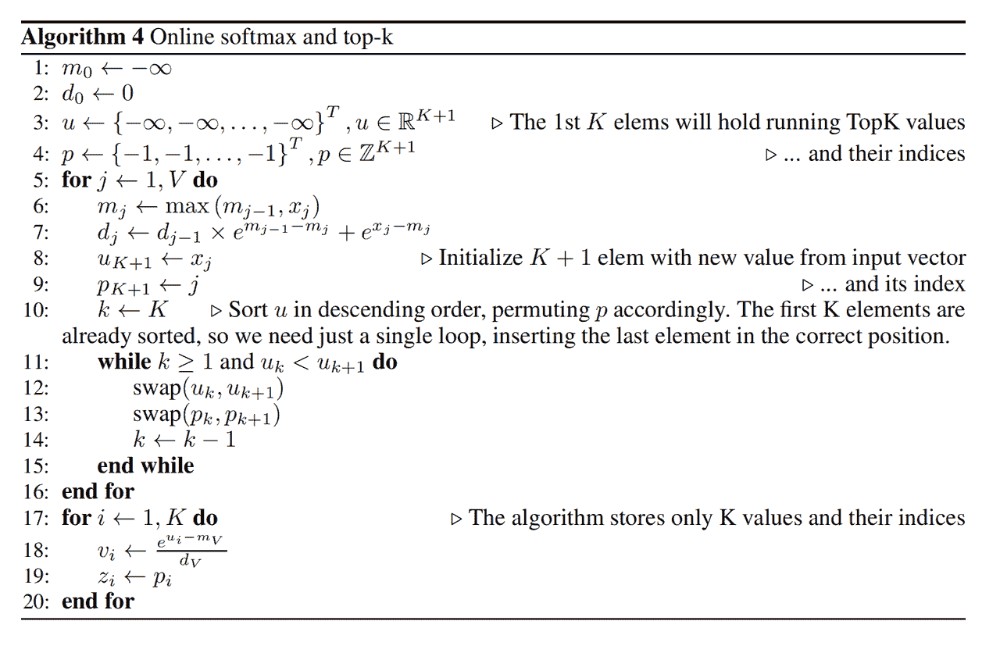

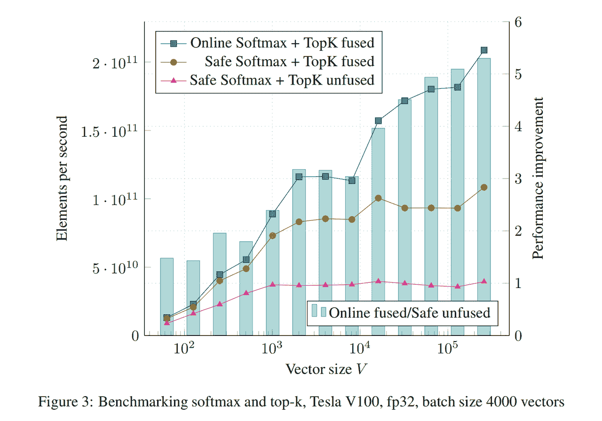

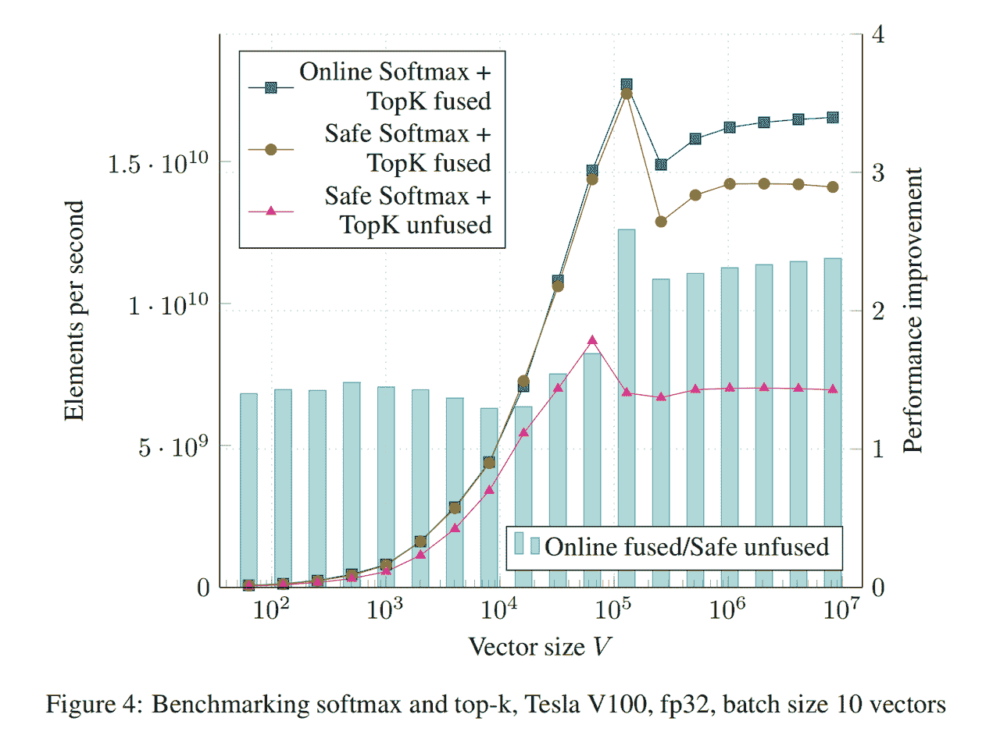

## softmax and matmul fusion - TODO

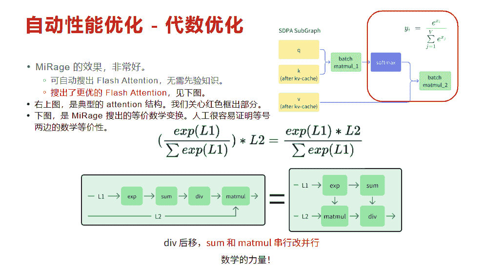

# 其他

[Online Softmax - 代数优化](https://ycna7yela7x9.feishu.cn/wiki/C81AwsSGXinzMjk5FQyc95e1nof)

## safe softmax 不影响概率分布

证明，safe softmax 不影响概率分布

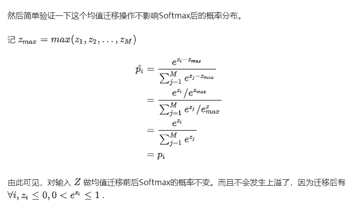

但，与 cross entropy 一起用时，可能 underflow，需要增加补偿项。

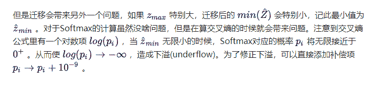

## Reference

Online Softmax: 2018 https://arxiv.org/pdf/1805.02867

oneflow 文章 & Code

如何实现一个高效的Softmax CUDA kernel？https://mp.weixin.qq.com/s/IMyqHxv2yOhKTO8DYBwb8g

kernel code: https://github.com/Oneflow-Inc/oneflow/blob/fe79e53181b1406c6068f24492b7be7c700b5ffc/oneflow/user/kernels/softmax_kernel.cu

MR & benchmark data: https://github.com/Oneflow-Inc/oneflow/pull/4058

关于Softmax的数值稳定性和梯度反向传播

https://zhuanlan.zhihu.com/p/92714192

其他 topics

1.  本文没考虑考虑 训练 & 反向传播。只涉及了 inference 的 softmax。

1.  硬件层面的 SFU 加速。如查表、泰勒展开等。https://zhuanlan.zhihu.com/p/577554331

1.  hierarchy softmax 路线的算法近似计算。如 https://arxiv.org/abs/1609.04309 Efficient softmax approximation for GPUs