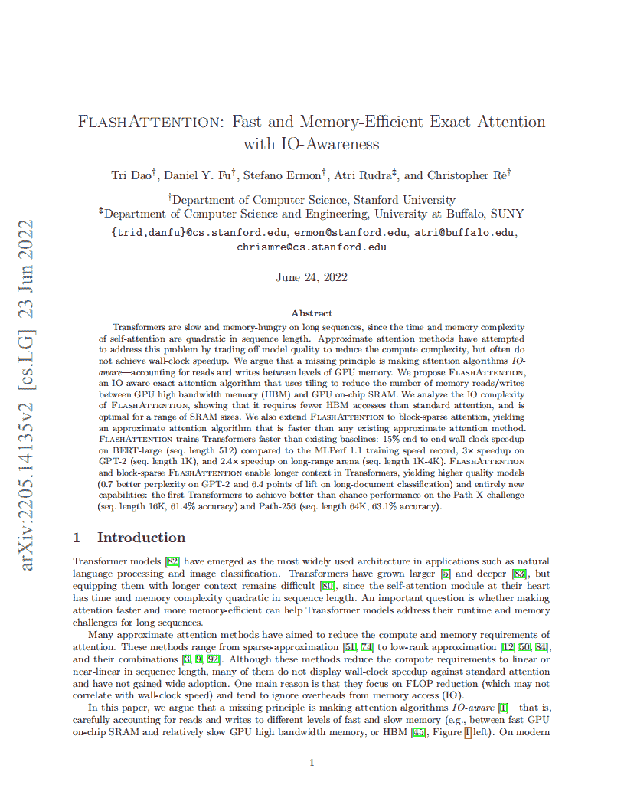

# FlashAttention

> 来源：[https://learning.feishu.cn/docx/VZHidxsSPoDnsBxCT4lcHVLGnnA](https://learning.feishu.cn/docx/VZHidxsSPoDnsBxCT4lcHVLGnnA)

| Title | year | Author | Notes |
| --- | --- | --- | --- |
| FlashAttention: Fast and Memory-Efficient Exact Attention with IO-Awareness | 2022.05 | Tri Dao |  |
| FlashAttention-2: Faster Attention with Better Parallelism and Work Partitioning | 2023.07 | Tri Dao |  |
| Flash-Decoding for long-context inference | 2023.10 |  |  |
| FlashDecoding++: Faster Large Language Model Inference on GPUs | 2023.11 |  |  |

[FlashAttention-v1-2022-05.pdf](https://internal-api-drive-stream.feishu.cn/space/api/box/stream/download/all/BkB0bp44eo7VBIxeV5zcaYdvnEd)

Baseline 是 Pytorch 版本

FlashAttention 加速 4x，Tri Dao，StanfordAILab

FlashAttention-2，又加速 2x，累计 9x

论文地址：https://tridao.me/publications/flash2/flash2.pdf

项目地址：https://github.com/Dao-AILab/flash-attention

# 加速的理论分析

TODO