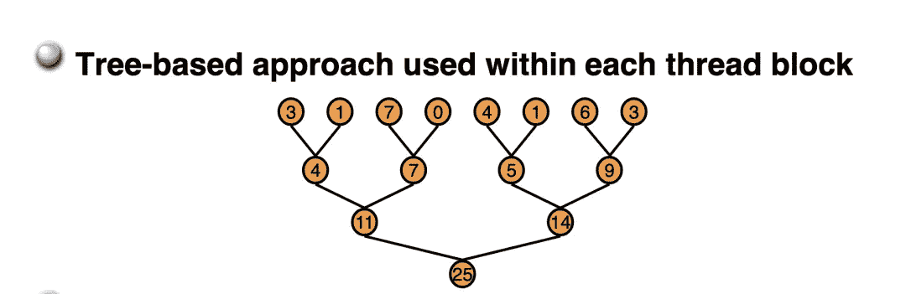
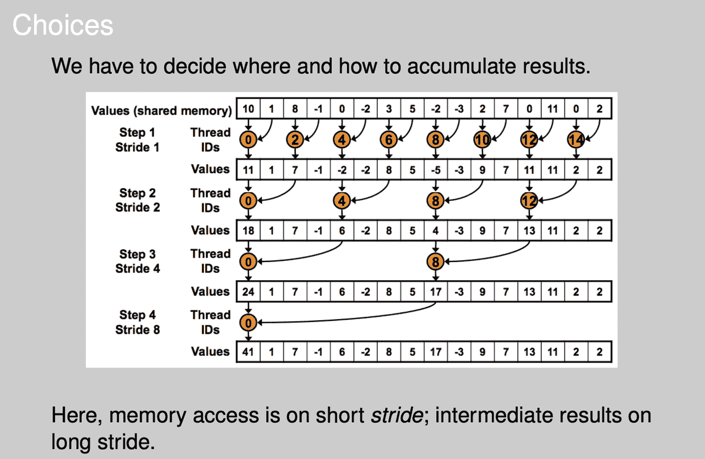
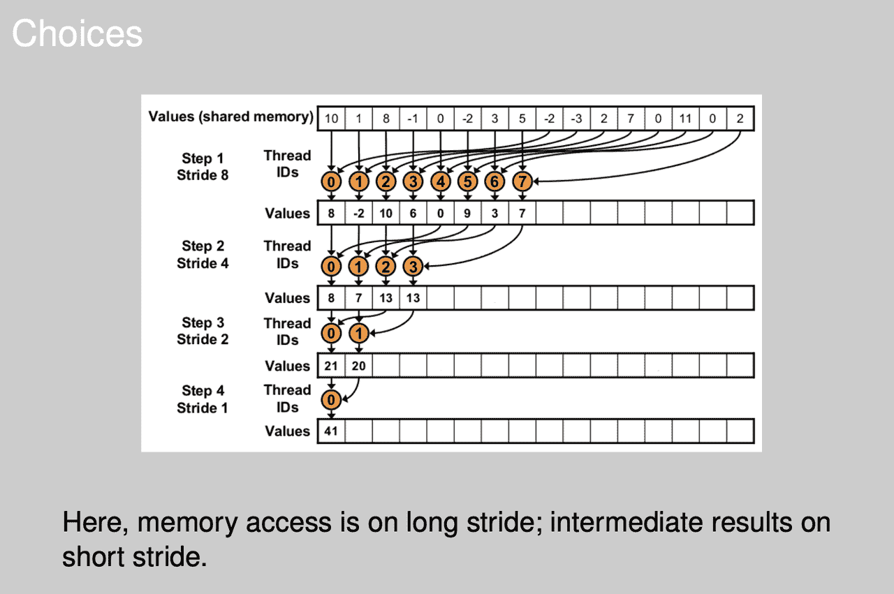

# 算子 Kernel 优化

> 来源：[https://learning.feishu.cn/docx/CDrgdJ66PoA7XdxrnAkcMVVcnjg](https://learning.feishu.cn/docx/CDrgdJ66PoA7XdxrnAkcMVVcnjg)

学习Kernel优化

https://zhuanlan.zhihu.com/p/692048488

模型切分是减少 SRAM 溢出。tiling 是减少 SRAM 搬入次数。

计算密集 / 访存密集 算子。

gemm / reduction / element-wise

从 Tensor shape & hardware 单元来分，一般是 3 种

| 类别 | SIMD hardware | SIMT hardware |
| --- | --- | --- |
| Scalar | RV | cuda core |
| Vector | RVV | cuda core |
| Tensor | DSA | Tensor Core |

TensorCore 的编程方法

1.  C++ API

1.  PTX isa。wmma 和 mma

1.  SASS 指令。c++ API 和 ptx 最终都翻译成 sass 指令

因为CUDA并没有向量计算指令，所以float4的使用主要是为了访存。其核心就是减少了一半的访存指令。

# 算子大类 & 优化方法

计算就 3 种，见表格。

reshape / transpose / gather / scatter 等，怎么分类？

softmax / layernorm / rope / kv cache 怎么分类？

还有其他典型算子吗？

| 算子大类 | 特点 | 子类和例子 |
| --- | --- | --- |
| element wise | 每个 element，独立的执行相同的计算 | 1.  基本（初等）数学运算。加减乘除，指数，对数，三角函数 |
| reduction | 一组数据的聚合操作 | 1.  sum |
| GEMM | 无他，就是用的多。也是线性代数的基本运算。 |  |

cnn models

majority of compute effort for Deep Learning inference is based on mathematical operations that can mostly be grouped into four parts: convolutions; activations; pooling; and normalization.

memory access patterns are extremely predictable, and they are readily parallelized

# GEMM

https://bruce-lee-ly.medium.com/nvidia-tensor-core-getting-started-with-mma-ptx-programming-508e44a6cb7d

注意区分 BMM 和 matmul。

gpt 里面的 4 个带参矩阵乘，都是 matmul。attention 里面 softmax 前后的两个乘法，都是 bmm。

BMM（Batch Matrix Multiplication）算子和 matmul（Matrix Multiplication）算子之间有以下几个主要区别:

1.  输入张量的形状不同:

+   BMM 接收两个形状为 (batch_size, m, k) 和 (batch_size, k, n) 的张量。

+   matmul 接收两个形状为 (m, k) 和 (k, n) 的张量。

1.  批量处理能力:

+   BMM 能够同时对一个批量的矩阵进行乘法运算,效率更高。

+   matmul 只能处理单个矩阵,需要手动循环批量中的每个矩阵。

1.  输出张量的形状不同:

+   BMM 的输出张量形状为 (batch_size, m, n)。

+   matmul 的输出张量形状为 (m, n)。

gpt 里面的 4 个带参矩阵乘，都是 matmul。attention 里面 softmax 前后的两个乘法，都是 bmm

# Reduction

https://www.math.wsu.edu/math/kcooper/CUDA/c05Reduce.pdf

https://github.com/dmlc/cub/blob/master/cub/block/block_reduce.cuh

## tree-based reduction

上古时代，经典 slides：https://developer.download.nvidia.cn/assets/cuda/files/reduction.pdf

特点：没有 shfl 指令，Reduction 的每一步都要走 shared memory。

已过时，不满足实际需求。

与 Memory Coalescence 问题，一起讨论。

典型的优化方法：

1.  避免线程束中的分支分化

1.  使用交错配对而不是相邻配对

1.  使用展开循环

1.  使用模板函数（编译时决定代码分支）

1.  使用共享内存 + 线程展开

1.  使用动态共享内存 + 线程展开







## BlockReduceSum

https://zhuanlan.zhihu.com/p/703748336

Triton到SASS（2）：Reduction

Code: https://github.com/pytorch/pytorch/blob/main/aten/src/ATen/native/cuda/block_reduce.cuh#L71

API

https://docs.nvidia.com/cuda/cuda-c-programming-guide/#warp-shuffle-functions

```
constexpr int kCUDABlockReduceNumThreads = 512;
// Algorithmic limitation: BlockReduce does two WarpReduce calls, each
// of which reduces C10_WARP_SIZE elements. So, at most
// C10_WARP_SIZE**2 elements can be reduced at a time.
// NOTE: This is &gt;= the max block size on current hardware anyway (1024).
constexpr int kCUDABlockReduceMaxThreads = C10_WARP_SIZE * C10_WARP_SIZE;

// Sums `val` across all threads in a warp.
//
// Assumptions:
//   - The size of each block should be a multiple of `C10_WARP_SIZE`
template &lt;typename T&gt;
__inline__ __device__ T WarpReduceSum(T val) {
#pragma unroll
  for (int offset = (C10_WARP_SIZE &gt;&gt; 1); offset &gt; 0; offset &gt;&gt;= 1) {
    val += WARP_SHFL_DOWN(val, offset);
  }
  return val;
}


// Sums `val` across all threads in a block.
//
// Warning: the return value is only valid for thread 0.
// Assumptions:
//   - The size of each block should be a multiple of `C10_WARP_SIZE`
//   - `shared` should be a pointer to shared memory with size of, at least,
//     `sizeof(T) * number_of_warps`
template &lt;typename T, typename B = Block1D&gt;
__inline__ __device__ T BlockReduceSum(T val, T* shared) {
  const int tid = B::Tid();
  const int lid = tid % C10_WARP_SIZE;
  const int wid = tid / C10_WARP_SIZE;
  val = WarpReduceSum(val);
  __syncthreads(); // prevent races when BlockReduces are called in a row.
  if (lid == 0) {
    shared[wid] = val;
  }
  __syncthreads();
  val = (tid &lt; B::Warps()) ? shared[lid] : T(0);
  if (wid == 0) {
    val = WarpReduceSum(val);
  }
  return val;
}

struct Block1D {
    static __forceinline__ __device__ int Tid() { return threadIdx.x; }

    static __forceinline__ __device__ int Warps() {
        return blockDim.x / C10_WARP_SIZE;
    }
};
```