# Triton 草稿纸

> 来源：[https://learning.feishu.cn/docx/DBj4d3lJhoZjShx4sDvcHHiynEe](https://learning.feishu.cn/docx/DBj4d3lJhoZjShx4sDvcHHiynEe)

Autotuner todo

further reading

+   1998 - Code generation in the polytope model.

+   2017 - Gpu kernels for block-sparse weights

+   2013 - Simple and Efficient Construction of Static Single Assignment Form

+   1965 - Peephole Optimization

+   1999 - Algorithms for Compile-time Memory Optimization. 复用 shared memory

tiling 的 paper。2 个 analytical 的，2 个 empirical 的。普遍还是依赖 hand-optimized sub-routines (e.g., cuBLAS and cuDNN).

+   2018 - Revisiting Loop Tiling for Datacenters: Live and Let Live

+   2013 - Defensive Loop Tiling for Shared Cache

+   2016 - TurboTiling: Leveraging Prefetching to Boost Performance of Tiled Codes.

+   2010 - Parameterized Tiling Revisited

+   2017 - CLBlast: A Tuned OpenCL BLAS Library, 用了 hierarchy 的 auto-tiling

+   2017 - Input-aware Auto-tuning of Compute-bound HPC Kernels.

# Compile Triton

编译 triton，参考 https://mp.weixin.qq.com/s/PDf5E7yzhqc6CyakV3fi-g

https://triton-lang.org/main/getting-started/installation.html#from-source

## version

version 选择要配对：

1.  LLVM does not have a stable API, so the Triton build will not work at an arbitrary LLVM version.

1.  Find the version of LLVM that Triton builds against. Check cmake/llvm-hash.txt to see the current version. For example, if it says: 49af6502c6dcb4a7f7520178bd14df396f78240c

没有 AMD backend 的版本。

1.  llvm: f733b4fb9b8b

1.  triton: 132fe1bb01e0a734d39c60835c76da257dbe7151

```
commit 132fe1bb01e0a734d39c60835c76da257dbe7151 (HEAD)
Author: q.yao &lt;streetyao@live.com&gt;
Date:   Mon May 8 20:41:46 2023 +0800

    [DOCS] Fix docstrings for sphinx docs (#1635)
```

## llvm build

为了 NV，AMD，RISC-V & x86 debug 方便，启用了一堆 project，实际可以不用这么多。

```
mkdir -p $build_dir &amp;&amp; cd $build_dir

cmake -G Ninja ../llvm \
   -DLLVM_ENABLE_PROJECTS=&quot;clang;lld;mlir&quot; \
   -DLLVM_BUILD_EXAMPLES=ON \
   -DLLVM_TARGETS_TO_BUILD=&quot;host;X86;NVPTX;RISCV;AMDGPU&quot; \
   -DLLVM_DEFAULT_TARGET_TRIPLE=&quot;riscv64-unknown-linux-gnu&quot; \
   -DCMAKE_BUILD_TYPE=Debug \
   -DLLVM_ENABLE_ASSERTIONS=ON \
   -DLLVM_ENABLE_RTTI=ON \
   -DLLVM_ENABLE_LIBEDIT=OFF 2&gt;&amp;1 | tee cmake.log

# CUDA version
cmake -G Ninja ../llvm \
   -DLLVM_ENABLE_PROJECTS=mlir \
   -DLLVM_BUILD_EXAMPLES=ON \
   -DLLVM_TARGETS_TO_BUILD=&quot;X86;NVPTX;RISCV;AMDGPU&quot; \
   -DMLIR_ENABLE_CUDA_RUNNER=ON \
   -DCMAKE_BUILD_TYPE=Debug \
   -DLLVM_ENABLE_ASSERTIONS=ON \
   -DCMAKE_C_COMPILER=clang \
   -DCMAKE_CXX_COMPILER=clang++ \
   -DLLVM_ENABLE_RTTI=ON \
   -DLLVM_INSTALL_UTILS=ON \
   -DMLIR_INCLUDE_INTEGRATION_TESTS=ON \
   2&gt;&amp;1 | tee cmake.log

time cmake --build . -- ${MAKEFLAGS} 2&gt;&amp;1 | tee build.log

# test only
cmake --build . --target check-mlir 2&gt;&amp;1 | tee check-mlir.log
```

## pybind11

update on 2024.12.20

最新版本的 triton，应该直接 pip install pybind11 即可，不再需要源码编译 pybind11 了。

```
pip install pytest
git clone git@github.com:pybind/pybind11.git
cd pybind11
mkdir build
cd build
cmake ..
make check -j 8
sudo make install
```

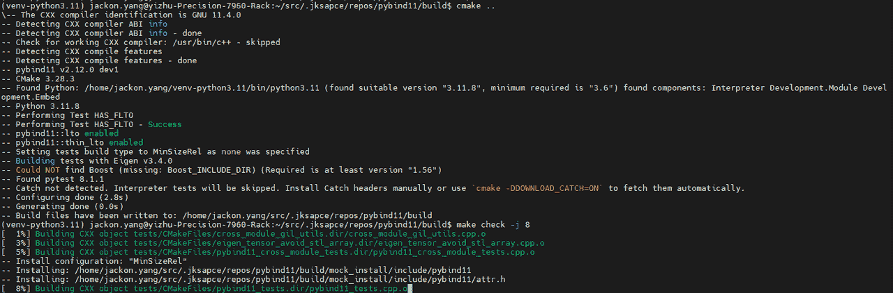

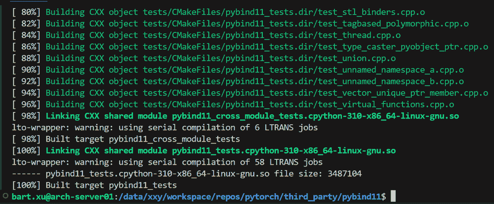

如果不装 pybind11，triton 编译(-DTRITON_BUILD_PYTHON_MODULE=ON) 会报错如下，装了 ok。

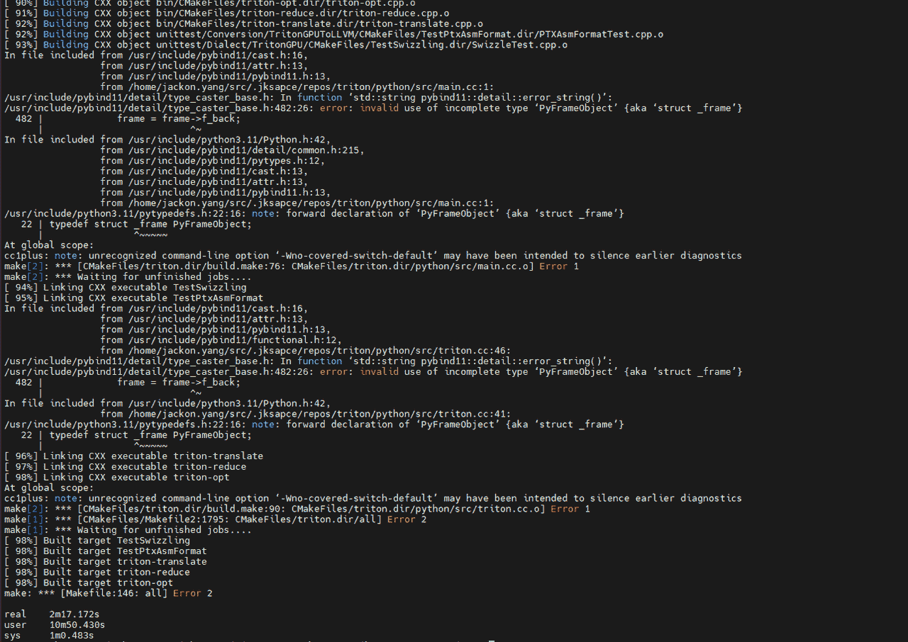

```
[ 93%] Building CXX object unittest/Dialect/TritonGPU/CMakeFiles/TestSwizzling.dir/SwizzleTest.cpp.o
In file included from /usr/include/pybind11/cast.h:16,
                 from /usr/include/pybind11/attr.h:13,
                 from /usr/include/pybind11/pybind11.h:13,
                 from /home/jackon.yang/src/.jksapce/repos/triton/python/src/main.cc:1:
/usr/include/pybind11/detail/type_caster_base.h: In function ‘std::string pybind11::detail::error_string()’:
/usr/include/pybind11/detail/type_caster_base.h:482:26: error: invalid use of incomplete type ‘PyFrameObject’ {aka ‘struct _frame’}
  482 |             frame = frame-&gt;f_back;
      |                          ^~
In file included from /usr/include/python3.11/Python.h:42,
                 from /usr/include/pybind11/detail/common.h:215,
                 from /usr/include/pybind11/pytypes.h:12,
                 from /usr/include/pybind11/cast.h:13,
                 from /usr/include/pybind11/attr.h:13,
                 from /usr/include/pybind11/pybind11.h:13,
                 from /home/jackon.yang/src/.jksapce/repos/triton/python/src/main.cc:1:
/usr/include/python3.11/pytypedefs.h:22:16: note: forward declaration of ‘PyFrameObject’ {aka ‘struct _frame’}
   22 | typedef struct _frame PyFrameObject;
      |                ^~~~~~
At global scope:
cc1plus: note: unrecognized command-line option ‘-Wno-covered-switch-default’ may have been intended to silence earlier diagnostics
make[2]: *** [CMakeFiles/triton.dir/build.make:76: CMakeFiles/triton.dir/python/src/main.cc.o] Error 1
make[2]: *** Waiting for unfinished jobs....
[ 94%] Linking CXX executable TestSwizzling
[ 95%] Linking CXX executable TestPtxAsmFormat
In file included from /usr/include/pybind11/cast.h:16,
                 from /usr/include/pybind11/attr.h:13,
                 from /usr/include/pybind11/pybind11.h:13,
                 from /usr/include/pybind11/functional.h:12,
                 from /home/jackon.yang/src/.jksapce/repos/triton/python/src/triton.cc:46:
/usr/include/pybind11/detail/type_caster_base.h: In function ‘std::string pybind11::detail::error_string()’:
/usr/include/pybind11/detail/type_caster_base.h:482:26: error: invalid use of incomplete type ‘PyFrameObject’ {aka ‘struct _frame’}
  482 |             frame = frame-&gt;f_back;
      |                          ^~
In file included from /usr/include/python3.11/Python.h:42,
                 from /home/jackon.yang/src/.jksapce/repos/triton/python/src/triton.cc:41:
/usr/include/python3.11/pytypedefs.h:22:16: note: forward declaration of ‘PyFrameObject’ {aka ‘struct _frame’}
   22 | typedef struct _frame PyFrameObject;
      |                ^~~~~~
[ 96%] Linking CXX executable triton-translate
[ 97%] Linking CXX executable triton-reduce
[ 98%] Linking CXX executable triton-opt
At global scope:
cc1plus: note: unrecognized command-line option ‘-Wno-covered-switch-default’ may have been intended to silence earlier diagnostics
make[2]: *** [CMakeFiles/triton.dir/build.make:90: CMakeFiles/triton.dir/python/src/triton.cc.o] Error 1
make[1]: *** [CMakeFiles/Makefile2:1795: CMakeFiles/triton.dir/all] Error 2
make[1]: *** Waiting for unfinished jobs....
[ 98%] Built target TestSwizzling
[ 98%] Built target TestPtxAsmFormat
[ 98%] Built target triton-translate
[ 98%] Built target triton-reduce
[ 98%] Built target triton-opt
make: *** [Makefile:146: all] Error 2
```

## triton

```
cd triton
mkdir -p build &amp;&amp; cd build

# option 1: using cmake
cmake .. -DTRITON_BUILD_PYTHON_MODULE=ON -DMLIR_DIR=llvm-project/build/lib/cmake/mlir -DCMAKE_BUILD_TYPE=&quot;Debug&quot; -DTRITON_CODEGEN_BACKENDS=&quot;amd;nvidia&quot;
make -j

# option 2: using Ninja
cmake -G Ninja .. -DTRITON_BUILD_PYTHON_MODULE=ON -DMLIR_DIR=llvm-project/build/lib/cmake/mlir -DCMAKE_BUILD_TYPE=&quot;Debug&quot;  -DTRITON_CODEGEN_BACKENDS=&quot;amd;nvidia&quot;
cmake --build . -j
```

编译通过

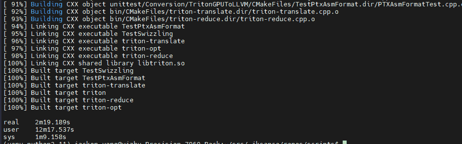

## More Notes

[6141/6214] Linking CXX executable bin/llvm-gsymutil

llvm 这一步时，疑似机器会 hang 住，vscode 断联。

# Run demo & Debug

## Python Run

```
export TRITON_HOME=/home/jackon.yang/src/triton
export PYTHONPATH=$TRITON_HOME/python:${PYTHONPATH}

cd triton/
ln -s `pwd`/build/libtriton.so python/triton/_C/

ldd -r 

cd python/tutorials
python 03-matrix-multiplication.py
```

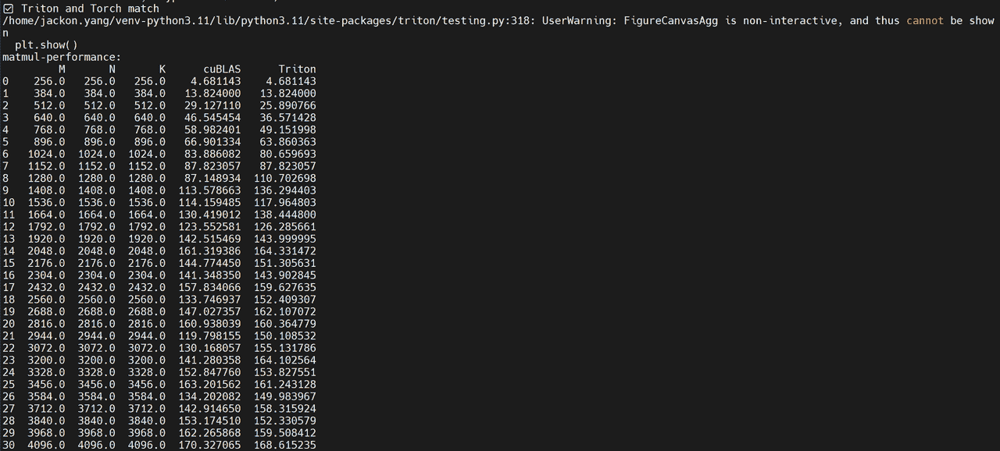

## GDB Debug

```
# gdb进入
gdb bash

# 设置路径
set directories /home/jackon.yang/src/workspace/adventures/triton-ops/softmax-logs

# 设置参数
set args run_softmax.sh

# 设置断点处
break stc-run-main.cc:28
break stc-run-main.cc:73
r
```

## undefined symbol: LLVMInitializeRISCVTargetInfo

应该是 LLVM RISCV 支持的编译参数没配对导致的。

```
ImportError: /home/jackon.yang/src/triton/python/triton/_C/libtriton.so: undefined symbol: LLVMInitializeRISCVTargetInfo
```

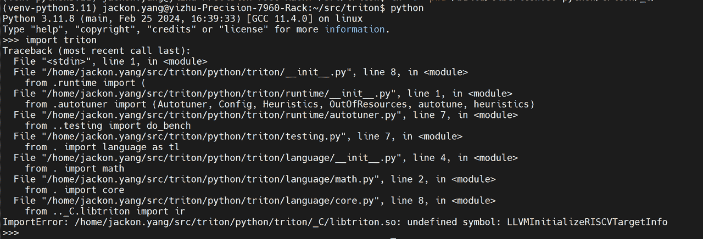

用 ldd -r 看

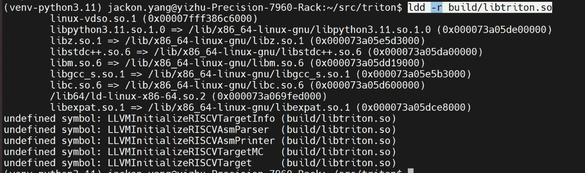

# Triton API 清单

## Triton 功能类 API

**在/py**thon/triton/init.py下进行查看，总共定义了19个常用的操作。

看起来，基本都是作为 decorator 用的几个常用 API。

```
__all__ = [
    &quot;autotune&quot;,
    &quot;cdiv&quot;,
    &quot;CompilationError&quot;,
    &quot;compile&quot;,
    &quot;Config&quot;,
    &quot;heuristics&quot;,
    &quot;impl&quot;,
    &quot;jit&quot;,
    &quot;JITFunction&quot;,
    &quot;KernelInterface&quot;,
    &quot;language&quot;,
    &quot;MockTensor&quot;,
    &quot;next_power_of_2&quot;,
    &quot;ops&quot;,
    &quot;OutOfResources&quot;,
    &quot;reinterpret&quot;,
    &quot;runtime&quot;,
    &quot;TensorWrapper&quot;,
    &quot;testing&quot;,
    &quot;program_ids_from_grid&quot;,
]
```

## Triton DSL & Ops

tl 的所有操作，可以在 pyt**hon/**triton/language/init.py 中的 __all__ 下查到，总共定义了 95 个常用的操作

triton language 的原语

```
__all__ = [
    &quot;abs&quot;,
    &quot;advance&quot;,
    &quot;arange&quot;,
    &quot;argmin&quot;,
    &quot;argmax&quot;,
    &quot;atomic_add&quot;,
    &quot;atomic_and&quot;,
    &quot;atomic_cas&quot;,
    &quot;atomic_max&quot;,
    &quot;atomic_min&quot;,
    &quot;atomic_or&quot;,
    &quot;atomic_xchg&quot;,
    &quot;atomic_xor&quot;,
    &quot;bfloat16&quot;,
    &quot;block_type&quot;,
    &quot;broadcast&quot;,
    &quot;broadcast_to&quot;,
    &quot;builtin&quot;,
    &quot;cat&quot;,
    &quot;cdiv&quot;,
    &quot;constexpr&quot;,
    &quot;cos&quot;,
    &quot;debug_barrier&quot;,
    &quot;device_assert&quot;,
    &quot;device_print&quot;,
    &quot;dot&quot;,
    &quot;dtype&quot;,
    &quot;exp&quot;,
    &quot;expand_dims&quot;,
    &quot;extra&quot;,
    &quot;fdiv&quot;,
    &quot;float16&quot;,
    &quot;float32&quot;,
    &quot;float64&quot;,
    &quot;float8e4&quot;,
    &quot;float8e5&quot;,
    &quot;full&quot;,
    &quot;function_type&quot;,
    &quot;int1&quot;,
    &quot;int16&quot;,
    &quot;int32&quot;,
    &quot;int64&quot;,
    &quot;int8&quot;,
    &quot;ir&quot;,
    &quot;math&quot;,
    &quot;load&quot;,
    &quot;log&quot;,
    &quot;make_block_ptr&quot;,
    &quot;max&quot;,
    &quot;max_contiguous&quot;,
    &quot;maximum&quot;,
    &quot;min&quot;,
    &quot;minimum&quot;,
    &quot;multiple_of&quot;,
    &quot;num_programs&quot;,
    &quot;pair_uniform_to_normal&quot;,
    &quot;philox&quot;,
    &quot;philox_impl&quot;,
    &quot;pi32_t&quot;,
    &quot;pointer_type&quot;,
    &quot;program_id&quot;,
    &quot;rand&quot;,
    &quot;rand4x&quot;,
    &quot;randint&quot;,
    &quot;randint4x&quot;,
    &quot;randn&quot;,
    &quot;randn4x&quot;,
    &quot;ravel&quot;,
    &quot;reduce&quot;,
    &quot;reshape&quot;,
    &quot;sigmoid&quot;,
    &quot;sin&quot;,
    &quot;softmax&quot;,
    &quot;sqrt&quot;,
    &quot;static_range&quot;,
    &quot;static_assert&quot;,
    &quot;static_print&quot;,
    &quot;store&quot;,
    &quot;sum&quot;,
    &quot;swizzle2d&quot;,
    &quot;tensor&quot;,
    &quot;trans&quot;,
    &quot;triton&quot;,
    &quot;uint16&quot;,
    &quot;uint32&quot;,
    &quot;uint32_to_uniform_float&quot;,
    &quot;uint64&quot;,
    &quot;uint8&quot;,
    &quot;umulhi&quot;,
    &quot;view&quot;,
    &quot;void&quot;,
    &quot;where&quot;,
    &quot;xor_sum&quot;,
    &quot;zeros&quot;,
    &quot;zeros_like&quot;,
]
```

# Triton 代码量分析

Commit ID: 8f4755b71ffb9319d79b4b077f1e3a7f40d63d47

Date: Thu Mar 7 23:51:56 2024

## 总体情况 - 代码量

一共 10 万行代码，8 万行 c/c++/header，2 万行 Python。

third-party 下，基本都是 c/c++，nvidia 只有 4k 行，core 里面的就是 nv 的代码了。

TritonGPU 的代码，主要在 lib 目录下，3k 行 TritonGPUToLLVM conversion，8k 行 dialect。

triton/python 下，看起来都是流程类代码，关系不大。

一共 2 万行相关代码。

## 详细代码量分布

|  |  |  | 代码量 |
| --- | --- | --- | --- |
| triton |  |  | 10 万 |
|  |  |  |  |
| third-party |  |  | 5 万 |
| triton/python |  |  | 2 万 |
|  | test |  | 1 万 |
|  | triton |  | 9k |
|  |  | language | 4k |
|  |  | runtime | 1k |
|  |  | compiler | 1k |
|  |  | ops | 1k |
|  |  | tools | 1k |
|  |  |  |  |
| triton/lib |  |  | 2 万 |
|  | Conversion |  | 4k |
|  |  | TritonGPUToLLVM | 3k |
|  |  | TritonToTritonGPU | 700 行 |
|  | Dialect |  | 1 万 |
|  |  | TritonGPU | 7k |
|  |  | Triton | 2k |
|  |  | TritonNvidiaGPU | 1k |
|  |  | NVGPU | 74 |
|  | Analysis |  | 3k |

## TritonGPU 代码分析

一共，1 万行代码要读：

+   3k 行，triton/lib/Conversion/TritonGPUToLLVM

+   7k 行，triton/lib/Dialect/TritonGPU

+   300 行，triton/python/triton/runtime/autotuner.py

Dialect 目录下的 Transforms 文件夹，很有信息量。

但，没看出 tiling 在哪里做的。

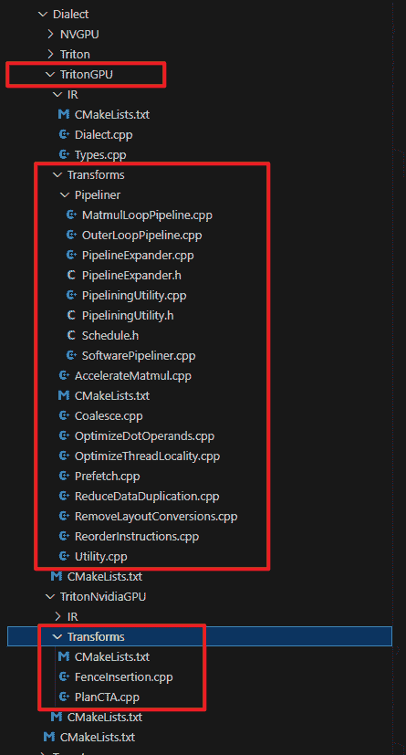

## 八卦 - TritonGPUToLLVM 重构

几周前，TritonGPUToLLVM 转换的代码量奇高，1.1 万行。

By 2024.03.08，删除 8k 行。只剩 3k 行。代码如下

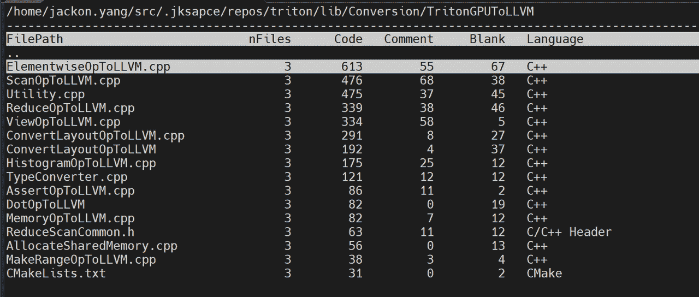

1 万行的老代码:

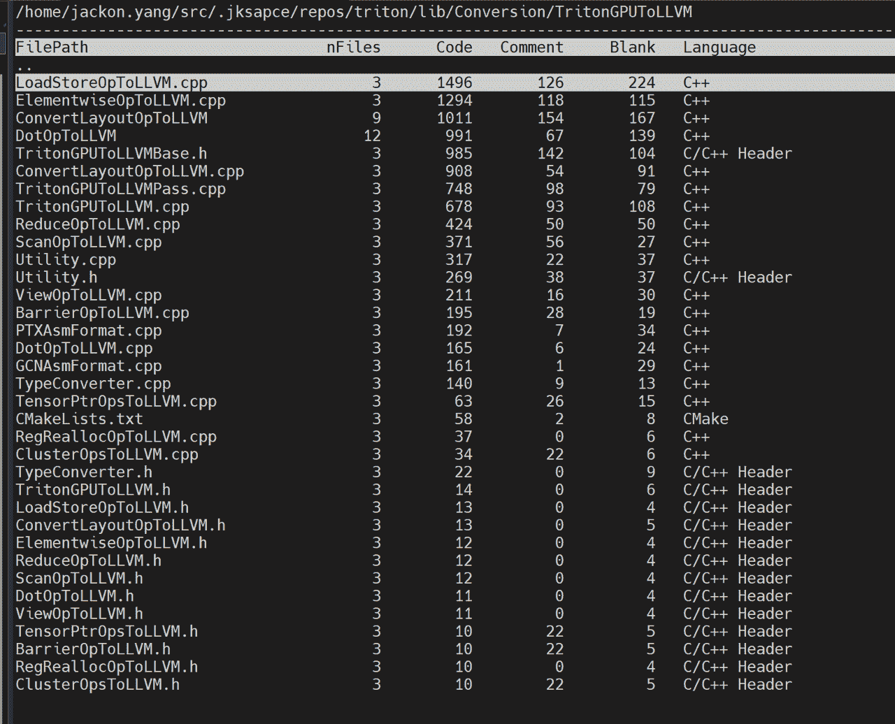

找出删掉的 conversions

```
git checkout -b a 87295507c54f7baf9855a05d2bcfd2fbffc49ffa
ls TritonGPUToLLVM/ | xargs  -n 1 echo &gt; ~/tmp/t10k-list.txt

git checkout main
ls TritonGPUToLLVM/ | xargs  -n 1 echo &gt; ~/tmp/t3k-list.txt

# list deleted files:
cat ~/tmp/t*k-list.txt | sort | uniq -c | sort -n
      1 AllocateSharedMemory.cpp
      1 AssertOpToLLVM.cpp
      1 BarrierOpToLLVM.cpp
      1 BarrierOpToLLVM.h
      1 ClusterOpsToLLVM.cpp
      1 ClusterOpsToLLVM.h
      1 ConvertLayoutOpToLLVM.h
      1 DotOpToLLVM.cpp
      1 DotOpToLLVM.h
      1 ElementwiseOpToLLVM.h
      1 GCNAsmFormat.cpp
      1 HistogramOpToLLVM.cpp
      1 LoadStoreOpToLLVM.cpp
      1 LoadStoreOpToLLVM.h
      1 MakeRangeOpToLLVM.cpp
      1 MemoryOpToLLVM.cpp
      1 PTXAsmFormat.cpp
      1 ReduceOpToLLVM.h
      1 ReduceScanCommon.h
      1 RegReallocOpToLLVM.cpp
      1 RegReallocOpToLLVM.h
      1 ScanOpToLLVM.h
      1 TensorPtrOpsToLLVM.cpp
      1 TensorPtrOpsToLLVM.h
      1 TritonGPUToLLVMBase.h
      1 TritonGPUToLLVM.cpp
      1 TritonGPUToLLVM.h
      1 TritonGPUToLLVMPass.cpp
      1 TypeConverter.h
      1 Utility.h
      1 ViewOpToLLVM.h
      2 CMakeLists.txt
      2 ConvertLayoutOpToLLVM
      2 ConvertLayoutOpToLLVM.cpp
      2 DotOpToLLVM
      2 ElementwiseOpToLLVM.cpp
      2 ReduceOpToLLVM.cpp
      2 ScanOpToLLVM.cpp
      2 TypeConverter.cpp
      2 Utility.cpp
      2 ViewOpToLLVM.cpp
```

## 总 10 万行，8 万 c/c++

一共 10 万行代码，8 万行 c/c++/header，2 万行 Python。

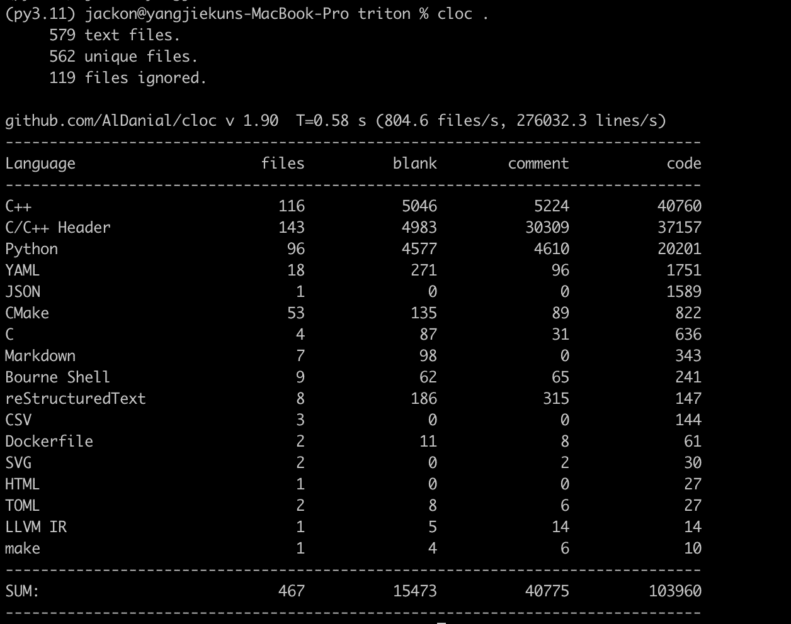

## Third-party 占 5 万

其中，5 万行是 third-party 代码。基本都是 c/c++，没有 Python。

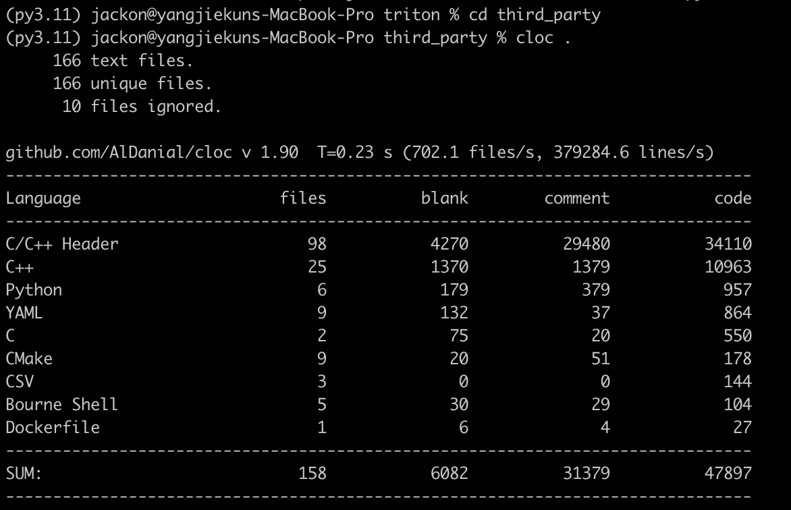

nvidia 只有 4k 行，剩下 4.5 万行都是 AMD 代码。

光 HIP 就 3 万行。

NV 代码量少，另一个原因是，都在 Triton core （triton/lib）里了

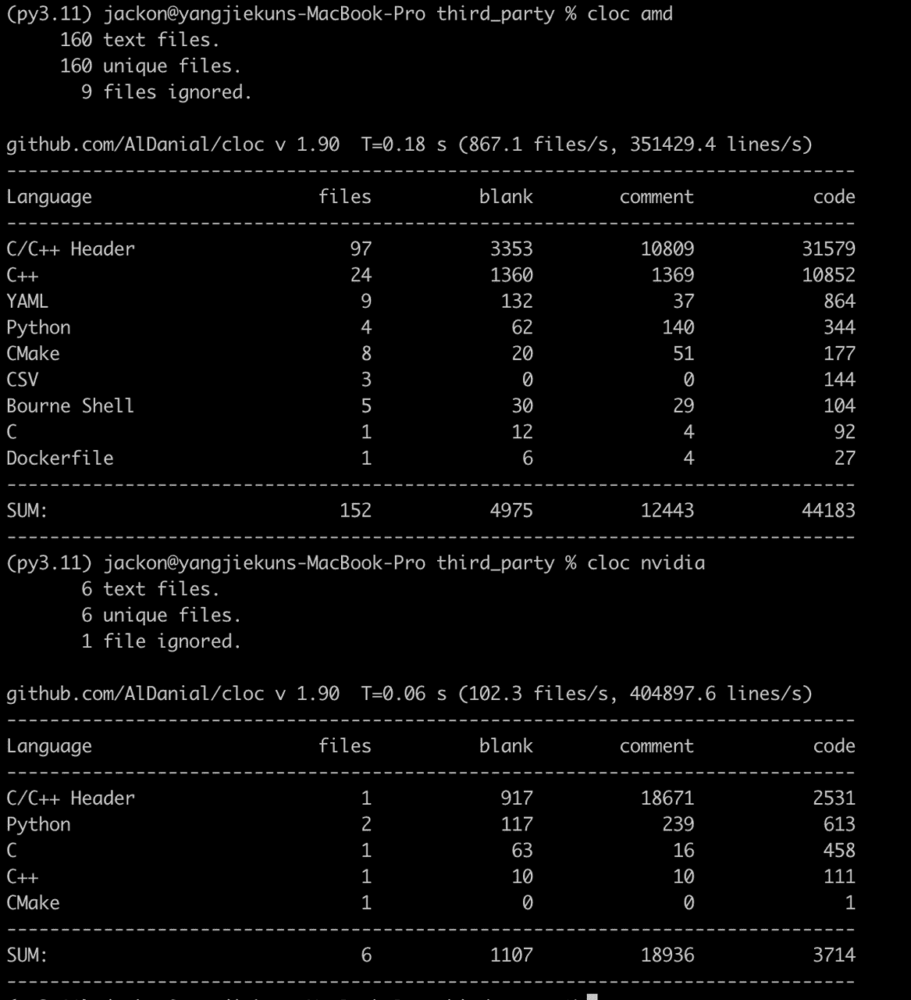

AMD 有用的 dialect 代码，1.2 万行。

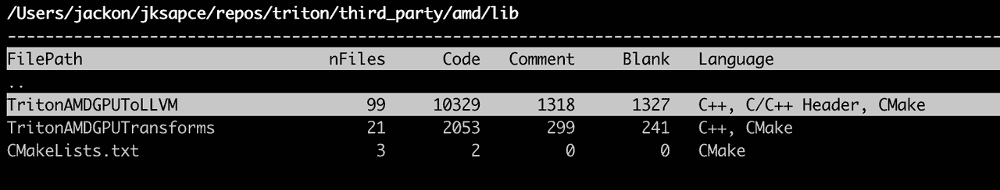

## Triton Core 5 万行代码

### lib 3 万行

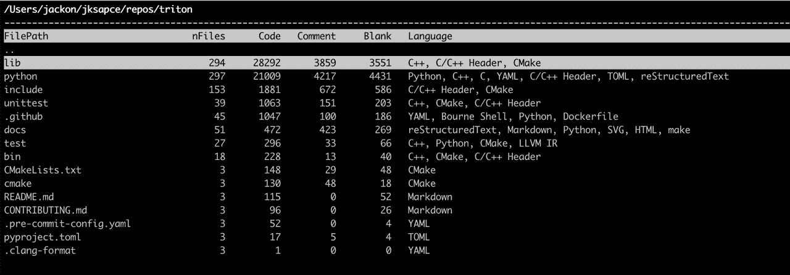

lib 下就是 Conversion 1.3万，Dialect 1.3 万，Analysis 3k，这 3 个 compiler 标准组件。

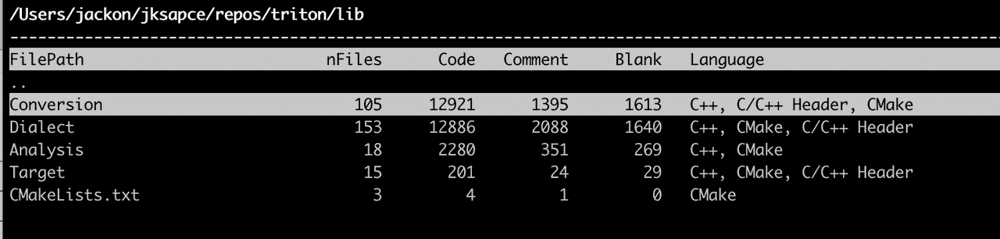

Conversion 1.3万，其中 1.1 万是 TritonGPUToLLVM

TritonToTritonGPU 只有 700 行。

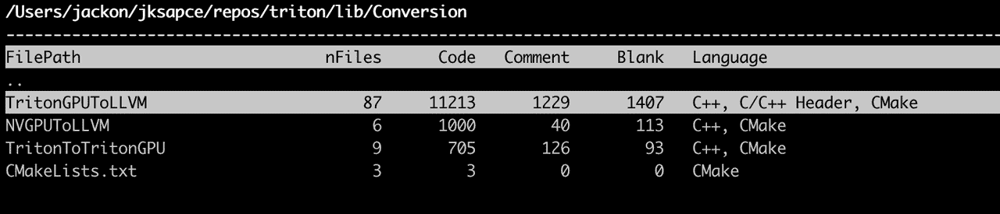

Dialect 1.3 行，2 个主要的 Dialect 各 4k-6k 水平，

比 MLIR 核心 dialect（1-2 万行） 的代码量明显少。

与 LLVM Pass 大多三五千行的水平，比较接近。

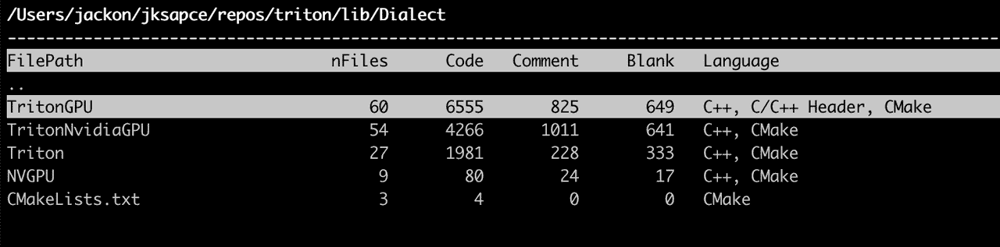

### Python 2 万行

其中 1 万行是 tests。

triton 9000 行，tutorial 和 src 下 c++ 各 2k 行。

python/triton 的 9000 行代码，

language 占一半 4k 行。

runtime / compiler / ops / tools 各 1k 左右。

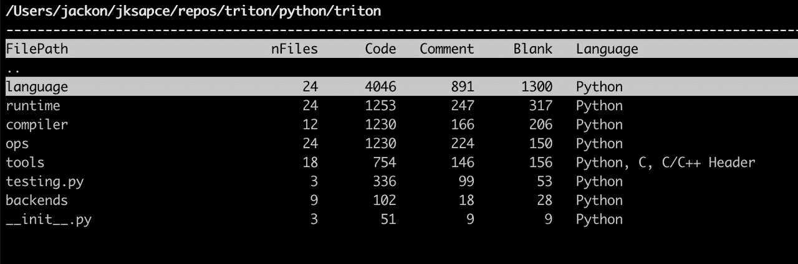

runtime 下，有 autotuner.py，200 行代码。

另外，jit，interpreter，driver 都有，没几百行代码。

compiler 下面，主要是 codegen

ops 下面，看来是几个比较难写的大算子。

特别是 flash_attention，看一下有没有被 inductor 用到，怎么用的。NV/AMD/CPU 都试一下。

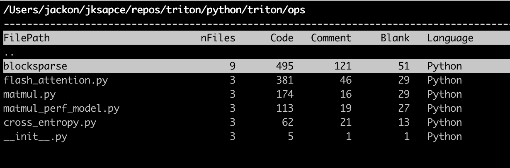