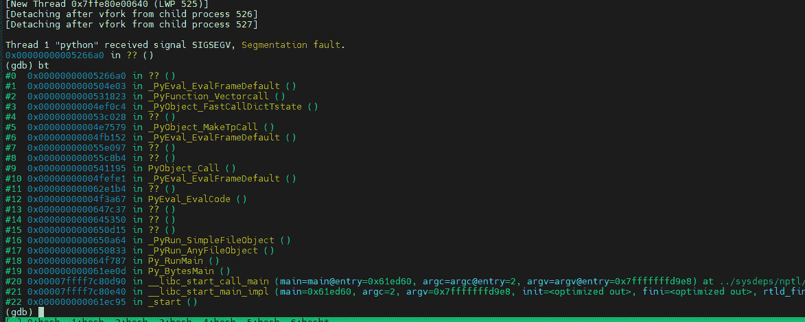
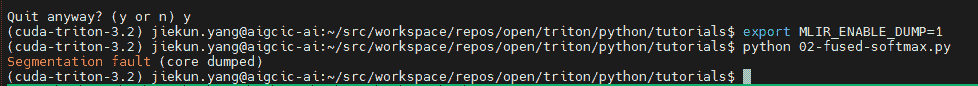
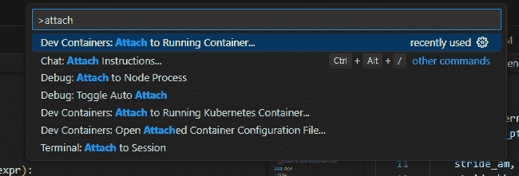
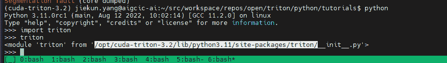
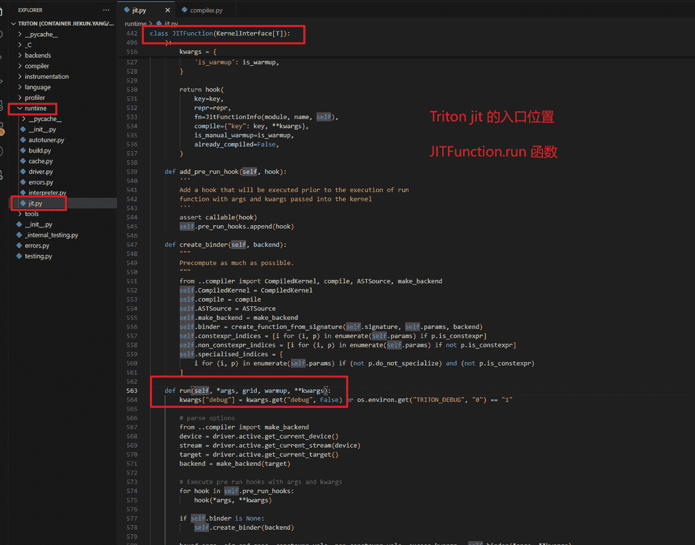
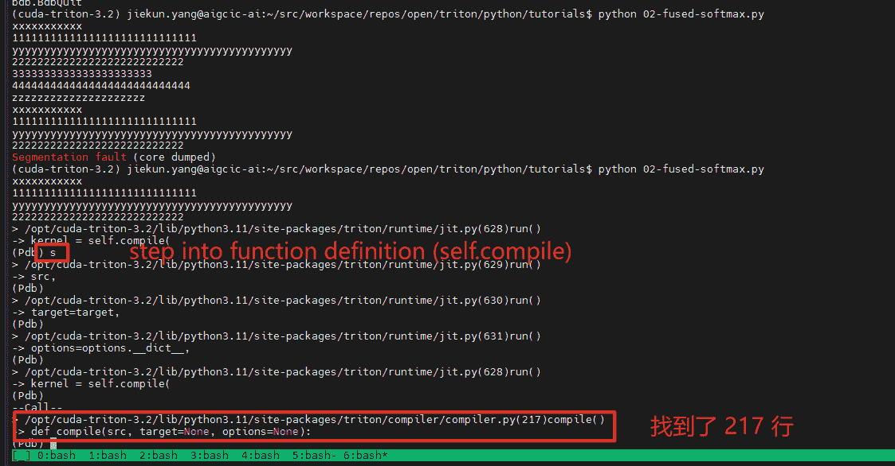

# Triton 问题排查

> 来源：[https://learning.feishu.cn/docx/SH3MdgHc6o4u4Ux2Uk6cl8ZznDb](https://learning.feishu.cn/docx/SH3MdgHc6o4u4Ux2Uk6cl8ZznDb)

必备选项

```
export TRITON_ALWAYS_COMPILE=1

export MLIR_ENABLE_DUMP=1
```

现象 Segmentation fault (core dumped)

```
gdb --args python 02-fused-softmax.py

r # run
bt # show stack trace
```



```
export MLIR_ENABLE_DUMP=1

python 02-fused-softmax.py
```

现象说明 -> 没有进入 triton compile pass







找到 triton python 代码的入口位置



用 pdb 跟 python 代码

```
# gdb for python
import pdb; pdb.set_trace();

# 常用指令缩写: s, n, r, c
# 调用: bt
```

准确找到 python function 的定义代码 的方法



python 调用 c++ 的工具 https://github.com/pybind/pybind11

Compiler 的关键概念: Pass