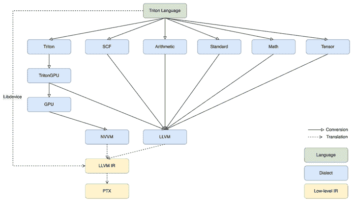

# Tiling in Triton

> 来源：[https://learning.feishu.cn/docx/UFATd2rh1oQmxAxmpJ2cfMoDnRd](https://learning.feishu.cn/docx/UFATd2rh1oQmxAxmpJ2cfMoDnRd)

## 深入 tiling

CUDA 的 codegen 在做 thread-Block 的 for-loop tiling 时，

+   inter-level 的并行计算，做的已经很不错了。

+   intra-level 的，还有很多优化空间。比如，memory coalescing, 共享内存的 sync 以及 bank conflict 的处理，在更细粒度的 register-level tensor core 的调度上。

CUDA 加速 batch GEMM 的手段参考：调用 tensor core，借助 shared memory，register files 去加速运算或者优化 data movement

intra-tiling 的优化手段

+   memory coalescing。1994 - Memory Access Coalescing: A Technique for Eliminating Redundant Memory Accesses.

+   Cache management。2011 - Accelerating GPU Kernels for Dense Linear Algebra.

