# Hands-on MLIR essentials

> 来源：[https://learning.feishu.cn/docx/MWcrdzm3eomNChxo3W4cbUmmneh](https://learning.feishu.cn/docx/MWcrdzm3eomNChxo3W4cbUmmneh)

这是一篇总结，适合复习和理解 MLIR 常用 coding。

## MLIR 学习路径

掌握常见工具链。`mlir-opt`, `mlir-translate`, `mlir-cpu-runner`

完成 MLIR 官方的 `toy` tutorial。https://mlir.llvm.org/docs/Tutorials/Toy/

添加一个 `dialect`、`Pass` 和 `op`。完成 `dialect` 的 conversion & lowering 到 `llvm`。

`type system`。`shape inference`。

`layout` in `Triton`。

落地。掌握几种经典的 `dialect` & lowering 到 `llvm` 的过程。

+   `func` to `llvm`
+   `memref` to `llvm`
+   `cf` to `llvm`
+   `arith` to `llvm` 等
+   `linalg`

2 个 `tablegen` 模块，即：ODS 和 DRR。

+   ODS (Operation Definition Specification)：统一 `Dialect`，`Operation` 等 `Dialect` 内部类的创建；https://mlir.llvm.org/docs/DefiningDialects/Operations/
+   DRR (Table-driven Declarative Rewrite Rule)：统一 Canonicalization, Transformation 和 Conversion 的创建，即 `PatternRewritter` 的管理（除此之外，也提供对 `Pass` 的管理）。https://mlir.llvm.org/docs/DeclarativeRewrites/

`DialectConversion` 为了能达到转换的目的，提供如下模块：

+   `ConversionTarget`,
+   `ConversionPattern`,
+   `TypeConverter`。

https://mlir.llvm.org/docs/Tutorials/Toy/

code path: `llvm-project/mlir/examples/toy`

tests dir: `llvm-project/mlir/test/Examples/Toy`

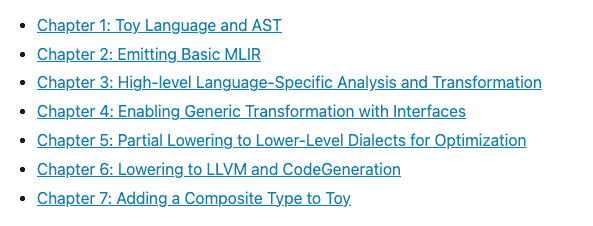

`mlir` 的核心概念：

1.  `dialect`
1.  `operations`: 用 CRTP 类声明，并在 `dialect` `initialize` 函数里 `addOperations` 注册。

Tips on debugging MLIR

https://discourse.llvm.org/t/tips-on-debugging-mlir/825

`mlir` build https://mlir.llvm.org/getting_started/

note: 删掉了 AMDGPU 编译会报错。

```
cmake -G Ninja ../llvm \
   -DLLVM_ENABLE_PROJECTS="mlir" \
   -DLLVM_BUILD_EXAMPLES=ON \
   -DLLVM_TARGETS_TO_BUILD="X86;NVPTX;AMDGPU" \
   -DCMAKE_BUILD_TYPE=Debug \
   -DLLVM_ENABLE_ASSERTIONS=ON \
   -DLLVM_ENABLE_RTTI=ON \
   -DLLVM_ENABLE_LIBEDIT=OFF 2>&1 | tee cmake.log

time cmake --build . -- ${MAKEFLAGS} 2>&1 | tee build.log

cmake --build . --target check-mlir 2>&1 | tee check-mlir.log
```

## Hands-on MLIR

基于 `Linalg` 重写 `llama2.c`。

能不能用几百行代码就搞定。然后 lowering 到 Intel cpu，riscv & nvidia backend 上。

Overall, to add the new dialect I changed three files and created six new ones

1.  写一个 `dialect`
1.  the `dialect`-to-`dialect` conversion framework

The `dialect` concept in MLIR allows to lower progressively and introduce domain-specific middle-end representations that are geared toward domain-specific optimizations.

a `dialect` specialized to perform transformation on “linear algebra”。

擅长处理 computationally intensive parts.

This `dialect` treats Linear algebra primitives as first-class citizens from which it is easy to lower into library calls, ARM SVE, TPU, `LLVM IR`, coarser ISAs…

It also supports key transformations (tiling, fusion, bulk memory transfers) without complex analyses.

### ENV

mac brew 装的 `llvm` 19，带了 `mlir`。

```
mlir-opt --version
Homebrew LLVM version 19.1.6
  Optimized build.
```

ubuntu `llvm-18`

```
sudo apt-get install mlir-18-tools
```

`mlir` compile from source

```
# Build via external projects mechanism
find_package(LLVM REQUIRED CONFIG)
set(LLVM_MAIN_SRC_DIR /home/jackon.yang/src/workspace/repos/llvm-project)
set(MLIR_MAIN_SRC_DIR ${LLVM_MAIN_SRC_DIR}/../mlir)
set(MLIR_INCLUDE_DIR ${MLIR_MAIN_SRC_DIR}/include)
set(MLIR_GENERATED_INCLUDE_DIR ${LLVM_BINARY_DIR}/tools/mlir/include)
set(MLIR_INCLUDE_DIRS "${MLIR_INCLUDE_DIR};${MLIR_GENERATED_INCLUDE_DIR}")
```

### MLIR tools

`opt`

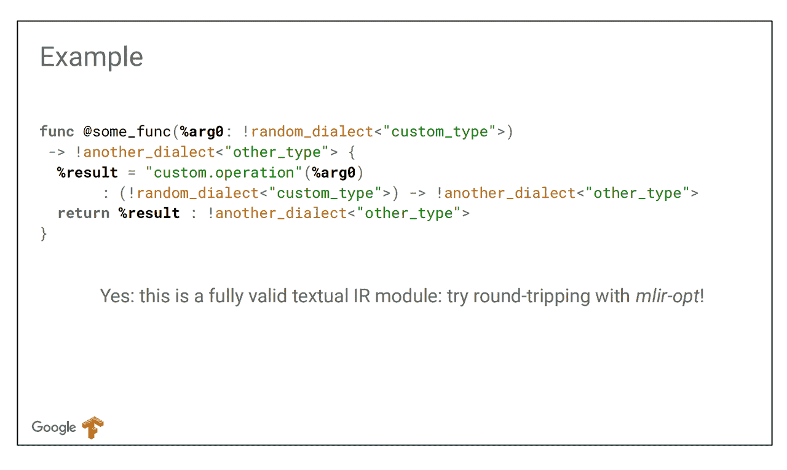

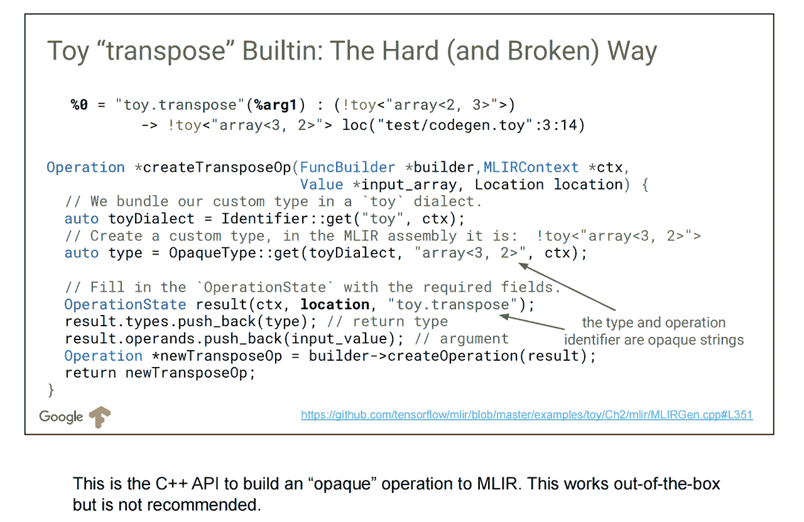

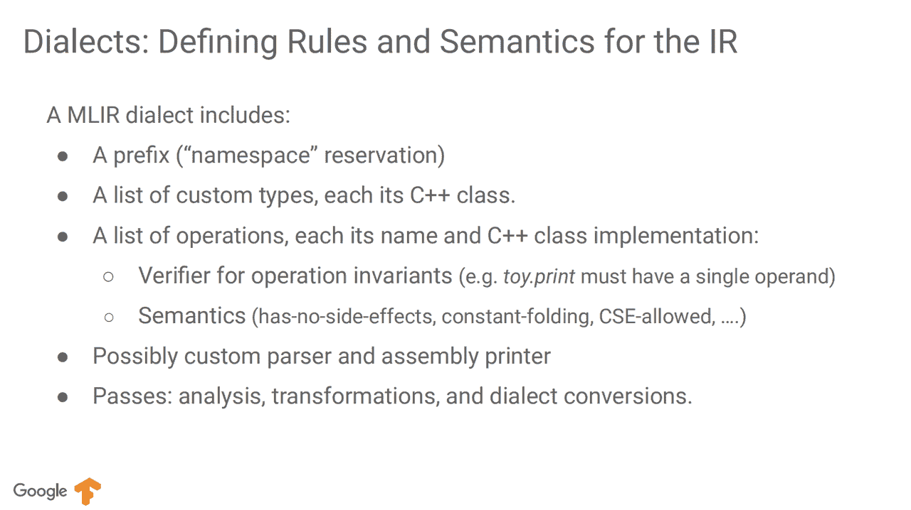

## The Standalone Example

https://archive.fosdem.org/2023/schedule/event/mlirdialect/attachments/slides/5740/export/events/attachments/mlirdialect/slides/5740/How_to_Build_your_own_MLIR_Dialect.pdf

S. Neuendorffer, "Architecting out-of-tree LLVM projects using cmake",

2021 LLVM Developers' Meeting, https://youtu.be/7wOU7csj1ME

An example of an out-of-tree MLIR dialect:

https://github.com/llvm/llvm-project/tree/main/mlir/examples/standalone

Build the standalone example with:

```
mkdir build && cd build
cmake -G Ninja .. -DMLIR_DIR=$PREFIX/lib/cmake/mlir -DLLVM_EXTERNAL_LIT=$BUILD_DIR/bin/llvm-lit
cmake --build . --target check-standalone
```

This assumes that you have built LLVM and MLIR in `$BUILD_DIR` and installed them to `$PREFIX`

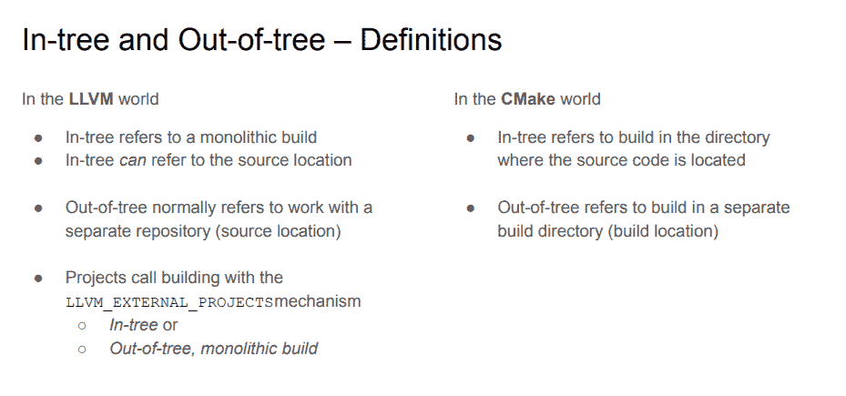

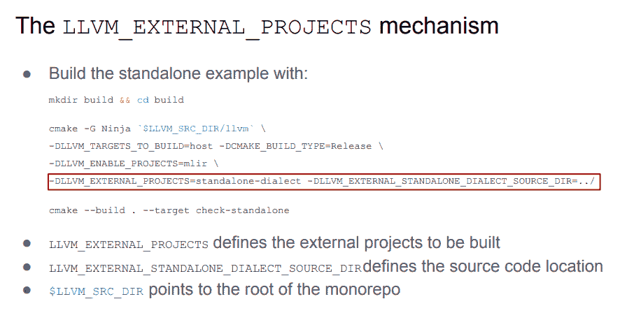

`find_package()` imports information which were exported by a project

`find_package(MLIR ..)` imports information from the installed MLIR and calls `find_package(LLVM ..)`

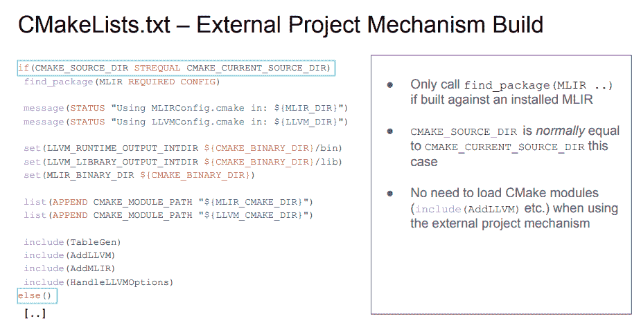

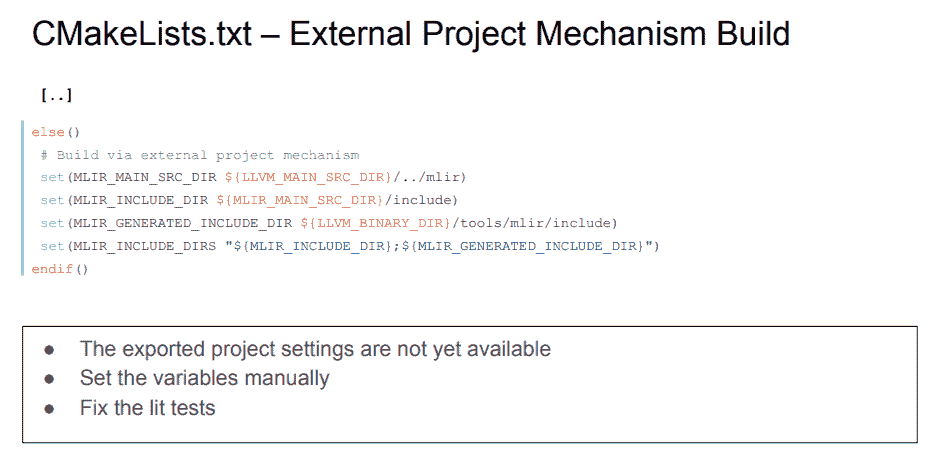

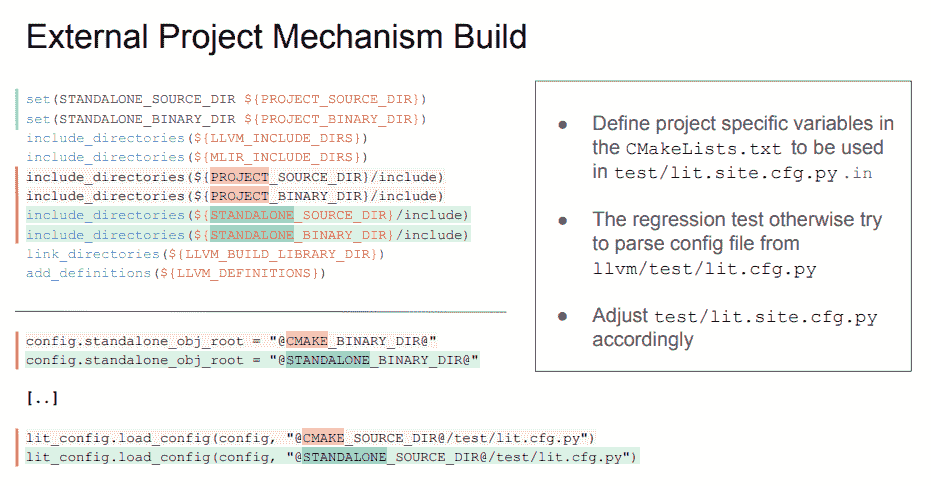

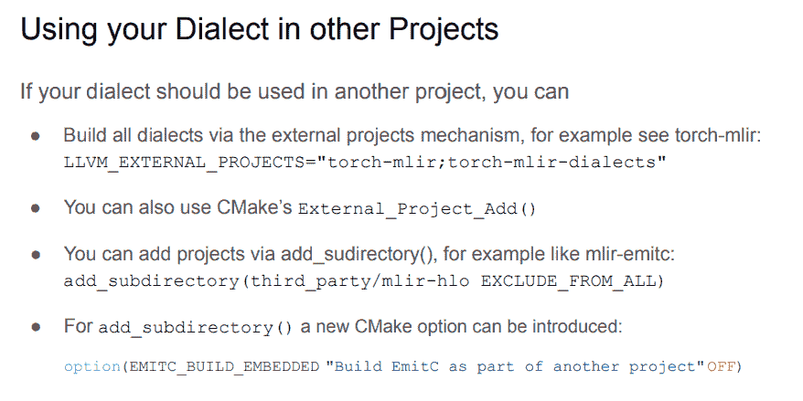

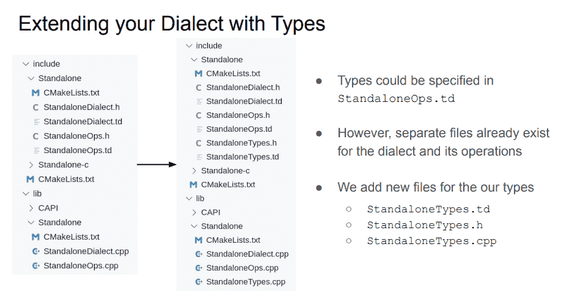

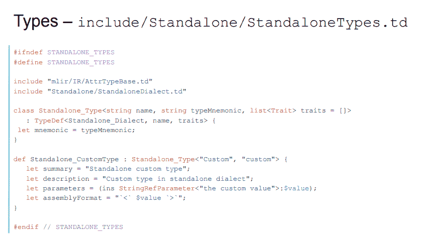

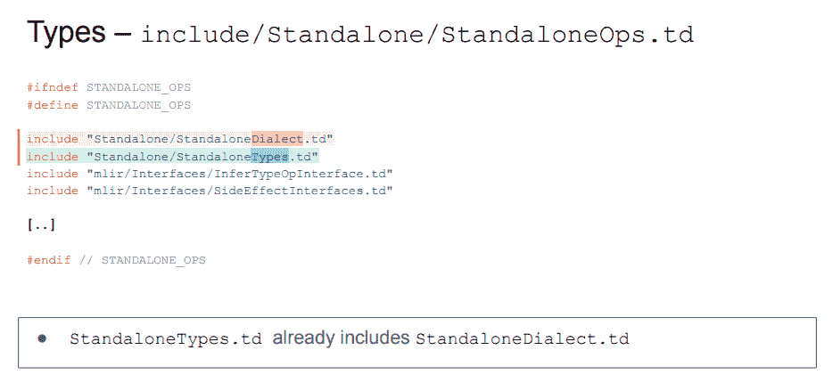

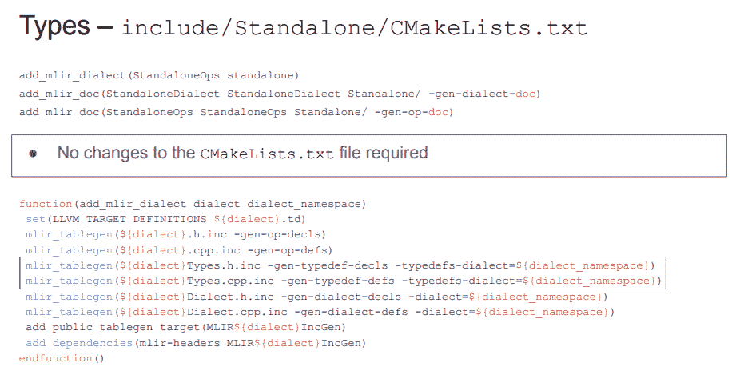

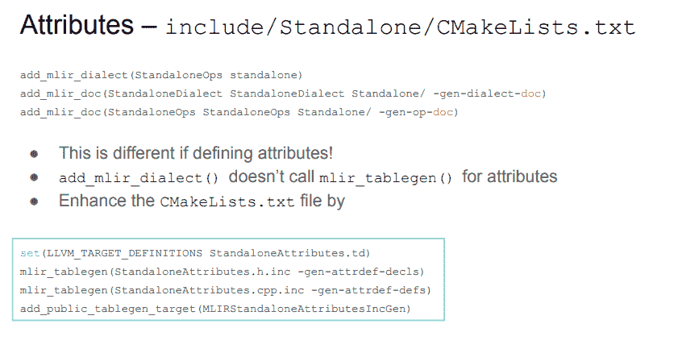

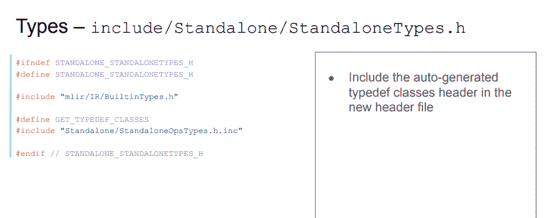

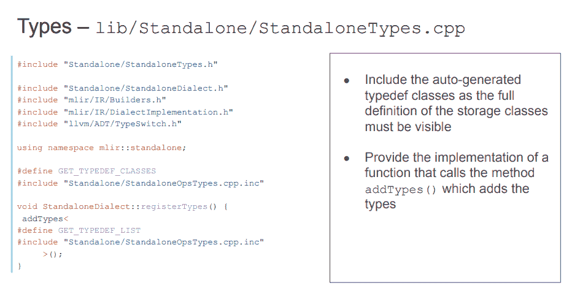

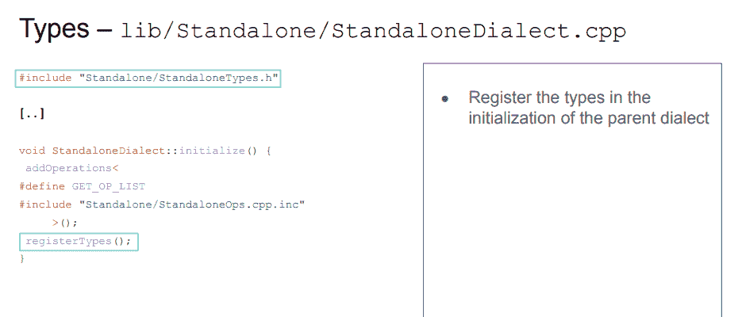

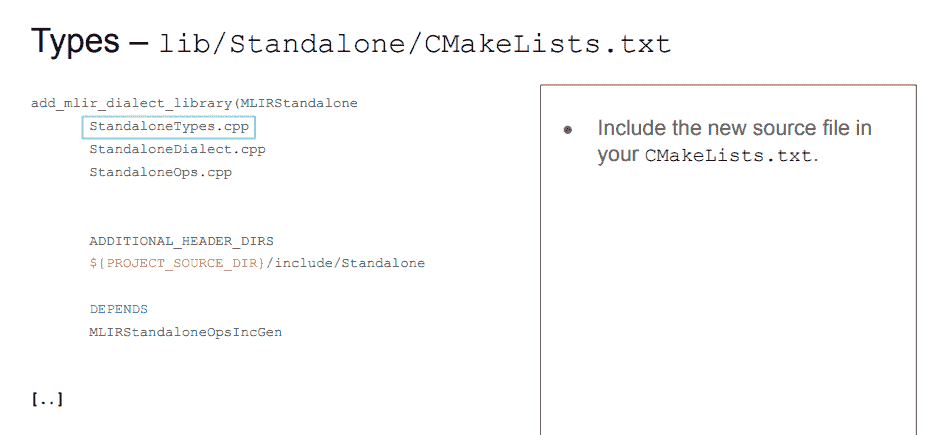

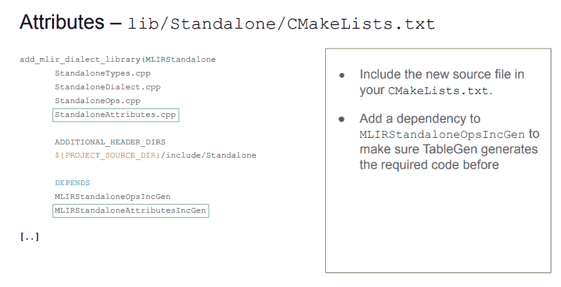

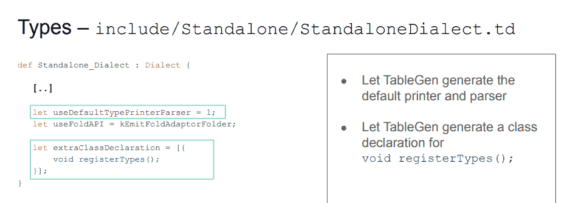

## toy language

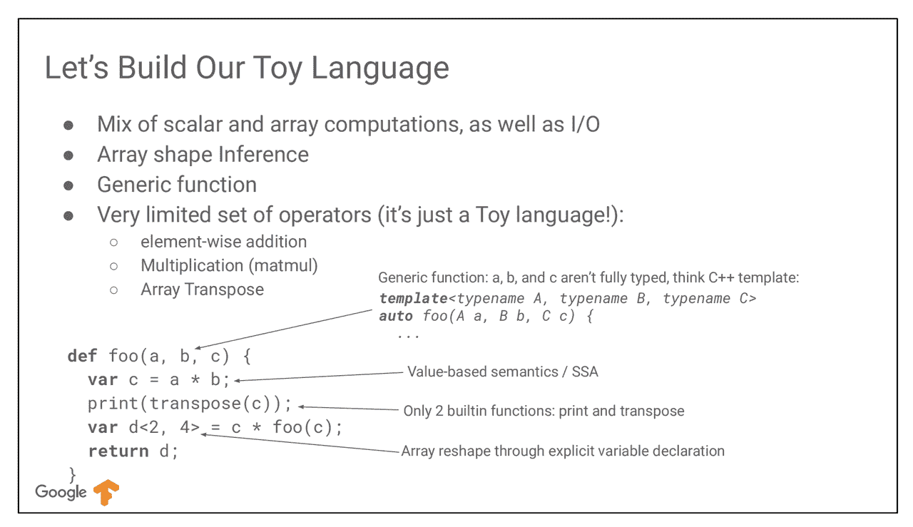

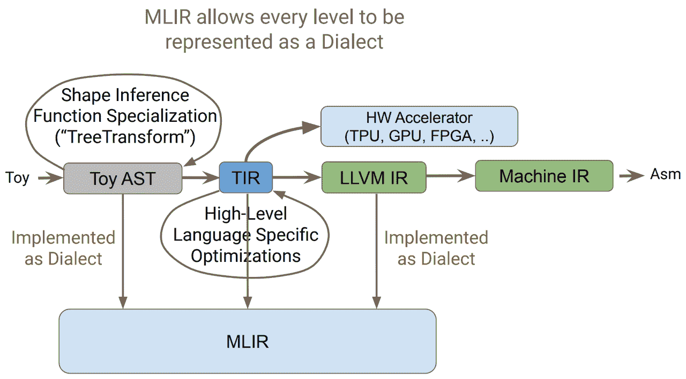

## tutorial - 02

```
TinyMatmulDialect registered.
hello.mlir:2:3: error: custom op 'tiny_matmul.hello' is unknown
  tiny_matmul.hello
  ^
```

## The Language and AST

`Toy` is a tensor-based language that allows you to define functions, perform some math computation, and print results.

the codegen will be limited to tensors of rank <= 2

datatype: only fp64

Values are immutable

```
# User defined generic function that operates on unknown shaped arguments.
def multiply_transpose(a, b) {
  return transpose(a) * transpose(b);
}

def main() {
  # Define a variable `a` with shape <2, 3>, initialized with the literal value.
  var a = [[1, 2, 3], [4, 5, 6]];
  var b<2, 3> = [1, 2, 3, 4, 5, 6];

  # This call will specialize `multiply_transpose` with <2, 3> for both
  # arguments and deduce a return type of <3, 2> in initialization of `c`.
  var c = multiply_transpose(a, b);

  # A second call to `multiply_transpose` with <2, 3> for both arguments will
  # reuse the previously specialized and inferred version and return <3, 2>.
  var d = multiply_transpose(b, a);

  # A new call with <3, 2> (instead of <2, 3>) for both dimensions will
  # trigger another specialization of `multiply_transpose`.
  var e = multiply_transpose(c, d);

  # Finally, calling into `multiply_transpose` with incompatible shapes
  # (<2, 3> and <3, 2>) will trigger a shape inference error.
  var f = multiply_transpose(a, c);
}
```

### Defining a Toy Dialect

用 `dialect` 定义 2 个东西：

1.  structure of the Toy language
1.  API of high-level analysis and transformation

defining dialects via `c++`

```
/// This is the definition of the Toy dialect. A dialect inherits from
/// mlir::Dialect and registers custom attributes, operations, and types. It can
/// also override virtual methods to change some general behavior, which will be
/// demonstrated in later chapters of the tutorial.
class ToyDialect : public mlir::Dialect {public:  explicit ToyDialect(mlir::MLIRContext *ctx);
  /// Provide a utility accessor to the dialect namespace.
  static llvm::StringRef getDialectNamespace() { return "toy"; }
  /// An initializer called from the constructor of ToyDialect that is used to
  /// register attributes, operations, types, and more within the Toy dialect.
  void initialize();
};
```

defining dialects [declaratively](https://llvm.org/docs/TableGen/ProgRef.html) via tablegen


def Toy_Dialect : Dialect {  // The namespace of our dialect, this corresponds 1-1 with the string we
  // provided in `ToyDialect::getDialectNamespace`.
  let name = "toy";
  // A short one-line summary of our dialect.
  let summary = "A high-level dialect for analyzing and optimizing the "                "Toy language";
  // A much longer description of our dialect.
  let description = [{
    The Toy language is a tensor-based language that allows you to define
    functions, perform some math computation, and print results. This dialect
    provides a representation of the language that is amenable to analysis and
    optimization.
  }];
  // The C++ namespace that the dialect class definition resides in.
  let cppNamespace = "toy";
}

To see what this generates

```
${build_root}/bin/mlir-tblgen --gen-dialect-decls ${mlir_src_root}/examples/toy/Ch2/include/toy/Ops.td -I ${mlir_src_root}/include/
```

After the dialect has been defined, it can now be loaded into an `MLIRContext`:

```
context.loadDialect<ToyDialect>();
```

By default, an `MLIRContext` [`only loads the`](https://mlir.llvm.org/docs/Dialects/Builtin/) `Builtin` Dialect

## Defining Toy Operations

```
%4 = "toy.constant"() {value = dense<1.0> : tensor<2x3xf64>} : () -> tensor<2x3xf64>
```

returns a single result of `RankedTensorType`

An operation [`class in`](https://en.wikipedia.org/wiki/Curiously_recurring_template_pattern) inherits from the CRTP `mlir::Op` class

(Curiously recurring template pattern)

```
class ConstantOp : public mlir::Op<
                     /// `mlir::Op` is a CRTP class, meaning that we provide the
                     /// derived class as a template parameter.
                     ConstantOp,
                     /// The ConstantOp takes zero input operands.
                     mlir::OpTrait::ZeroOperands,
                     /// The ConstantOp returns a single result.
                     mlir::OpTrait::OneResult,
                     /// We also provide a utility `getType` accessor that
                     /// returns the TensorType of the single result.
                     mlir::OpTraits::OneTypedResult<TensorType>::Impl> {

 public:
  /// Inherit the constructors from the base Op class.
  using Op::Op;

  /// Provide the unique name for this operation. MLIR will use this to register
  /// the operation and uniquely identify it throughout the system. The name
  /// provided here must be prefixed by the parent dialect namespace followed
  /// by a `.`.
  static llvm::StringRef getOperationName() { return "toy.constant"; }

  /// Return the value of the constant by fetching it from the attribute.
  mlir::DenseElementsAttr getValue();

  /// Operations may provide additional verification beyond what the attached
  /// traits provide.  Here we will ensure that the specific invariants of the
  /// constant operation are upheld, for example the result type must be
  /// of TensorType and matches the type of the constant `value`.
  LogicalResult verifyInvariants();

  /// Provide an interface to build this operation from a set of input values.
  /// This interface is used by the `builder` classes to allow for easily
  /// generating instances of this operation:
  ///   mlir::OpBuilder::create<ConstantOp>(...)
  /// This method populates the given `state` that MLIR uses to create
  /// operations. This state is a collection of all of the discrete elements
  /// that an operation may contain.
  /// Build a constant with the given return type and `value` attribute.
  static void build(mlir::OpBuilder &builder, mlir::OperationState &state,
                    mlir::Type result, mlir::DenseElementsAttr value);
  /// Build a constant and reuse the type from the given 'value'.
  static void build(mlir::OpBuilder &builder, mlir::OperationState &state,
                    mlir::DenseElementsAttr value);
  /// Build a constant by broadcasting the given 'value'.
  static void build(mlir::OpBuilder &builder, mlir::OperationState &state,
                    double value);
};
```

and we can register this operation in the `ToyDialect` initializer:

```
void ToyDialect::initialize() {
    addOperations<ConstantOp>();
}
```

## Op vs Operation - design notes

In MLIR, there are two main classes related to operations: `Operation` and `Op`

`Operation` class provides a general API into an operation instance.

each specific type of operation is represented by an `Op` derived class.

`Op` derived classes act as smart pointer wrapper around a `Operation*`.

设计思路

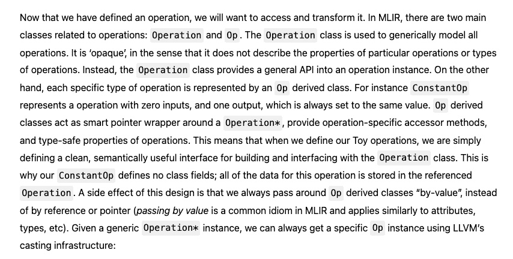

```
void processConstantOp(mlir::Operation *operation) {
  ConstantOp op = llvm::dyn_cast<ConstantOp>(operation);

  // This operation is not an instance of `ConstantOp`.
  if (!op)
    return;

  // Get the internal operation instance wrapped by the smart pointer.
  mlir::Operation *internalOperation = op.getOperation();
  assert(internalOperation == operation &&
         "these operation instances are the same");
}
```

## Operation Definition Specification (ODS) Framework

就是用 `TableGen`，包括：

1. op declaration
1. Defining Arguments and Results
1. Adding Documentation: `summary` and `description` fields.
1. Verifying Operation Semantics. ODS framework will automatically generate a lot.
1. Attaching `build` Methods

```
// Base class for toy dialect operations. This operation inherits from the base
// `Op` class in OpBase.td, and provides:
//   * The parent dialect of the operation.
//   * The mnemonic for the operation, or the name without the dialect prefix.
//   * A list of traits for the operation.
class Toy_Op<string mnemonic, list<Trait> traits = []> :
    Op<Toy_Dialect, mnemonic, traits>;
    
def ConstantOp : Toy_Op<"constant"> {
  // The constant operation takes an attribute as the only input.
  // `F64ElementsAttr` corresponds to a 64-bit floating-point ElementsAttr.
  let arguments = (ins F64ElementsAttr:$value);
  // The constant operation returns a single value of TensorType.
  // F64Tensor corresponds to a 64-bit floating-point TensorType.
  let results = (outs F64Tensor);
  
  // Add additional verification logic to the constant operation. Setting this bit
  // to `1` will generate a `::mlir::LogicalResult verify()` declaration on the
  // operation class that is called after ODS constructs have been verified, for
  // example the types of arguments and results. We implement additional verification
  // in the definition of this `verify` method in the C++ source file. 
  let hasVerifier = 1;
  
  // Add custom build methods for the constant operation. These methods populate
  // the `state` that MLIR uses to create operations, i.e. these are used when
  // using `builder.create<ConstantOp>(...)`.
  let builders = [    // Build a constant with a given constant tensor value.
    OpBuilder<(ins "DenseElementsAttr":$value), [{
      // Call into an autogenerated `build` method.
      build(builder, result, value.getType(), value);
    }]>,
    // Build a constant with a given constant floating-point value. This builder
    // creates a declaration for `ConstantOp::build` with the given parameters.
    OpBuilder<(ins "double":$value)>  ];

}
```

By providing a name to the arguments or results, e.g. `$value`, ODS will automatically generate a matching accessor: `DenseElementsAttr` `ConstantOp::value()`.

```
${build_root}/bin/mlir-tblgen -gen-op-defs ${mlir_src_root}/examples/toy/Ch2/include/toy/Ops.td -I ${mlir_src_root}/include/
```


Depending on the selected action, this will print either the `ConstantOp` class declaration or its implementation. Comparing this output to the hand-crafted implementation is incredibly useful when getting started with `TableGen`.

## Custom Assembly Format

`MLIR` allows for operations to define [their own custom assembly format](https://mlir.llvm.org/docs/DefiningDialects/Operations/#declarative-assembly-format), either declaratively or imperatively via `C++`.

Override the `hasCustomAssemblyFormat` field for a `C++` format, or the `assemblyFormat` field for the declarative format.

```
/// Consider a stripped definition of `toy.print` here.
def PrintOp : Toy_Op<"print"> {
  let arguments = (ins F64Tensor:$input);

  // Divert the printer and parser to `parse` and `print` methods on our operation,
  // to be implemented in the .cpp file. More details on these methods is shown below.
  let hasCustomAssemblyFormat = 1;
}
```

```
/// The 'OpAsmPrinter' class is a stream that will allows for formatting
/// strings, attributes, operands, types, etc.
void PrintOp::print(mlir::OpAsmPrinter &printer) {
  printer << "toy.print " << op.input();
  printer.printOptionalAttrDict(op.getAttrs());
  printer << " : " << op.input().getType();
}

/// The 'OpAsmParser' class provides a collection of methods for parsing
/// various punctuation, as well as attributes, operands, types, etc. Each of
/// these methods returns a `ParseResult`. This class is a wrapper around
/// `LogicalResult` that can be converted to a boolean `true` value on failure,
/// or `false` on success. This allows for easily chaining together a set of
/// parser rules. These rules are used to populate an `mlir::OperationState`
/// similarly to the `build` methods described above.
mlir::ParseResult PrintOp::parse(mlir::OpAsmParser &parser,
                                 mlir::OperationState &result) {
  // Parse the input operand, the attribute dictionary, and the type of the
  // input.
  mlir::OpAsmParser::UnresolvedOperand inputOperand;
  mlir::Type inputType;
  if (parser.parseOperand(inputOperand) ||
      parser.parseOptionalAttrDict(result.attributes) || parser.parseColon() ||
      parser.parseType(inputType))
    return mlir::failure();

  // Resolve the input operand to the type we parsed in.
  if (parser.resolveOperand(inputOperand, inputType, result.operands))
    return mlir::failure();

  return mlir::success();
}
```

The declarative format is largely composed of three different components:

+   Directives

+   A type of builtin function, with an optional set of arguments.

+   Literals

+   A keyword or punctuation surrounded by backticks.

+   Variables

+   An entity that has been registered on the operation itself, i.e. an argument(attribute or operand), result, successor, etc. In the `PrintOp` example above, a variable would be `$input`.

```
/// Consider a stripped definition of `toy.print` here.
def PrintOp : Toy_Op<"print"> {
  let arguments = (ins F64Tensor:$input);

  // In the following format we have two directives, `attr-dict` and `type`.
  // These correspond to the attribute dictionary and the type of a given
  // variable represectively.
  let assemblyFormat = "$input attr-dict `:` type($input)";
}
```

## Complete Toy Example

there are many more that we haven’t had a chance to: regions, variadic operands, etc. Check out the full specification for more details.

We can now generate our “Toy IR”. You can build `toyc-ch2` and try yourself on the above example: `toyc-ch2 test/Examples/Toy/Ch2/codegen.toy -emit=mlir -mlir-print-debuginfo`. We can also check our RoundTrip: `toyc-ch2 test/Examples/Toy/Ch2/codegen.toy -emit=mlir -mlir-print-debuginfo 2> codegen.mlir` followed by `toyc-ch2 codegen.mlir -emit=mlir`. You should also use `mlir-tblgen` on the final definition file and study the generated `C++` code.

# Analysis and Transformation

We divide compiler transformations into two categories: local and global.

In this chapter, we focus on how to leverage the Toy Dialect and its high-level semantics to perform local pattern-match transformations that would be difficult in `LLVM`. For this, we use `MLIR`’s Generic DAG Rewriter.

two methods to implement pattern-match transformations:

1. Imperative, `C++` pattern-match and rewrite

2. Declarative, rule-based [pattern-match and rewrite](https://mlir.llvm.org/docs/Tutorials/Toy/Ch-2/) using table-driven Declarative Rewrite Rules (`DRR`). Note that the use of `DRR` requires that the operations be defined using `ODS`, as described in Chapter 2.

## Transpose using `C++` style

goal: eliminate a sequence of two transposes that cancel out: `transpose(transpose(X)) -> X`

```
def transpose_transpose(x) {
  return transpose(transpose(x));
}
```

Which corresponds to the following IR:

```
toy.func @transpose_transpose(%arg0: tensor<*xf64>) -> tensor<*xf64> {
  %0 = toy.transpose(%arg0 : tensor<*xf64>) to tensor<*xf64>;
  %1 = toy.transpose(%0 : tensor<*xf64>) to tensor<*xf64>;
  toy.return %1 : tensor<*xf64>;
}
```

```
/// Fold transpose(transpose(x)) -> x
struct SimplifyRedundantTranspose : public mlir::OpRewritePattern<TransposeOp> {
  /// We register this pattern to match every toy.transpose in the IR.
  /// The "benefit" is used by the framework to order the patterns and process
  /// them in order of profitability.
  SimplifyRedundantTranspose(mlir::MLIRContext *context)
      : OpRewritePattern<TransposeOp>(context, /*benefit=*/1) {}

  /// This method is attempting to match a pattern and rewrite it. The rewriter
  /// argument is the orchestrator of the sequence of rewrites. It is expected
  /// to interact with it to perform any changes to the IR from here.
  mlir::LogicalResult
  matchAndRewrite(TransposeOp op,
                  mlir::PatternRewriter &rewriter) const override {
    // Look through the input of the current transpose.
    mlir::Value transposeInput = op.getOperand();
    TransposeOp transposeInputOp = transposeInput.getDefiningOp<TransposeOp>();

    // Input defined by another transpose? If not, no match.
    if (!transposeInputOp)
      return failure();

    // Otherwise, we have a redundant transpose. Use the rewriter.
    rewriter.replaceOp(op, {transposeInputOp.getOperand()});
    return success();
  }
};
```

```
// Register our patterns for rewrite by the Canonicalization framework.
void TransposeOp::getCanonicalizationPatterns(
  RewritePatternSet &results, MLIRContext *context) {
    results.add<SimplifyRedundantTranspose>(context);
}
```

In `MLIR`, the optimizations are run through a `PassManager` in a similar way to `LLVM`:

```
mlir::PassManager pm(module->getName());  pm.addNestedPass<mlir::toy::FuncOp>(mlir::createCanonicalizerPass());
```

Finally, we can run `toyc-ch3 test/Examples/Toy/Ch3/transpose_transpose.toy -emit=mlir -opt` and observe our pattern in action:

结果如下：

1. 直接 `return` 了 `%arg0`，符合预期。

2. 前面的 `transpose %0` 没有被 `dead code elimination` 消掉，不符合预期。

```
toy.func @transpose_transpose(%arg0: tensor<*xf64>) -> tensor<*xf64> {
  %0 = toy.transpose(%arg0 : tensor<*xf64>) to tensor<*xf64>;
  toy.return %arg0 : tensor<*xf64>;
}
```

解释：`MLIR` conservatively assumes that operations may have side-effects.

solution：加 trait，显式声明 `pure`

```
def TransposeOp : Toy_Op<"transpose", [Pure]> {...}
```

Let’s retry now `toyc-ch3 test/transpose_transpose.toy -emit=mlir -opt`:

```
toy.func @transpose_transpose(%arg0: tensor<*xf64>) -> tensor<*xf64> {
  toy.return %arg0 : tensor<*xf64>;
}
```

## Optimize Reshapes using `DRR`

```
class Pattern<
    dag sourcePattern, list<dag> resultPatterns,
    list<dag> additionalConstraints = [],
    dag benefitsAdded = (addBenefit 0)>;
```

redundant reshape optimization


```
// Reshape(Reshape(x)) = Reshape(x)
def ReshapeReshapeOptPattern : Pat&lt;(ReshapeOp(ReshapeOp $arg)),                                   (ReshapeOp $arg)&gt;;
```

The automatically generated C++ code corresponding to each of the `DRR` patterns can be found under `path/to/BUILD/tools/mlir/examples/toy/Ch3/ToyCombine.inc`.

adding argument constraints

```
def TypesAreIdentical : Constraint&lt;CPred&lt;&quot;$0.getType() == $1.getType()&quot;&gt;&gt;;
def RedundantReshapeOptPattern : Pat&lt;
  (ReshapeOp:$res $arg), (replaceWithValue $arg),
  [(TypesAreIdentical $res, $arg)]&gt;;
```

Some optimizations may require additional transformations on instruction arguments. This is achieved using `NativeCodeCall`, which allows for more complex transformations either by calling into a C++ helper function or by using inline C++

```
def ReshapeConstant : NativeCodeCall&lt;&quot;$0.reshape(($1.getType()).cast&lt;ShapedType&gt;())&quot;&gt;;
def FoldConstantReshapeOptPattern : Pat&lt;
  (ReshapeOp:$res (ConstantOp $arg)),
  (ConstantOp (ReshapeConstant $arg, $res))&gt;;
```

```
def ReshapeConstant : NativeCodeCall&lt;&quot;$0.reshape(($1.getType()).cast&lt;ShapedType&gt;())&quot;&gt;;
def FoldConstantReshapeOptPattern : Pat&lt;
  (ReshapeOp:$res (ConstantOp $arg)),
  (ConstantOp (ReshapeConstant $arg, $res))&gt;;
```

```
def main() {
  var a&lt;2,1&gt; = [1, 2];
  var b&lt;2,1&gt; = a;
  var c&lt;2,1&gt; = b;
  print(c);
}
```

```
module {
  toy.func @main() {
    %0 = toy.constant dense&lt;[1.000000e+00, 2.000000e+00]&gt; : tensor&lt;2xf64&gt;
    %1 = toy.reshape(%0 : tensor&lt;2xf64&gt;) to tensor&lt;2x1xf64&gt;
    %2 = toy.reshape(%1 : tensor&lt;2x1xf64&gt;) to tensor&lt;2x1xf64&gt;
    %3 = toy.reshape(%2 : tensor&lt;2x1xf64&gt;) to tensor&lt;2x1xf64&gt;
    toy.print %3 : tensor&lt;2x1xf64&gt;
    toy.return
  }
}
```

We can try to run `toyc-ch3 test/Examples/Toy/Ch3/trivial_reshape.toy -emit=mlir -opt` and observe our pattern in action:

```
module {
  toy.func @main() {
    %0 = toy.constant dense&lt;[[1.000000e+00], [2.000000e+00]]&gt; : tensor&lt;2x1xf64&gt;
    toy.print %0 : tensor&lt;2x1xf64&gt;
    toy.return
  }
}
```

相当于 `constant folding`

# Generic Transformation

MLIR provides a set of always available-hooks for certain core transformations.

比如 `canonicalizations`

hooks on operations don’t scale well.

Interfaces provide a generic mechanism for dialects and operations to provide information to a transformation or analysis

## Shape Inference

Our Toy IR currently operates on generic tensors, meaning that we don’t know the shape of tensors other than during the initialization of constants.

The approach we take for Toy is to inline all of the function calls, then perform intraprocedural shape propagation.

inlining algorithm is quite complicated.

MLIR provides a generic inliner algorithm that dialect[s can plug](https://mlir.llvm.org/docs/Interfaces/) into. All we need to do in Toy is to provide the interfaces for the inliner to hook into.

```
/// This class defines the interface for handling inlining with Toy operations.
/// We simplify inherit from the base interface class and override
/// the necessary methods.
struct ToyInlinerInterface : public DialectInlinerInterface {
  using DialectInlinerInterface::DialectInlinerInterface;

  /// This hook checks to see if the given callable operation is legal to inline
  /// into the given call. For Toy this hook can simply return true, as the Toy
  /// Call operation is always inlinable.
  bool isLegalToInline(Operation *call, Operation *callable,
                       bool wouldBeCloned) const final {
    return true;
  }

  /// This hook checks to see if the given operation is legal to inline into the
  /// given region. For Toy this hook can simply return true, as all Toy
  /// operations are inlinable.
  bool isLegalToInline(Operation *, Region *, bool,
                       IRMapping &amp;) const final {
    return true;
  }

  /// This hook cheks if the given &#x27;src&#x27; region can be inlined into the &#x27;dest&#x27;
  /// region. The regions here are the bodies of the callable functions. For
  /// Toy, any function can be inlined, so we simply return true.
  bool isLegalToInline(Region *dest, Region *src, bool wouldBeCloned,
                       IRMapping &amp;valueMapping) const final {
    return true;
  }

  /// This hook is called when a terminator operation has been inlined. The only
  /// terminator that we have in the Toy dialect is the return
  /// operation(toy.return). We handle the return by replacing the values
  /// previously returned by the call operation with the operands of the
  /// return.
  void handleTerminator(Operation *op,
                        MutableArrayRef&lt;Value&gt; valuesToRepl) const final {
    // Only &quot;toy.return&quot; needs to be handled here.
    auto returnOp = cast&lt;ReturnOp&gt;(op);

    // Replace the values directly with the return operands.
    assert(returnOp.getNumOperands() == valuesToRepl.size());
    for (const auto &amp;it : llvm::enumerate(returnOp.getOperands()))
      valuesToRepl[it.index()].replaceAllUsesWith(it.value());
  }
};
```

# Partial Lowering

we will show how to perform progressive lowering through a mix of dialects coexisting in the same function.

goal: convert the compute-intensive Toy operations into a combination of operations from the `Affine`, `Arith`, `Func`, and `MemRef` dialects for further optimization.

`Affine` Dialect: tailored to the computation-heavy part of the program

A[s part of ](https://mlir.llvm.org/docs/Dialects/Builtin/#rankedtensortype)this lowe[ring, we w](https://mlir.llvm.org/docs/Dialects/Builtin/#memreftype)ill be lowering from the `TensorType` that Toy operates on to the `MemRefType` that is indexed via an affine loop-nest.

Tensors represent an abstract value-typed sequence of data, meaning that they don’t live in any memory. MemRefs, on the other hand, represent lower level buffer access, as they are concrete references to a region of memory.

## DialectConversion framework

[a unified ](https://mlir.llvm.org/getting_started/Glossary/#conversion)framework for converting between different dialects.

To use this framework, we need to provide two things (and an optional third):

+   A `Conversion Target`

+   This[ is the form](https://mlir.llvm.org/getting_started/Glossary/#legalization)al specification of what operations or dialects are legal for the conversion. Operations that aren’t legal will require rewrite patterns to perform legalization.

+   A set of `Rewrite Patterns`

+   [This is ](https://mlir.llvm.org/docs/Tutorials/QuickstartRewrites/)the set of patterns used to convert illegal operations into a set of zero or more legal ones.

+   Optionally, a [`Type Converter`](https://mlir.llvm.org/docs/DialectConversion/#type-conversion).

+   If provided, this is used to convert the types of block arguments. We won’t be needing this for our conversion.

## Conversion Target


```
void ToyToAffineLoweringPass::runOnOperation() {
  // The first thing to define is the conversion target. This will define the
  // final target for this lowering.
  mlir::ConversionTarget target(getContext());

  // We define the specific operations, or dialects, that are legal targets for
  // this lowering. In our case, we are lowering to a combination of the
  // `Affine`, `Arith`, `Func`, and `MemRef` dialects.
  target.addLegalDialect<affine::AffineDialect, arith::ArithDialect,
                         func::FuncDialect, memref::MemRefDialect>();

  // We also define the Toy dialect as Illegal so that the conversion will fail
  // if any of these operations are *not* converted. Given that we actually want
  // a partial lowering, we explicitly mark the Toy operations that don't want
  // to lower, `toy.print`, as *legal*. `toy.print` will still need its operands
  // to be updated though (as we convert from TensorType to MemRefType), so we
  // only treat it as `legal` if its operands are legal.
  target.addIllegalDialect<ToyDialect>();
  target.addDynamicallyLegalOp<toy::PrintOp>([](toy::PrintOp op) {
    return llvm::none_of(op->getOperandTypes(),
                         [](Type type) { return type.isa<TensorType>(); });
  });
  ...
}
```

Above, we first set the toy dialect to illegal, and then the print operation as legal. We could have done this the other way around. Individual operations always take precedence over the (more generic) dialect definitions, so the order doesn’t matter.

## Conversion Patterns

```
/// Lower the `toy.transpose` operation to an affine loop nest.
struct TransposeOpLowering : public mlir::ConversionPattern {
  TransposeOpLowering(mlir::MLIRContext *ctx)
      : mlir::ConversionPattern(TransposeOp::getOperationName(), 1, ctx) {}

  /// Match and rewrite the given `toy.transpose` operation, with the given
  /// operands that have been remapped from `tensor<...>` to `memref<...>`.
  mlir::LogicalResult
  matchAndRewrite(mlir::Operation *op, ArrayRef<mlir::Value> operands,
                  mlir::ConversionPatternRewriter &rewriter) const final {
    auto loc = op->getLoc();

    // Call to a helper function that will lower the current operation to a set
    // of affine loops. We provide a functor that operates on the remapped
    // operands, as well as the loop induction variables for the inner most
    // loop body.
    lowerOpToLoops(
        op, operands, rewriter,
        [loc](mlir::PatternRewriter &rewriter,
              ArrayRef<mlir::Value> memRefOperands,
              ArrayRef<mlir::Value> loopIvs) {
          // Generate an adaptor for the remapped operands of the TransposeOp.
          // This allows for using the nice named accessors that are generated
          // by the ODS. This adaptor is automatically provided by the ODS
          // framework.
          TransposeOpAdaptor transposeAdaptor(memRefOperands);
          mlir::Value input = transposeAdaptor.input();

          // Transpose the elements by generating a load from the reverse
          // indices.
          SmallVector<mlir::Value, 2> reverseIvs(llvm::reverse(loopIvs));
          return rewriter.create<mlir::AffineLoadOp>(loc, input, reverseIvs);
        });
    return success();
  }
};
```

## Design Considerations

In our lowering, we transform from a value-type, `TensorType`, to an allocated (buffer-like) type, `MemRefType`.

However, given that we do not lower the `toy.print` operation, we need to temporarily bridge these two worlds. There are many ways to go about this, each with their own tradeoffs:

+   Generate load operations from the buffer

One option is to generate load operations from the buffer type to materialize an instance of the value type. This allows for the definition of the `toy.print` operation to remain unchanged. The downside to this approach is that the optimizations on the affine dialect are limited, because the load will actually involve a full copy that is only visible after our optimizations have been performed.

+   Generate a new version of `toy.print` that operates on the lowered type

Another option would be to have another, lowered, variant of `toy.print` that operates on the lowered type. The benefit of this option is that there is no hidden, unnecessary copy to the optimizer. The downside is that another operation definition is needed that may duplicate many aspects of the first. Defining a base class in ODS may simplify this, but you still need to treat these operations separately.

+   Update `toy.print` to allow for operating on the lowered type

A third option is to update the current definition of `toy.print` to allow for operating the on the lowered type. The benefit of this approach is that it is simple, does not introduce an additional hidden copy, and does not require another operation definition. The downside to this option is that it requires mixing abstraction levels in the `Toy` dialect.

```
def PrintOp : Toy_Op<"print"> {
  ...

  // The print operation takes an input tensor to print.
  // We also allow a F64MemRef to enable interop during partial lowering.
  let arguments = (ins AnyTypeOf<[F64Tensor, F64MemRef]>:$input);
}
```

## Complete Toy Example

```
toy.func @main() {
  %0 = toy.constant dense<[[1.000000e+00, 2.000000e+00, 3.000000e+00], [4.000000e+00, 5.000000e+00, 6.000000e+00]]> : tensor<2x3xf64>;
  %2 = toy.transpose(%0 : tensor<2x3xf64>) to tensor<3x2xf64>;
  %3 = toy.mul %2, %2 : tensor<3x2xf64>;
  toy.print %3 : tensor<3x2xf64>;
  toy.return
}
```

```
func.func @main() {
  %cst = arith.constant 1.000000e+00 : f64
  %cst_0 = arith.constant 2.000000e+00 : f64
  %cst_1 = arith.constant 3.000000e+00 : f64
  %cst_2 = arith.constant 4.000000e+00 : f64
  %cst_3 = arith.constant 5.000000e+00 : f64
  %cst_4 = arith.constant 6.000000e+00 : f64

  // Allocating buffers for the inputs and outputs.
  %0 = memref.alloc() : memref<3x2xf64>;
  %1 = memref.alloc() : memref<3x2xf64>;
  %2 = memref.alloc() : memref<2x3xf64>;

  // Initialize the input buffer with the constant values.
  affine.store %cst, %2[0, 0] : memref<2x3xf64>;
  affine.store %cst_0, %2[0, 1] : memref<2x3xf64>;
  affine.store %cst_1, %2[0, 2] : memref<2x3xf64>;
  affine.store %cst_2, %2[1, 0] : memref<2x3xf64>;
  affine.store %cst_3, %2[1, 1] : memref<2x3xf64>;
  affine.store %cst_4, %2[1, 2] : memref<2x3xf64>;

  // Load the transpose value from the input buffer and store it into the
  // next input buffer.
  affine.for %arg0 = 0 to 3 {
    affine.for %arg1 = 0 to 2 {
      %3 = affine.load %2[%arg1, %arg0] : memref<2x3xf64>;
      affine.store %3, %1[%arg0, %arg1] : memref<3x2xf64>;
    }
  }

  // Multiply and store into the output buffer.
  affine.for %arg0 = 0 to 3 {
    affine.for %arg1 = 0 to 2 {
      %3 = affine.load %1[%arg0, %arg1] : memref<3x2xf64>;
      %4 = affine.load %1[%arg0, %arg1] : memref<3x2xf64>;
      %5 = arith.mulf %3, %4 : f64
      affine.store %5, %0[%arg0, %arg1] : memref<3x2xf64>;
    }
  }

  // Print the value held by the buffer.
  toy.print %0 : memref<3x2xf64>;
  memref.dealloc %2 : memref<2x3xf64>;
  memref.dealloc %1 : memref<3x2xf64>;
  memref.dealloc %0 : memref<3x2xf64>;
  return
}
```

Adding the `LoopFusion` and `AffineScalarReplacement` passes to the pipeline gives the following result:

右侧是 fusion 后的，`transpose` 和 `mul` 做了算子融合。并优化掉了不必要的 memory load/store。

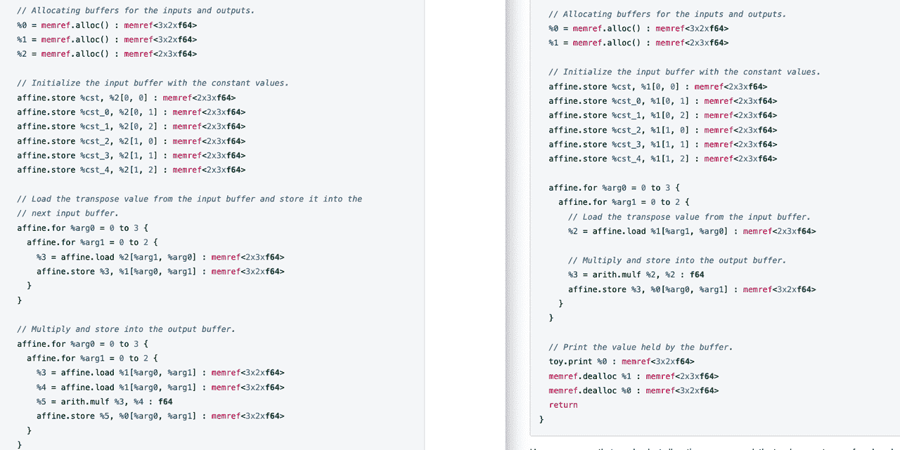

## Lowering to LLVM and CodeGeneration
