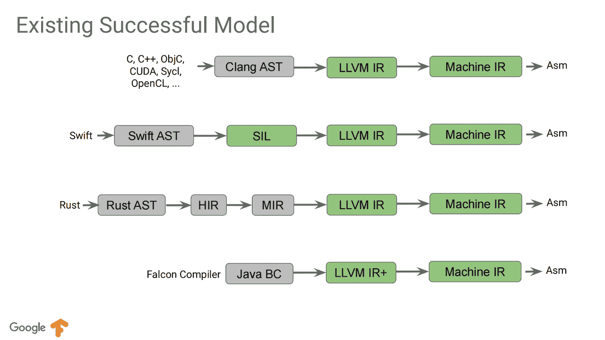

# LLVM IR 设计思想 & 局限性

> 来源：[https://learning.feishu.cn/docx/VWTYd2iv8ojrapx8YLNcawzanWb](https://learning.feishu.cn/docx/VWTYd2iv8ojrapx8YLNcawzanWb)

published: https://zhuanlan.zhihu.com/p/15291378541

LLVM IR - Design Philosophy and Limitations

# Summary

1.  通用性双刃剑。LLVM IR 的设计强调通用性，但仅提供单一层次的 IR，限制了对领域特定语言（DSL）的支持。

1.  low-level RISC-like。表达高级语言 & 并行计算的能力，都很弱。导致了碎片化的 compiler frontend，也催生了 MLIR。

1.  与硬件解耦。导致生成的 bitcode 效率低下，不适合作为 Driver 的 IR。

1.  兼容性权衡。在易用性与开发成本之间，牺牲了 IR 的向前兼容性，这也促成了 SPIR-V 等新标准的出现。

某种程度上，高层 IR 和 并行计算，都是一种 DSL。

关于 LLVM IR 局限性的讨论，重点推荐 2 篇文章：

+   MLIR paper, 2020: https://arxiv.org/abs/2002.11054

+   Lei Zhang, 2022: https://www.lei.chat/zh/posts/compilers-and-irs-llvm-ir-spirv-and-mlir/

[Compiler IR - 编译原理](https://deep-learning.feishu.cn/wiki/BbWLwQSODi3MD4kq1UWcIcctnRd?fromScene=spaceOverview)文假定，读者有一定的编译器理论基础。

# 设计思想

LLVM Language Reference Manual: https://llvm.org/docs/LangRef.html

LLVM IR is roughly "C with vectors" (2020 MLIR paper)

设计思想：

1.  **SSA form**。Linear IR，简化数据流分析，便于优化。

1.  Complete Code Representation。新前端开发时，仅需理解 LLVM IR 的基本概念和不变性。早期编译器（如 GCC）做不到。

1.  Low Level but Target-Independent。RISC-like 的虚拟指令集，但与具体硬件无关。

1.  **Type System**。强类型系统，没有隐式类型转换。可提供类型检查和自动纠错能力，增强代码健壮性。

LLVM IR 与 RISC 的主要区别：

+   **强类型系统**：LLVM IR 的类型系统提供类型检查等自动纠错能力。

+   **无限寄存器模型**：LLVM IR 使用虚拟寄存器，而 RISC 使用物理寄存器。

+   **抽象的过程调用约定**：在 LLVM IR 中，过程调用通过 call 和 ret 指令实现，抽象化了参数传递，与底层硬件指令（如 RISC-V 的 ecall、jal 等）无关。

LLVM IR 示例，展示如何定义函数及其参数

```
define i32 @add(i32 %a, i32 %b) {
entry:
  %sum = add i32 %a, %b
  ret i32 %sum
}
```

点评

LLVM 技术栈成熟，通用性强，生态系统优秀。

LLVM IR 提供高效灵活的中间表示，适应现代编译器需求。

支持多种编程语言（如 C、C++、Rust 等），能够生成高效的机器代码。

# 局限性

## 通用性 vs DSL IR

LLVM IR 旨在通用编译，只提供了单一层次的 LLVM IR。

许多 DSL 不适合使用 LLVM IR 进行编译。

例如，TVM 图层的 Relay IR，Triton Compiler 表达算子逻辑的 Triton IR。

MLIR 的 dialect，很好的回答了如何解耦的问题。对标的 Dialect，分别是

+   TOSA: Tensor Operator Set Architecture。文档 https://mlir.llvm.org/docs/Dialects/TOSA/

+   Linalg：文档 https://mlir.llvm.org/docs/Dialects/Linalg/

## 高层 IR 的抽象不足

LLVM IR 是 low-level 的 RISC-like 虚拟指令集。

不适合表达高层次的抽象。

MLIR 提供了更好的通用解决方案。

高层 IR 作为一种 DSL，可以通过 MLIR Dialect 模块化地支持。

传统的编译模型：AST -> LLVM。

现代编译器，一般在 AST 和 LLVM 加了一层 language-specific IR。比如，

+   Swift 使用 SIL（Swift Intermediate Language）IR，

+   Rust 使用 MIR（Mid-level Intermediate Representation）IR。

+   Clang 仍是 AST 到 LLVM IR，缺少这一层 IR 抽象。



## 并行编程的抽象

并行编程，也是一种高级别的操作。

LLVM IR 缺少 parallel constructs 的原生支持，手写 matmul、conv 等操作非常复杂。

以矩阵乘法为例，

以下是 LLVM IR、PTX 和 MLIR 的对比，突出各自的优缺点。

LLVM IR 缺乏高层次抽象，代码复杂且冗长，优化困难。

1.  **并行性**。手动处理循环，增加了出错的可能性。

1.  **数据依赖不清晰**。编译器无法进行激进优化，导致性能损失。

1.  **内存管理**。手动获取和存储元素以及管理内存指针的细节，增加了出错风险。

MLIR linalg.generic 示例

1.  **高层次抽象**。linalg.generic 提供清晰的矩阵乘法核心逻辑表达。

1.  **并行性**。indexing_maps 和 iterator_types 清晰表示了可以并行执行的部分。

1.  **内存管理**。内存管理在更高层次上得到处理，编译器可以针对具体硬件进行优化。

PTX 示例

+   **并行表达**。通过线程索引 %threadIdx.x 和 %threadIdx.y 确定当前线程的行和列。

+   **计算逻辑清晰**：在一个简单的循环中累加矩阵乘法的结果，直接将结果存储到 C 矩阵。

LLVM IR 代码示例

```
define void @matmul(float* %A, float* %B, float* %C) {
entry:
  %i = alloca i32
  %j = alloca i32
  %k = alloca i32
  %sum = alloca float
  store float 0.0, float* %sum

  %i_val = load i32, i32* %i
  %j_val = load i32, i32* %j

  for.k:
    br label %loop

loop:
  %k_val = load i32, i32* %k
  %cond = icmp slt i32 %k_val, 4
  br i1 %cond, label %body, label %end

body:
  %a_elem = getelementptr float, float* %A, i32 %i_val, i32 %k_val
  %b_elem = getelementptr float, float* %B, i32 %k_val, i32 %j_val
  %c_elem = getelementptr float, float* %C, i32 %i_val, i32 %j_val
  %a_val = load float, float* %a_elem
  %b_val = load float, float* %b_elem
  %current_sum = load float, float* %sum
  %new_sum = fadd float %current_sum, %a_val * %b_val
  store float %new_sum, float* %sum

  %k_next = getelementptr i32, i32* %k, i32 1
  store i32 %k_next, i32* %k
  br label %loop

end:
  ret void
}
```

MLIR 使用 linalg.generic 的示例如下

```
module {
  func @matmul(%A: memref&lt;4x4xf32&gt;, %B: memref&lt;4x4xf32&gt;, %C: memref&lt;4x4xf32&gt;) {
    linalg.generic {
      indexing_maps = [
        affine_map&lt;(i, j) -&gt; (i, j)&gt;, // 输出矩阵 C 的索引
        affine_map&lt;(i, k) -&gt; (k, i)&gt;, // 输入矩阵 A 的索引
        affine_map&lt;(k, j) -&gt; (j, k)&gt;  // 输入矩阵 B 的索引
      ],
      iterator_types = [&quot;parallel&quot;, &quot;parallel&quot;, &quot;reduction&quot;] // 并行和归约迭代器
    } {
      // 计算 C[i, j] += A[i, k] * B[k, j]
      ^^{
        %a_elem = linalg.load %A[%i, %k] : memref&lt;4x4xf32&gt;
        %b_elem = linalg.load %B[%k, %j] : memref&lt;4x4xf32&gt;
        %c_elem = linalg.load %C[%i, %j] : memref&lt;4x4xf32&gt;
        %new_value = arith.mulf %a_elem, %b_elem : f32
        %updated_value = arith.addf %c_elem, %new_value : f32
        linalg.store %updated_value, %C[%i, %j] : memref&lt;4x4xf32&gt;
      }
    }
    return
  }
}
```

CUDA PTX 的示例（NVIDIA RTX 4090，sm_89 架构）

```
.version 7.5
.target sm_89
.address_size 64

.global .func void matmul(float* A, float* B, float* C) {
  .reg .f32 sum;
  .reg .u32 i = %threadIdx.y;
  .reg .u32 j = %threadIdx.x;

  sum = 0.0f;
  for .u32 k = 0; k &lt; 4; k++ {
    sum += A[i * 4 + k] * B[k * 4 + j];
  }
  C[i * 4 + j] = sum;
}

// Kernel 启动
.kernel void matmul_kernel(float* A, float* B, float* C) {
  matmul(A, B, C);
}
```

## 向前兼容 & SPIR-V

为了平衡易用性 & 开发代价，LLVM IR 不保证向前兼容。

https://llvm.org/docs/DeveloperPolicy.html#ir-backwards-compatibility

LLVM 对 DSL IR 较弱的支持能力，难以针对特定领域建立 spec 标准。

开发者手动实现诸多领域相关的细节，也增加了向前兼容的难度。

这在注重向前兼容的场景里，是很致命的。

比如，硬件驱动。

硬件设备会存在于像是手机之类的终端产品之中，这些终端产品被产品制造商和最终消费者所掌控。 驱动的升级是无法得到保障的，因此驱动依赖的 LLVM 库也可能永远无法得到升级。

SPIR 的思路是，锁定某一版本的 LLVM IR，使用 LLVM 内联函数 (intrinsic) 和元数据 (metadata) 来定义 OpenCL 的计算原语以及定义。 但 Khronos Group 逐渐意识到 LLVM IR 实在不适合这种任务，遂转向了设计与开发 SPIR-V。

SPIR-V 主要用于 Vulkan 和 OpenCL 应用程序。

提供了一种标准化的二进制格式，便于跨平台和跨设备的移植。

更注重于字节码的高效处理并提供强兼容性。

## 不够高效的字节码

这也是 SPIR-V 之于 LLVM IR 的关键优势之一。

同样是为了通用性，LLVM IR 虽然是 low level IR，但在更低的 level，也会不满足需求。

LLVM IR 的 字节码（LLVM Bitcode），通常包含更多的调试信息和类型信息，

导致更大的内存占用、更慢的传输和加载速度。

这在 hardware driver 场景下，latency 的增加也是不可接受的。

SPIR-V 设计了高效字节码格式，专为高效的加载和执行而设计。

在性能和效率上相较于 LLVM IR 有明显优势。

# 主流 IR 的对比总结

brief:

1.  **LLVM IR**: 适合通用编译，具备强大的优化能力和类型系统。

1.  **MLIR**: 学习 MLIR 的架构、Dialect 概念及其如何支持 DSL 抽象。

1.  **SPIR-V**: 理解其在稳定性、向前兼容性和字节码效率上的优势。

1.  **PTX**：掌握针对 GPU 编程的低级表示。

1.  **OpenMP**：学习并行编程的表示方法及编译器的自动并行优化支持。

LLVM 在标量优化和同构编译做得很好。本质是，single layer 且 risc-like 的 LLVM IR，完美适合这个场景。

向量化、张量化、异构等，任何的变化，都令 LLVM IR 捉襟见肘。

MLIR 是 compiler infra。相比 LLVM IR，核心优势是：

1.  更好的 DSL IR 支持。

1.  通过 DSL 也能支持 high-level 抽象，并行编程等。

SPIR-V 更适合 hardware driver，特别是 GPGPU。核心优势是：

1.  稳定的 IR 标准，更好的向前兼容性。方便 hardware driver 版本升级。

1.  高效的字节码。专为高效的加载和执行而设计。

OpenMP。LLVM 仓库中，独立的并行计算支持项目。

OpenMP 是现代高性能编程中的重要工具，尤其在共享内存架构中。

OpenMP 允许开发者在 C、C++ 和 Fortran 中轻松添加并行性。

例如，使用 #pragma omp parallel 指令，可以轻松地将循环并行化：

```
#pragma omp parallel for
for (int i = 0; i &lt; N; i++) {
    // 并行执行的代码
}
```