# LLVM & 编译原理 Readings

> 来源：[https://learning.feishu.cn/docx/Gu7Ldvqtgoz7Vexf6p1crFCmnOd](https://learning.feishu.cn/docx/Gu7Ldvqtgoz7Vexf6p1crFCmnOd)

## 入门材料

### 学习路线图

新手入门，主要是 2 个材料：

1.  `LLVM Essentials-2015.pdf`
1.  2019 EuroLLVM Developers’ Meeting - LLVM IR Tutorial

预置条件：

[`CS143 编译原理笔记 - 提纲`](https://deep-learning.feishu.cn/wiki/YzyCwQzcUi8R0LkG243cCPRvnwg?fromScene=spaceOverview)解简单的编译原理，效果会更好。入门推荐

要点提纲

1.  掌握 LLVM common Tools
1.  掌握 LLVM IR 的 API。看的懂手册、会用 `llvm::IRBuilder`。
1.  Pass Infra
1.  Codegen

不覆盖的内容：

1.  intrinsic
1.  exception
1.  metadata & attribute
1.  vector instruction
1.  debug information & DWARF

### LLVM Essentials - 2015

`LLVM Essentials-2015.pdf`: sourceforge 下载链接

非常适合入门 LLVM，只是 2015 年的书，API 有点老了。

我用 chatGPT 重新写了一下 tutorial code，并用 `Clang19` 跑通了。

快的话，一个周末就可以刷完。

书 200 多页。精髓，都在 code 里面，每个 chapter ~100 行代码。

特别是 Building LLVM IR - scalar add，做完就感觉会写 LLVM 代码了。

看懂代码，可以跳过书中的大部分文字解释。

### LLVM IR Tutorial - 2019

2019 EuroLLVM Developers’ Meeting - LLVM IR Tutorial

https://www.youtube.com/watch?v=m8G_S5LwlTo

slides: https://llvm.org/devmtg/2019-04/slides/Tutorial-Bridgers-LLVM_IR_tutorial.pdf

对 GEP 的讲解，非常深入，非常精髓。

## 个人理解

通常，大家都会推荐这些书：

1.  编译原理相关书籍
1.  [`CS143`](https://web.stanford.edu/class/cs143/)， [`Bilibili`](https://www.bilibili.com/video/BV1NE411376V/)
1.  鲸书：高级编译器设计与实现
1.  龙书：编译原理
1.  `Engineering a Compiler, Second Edition.pdf`
1.  `The SSA Design Book.pdf`
1.  体系结构相关
1.  Computer Architecture - A Quantitative Approach
1.  `Computer Organization and Design RISC-V edition.pdf`
1.  编译相关经典论文
1.  `The Compiler Design Handbook, 2nd Edition (Dec 2007).pdf`
1.  PLDI 论文
1.  ISCA 论文
1.  CGO 论文
1.  LLVM 相关学习书籍。low-level IR, optimization, and code-generation
1.  `Getting Started with LLVM Core Libraries.pdf`
1.  `LLVM Cookbook.pdf`
1.  `LLVM Essentials.pdf`
1.  看源码的 `examples` 目录

传统的建议，一般包括：

1.  学习编译原理，刷书。比如，龙书，鲸书，`Engineering a Compiler`。
1.  LLVM 看书 & 做练习。比如，`LLVM essentials`，`LLVM Cookbook`。
1.  读 LLVM 源码。特别是，源码的 `examples` 目录。
1.  Start with the LLVM Developer Meeting tutorials and presentations. They're on YouTube.

个人看法，这种入门，造就了 2 种群体：

1.  熟悉 LLVM API 但不懂编译原理和算法。
1.  懂编译原理，但不会 LLVM。基本写不了代码。

传统学习编译器，是为了创造新语言，所以，重点是 frontend。

现在学习编译器，是 hardware 适配 & 性能优化。即，后端 `codegen` 和 中端 `opt`。

另外，deep learning model 本身就是 DAG，也不需要词法解析构建 AST 了。

LLVM 最新的 tutorial，实现 Kaleidoscope 语言，仍有 10 个 chapter 中的 2 个在写 Lexer 和 parser。

如果能基于 LLVM 提供的 compiler infra 来学习编译原理，效果可能会更好。

CS 6120: Advanced Compilers: The Self-Guided Online Course

https://www.cs.cornell.edu/courses/cs6120/2020fa/self-guided/

https://www.cs.cmu.edu/afs/cs/academic/class/15745-s19/www/syllabus.html

Compilers: Principles, Techniques, and Tools (2nd Edition)

## 阅读材料

官方文档，主要看 `UserGuides` 系列 https://llvm.org/docs/UserGuides.html

重点包括：

+   `Optimizations` （终端）。
+   Writing an LLVM Backend: https://llvm.org/docs/WritingAnLLVMBackend.html
+   The LLVM Target-Independent Code Generator: https://llvm.org/docs/CodeGenerator.html
+   `TableGen`: https://llvm.org/docs/TableGen/index.htmls
+   Code Generation （后端）。比如：Writing an LLVM Backend

`Clang` （前端）相关的，在独立的 https://clang.llvm.org。

比较重要的内容：

+   https://clang.llvm.org/docs/InternalsManual.html
+   https://clang.llvm.org/docs/Tooling.html

LLVM 官方的 `GettingStarted` 系列

+   https://llvm.org/docs/GettingStarted.html
+   https://llvm.org/docs/ProgrammersManual.html

LLVM 后端 - `CodeGen`

+   [Build a Modern Computer from First Principles: From Nand to Tetris](https://www.coursera.org/learn/build-a-computer). Taught by Shimon Schocken and Noam Nisan. This course starts backward: first, you build the logic gates (and, or, xor, etc.), then use the logic gates to construct Arithmetic-Logic Unit (ALU), and then use the ALU to build the CPU. Then you learn how to control the CPU with zeros and ones (machine code), and eventually, you develop your assembler to convert the human-readable assembly into the machine code.
+   Parsing `Mach-O` files(🔌). This is a short article written by me. It shows how to parse object files on macOS (`Mach-O`). If you are on Linux or Windows, search for similar articles on `elf` and `PE/COFF` files, respectively.
+   Performance Analysis and Tuning on Modern CPUs. The book by Denis Bakhvalov. While it is about performance, it gives an excellent introduction to how CPUs work.

Clang & LLVM 前端

+   Understanding the Clang AST. This article is written by Jonas Devlieghere. It goes into detail and touches implementation details of Clang’s AST. It also has a lot of excellent links to dive deeper into the subject.
+   [`clang-tutor`](https://github.com/banach-space/clang-tutor/). This repository maintained by Andrzej Warzyński. It contains several Clang plugins covering various topics, from simple AST traversals to more involved subjects such as automatic refactoring and obfuscation.

### 优质 Paper

https://llvm.org/pubs/

| Title | year | Author | Notes |
| --- | --- | --- | --- |
| LLVM: A Compilation Framework for Lifelong Program Analysis & Transformation | 2004 | Chris Lattner | |
| The LLVM Compiler Framework and Infrastructure | | Gennady Pekhimenko | |
| | | | |
| Making Graphs Reducible with Controlled Node Splitting | | | |
| Partial Redundancy Elimination in SSA Form | | | |
| MLIR: A Compiler Infrastructure for the End of Moore’s Law | 2020 | Chris Lattner | |
| Compiling ONNX Neural Network Models Using MLIR | 2020 | IBM | |
| | | | |

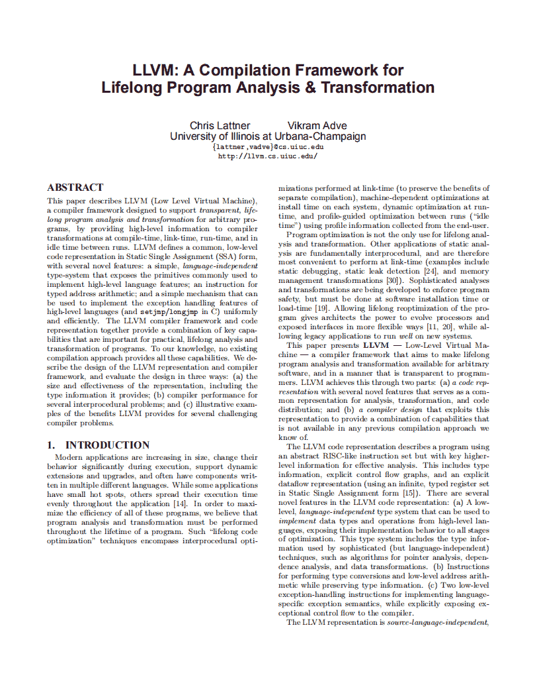

[`2004-LLVM.pdf`](https://internal-api-drive-stream.feishu.cn/space/api/box/stream/download/all/Jvf1b9AP1osn9Ix90Lnct8Zgn0d)

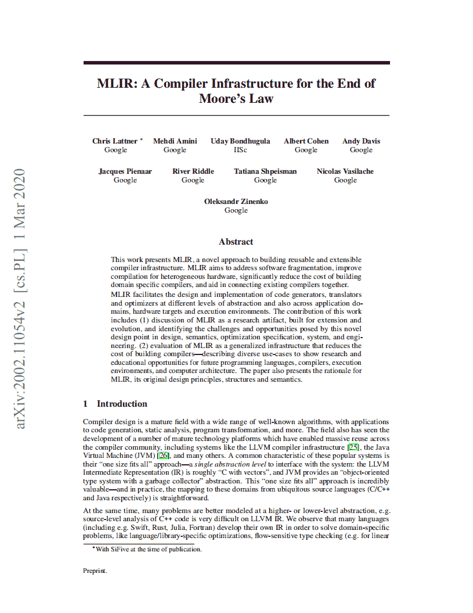

[`2020-mlir.pdf`](https://internal-api-drive-stream.feishu.cn/space/api/box/stream/download/all/KyM4bgS4woqQ0bxi8yJccUdPnsd)

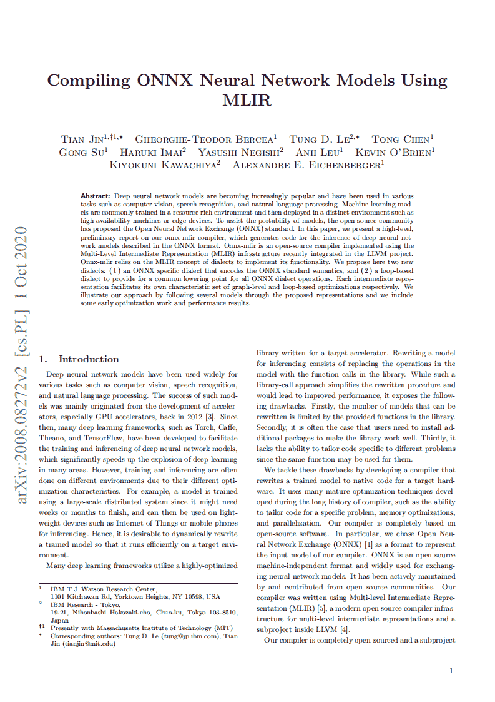

[`2020-onnx-mlir.pdf`](https://internal-api-drive-stream.feishu.cn/space/api/box/stream/download/all/Pdh6bxzi8ofiJExM7C5c6kRDnVC)

`llvm`

#### Big Picture

[1] Jeanne Ferrante, Karl J. Ottenstein, Joe D. Warren. The program dependence graph and its use in optimization. ACM Transactions on Programming Languages and Systems, Vol.9, No.3, July 1987, Pages 319-349.
[2] Stanislav Manilov, Christos Vasiladiotis, Björn Franke. Generalized Profile-Guided Iterator Recognition. The University of Edinburgh. CC’18, February 24–25, 2018, Vienna, Austria.

Compiler-Based Code Improvement Techniques, an [unpublished paper](https://link.zhihu.com/?target=https%3A//www.clear.rice.edu/comp512/Lectures/Papers/survey.pdf) by K.D. Cooper, K.S. McKinley, and L. Torczon (local copy)

#### Value Numbering

P. [Briggs](https://link.zhihu.com/?target=http%3A//dx.doi.org/10.1002/%28SICI%291097-024X%28199706%2927%3A6%253C701%3A%3AAID-SPE104%253E3.3.CO%3B2-S), K.D. Cooper, and L.T. Simpson, "Value Numbering," Software-Practice and Experience, 27(6), July 1997. (DOI)

#### Global Common Subexpression Elimination

J. Cocke, "Global Common Subexpression Elimination," [Proceedings](https://link.zhihu.com/?target=http%3A//doi.acm.org/10.1145/800028.808480) of a Symposium on Compiler Construction, Sigplan Notices 5(7), 1970, pages 20--24. (DOI)

#### Global and Interprocedural

K. Pettis and R.C. Hansen, "Profile Guided Code [Positioning](https://link.zhihu.com/?target=http%3A//doi.acm.org/10.1145/93542.93550)," Proceedings of the ACM SIGPLAN '90 Conference on Programming Language Design and Implementation (PLDI), White Plains, NY, July 1990, pages 16-27. (Also SIGPLAN Notices 25(6).) (DOI)

K.D. Cooper, M.W. Hall, and L. Torczon, "An Experiment with [Inline Substitution](https://link.zhihu.com/?target=http%3A//dx.doi.org/10.1002/spe.4380210604)", Software--Practice and Experience 21(6), June 1991, pages 581-601. (DOI)

+   J.W. Davidson and A. [Ho](https://link.zhihu.com/?target=http%3A//dx.doi.org/10.1002/spe.4380180805)ller, "A Study of a C Function Inliner," Software--Practice and Experience 19(1), January 1988, pages 79-97.    (DOI)

+   J.W. Davidson and A. Ho[lle](https://link.zhihu.com/?target=http%3A//dx.doi.org/10.1109/32.121752)r, "Subprogram Inlining: A Study of Its Effects on Program Execution Time", IEEE Transactions on Software Engineering, 18(2) 1992, pages 89-102.    (DOI)

+   P. Zhao and J.N. Amaral, "To Inline or Not t[o I](https://link.zhihu.com/?target=http%3A//rd.springer.com/chapter/10.1007/978-3-540-24644-2_26)nline? Enhanced Inlining Decions," Proceedings of the 4th Workshop on Languages and Compilers for Parallel Computing (LCPC), October 2003, pages 405-419.    (URL)

+   K. Cooper, T. Harvey, and T. Waterman, "An Adap[tiv](https://link.zhihu.com/?target=http%3A//dl.acm.org/citation.cfm%3Fid%3D1788374.1788381)e Strategy for Inline Substitution", Proceedings of CC 2008, pages 69-84    (URL)

## SSA

Efficiently computing static single assignment form and the control dependence graph

https://www.cs.utexas.edu/~pingali/CS380C/2010/papers/ssaCytron.pdf

+   M. Wegman and F.K. Zadeck, "Constant Propagation with C[ond](https://link.zhihu.com/?target=http%3A//doi.acm.org/10.1145/103135.103136)itional Branches", ACM Transactions on Programming Languages and Systems (TOPLAS) 13(2), pages 181-210.     (DOI)

+   "Efficiently Computing Static Single Assignment Form and the Control Dependence Graph", R. Cytron, J. Ferra[nte](https://link.zhihu.com/?target=http%3A//doi.acm.org/10.1145/115372.115320), B.K. Rosen, M.N. Wegman, and F.K. Zadeck, ACM TOPLAS 13(4), October 1991, pages 451--490.     (DOI)

+   "Practical Improvements to the Construction and Destruction of Static Sin[gle](https://link.zhihu.com/?target=http%3A//dl.acm.org/citation.cfm%3Fid%3D295545.295551) Assignment Form", P. Briggs, K.D. Cooper, T.J. Harvey, and L.T. Simpson, Software--Practice and Experience 28(8) July 1998, pages 859--891. (on readings page) (DOI)

+   [Highly recommended: "The Devel](https://link.zhihu.com/?target=http%3A//webcast.rice.edu/webcast.php%3Faction%3Ddetails%26event%3D1346)opment of Static Single Assignment Form", F.K. Zadeck, talk from December 2007 Workshop in Memory of Ken Kennedy

+    C. Click and K.D. Cooper, "Combining Analyses, Combin[ing](https://link.zhihu.com/?target=http%3A//doi.acm.org/10.1145/201059.201061) Optimizataions," ACM Transactions on Programming Languages and Systems (TOPLAS), 17(2), pages 181-196.     (DOI)

## Lazy Code Motion

+   J. [Kno](https://link.zhihu.com/?target=http%3A//doi.acm.org/10.1145/143095.143136)op, O. Ruthing, and B. Steffen, "Lazy Code Motion", Proceedings of ACM SIGPLAN '92 Conference on Programming Language Design and Implementation (PLDI), June 199, (DOI)

+   K-[H. ](https://link.zhihu.com/?target=http%3A//doi.acm.org/10.1145/152819.152823)Drechsler and M.P. Stadel, "A variation of Knoop, Ruthing, and Steffen's Lazy Code Motion", ACM SIGPLAN Notices, 28(5), May 1993 (DOI)

+   L. T. Simpson, "Value-Driven Redundancy Elimination," Ph.D. Thesis, Rice University Department of Computer Science, April 1996. (Also Rice CS TR 96-308)

+   R. Kennedy, S. Chan, [S.M](https://link.zhihu.com/?target=http%3A//doi.acm.org/10.1145/319301.319348). Liu, R. Lo, P. Tu, and F.Chow, “Partial Redundancy Elimination in SSA Form”, ACM Transactions on Programming Languages and Systems, 21(3), May 1999, pages 627-676.     DOI

## Strength Reduction

+   V. Lefevre, "[Multiplication by](https://link.zhihu.com/?target=https%3A//www.clear.rice.edu/comp512/Lectures/Papers/Lefevre-Multiplication.pdf) an Integer Constant," INRIA Technical Report 4192, May 2001.

+    "Reduction of Operator Strength" by F.E. Allen, J. Cocke, and K. Kennedy in Program Flow Analysis, N.D. Jones and S.S. Muchnick, editors. (copy in Fondren Library)

+   K.D[. C](https://link.zhihu.com/?target=http%3A//doi.acm.org/10.1145/504709.504710)ooper, L.T. Simpson, and C.A. Vick, "Operator Strength Reduction", ACM TOPLAS, 23(5), September 2001, pages 603-625.     (DOI)

+   J[. Knoop,](https://link.zhihu.com/?target=http%3A//citeseerx.ist.psu.edu/viewdoc/summary%3Fdoi%3D10.1.1.49.5725) O. [Ruthing, a](https://link.zhihu.com/?target=https%3A//www.clear.rice.edu/comp512/Lectures/Papers/Knoop-LazyStrengthReduction.pdf)nd B. Steffen, "Lazy Strength Reduction," Journal of Programming Languages, 1(1), 1993, pages 71-91.     (CiteSeer or local copy))

## Algebraic Reassociation of Expressions

+   P[. B](https://link.zhihu.com/?target=http%3A//doi.acm.org/10.1145/773473.178257)riggs and K.D. Cooper, "Effective Partial Redundancy Elimination," Proceedings of PLDI 94, June 1994, pages 159-170.    (DOI)

+   B. A[lpe](https://link.zhihu.com/?target=http%3A//doi.acm.org/10.1145/73560.73561)rn, M.N. Wegman, and F.K. Zadeck, "Detecting Equality of Variables in Programs," Proceedings of the 15th ACM SIGPLAN-SIGACT Symposium on Principles of Programming Languages (POPL 88), pages 1-11.    (DOI)

## Register Allocation

+   K.D. Cooper, T.J. Harvey, and L. Torczon[, "](https://link.zhihu.com/?target=http%3A//dx.doi.org/10.1002/%28SICI%291097-024X%2819980410%2928%3A4%253C425%3A%3AAID-SPE160%253E3.0.CO%3B2-2)How to Build an Interference Graph", Software--Practice and Experience. 28(4), April 1998.     (DOI)

+   R. Gupta, M.L. Soffa, and T. Steele, "Register Allocation via Clique Separators," Proceedings of t[he ](https://link.zhihu.com/?target=http%3A//doi.acm.org/10.1145/74818.74842)ACM SIGPLAN 1989 Conference on Programming Language Design and Implementation (PLDI '89), July 1989, pages 264-274. (Also, SIGPLAN Notices 24(7))     (DOI)

+   C. Fu, and K. Wilken, "A Faster Optimal Regis[ter](https://link.zhihu.com/?target=http%3A//dl.acm.org/citation.cfm%3Fid%3D774861.774888) Allocator,", Proceedings of the 35th Annual ACM/IEEE International Symposium on Microarchitecture (MICRO 35), pages 245-256.     (DOI)

## 其他

### General Theory / Introduction

+   [Compilers](https://online.stanford.edu/courses/soe-ycscs1-compilers). The course is taught by Alex Aiken. In this course, you build a compiler for a real programming language from scratch. It covers the whole compilation pipeline: parsing, type-checking, optimizations, code generation. Besides practical parts, it also dives into the theory.

+   [Automata Theory](https://online.stanford.edu/courses/soe-ycsautomata-automata-theory). The course is taught by Jeffrey Ullman. This one is pretty heavy on theory. It starts with relatively simple topics like state machines and finite automata (deterministic and otherwise). It gradually moves on to more complex things like Turing-machines, computational complexity, famous P vs. NP, etc.

+   Theory of Computation. This course is taught by Michael Sipser. It is similar to the one above but delivered in a different style. It goes into more detail on specific topics.

### LLVM IR - Mid end

+   [L](https://www.youtube.com/watch?v=m8G_S5LwlTo)LVM IR Tutorial - Phis, GEPs and other things, oh my!. This is a great talk by Vince Bridgers and Felipe de Azevedo Piovezan.

+   Introduction to LLVM. A one-hour-long talk/tutorial from LLVM Developers meeting given by Eric Christopher and Johannes Doerfert. Another great tutorial that better builds on top of the previous video.

+   CS 6120: Advanced Compilers. The course is taught by Adrian Sampson. The title says “advanced,” but it covers what one would expect in a modern production-grade compiler: SSA, CFG, optimizations, various analyses.

+   Bitcode Demystified(🔌). This one is from me. It gives a high-level description of what’s the LLVM Bitcode is.

+   [`llvm-tutor`](https://github.com/banach-space/llvm-tutor). This one is also from Andrzej Warzyński. It covers LLVM plugins (so-called passes) that allow one to analyze and transform the programs in the LLVM IR form.

关于线性代数计算优化的框架`poly`的论文值得看看，这个代码也在LLVM的`poly`目录下。

# LLVM 学习与应用资源

https://lowlevelbits.org/how-to-learn-compilers-llvm-edition/

https://mukulrathi.com/create-your-own-programming-language/llvm-ir-cpp-api-tutorial/

图很漂亮

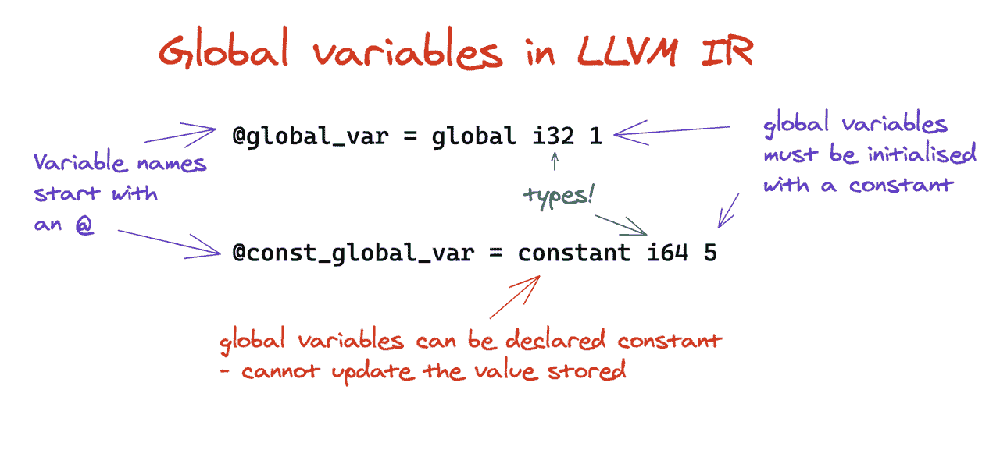

LLVM 不只可以做 compiler，一些例子：

+   UIUC 的 Virtual Ghost 展示了您以使用编译器通道来保护进程免受受损操作系统内核的影响。http://sva.cs.illinois.edu/pubs/VirtualGhost-ASPLOS-2014.pdf

+   UW 的 CoreDet 使多线程程序具有确定性。https://homes.cs.washington.edu/~djg/papers/asplos10-coredet.pdf

+   在近似计算工作中，使用 LLVM pass 将错误注入程序以模拟容易出错的硬件。

## Onnx-MLIR

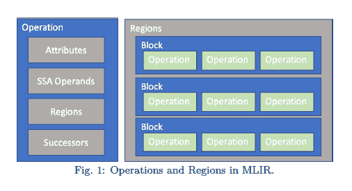

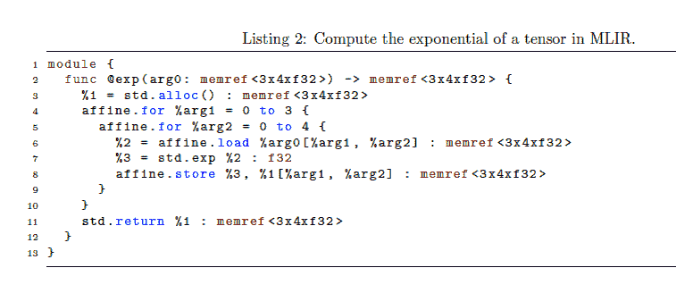

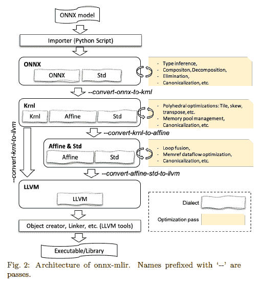

展开以后的 affine，类似于 tvm 的 `TensorIR`

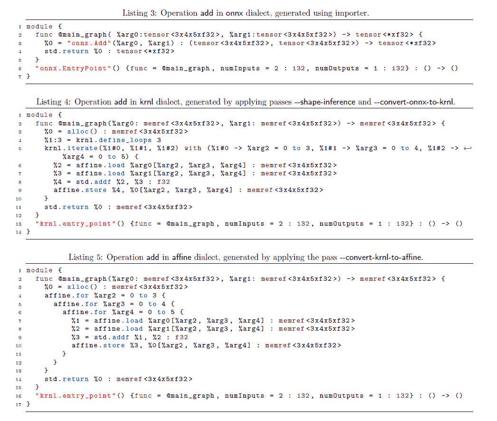

## LLVM Pass

下面这个问题，属于 algebraic simplification。不是 constant propagation。

https://3cs1203.files.wordpress.com/2014/01/compiler-optimizations1.pdf

https://www.youtube.com/watch?v=I9hnXLE86kI

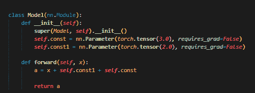

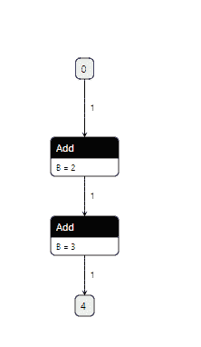

LLVM pass: `-instcombine`: Combine redundant instructions

https://llvm.org/docs/Passes.html

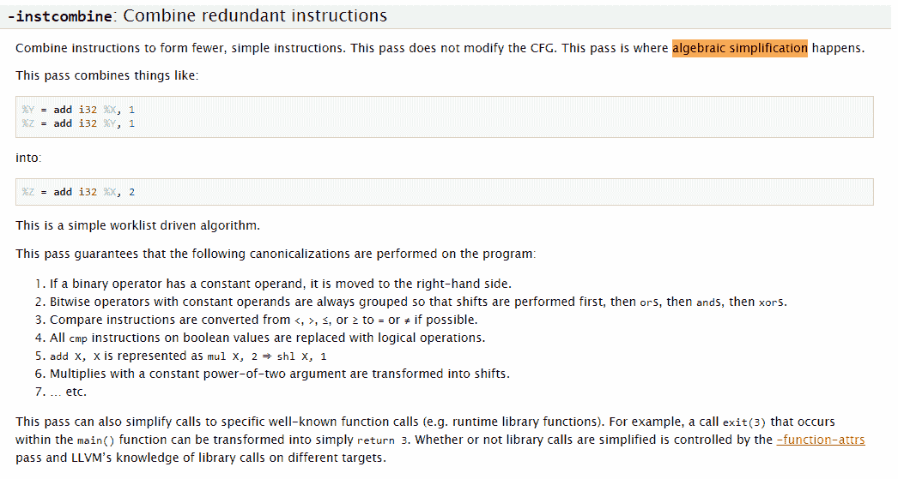

## 如何学习 LLVM

知乎问题:

如何学好用好LLVM？https://www.zhihu.com/question/309889585
