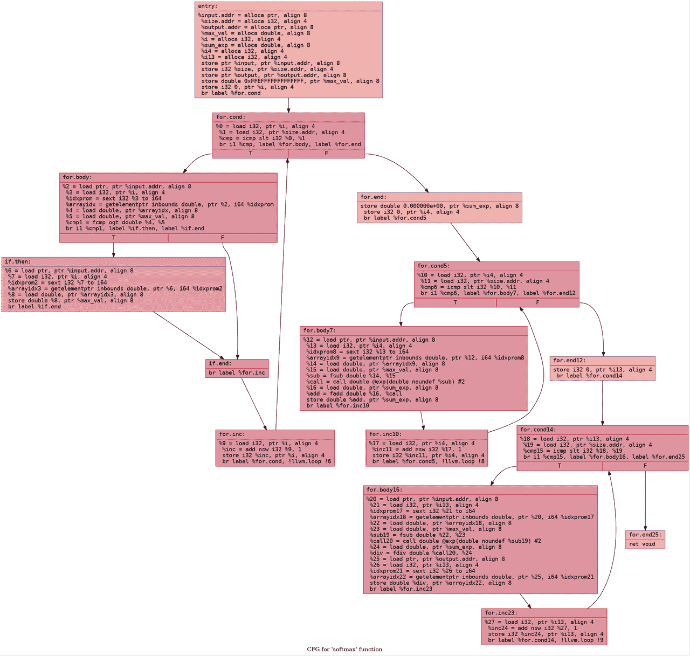
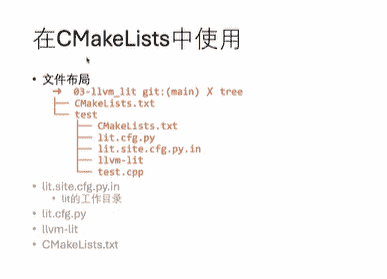
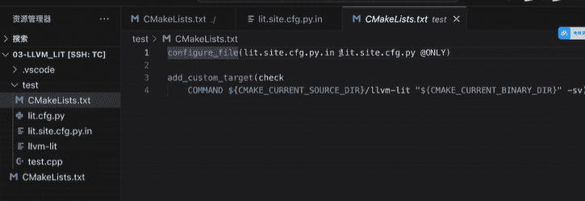
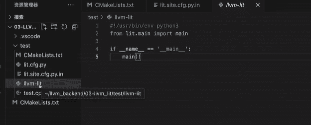
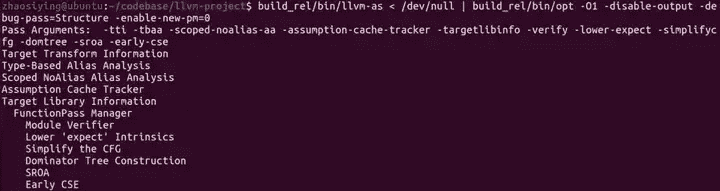
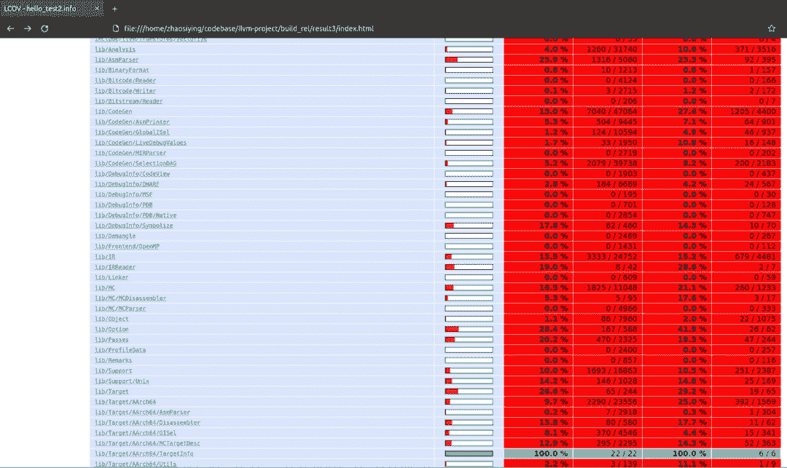

# Hands-on LLVM - 1. Tools

> 来源：[https://learning.feishu.cn/docx/DphhddP15orjTVxe87QcL2Rrn8d](https://learning.feishu.cn/docx/DphhddP15orjTVxe87QcL2Rrn8d)

要点 Summary:

1. 基础工具：`clang`, `opt` & `llc`。
2. 测试工具：`FileCheck` & `lit`。- TODO：测试用例的设计、编写 & 组织。
3. LLVM 分析工具：`llvm-objdump`，`llvm-dis`，`llvm-nm`，`llvm-cov`，`llvm-profdata`，`llvm-symbolizer`
4. ELF 文件分析工具：`readelf` (`eu-readelf`), `objdump`，`nm`，`strings`
5. 其他：`hexdump`

## Tool List

LLVM Tools 主要是 3 个工具：`clang`，`opt`，`llc`。

其中，`opt` 和 `llc` 是 LLVM 的核心 compiler。也有的叫 core libs。

常用 tools 清单如下

| Tool | Input | Output | 功能 |
| --- | --- | --- | --- |
| `clang` | `file.c` | `file.ll` | c/cpp 转 LLVM IR |
| `opt` | `file.ll` | `file.ll` | 优化器 |
| `llc` | `file.ll` | `file.o` | 指令发射 |
| `llvm-mc` | `file.s` | `file.o` | assembler 汇编器。 |
| `lld` |  |  | linker。gcc 的是 `ld`。 |
| `lli` |  |  | LLVM IR 的解释器，也是一个JIT编译器。 |
| `llvm-link` | 多个 IR | 1 个 IR | IR 级别的链接器，链接的是 IR 文件 |
| `llvm-as` | `file.ll` | `file.bc` | 针对 LLVM IR 的汇编器。从 readable IR 到 bitcode 文件。 |
| `llvm-dis` | `file.bc` | `file.ll` | 与 `llvm-as` 相反，从 bitcode 文件到 readable IR。 |

典型的编译流程 & LLVM tools


## 实验准备

### 实验环境

mac `brew` install 的 `llvm` 19

```
$ clang++ --version
Homebrew clang version 19.1.6
Target: x86_64-apple-darwin24.2.0
Thread model: posix
InstalledDir: /usr/local/Cellar/llvm/19.1.6/bin
Configuration file: /usr/local/etc/clang/x86_64-apple-darwin24.cfg
```

或，源码编译 （此处，MLIR 也启用了）

```
cmake -G Ninja ../llvm \
   -DLLVM_ENABLE_PROJECTS="clang;lld;mlir;llvm" \
   -DLLVM_BUILD_EXAMPLES=ON \
   -DLLVM_TARGETS_TO_BUILD="NVPTX;AMDGPU;X86;RISCV" \
   -DCMAKE_BUILD_TYPE=Debug \
   -DLLVM_ENABLE_ASSERTIONS=ON \
   -DLLVM_ENABLE_RTTI=ON \
   -DLLVM_ENABLE_LIBEDIT=OFF 2>&1 | tee cmake.log
```

### Example Input - softmax.c

以 softmax 的 c 语言实现为例。

有多个 basic block，也有 if 和 for-loop 2 种 control flow。

https://github.com/JackonYang/paper-reading/blob/master/02-tutorial-code/11-learn-llvm/01-llvm-tools/softmax.c

```
#include <math.h>
#include <float.h>

void softmax(const double* input, int size, double* output) {
    // Find the maximum value in the input for numerical stability
    double max_val = -DBL_MAX;  // Using DBL_MAX for double precision
    for (int i = 0; i < size; ++i) {
        if (input[i] > max_val) {
            max_val = input[i];
        }
    }

    // Compute the exponentials and their sum
    double sum_exp = 0.0;
    for (int i = 0; i < size; ++i) {
        sum_exp += exp(input[i] - max_val);
    }

    // Compute the softmax output
    for (int i = 0; i < size; ++i) {
        output[i] = exp(input[i] - max_val) / sum_exp;
    }
}
```

### Example Input - main.c

```
#include <stdio.h>

extern void softmax(double *input, int size, double *output);


int main() {
    double input[] = {1.0, 2.0, 3.0};
    double output[3];
    softmax(input, 3, output);

    for (int i = 0; i < 3; i++) {
        printf("%f ", output[i]);
    }
    printf("\n");
    return 0;
}
```

## Usage

### emit-llvm & bc

要点：

1. 生成 bitcode 和 `*.ll` 2 种格式的 LLVM IR。`-emit-llvm` 的参数分别是 `-c`, `-S`
2. `.bc` 和 `.ll` 相互 convert，
3. 生成 assembly code。

```
clang -S -emit-llvm softmax.c -o softmax.ll
clang -c -emit-llvm softmax.c -o softmax.bc

# convert
llvm-as softmax.ll -o softmax.bc
llvm-dis softmax.bc -o softmax.ll

# link to 1 bc file
llvm-link main.bc softmax.bc -o output.bc
# directly executes programs in LLVM bitcode format
lli output.bc
```

生成的完整 IR 见：https://github.com/JackonYang/paper-reading/tree/master/02-tutorial-code/11-learn-llvm/01-llvm-tools/build/frontend

查看 `bc` 文件的内容，用 `hexdump`

```
# view the content of bitcode file
hexdump –c softmax.bc
```

例如

```
$ hexdump -c build/frontend/softmax.c.bc | head -n 10
0000000   B   C 300 336   5 024  \0  \0 005  \0  \0  \0   b  \f   0   $
0000010   M   Y 276 246   M 373 264   O 033 310   $   D 001   2 005  \0
0000020   !  \f  \0  \0   ( 003  \0  \0  \v 002   !  \0 002  \0  \0  \0
0000030 031  \0  \0  \0  \a 201   # 221   A 310 004   I 006 020   2   9
0000040 222 001 204  \f   % 005  \b 031 036 004 213   b 200 020   E 002
0000050   B 222  \v   B 204 020   2 024   8  \b 030   K  \n   2   B 210
0000060   H   p 304   !   #   D 022 207 214 020   A 222 002   d 310  \b
0000070 261 024       C   F 210     311 001   2   B 204   X 016 220 021
0000080   "   D 220 241 202 242 002 031 303  \a 313 025 031   B 214 214
0000090   % 020 035   :   t 310  \0  \0 211      \0  \0 016  \0  \0  \0
```

`ll` 文件是肉眼可读的，直接 `cat` 即可

```
$ cat build/frontend/softmax.c.ll | head -n 15
; ModuleID = 'softmax.c'
source_filename = "softmax.c"
target datalayout = "e-m:e-p270:32:32-p271:32:32-p272:64:64-i64:64-i128:128-f80:128-n8:16:32:64-S128"
target triple = "x86_64-unknown-linux-gnu"

; Function Attrs: noinline nounwind optnone uwtable
define dso_local void @softmax(ptr noundef %input, i32 noundef %size, ptr noundef %output) #0 {
entry:
  %input.addr = alloca ptr, align 8
  %size.addr = alloca i32, align 4
  %output.addr = alloca ptr, align 8
  %max_val = alloca double, align 8
  %i = alloca i32, align 4
  %sum_exp = alloca double, align 8
  %i4 = alloca i32, align 4
```

### llc

从 `.ll` 文件开始，生成 `.o` & executable file 的命令如下。

```
# -relocation-model=pic works like -fPIC in clang
llc -filetype=obj -relocation-model=pic build/llc/main.linked.ll -o build/llc/main.linked.o
# generate executable file
clang -fPIE build/llc/main.linked.o -o build/llc/main.linked -lm
```

参数 `-filetype=obj` 指定输出目标文件。默认是输出汇编文件。

# gen asm

```
llc output.bc –o output.s
```

### opt & graphviz 可视化 CFG

把 LLVM IR 转 dot 文件，方便用 graphviz 的 `dot` 工具可视化。

做 CFG 分析时，比较有用。

注意，输出 dot-cfg 时，名字格式是 `.<funtion-name>.dot`，默认是 Linux 隐藏文件。

```
mkdir -p build/opt

opt -debug-pass-manager -passes=dot-cfg `find . -name "softmax.c.ll"` -disable-output
dot -Tpng .softmax.dot -o build/opt/graph.png
```



matmul 的


### clang 编译流程拆解

最简单的编译命令，

```
clang hello.c -o hello
```

在前面的例子中，有 `softmax.c` & `main.c` 2 个文件，命令也类似。

主要的变化是加了 `-lm`，因为 `softmax` 中 `exp` 函数，需要链接 math 这个数据库。

```
clang softmax.c main.c -lm -o softmax
```

使用 `-###` 命令行参数，可以看到详细编译过程。共 3 步，

分别 emit 了 2 个 `.o` 文件，然后 `ld` link 成一个 executable binary。

`-target-cpu` `x86-64`，选了 `x86-64` 指令级，匹配测试机器的 cpu 型号。


```
$ clang -### softmax.c main.c -lm -o softmax

# outoput:
clang version 20.0.0git (llvm-project.git f590963db836ccbf7c547a3dea9dc719f24444d1)
Target: x86_64-unknown-linux-gnu
Thread model: posix
InstalledDir: /home/jackon.yang/src/workspace/repos/llvm-project/build-mlir/bin
Build config: +unoptimized, +assertions
"/home/jackon.yang/src/workspace/repos/llvm-project/build-mlir/bin/clang-20" "-cc1" "-triple" "x86_64-unknown-linux-gnu" "-emit-obj" "-dumpdir" "softmax-" "-disable-free" "-clear-ast-before-backend" "-main-file-name" "softmax.c" "-mrelocation-model" "pic" "-pic-level" "2" "-pic-is-pie" "-mframe-pointer=all" "-fmath-errno" "-ffp-contract=on" "-fno-rounding-math" "-mconstructor-aliases" "-funwind-tables=2" "-target-cpu" "x86-64" "-tune-cpu" "generic" "-debugger-tuning=gdb" "-fdebug-compilation-dir=/home/jackon.yang/src/paper-reading/02-tutorial-code/11-learn-llvm/01-llvm-tools" "-fcoverage-compilation-dir=/home/jackon.yang/src/paper-reading/02-tutorial-code/11-learn-llvm/01-llvm-tools" "-resource-dir" "/home/jackon.yang/src/workspace/repos/llvm-project/build-mlir/lib/clang/20" "-internal-isystem" "/home/jackon.yang/src/workspace/repos/llvm-project/build-mlir/lib/clang/20/include" "-internal-isystem" "/usr/local/include" "-internal-isystem" "/usr/lib/gcc/x86_64-linux-gnu/13/../../../../x86_64-linux-gnu/include" "-internal-externc-isystem" "/usr/include/x86_64-linux-gnu" "-internal-externc-isystem" "/include" "-internal-externc-isystem" "/usr/include" "-ferror-limit" "19" "-fgnuc-version=4.2.1" "-fskip-odr-check-in-gmf" "-fcolor-diagnostics" "-faddrsig" "-D__GCC_HAVE_DWARF2_CFI_ASM=1" "-o" "/tmp/softmax-769943.o" "-x" "c" "softmax.c"
"/home/jackon.yang/src/workspace/repos/llvm-project/build-mlir/bin/clang-20" "-cc1" "-triple" "x86_64-unknown-linux-gnu" "-emit-obj" "-dumpdir" "softmax-" "-disable-free" "-clear-ast-before-backend" "-main-file-name" "main.c" "-mrelocation-model" "pic" "-pic-level" "2" "-pic-is-pie" "-mframe-pointer=all" "-fmath-errno" "-ffp-contract=on" "-fno-rounding-math" "-mconstructor-aliases" "-funwind-tables=2" "-target-cpu" "x86-64" "-tune-cpu" "generic" "-debugger-tuning=gdb" "-fdebug-compilation-dir=/home/jackon.yang/src/paper-reading/02-tutorial-code/11-learn-llvm/01-llvm-tools" "-fcoverage-compilation-dir=/home/jackon.yang/src/paper-reading/02-tutorial-code/11-learn-llvm/01-llvm-tools" "-resource-dir" "/home/jackon.yang/src/workspace/repos/llvm-project/build-mlir/lib/clang/20" "-internal-isystem" "/home/jackon.yang/src/workspace/repos/llvm-project/build-mlir/lib/clang/20/include" "-internal-isystem" "/usr/local/include" "-internal-isystem" "/usr/lib/gcc/x86_64-linux-gnu/13/../../../../x86_64-linux-gnu/include" "-internal-externc-isystem" "/usr/include/x86_64-linux-gnu" "-internal-externc-isystem" "/include" "-internal-externc-isystem" "/usr/include" "-ferror-limit" "19" "-fgnuc-version=4.2.1" "-fskip-odr-check-in-gmf" "-fcolor-diagnostics" "-faddrsig" "-D__GCC_HAVE_DWARF2_CFI_ASM=1" "-o" "/tmp/main-1230db.o" "-x" "c" "main.c"
"/usr/bin/ld" "-z" "relro" "--hash-style=gnu" "--eh-frame-hdr" "-m" "elf_x86_64" "-pie" "-dynamic-linker" "/lib64/ld-linux-x86-64.so.2" "-o" "softmax" "/lib/x86_64-linux-gnu/Scrt1.o" "/lib/x86_64-linux-gnu/crti.o" "/usr/lib/gcc/x86_64-linux-gnu/13/crtbeginS.o" "-L/usr/lib/gcc/x86_64-linux-gnu/13" "-L/usr/lib/gcc/x86_64-linux-gnu/13/../../../../lib64" "-L/lib/x86_64-linux-gnu" "-L/lib/../lib64" "-L/usr/lib/x86_64-linux-gnu" "-L/usr/lib/../lib64" "-L/lib" "-L/usr/lib" "/tmp/softmax-769943.o" "/tmp/main-1230db.o" "-lm" "-lgcc" "--as-needed" "-lgcc_s" "--no-as-needed" "-lc" "-lgcc" "--as-needed" "-lgcc_s" "--no-as-needed" "/usr/lib/gcc/x86_64-linux-gnu/13/crtendS.o" "/lib/x86_64-linux-gnu/crtn.o"
```

# LLVM Testing

简单来说，

1. `FileCheck` 可以简单理解为 增强版的 `grep`。
2. `lit` 是类似 `pytest` 的一个测试发现和执行框架。

文档:

+   https://llvm.org/docs/CommandGuide/FileCheck.html
+   https://llvm.org/docs/CommandGuide/lit.html
+   https://llvm.org/docs/TestingGuide.html

## FileCheck 基础用法

用法举例

```
# check file
$ cat raw-check.txt
// CHECK: foo
// CHECK: bar

# check success
$ echo 'foo bar' | FileCheck raw-check.txt

# check failed
$ echo 'bar foo' | FileCheck raw-check.txt
raw-check.txt:2:11: error: CHECK: expected string not found in input
// CHECK: bar
          ^
<stdin>:1:8: note: scanning from here
bar foo
       ^

Input file: <stdin>
Check file: raw-check.txt

-dump-input=help explains the following input dump.

Input was:
<<<<<<<
         1: bar foo
check:2            X error: no match found
>>>>>>>
```

例子中可以看到，`CHECK` 指令都写在注释中。所以，更常见的用法是

把 `CHECK` 和 source code 写到一起。

比如，

```
# CHECK: Foo
# FOO_ONLY_CHECK: Foo
print("Foo")

# CHECK: Bar
# BAR_ONLY_CHECK: Bar
print("Bar")
```

假设文件名是 `py-demo.py`，执行方法

```
python py-demo.py | FileCheck py-demo.py
```

## lit 用法

`lit` 是类似 `pytest` 的一个测试发现和执行框架。

依赖于`lit.cfg`(或`lit.site.cfg`)文件标记来实现. 当一个目录下包含这个文件时, 那么这个目录就可以被用作`lit`的测试根目录, `lit`会自动的递归进入子目录查找测试文件.

扫描文本文件中的 `RUN:` 标识，并执行对应的指令。

安装方法

```
pip install lit
```

构造 `testcase`，

一个 python 文件的 testcase 用例，关键是第一行的 `# RUN: xxxx`

```
# RUN: python3 %s | FileCheck %s

# CHECK: Foo
# FOO_ONLY_CHECK: Foo
print("Foo")

# CHECK: Bar
# BAR_ONLY_CHECK: Bar
print("Bar")
```

`lit.cfg` 的最简例子

```
import lit.formats

config.name = 'My Lit Demo';
config.test_format = lit.formats.ShTest()  # Choose the output format. 一般就用这个配置。
config.suffixes = ['.py']  # Specify test file extensions
```

`test_format`, 通常就是`lit.formats.ShTest()`, 表示每个被发现到的测试文件都是独立的测试文件

运行命令 & 结果如下

```
$ lit .
-- Testing: 1 tests, 1 workers --
PASS: My Lit Demo :: py-demo.py (1 of 1)

Testing Time: 0.08s

Total Discovered Tests: 1
  Passed: 1 (100.00%)
```

在 `cmake` 中使用




`-sv` 输出 `lit` 测试信息。






## lit Config

Lit的配置文件规则如下:

+   测试的根目录必须包含一个`lit.site.cfg`或`lit.cfg`.
+   `lit.site.cfg`或`lit.cfg`本质没有区别, 只是`lit.site.cfg`会被优先加载.
+   习惯上,`lit.site.cfg`主要用于定义一些编译相关的信息, 是通过`CMAKE`的`configure_file`来动态生成的, 此时`lit.site.cfg`通常是作为一个跳板, 往往会通过`lit_config.load_config`来加载另一个`lit.cfg`
+   每个目录都会有一个逻辑上的`local_config`,这个`local_config`要么是从父目录拷贝的, 要么是用新的`lit.site.cfg`或`lit.cfg`覆盖的.
+   在从父目录拷贝config时,可以通过`lit.local.cfg`来更新`local_config`
+   常见的用法如, 根目录不设置`suffixes`,只存储通用的参数, 不同子目录则按自己的需求设置不同的`suffixes`及`environment`

关于`config`文件:


# lit 配置说明

- config文件实际是一个回调的Python文件，lit会预定义`config`、`lit_config`等"builtin"变量。
- `config`即逻辑上的`local_config`，它内部已经存储了一些值，我们直接修改它即可。
- `config`这个变量有一些关键数据成员会被lit回调使用，比较重要的有
- `name: str`
- `test_format`，通常就是`lit.formats.ShTest(True)`，它表示每个被发现到的测试文件都是独立的测试文件
- `test_source_root`，表示扫描测试文件的起始目录，通常就是`os.path.dirname(__file__)`
- `suffixes: list[str]`，表示`test_source_root`下哪些文件会被识别为测试文件，例如`['.py']`，注意，目前lit的实现有问题，后缀名中只允许存在一个dot，也就是说`['.lit.py']`是不允许的
- `test_exec_root`，表示测试执行的起始目录，注意，测试实际的执行目录(CWD)会额外concat一段`relative_path(test_file_path, test_source_root)`，并不是直接在`test_exec_root`下执行
- `environment`：用于为测试设置新的环境变量。
- `substitutions: list[str]`，用于定义一系列额外的文本替换，以简化测试文件中的描述。
- 除此之外，`config`常常还用于存储一些通用的变量，作为传值的工具。
- 例如，往往通过CMake的`configure_file`动态生成`lit.site.cfg`，通过`config.my_src_dir="@CMAKE_SOURCE_DIR@"`这样的语法把CMAKE变量设置到`lit.site.cfg`中，然后通过`lit_config.load_config(config, "@PATH_TO_REAL_LIT_DIR@/lit.cfg")`来将这些数据传递给真实的`lit.cfg`
- 例如，常常会在`lit.local.cfg`中利用读取父目录`config`定义的额外数据，来进一步做一些其他操作
- `lit.llvm`附带了一套LLVM相关的更新`config`变量的工具，位于`lit.llvm`，这些工具不是必须的，但是如果项目和LLVM相关，则可以更便利地设置一些LLVM相关的lit配置。
- Step1：更新`config.llvm_lib_dir`和`config.llvm_tools_dir`到具体值
- Step2：调用`lit.llvm.initialize(lit_config, config)`初始化
- Step3：调用`lit.llvm.llvm_config.use_default_substitutions()`等来进一步更新`config`变量

## BugPoint - TODO

自动构造可复现 bug 的最小测试用例。http://llvm.org/docs/Bugpoint.html

# Debug & Tracing

作者：雾魂泉守曌鹓鶵

链接：https://www.zhihu.com/question/309889585/answer/3075034674

来源：知乎

著作权归作者所有。商业转载请联系作者获得授权，非商业转载请注明出处。

我使用`GCOV`代码覆盖率统计工具，看看哪些文件的哪个函数被执行到了，然后再去`gdb`深入调试并学习这个文件。

首先需要增加以下两个编译参数`-fprofile-arcs` `-ftest-converage`重新编译LLVM：


运行`clang`，`opt`或是`llc`程序，我们可以精心设计传入的参数和输入的文件，使得只有跟我们研究相关的代码被执行，运行后会生成`.gcda`程序运行的记录：



借助`lcov`工具对`hello.c.gcov`进行处理，得到`hello_test.info`，然后利用`genhtml`工具对`.info`进行可视化：

```
lcov -d . -t 'Hello test' -o 'hello_test.info' -b . -c
genhtml -o result hello_test.info
```

得到了`result`文件夹，借助web浏览器，可以直观地看到都哪些文件和函数被调用了：


