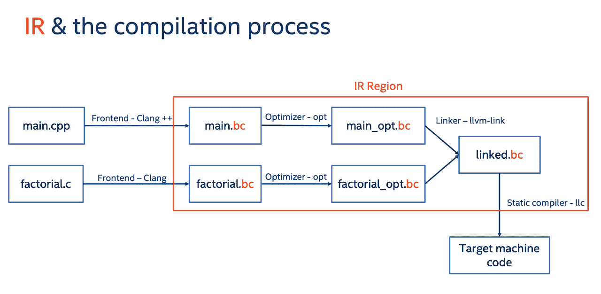
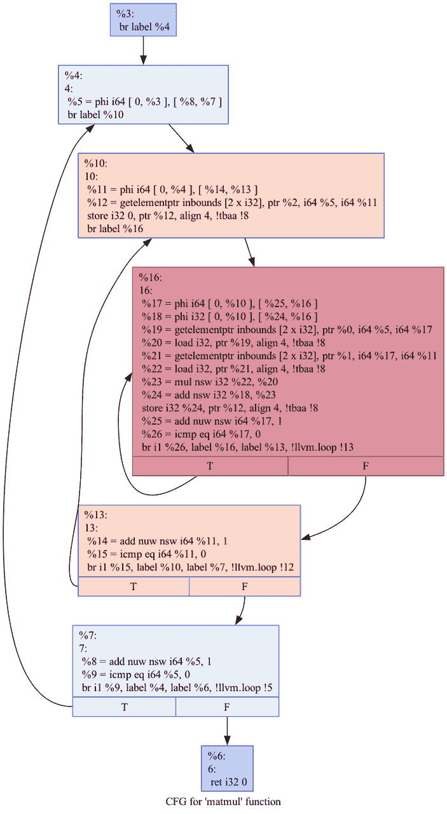
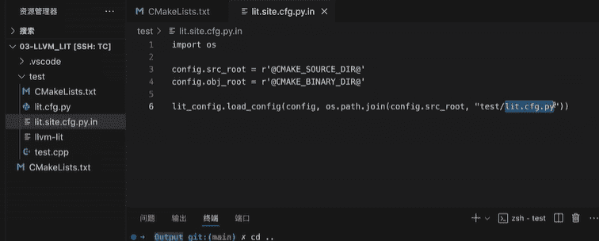
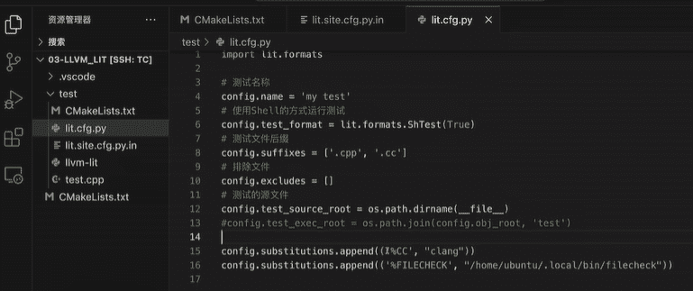
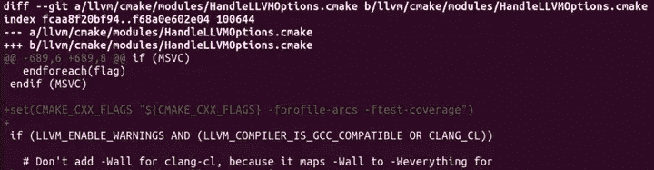

# Hands-on LLVM - 1. Tools

> 来源：[https://learning.feishu.cn/docx/DphhddP15orjTVxe87QcL2Rrn8d](https://learning.feishu.cn/docx/DphhddP15orjTVxe87QcL2Rrn8d)

要点 Summary:

1.  基础工具：clang, opt & llc。

1.  测试工具：FileCheck & lit。- TODO：测试用例的设计、编写 & 组织。

1.  LLVM 分析工具：llvm-objdump，llvm-dis，llvm-nm，llvm-cov，llvm-profdata，llvm-symbolizer

1.  ELF 文件分析工具：readelf (eu-readelf), objdump，nm，strings

1.  其他：hexdump

# Tool List

LLVM Tools 主要是 3 个工具：clang，opt，llc。

其中，opt 和 llc 是 LLVM 的核心 compiler。也有的叫 core libs。

常用 tools 清单如下

| Tool | Input | Output | 功能 |
| --- | --- | --- | --- |
| clang | file.c | file.ll | c/cpp 转 LLVM IR |
| opt | file.ll | file.ll | 优化器 |
| llc | file.ll | file.o | 指令发射 |
|  |  |  |  |
| llvm-mc | file.s | file.o | assembler 汇编器。 |
|  |  |  |  |
| lld |  |  | linker。gcc 的是 ld。 |
| lli |  |  | LLVM IR 的解释器，也是一个JIT编译器。 |
| llvm-link | 多个 IR | 1 个 IR | IR 级别的链接器，链接的是 IR 文件 |
|  |  |  |  |
| llvm-as | file.ll | file.bc | 针对 LLVM IR 的汇编器。从 readable IR 到 bitcode 文件。 |
| llvm-dis | file.bc | file.ll | 与 llvm-as 相反，从 bitcode 文件到 readable IR。 |

典型的编译流程 & LLVM tools



# 实验准备

## 实验环境

mac brew install 的 llvm 19

```
$ clang++ --version
Homebrew clang version 19.1.6
Target: x86_64-apple-darwin24.2.0
Thread model: posix
InstalledDir: /usr/local/Cellar/llvm/19.1.6/bin
Configuration file: /usr/local/etc/clang/x86_64-apple-darwin24.cfg
```

或，源码编译 （此处，MLIR 也启用了）

```
cmake -G Ninja ../llvm \
   -DLLVM_ENABLE_PROJECTS=&quot;clang;lld;mlir;llvm&quot; \
   -DLLVM_BUILD_EXAMPLES=ON \
   -DLLVM_TARGETS_TO_BUILD=&quot;NVPTX;AMDGPU;X86;RISCV&quot; \
   -DCMAKE_BUILD_TYPE=Debug \
   -DLLVM_ENABLE_ASSERTIONS=ON \
   -DLLVM_ENABLE_RTTI=ON \
   -DLLVM_ENABLE_LIBEDIT=OFF 2&gt;&amp;1 | tee cmake.log
```

## Example Input - softmax.c

以 softmax 的 c 语言实现为例。

有多个 basic block，也有 if 和 for-loop 2 种 control flow。

https://github.com/JackonYang/paper-reading/blob/master/02-tutorial-code/11-learn-llvm/01-llvm-tools/softmax.c

```
#include &lt;math.h&gt;
#include &lt;float.h&gt;

void softmax(const double* input, int size, double* output) {
    // Find the maximum value in the input for numerical stability
    double max_val = -DBL_MAX;  // Using DBL_MAX for double precision
    for (int i = 0; i &lt; size; ++i) {
        if (input[i] &gt; max_val) {
            max_val = input[i];
        }
    }

    // Compute the exponentials and their sum
    double sum_exp = 0.0;
    for (int i = 0; i &lt; size; ++i) {
        sum_exp += exp(input[i] - max_val);
    }

    // Compute the softmax output
    for (int i = 0; i &lt; size; ++i) {
        output[i] = exp(input[i] - max_val) / sum_exp;
    }
}
```

## Example Input - main.c

```
#include &lt;stdio.h&gt;

extern void softmax(double *input, int size, double *output);


int main() {
    double input[] = {1.0, 2.0, 3.0};
    double output[3];
    softmax(input, 3, output);

    for (int i = 0; i &lt; 3; i++) {
        printf(&quot;%f &quot;, output[i]);
    }
    printf(&quot;\n&quot;);
    return 0;
}
```

# Usage

## emit-llvm & bc

要点：

1.  生成 bitcode 和 *.ll 2 种格式的 LLVM IR。-emit-llvm 的参数分别是 -c, -S

1.  .bc 和 .ll 相互 convert，

1.  生成 assembly code。

```
clang -S -emit-llvm softmax.c -o softmax.ll
clang -c -emit-llvm softmax.c -o softmax.bc

# convert
llvm-as softmax.ll -o softmax.bc
llvm-dis softmax.bc -o softmax.ll

# link to 1 bc file
llvm-link main.bc softmax.bc -o output.bc
# directly executes programs in LLVM bitcode format
lli output.bc
```

生成的完整 IR 见：https://github.com/JackonYang/paper-reading/tree/master/02-tutorial-code/11-learn-llvm/01-llvm-tools/build/frontend

查看 bc 文件的内容，用 hexdump

```
# view the content of bitcode file
hexdump –c softmax.bc
```

例如

```
$ hexdump -c build/frontend/softmax.c.bc | head -n 10
0000000   B   C 300 336   5 024  \0  \0 005  \0  \0  \0   b  \f   0   $
0000010   M   Y 276 246   M 373 264   O 033 310   $   D 001   2 005  \0
0000020   !  \f  \0  \0   ( 003  \0  \0  \v 002   !  \0 002  \0  \0  \0
0000030 031  \0  \0  \0  \a 201   # 221   A 310 004   I 006 020   2   9
0000040 222 001 204  \f   % 005  \b 031 036 004 213   b 200 020   E 002
0000050   B 222  \v   B 204 020   2 024   8  \b 030   K  \n   2   B 210
0000060   H   p 304   !   #   D 022 207 214 020   A 222 002   d 310  \b
0000070 261 024       C   F 210     311 001   2   B 204   X 016 220 021
0000080   &quot;   D 220 241 202 242 002 031 303  \a 313 025 031   B 214 214
0000090   % 020 035   :   t 310  \0  \0 211      \0  \0 016  \0  \0  \0
```

ll 文件是肉眼可读的，直接 cat 即可

```
$ cat build/frontend/softmax.c.ll | head -n 15
; ModuleID = &#x27;softmax.c&#x27;
source_filename = &quot;softmax.c&quot;
target datalayout = &quot;e-m:e-p270:32:32-p271:32:32-p272:64:64-i64:64-i128:128-f80:128-n8:16:32:64-S128&quot;
target triple = &quot;x86_64-unknown-linux-gnu&quot;

; Function Attrs: noinline nounwind optnone uwtable
define dso_local void @softmax(ptr noundef %input, i32 noundef %size, ptr noundef %output) #0 {
entry:
  %input.addr = alloca ptr, align 8
  %size.addr = alloca i32, align 4
  %output.addr = alloca ptr, align 8
  %max_val = alloca double, align 8
  %i = alloca i32, align 4
  %sum_exp = alloca double, align 8
  %i4 = alloca i32, align 4
```

## llc

从 .ll 文件开始，生成 .o & executable file 的命令如下。

```
# -relocation-model=pic works like -fPIC in clang
llc -filetype=obj -relocation-model=pic build/llc/main.linked.ll -o build/llc/main.linked.o
# generate executable file
clang -fPIE build/llc/main.linked.o -o build/llc/main.linked -lm
```

参数 -filetype=obj 指定输出目标文件。默认是输出汇编文件。

```
# gen asm
llc output.bc –o output.s
```

## opt & graphviz 可视化 CFG

把 LLVM IR 转 dot 文件，方便用 graphviz 的 dot 工具可视化。

做 CFG 分析时，比较有用。

注意，输出 dot-cfg 时，名字格式是 `.<funtion-name>.dot'，默认是 Linux 隐藏文件。

```
mkdir -p build/opt

opt -debug-pass-manager -passes=dot-cfg `find . -name &quot;softmax.c.ll&quot;` -disable-output
dot -Tpng .softmax.dot -o build/opt/graph.png
```


matmul 的



## clang 编译流程拆解

最简单的编译命令，

```
clang hello.c -o hello
```

在前面的例子中，有 softmax.c & main.c 2 个文件，命令也类似。

主要的变化是加了 -lm，因为 softmax 中 exp 函数，需要链接 math 这个数据库。

```
clang softmax.c main.c -lm -o softmax
```

使用 -### 命令行参数，可以看到详细编译过程。共 3 步，

分别 emit 了 2 个 .o 文件，然后 ld link 成一个 executable binary。

"-target-cpu" "x86-64"，选了 x86-64 指令级，匹配测试机器的 cpu 型号。

```
$ clang -### softmax.c main.c -lm -o softmax

# outoput:
clang version 20.0.0git (llvm-project.git f590963db836ccbf7c547a3dea9dc719f24444d1)
Target: x86_64-unknown-linux-gnu
Thread model: posix
InstalledDir: /home/jackon.yang/src/workspace/repos/llvm-project/build-mlir/bin
Build config: +unoptimized, +assertions
 &quot;/home/jackon.yang/src/workspace/repos/llvm-project/build-mlir/bin/clang-20&quot; &quot;-cc1&quot; &quot;-triple&quot; &quot;x86_64-unknown-linux-gnu&quot; &quot;-emit-obj&quot; &quot;-dumpdir&quot; &quot;softmax-&quot; &quot;-disable-free&quot; &quot;-clear-ast-before-backend&quot; &quot;-main-file-name&quot; &quot;softmax.c&quot; &quot;-mrelocation-model&quot; &quot;pic&quot; &quot;-pic-level&quot; &quot;2&quot; &quot;-pic-is-pie&quot; &quot;-mframe-pointer=all&quot; &quot;-fmath-errno&quot; &quot;-ffp-contract=on&quot; &quot;-fno-rounding-math&quot; &quot;-mconstructor-aliases&quot; &quot;-funwind-tables=2&quot; &quot;-target-cpu&quot; &quot;x86-64&quot; &quot;-tune-cpu&quot; &quot;generic&quot; &quot;-debugger-tuning=gdb&quot; &quot;-fdebug-compilation-dir=/home/jackon.yang/src/paper-reading/02-tutorial-code/11-learn-llvm/01-llvm-tools&quot; &quot;-fcoverage-compilation-dir=/home/jackon.yang/src/paper-reading/02-tutorial-code/11-learn-llvm/01-llvm-tools&quot; &quot;-resource-dir&quot; &quot;/home/jackon.yang/src/workspace/repos/llvm-project/build-mlir/lib/clang/20&quot; &quot;-internal-isystem&quot; &quot;/home/jackon.yang/src/workspace/repos/llvm-project/build-mlir/lib/clang/20/include&quot; &quot;-internal-isystem&quot; &quot;/usr/local/include&quot; &quot;-internal-isystem&quot; &quot;/usr/lib/gcc/x86_64-linux-gnu/13/../../../../x86_64-linux-gnu/include&quot; &quot;-internal-externc-isystem&quot; &quot;/usr/include/x86_64-linux-gnu&quot; &quot;-internal-externc-isystem&quot; &quot;/include&quot; &quot;-internal-externc-isystem&quot; &quot;/usr/include&quot; &quot;-ferror-limit&quot; &quot;19&quot; &quot;-fgnuc-version=4.2.1&quot; &quot;-fskip-odr-check-in-gmf&quot; &quot;-fcolor-diagnostics&quot; &quot;-faddrsig&quot; &quot;-D__GCC_HAVE_DWARF2_CFI_ASM=1&quot; &quot;-o&quot; &quot;/tmp/softmax-769943.o&quot; &quot;-x&quot; &quot;c&quot; &quot;softmax.c&quot;
 &quot;/home/jackon.yang/src/workspace/repos/llvm-project/build-mlir/bin/clang-20&quot; &quot;-cc1&quot; &quot;-triple&quot; &quot;x86_64-unknown-linux-gnu&quot; &quot;-emit-obj&quot; &quot;-dumpdir&quot; &quot;softmax-&quot; &quot;-disable-free&quot; &quot;-clear-ast-before-backend&quot; &quot;-main-file-name&quot; &quot;main.c&quot; &quot;-mrelocation-model&quot; &quot;pic&quot; &quot;-pic-level&quot; &quot;2&quot; &quot;-pic-is-pie&quot; &quot;-mframe-pointer=all&quot; &quot;-fmath-errno&quot; &quot;-ffp-contract=on&quot; &quot;-fno-rounding-math&quot; &quot;-mconstructor-aliases&quot; &quot;-funwind-tables=2&quot; &quot;-target-cpu&quot; &quot;x86-64&quot; &quot;-tune-cpu&quot; &quot;generic&quot; &quot;-debugger-tuning=gdb&quot; &quot;-fdebug-compilation-dir=/home/jackon.yang/src/paper-reading/02-tutorial-code/11-learn-llvm/01-llvm-tools&quot; &quot;-fcoverage-compilation-dir=/home/jackon.yang/src/paper-reading/02-tutorial-code/11-learn-llvm/01-llvm-tools&quot; &quot;-resource-dir&quot; &quot;/home/jackon.yang/src/workspace/repos/llvm-project/build-mlir/lib/clang/20&quot; &quot;-internal-isystem&quot; &quot;/home/jackon.yang/src/workspace/repos/llvm-project/build-mlir/lib/clang/20/include&quot; &quot;-internal-isystem&quot; &quot;/usr/local/include&quot; &quot;-internal-isystem&quot; &quot;/usr/lib/gcc/x86_64-linux-gnu/13/../../../../x86_64-linux-gnu/include&quot; &quot;-internal-externc-isystem&quot; &quot;/usr/include/x86_64-linux-gnu&quot; &quot;-internal-externc-isystem&quot; &quot;/include&quot; &quot;-internal-externc-isystem&quot; &quot;/usr/include&quot; &quot;-ferror-limit&quot; &quot;19&quot; &quot;-fgnuc-version=4.2.1&quot; &quot;-fskip-odr-check-in-gmf&quot; &quot;-fcolor-diagnostics&quot; &quot;-faddrsig&quot; &quot;-D__GCC_HAVE_DWARF2_CFI_ASM=1&quot; &quot;-o&quot; &quot;/tmp/main-1230db.o&quot; &quot;-x&quot; &quot;c&quot; &quot;main.c&quot;
 &quot;/usr/bin/ld&quot; &quot;-z&quot; &quot;relro&quot; &quot;--hash-style=gnu&quot; &quot;--eh-frame-hdr&quot; &quot;-m&quot; &quot;elf_x86_64&quot; &quot;-pie&quot; &quot;-dynamic-linker&quot; &quot;/lib64/ld-linux-x86-64.so.2&quot; &quot;-o&quot; &quot;softmax&quot; &quot;/lib/x86_64-linux-gnu/Scrt1.o&quot; &quot;/lib/x86_64-linux-gnu/crti.o&quot; &quot;/usr/lib/gcc/x86_64-linux-gnu/13/crtbeginS.o&quot; &quot;-L/usr/lib/gcc/x86_64-linux-gnu/13&quot; &quot;-L/usr/lib/gcc/x86_64-linux-gnu/13/../../../../lib64&quot; &quot;-L/lib/x86_64-linux-gnu&quot; &quot;-L/lib/../lib64&quot; &quot;-L/usr/lib/x86_64-linux-gnu&quot; &quot;-L/usr/lib/../lib64&quot; &quot;-L/lib&quot; &quot;-L/usr/lib&quot; &quot;/tmp/softmax-769943.o&quot; &quot;/tmp/main-1230db.o&quot; &quot;-lm&quot; &quot;-lgcc&quot; &quot;--as-needed&quot; &quot;-lgcc_s&quot; &quot;--no-as-needed&quot; &quot;-lc&quot; &quot;-lgcc&quot; &quot;--as-needed&quot; &quot;-lgcc_s&quot; &quot;--no-as-needed&quot; &quot;/usr/lib/gcc/x86_64-linux-gnu/13/crtendS.o&quot; &quot;/lib/x86_64-linux-gnu/crtn.o&quot;
```

# LLVM Testing

简单来说，

1.  FileCheck 可以简单理解为 增强版的 grep。

1.  lit 是类似 pytest 的一个测试发现和执行框架。

文档:

+   https://llvm.org/docs/CommandGuide/FileCheck.html

+   https://llvm.org/docs/CommandGuide/lit.html

+   https://llvm.org/docs/TestingGuide.html

## FileCheck 基础用法

用法举例

```
# check file
$ cat raw-check.txt
// CHECK: foo
// CHECK: bar

# check success
$ echo &#x27;foo bar&#x27; | FileCheck raw-check.txt

# check failed
$ echo &#x27;bar foo&#x27; | FileCheck raw-check.txt
raw-check.txt:2:11: error: CHECK: expected string not found in input
// CHECK: bar
          ^
&lt;stdin&gt;:1:8: note: scanning from here
bar foo
       ^

Input file: &lt;stdin&gt;
Check file: raw-check.txt

-dump-input=help explains the following input dump.

Input was:
&lt;&lt;&lt;&lt;&lt;&lt;
         1: bar foo
check:2            X error: no match found
&gt;&gt;&gt;&gt;&gt;&gt;
```

例子中可以看到，CHECK 指令都写在注释中。所以，更常见的用法是

把 CHECK 和 source code 写到一起。

比如，

```
# CHECK: Foo
# FOO_ONLY_CHECK: Foo
print(&quot;Foo&quot;)

# CHECK: Bar
# BAR_ONLY_CHECK: Bar
print(&quot;Bar&quot;)
```

假设文件名是 py-demo.py，执行方法

```
python py-demo.py | FileCheck py-demo.py
```

## lit 用法

lit 是类似 pytest 的一个测试发现和执行框架。

依赖于lit.cfg(或lit.site.cfg)文件标记来实现. 当一个目录下包含这个文件时, 那么这个目录就可以被用作lit的测试根目录, lit会自动的递归进入子目录查找测试文件.

扫描文本文件中的 RUN: 标识，并执行对应的指令。

安装方法

```
pip install lit
```

构造 testcase，

一个 python 文件的 testcase 用例，关键是第一行的 # RUN: xxxx

```
# RUN: python3 %s | FileCheck %s

# CHECK: Foo
# FOO_ONLY_CHECK: Foo
print(&quot;Foo&quot;)

# CHECK: Bar
# BAR_ONLY_CHECK: Bar
print(&quot;Bar&quot;)
```

lit.cfg 的最简例子

```
import lit.formats

config.name = &#x27;My Lit Demo&#x27;
config.test_format = lit.formats.ShTest()  # Choose the output format. 一般就用这个配置。
config.suffixes = [&#x27;.py&#x27;]  # Specify test file extensions
```

test_format, 通常就是lit.formats.ShTest(), 表示每个被发现到的测试文件都是独立的测试文件

运行命令 & 结果如下

```
$ lit .
-- Testing: 1 tests, 1 workers --
PASS: My Lit Demo :: py-demo.py (1 of 1)

Testing Time: 0.08s

Total Discovered Tests: 1
  Passed: 1 (100.00%)
```

在 cmake 中使用




-sv 输出 lit 测试信息。




## lit Config

Lit的配置文件规则如下:

+   测试的根目录必须包含一个lit.site.cfg或lit.cfg.

+   lit.site.cfg或lit.cfg本质没有区别, 只是lit.site.cfg会被优先加载.

+   习惯上,lit.site.cfg主要用于定义一些编译相关的信息, 是通过CMAKE的configure_file来动态生成的, 此时lit.site.cfg通常是作为一个跳板, 往往会通过lit_config.load_config来加载另一个lit.cfg

+   每个目录都会有一个逻辑上的local_config,这个local_config要么是从父目录拷贝的, 要么是用新的lit.site.cfg或lit.cfg覆盖的.

+   在从父目录拷贝config时,可以通过lit.local.cfg来更新local_config

+   常见的用法如, 根目录不设置suffixes,只存储通用的参数, 不同子目录则按自己的需求设置不同的suffixes及environment

关于config文件:

+   config文件实际是一个回调的python文件, lit会预定义config,lit_config等"builtin"变量

+   config的就是逻辑上的local_config, 它内部已经存储了一些值, 我们直接修改它即可

+   config这个变量有一些关键数据成员会被lit回调使用,比较重要的有

+   name:str

+   test_format, 通常就是lit.formats.ShTest(True), 它表示每个被发现到的测试文件都是独立的测试文件

+   test_source_root, 表示扫描测试文件的起始目录, 通常就是os.path.dirname(__file__)

+   suffixes:list[str], 表示test_source_root下哪些文件会被识别为测试文件, 例如['.py'], 注意, 目前lit的实现有问题, 后缀名中只允许存在一个dot, 也就是说['.lit.py']是不允许的

+   **test**_exec_root, 表示测试执行的起始目录, 注意, 测试实际的执行目录(CWD)会额外concat一段relative_path(test_file_path,test_source_root), 并不是直接在test_exec_root下执行

+   environment: 用于为测试设置新的环境变量.

+   substitutions:list[str], 用于定义一系列额外的文本替换, 以简化测试文件中的描述.

+   除此之外, config常常还用于存储一些通用的变量, 作为传值的工具.

+   例如, 往往通过CMAKE的configure_file动态生成lit.site.cfg, 通过config.my_src_dir="@CMAKE_SOURCE_DIR@"这样的语法把CMAKE变量设置到lit.site.cfg中, 然后通过lit_config.load_config(config,"@PATH_TO_REAL_LIT_DIR@/lit.cfg")来将这些数据传递给真实的lit.cfg

+   例如, 常常会在lit.local.cfg中利用读取父目录config定义的额外数据, 来进一步做一些其他操作

+   lit.llvm附带了一套llvm相关的更新config变量的工具,位于lit.llvm, 这些工具不是必须的, 但是如果项目和 LLVM 相关, 则可以更便利的设置一些llvm相关的lit配置.

+   Step1,更新config.llvm_lib_dir和config.llvm_tools_dir到具体值

+   Step2,调用lit.llvm.initialize(lit_config, config)初始化

+   Step3,调用lit.llvm.llvm_config.use_default_substitutions()等来进一步更新config变量

## BugPoint - TODO

自动构造可复现 bug 的最小测试用例。http://llvm.org/docs/Bugpoint.html

# Debug & Tracing

作者：雾魂泉守曌鹓鶵

链接：https://www.zhihu.com/question/309889585/answer/3075034674

来源：知乎

著作权归作者所有。商业转载请联系作者获得授权，非商业转载请注明出处。

我使用[GCOV](https://zhida.zhihu.com/search?content_id=589182528&content_type=Answer&match_order=1&q=GCOV&zhida_source=entity)[代码覆](https://zhida.zhihu.com/search?content_id=589182528&content_type=Answer&match_order=1&q=gdb&zhida_source=entity)盖率统计工具，看看哪些文件的哪个函数被执行到了，然后再去gdb深入调试并学习这个文件。

首先需要增加以下两个编译参数-fprofile-arcs -ftest-converage重新编译LLVM：




运行[clang](https://zhida.zhihu.com/search?content_id=589182528&content_type=Answer&match_order=1&q=clang&zhida_source=entity)，[opt](https://zhida.zhihu.com/search?content_id=589182528&content_type=Answer&match_order=1&q=opt&zhida_source=entity)或是[llc](https://zhida.zhihu.com/search?content_id=589182528&content_type=Answer&match_order=1&q=llc&zhida_source=entity)程序，我们可以精心设计传入的参数和输入的文件，使得只有跟我们研究相关的代码被执行，运行后会生成.gcda程序运行的记录：


借助[lcov](https://zhida.zhihu.com/search?content_id=589182528&content_type=Answer&match_order=1&q=lcov&zhida_source=entity)工具对he[llo.c.g](https://zhida.zhihu.com/search?content_id=589182528&content_type=Answer&match_order=1&q=genhtml&zhida_source=entity)cov进行处理，得到http://hello_test.info，然后利用genhtml工具对.info进行可视化：

```
lcov -d . -t &#x27;Hello test&#x27; -o &#x27;hello_test.info&#x27; -b . -c
genhtml -o result hello_test.info
```

得到了result文件夹，借助web浏览器，可以直观地看到都哪些文件和函数被调用了：

