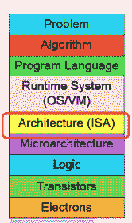
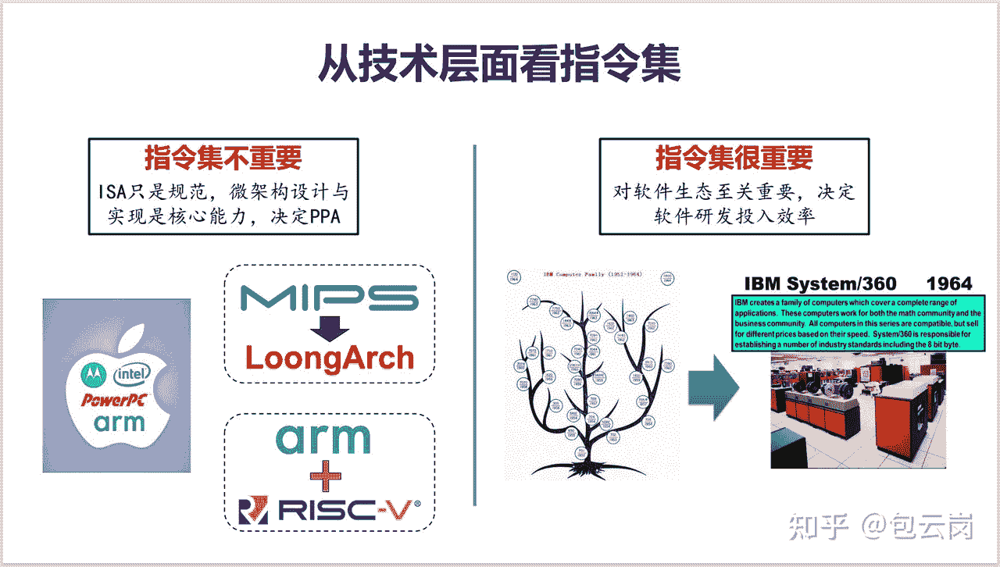
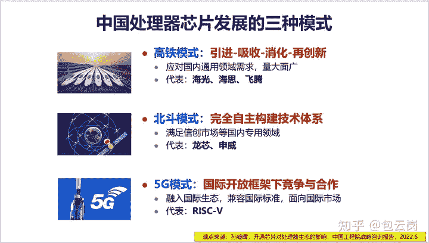
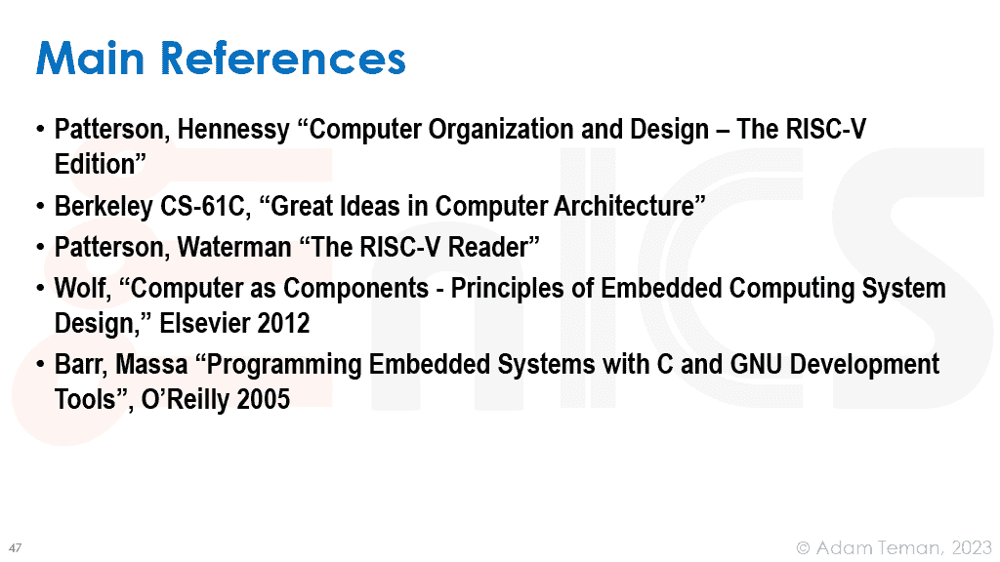
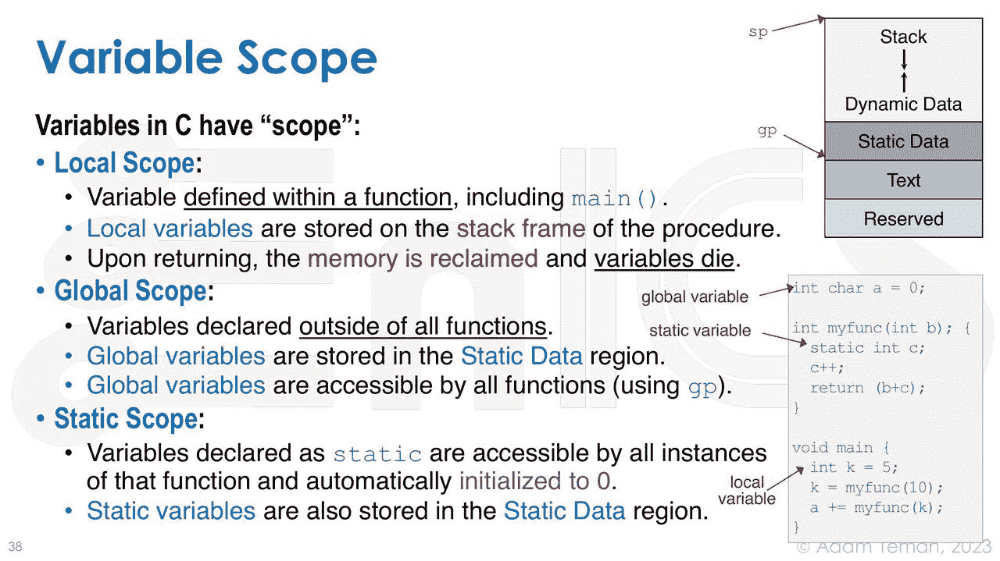

# ISA & intrinsic Designs

> 来源：[https://learning.feishu.cn/docx/CwXrd1CVOorvFpxQ1W9cKwGunNd](https://learning.feishu.cn/docx/CwXrd1CVOorvFpxQ1W9cKwGunNd)

# 务虚讨论







## IR 的比较

不同的硬件喜欢不同的指令流。

IR 没有好坏，但对整个上层的生态系统产生深远影响。场景不同，tradeoff 也不同。

IR 的 3 种形态，LLVM IR 都支持，还能高效的相互转换。

1.  in-memory form：高效分析和变换

1.  bytecode form：存储和交换

1.  textural form：阅读和纠错

| IR | 要点 | 特点，优缺点 |
| --- | --- | --- |
| LLVM IR | 使用控制流 (control flow)、基础块 (basic block)、以及静态单赋值 (SSA) 形式来表示程序。 | 1.  用文本表示将 UNIX 哲学带入了编译器 |
| SPIR-V | 设计为硬件驱动的输入程序表示 | 1.  有技术上的机制和组织上的流程来维持其可扩展性 |
| MLIR | dialect 机制解耦 IR。 | 1.  compiler infra 极大地简化定义各种层级 operation 和转换。 |

## IR 的设计理念

1.  Challenges of macro-instruction Design -> IR

1.  Design tradeoffs: programmer / compiler / hardware friendly.

1.  Programmer: Triton IR (Triton DSL), ONNX.

1.  Hardware: Assembly.

1.  Compiler: LLVM IR, MLIR dialects.

1.  Target user of macro-instruction? -- compiler, and easy codegen of hardware Assembly.

1.  CUDA Reduction as an example

1.  Choices of Baseline IR: LLVM / CUDA(ptx) / Linalg / Triton Ops (Dataflow pattern)

1.  携带优化相关信息，比如，loop dim 的 数据依赖关系

1.  Lessons learned from some near-SOTA softmax implementations

1.  Design Proposals and explanations.

考虑具体问题的普遍性或者特殊性、给整个编译器栈带来的组合复杂性、对各种变换的影响等等。

1.  中间表示中的操作 (operation) 能够具有清晰明确的语义。这是一切的根基。

1.  在这之上我们希望操作能够相互正交 (orthogonal)，这有助于定义标准 (canonical) 形态以减少变换需要考虑的情况。

1.  另外我们也会希望在同一中间表示的不同部分中避免出现重复信息。 重复信息在各种变换后有很大概率会导致中间表示的不一致，从而导致错误编译。

1.  尽可能地保持高层次信息也是非常有好处的，因为在代码表示递降后想重新找回丢失的信息很难。

TODO:

1.  Triton compile on CUDA。ptx & LLVM IR code

1.  Research of SOTA softmax code。

## intrinsic 的定位和价值空间

intrinsic 比常规库函数更快（编译器对它们了解更多，因此可以更好地进行优化）

作为标准C语言和汇编语言之间的中介，使我们能够使用类似于程序集的功能，但仍可以让编译器处理诸如类型检查，寄存器分配，指令调度和调用堆栈维护之类的细节。

与特定指令共享一对一或多对一关系。注意，没有多对一。

intrinsic 可能会有些烦人，因为，某些指令集只有在 CFLAGS 中显式启用时才能由编译器生成。 但是，如果在CFLAGS 中启用了指令集，则可以在任何地方生成指令集，也就是说，不能保证所有指令都将受到 CPUID 检查的保护。

参考

+   X86 Built-in Functions

+   ARM NEON Intrinsics

+   TI C6X Built-in Functions

# 硬件背景 - Microprocessor (CPU)

## Summary

前 2 个 section 可以。后 3 个 section 讲的比较浅。

1.  CPU = Datapath + Control

1.  图灵机：计算所有可计算的问题。图灵完备性。

1.  冯诺伊曼架构：stored-program computer。

1.  RISC-V 只支持 4 种 mode 里的第 3 种：Displacement Addressing。

1.  指令可以分 3 类：data transfer, flow-control, compute

calling convention (约定)，是 ABI 的一部分，一般在 compiler 里实现。

注意区分 stack pointer 和 frame pointer。都需要独占 register。

1.  running 的主要 4 个阶段：compiling, assembling, Linking, loading.

1.  object file 的格式，常用 ELF or COFF.

分层，常被忽略，但应该学习的 3 层：

1.  runtime (OS / VM)

1.  Architecture (ISA)

1.  MicroArchitecture


## Introduction and History

### 分类 & 基本概念


### Turing Machine

图灵机，计算所有可计算的问题。

能 simulate 图灵机的，就满足图灵完备性。


第一个电子的 computer。

冯诺伊曼架构。stored-program。难怪，指令和数据分开的，就叫非冯架构。


### Stored-Program Computers

PC - program counter 是个重要的概念。


微指令，是微架构的一部分。对 programmer 不可见。

缺点，不能跟进微架构的创新，比如，没法通过 pipeline 做指令级并行。与 compiler 的工作重复。不能重新 programming。


### 哈佛架构


### ISA 指令集


## ISA

### ISA Introduction


读写 SRAM 和 register 都是 1 个 cycle 的 latency。实际是用了 single clock edge。

但，SRAM 是独占。而 register 可以与 compute 共享一个 cycle。

一个 cycle 可以读写多个 register，但 SRAM 必须是相同地址。（可以用多个 bank 提高 bandwidth）


ABI 是比 ISA 高一级的 abstract。


### Data Transfer Instructions

RISC 里，必须用 load/store 才能访问 memory。在 CISC 里，有 instruction 可以直接访问 SRAM。


RISC-V 只支持 4 种 mode 里的第 3 种：Displacement Addressing。


### Flow-Control Instructions

需要 branch prediction 的地方。


### Arithmetic-Logic Instructions


### Big Endian vs. Little Endian

大端法：特朗普吃披萨。


## Measuring Performance

skipped


## Reference



# Compilation - From C to Assembly

Clang 来编译 C++ 程序通常要经过 Clang AST, LLVM IR, MachineInstr, MC 等等多个层级。

https://eli.thegreenplace.net/2012/11/24/life-of-an-instruction-in-llvm

Life of an instruction in LLVM

## Motivation - ISA 的趋势 & RISC-V


好多 standard 的 mapping 关系。


## Basic Operations

3 个：

1.  instruction fetch

1.  register access

1.  execution

组件说明：

+   Control and Datapath: 就是 Control + ALU 部分。

+   IMEM: instruction memory

+   DMEM: data memory

load-store architecture，就是 RISC 架构 (RISC-V)，即，只能直接读 SRAM。


PC 的累加，也需要一个 ALU。输入 old address，输出 new address。

因为 RV 有 32 个 register，所以 rs 和 rd 都需要 5bits。


硬件不区分 resister，ABI 约定了几种 register 语义。

硬件只约定了 1 个 register，x0 硬编码为 0.


## Variables and Memory Access

介绍 C 和 RISC-V 的 memory model，以及寻址方式。

挑战在于，RISC-V 只有 displacement addressing，如何满足业务需求。特别是，访问 32bit 的绝对地址。


volatile 关键词，阻止 compiler 的 dead code elimination。

比如，有的变量是输出，在局部代码内并没有被用到。


后面几页，都是 c 指针的具体设计与实现。经典的那套理论。


## Control Flow

ISA 层面，比较简单。没啥新知识。


## Procedure Calls


2 种 jump 指令，当 dst 距离最新 PC 很远（Imm 很大）的时候，适合指令 2（jump and link register）


state register，3 个：x2, x3, x4.

stack pointer, global pointer, thread pointer.

saved register，3 组：x8, x9, x18-27

frame pointer/saved reg, saved register, saved registers

temporary registers, 2 组：x5-7, x12-17

这些为什么是 volatile？

caller 自己保存有用的 value 到 memory，因为 callee 可以覆盖 register。

additional volatile register, 3 组，x1, x10-11, x12-17

return address, arguments/return address, arguments.

同上，callee 可以覆盖 register。


序言和尾声

应该都是 compiler codegen 里讲过的东西，会更详细一些。




# AVX512 扩展

AVX512 的各种扩展指令集和对应的简要说明 (lscpu 看 CPUID?)

| CPUID 标志 | 说明 |
| --- | --- |
| AVX512F | 基本指令集 |
| AVX512ER | 指数和倒数指令集 |
| AVX512PF | 预取指令集 |
| AVX512CD | 冲突检测指令集 |
| AVX512DQ | 双字和四字指令集 |
| AVX512BW | 字节和字指令集 |
| AVX512VL | 128位和256位向量指令集 |
| AVX512_IFMA | 整数融合乘加运算 |
| AVX512_VBMI | 附加向量字节指令集 |
| AVX512_VNNI | 向量神经网络指令集 |

Intrinsic Function 优势：

1.  无需学习汇编语言编程；

1.  无缝衔接C++语言；

1.  无需关注调用约定和寄存器的处理；

1.  代码兼容性好；

SSE/AVX intrinsic functions 的命名习惯如下

```
__&lt;return_type&gt; _&lt;vector_size&gt;_&lt;intrin_op&gt;_&lt;suffix&gt;
```

# References

体系结构四大顶会ISCA、MICRO、HPCA、ASPLOS

[h](https://stackoverflow.com/questions/2268562/what-are-intrinsics)ttps://stackoverflow.com/questions/2268562/what-are-intrinsics

ARM Intrinsics

[h](https://developer.arm.com/technologies/neon/intrinsics)ttps://developer.arm.com/technologies/neon/intrinsics

Intel® Intrinsics Guide

[h](https://software.intel.com/sites/landingpage/IntrinsicsGuide/)ttps://software.intel.com/sites/landingpage/IntrinsicsGuide/

编译器与中间表示: LLVM IR, SPIR-V, 以及 MLIR

https://www.lei.chat/zh/posts/compilers-and-irs-llvm-ir-spirv-and-mlir/

如何设计高并行度的IR

https://www.zhihu.com/question/618795561/answer/3204771292 参考价值一般。

First question: 高并行度，是首要的设计目标吗？

+   抄 cuda 的 ptx 或者 llvm ir。

+   cuda是并行计算的绝对的顶流

+   llvm是编译器的顶流，对矢量计算优化有先进的见解。