# LLVM & MLIR 仓库概况

> 来源：[https://learning.feishu.cn/docx/Gmgld1V4eoHpb3xXAqZcqPn4nHf](https://learning.feishu.cn/docx/Gmgld1V4eoHpb3xXAqZcqPn4nHf)

工程经验丰富的 LLVM / MLIR 的新人，

通过了解 code repo 的代码量分布 & 模块名字，可以更快的建立总体认知，抓取学习的重点模块。

# 总结

1.  LLVM 仓库里的项目，很多。比如：clang，LLVM，MLIR 等。

1.  LLVM 项目，有 300 万行代码，其中，200 万 c++，60 万汇编。代码有点多。

1.  MLIR 30 万行，相对合理。

1.  Clang 也是代码狂魔。250 万行代码，其中有 200 万的 c/c++。

1.  LLVM 要点：

1.  主要提供了 IR、pass、硬件 target、codegen 相关的抽象和代码。

1.  封装很干净。除了极个别的 pass，大部分都是几百到三五千行代码搞定。

1.  Target 代码有 75 万行，非常多。支持了：x86, aarch64, arm, riscv, mips 等。支持 AMD GPU，且代码量最多，有 12 万行。

1.  MLIR 要点：

1.  在 LLVM 基础上，主要引入了 dialect 和 conversion 2 个抽象。

1.  Target 不是具体的硬件，而是 llvm ir，SPIR-V (GPU 相关，Vulkan 的 IR)，cpp 这样的抽象 IR。

1.  dialect 都是一些比较基础的计算组件，没有与 deep learning 直接相关的。

# 仓库概况

## 总体代码行数

LLVM 仓库里的项目，有点多。

重点的关注的有：clang，LLVM，MLIR 等。

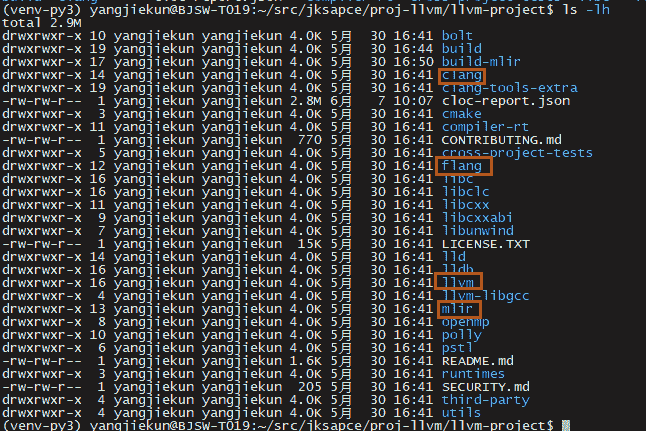

llvm 仓库里的 llvm 子项目，一共 300 万行代码，其中，200 万 c++，60 万汇编。

代码量有点大，怀疑有大量是 code 生成的 code。

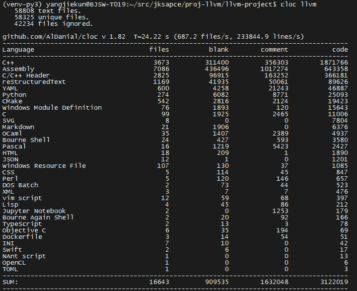

MLIR 一共 40 万行代码，其中 30 万 c++。

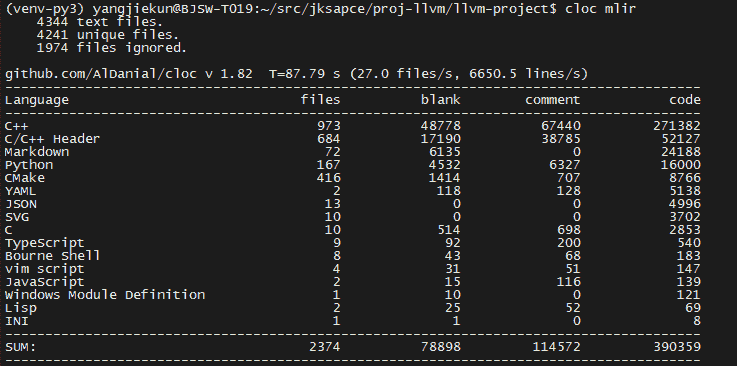

Clang 是 250 万行代码。200 万的 c/c++

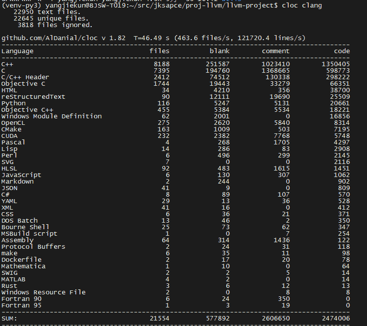

## LLVM 代码分布

一共 300 万行代码。

主体都在 lib 目录下，167 万。另外，test 目录下 67 万行。include 目录有 26 万。三者占了大部分。

重点是 lib 和 include 目录。

（include 都有 20 万行，啥玩意能写这么多代码？）

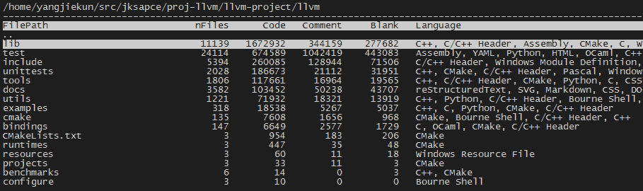

Lib 目录总体情况

1.  一共 167 万行代码，其中 Target 占了 75 万，是大头。

1.  CodeGen，Transform 各有 20 多万行代码，量很大，也是很重要的概念。

1.  其他目录代码量在三五千到几万之间，重要的概念包括：

1.  Analysis

1.  Passes

1.  IR

1.  TableGen

1.  LTO

详细分析如下

一共 167 万行代码，10 万行以上代码的，有 3 个，合计 120 万，其他供 47 万行代码。

1.  Target 75 万行

1.  CodeGen 23 万行

1.  Transform 22 万行。

1-10 万行代码之间的，比较重要的有：

1.  Support 8.8 万行。不管做的事重不重要，代码量在这里。

1.  Analysis 6.8 万。

1.  IR 5 万。

1.  DebugInfo 4.5 万。

1.  MC 3.7 万行。MLTC 里也有这个概念。

1.  Bitcode 1.4 万行。不知道干嘛。

其他比较重要的，都是三五千行代码。

1.  TableGen

1.  Passes

1.  LTO

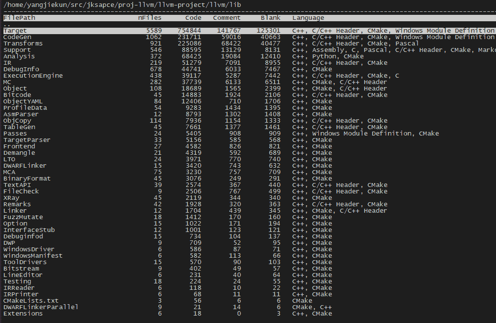

### llvm/lib/Target 目录

一共 75 万行代码，里面就是各种 target。比如

+   AMD gpu：这个都支持了，有点意思。而且代码量最多，12 万行。

+   x86, aarch64, arm, riscv, mips

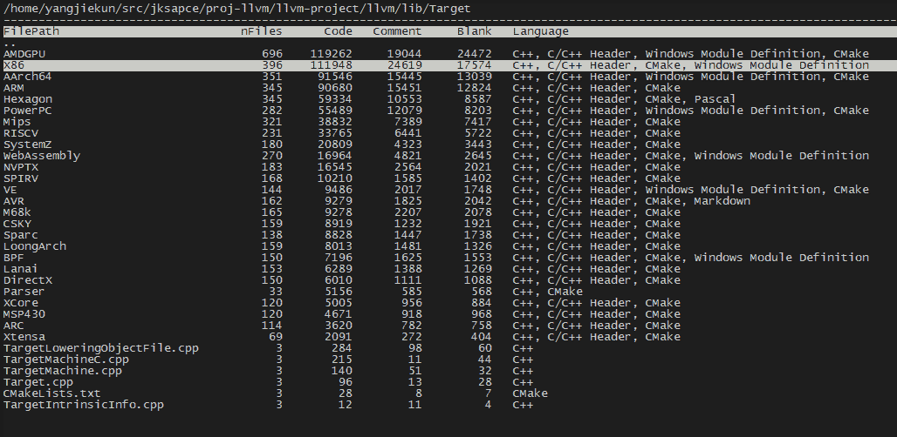

以 x86 target 为例，子目录如下

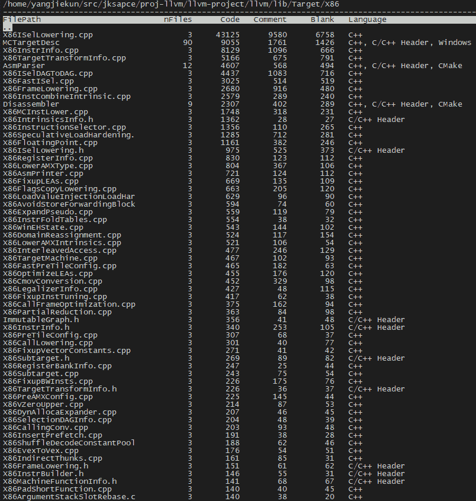

### llvm/lib/CodeGen

23 万行代码。

里面有一些听过，但不懂的概念，比如：

1.  SelectionDAG：7.7 万行代码，占了 codegen 的 30%，可见重要性。

1.  MachineScheduler.cpp

1.  RegAllocGreedy.cpp: 不到 2000 行代码。应该是贪心算法做寄存器分配。

1.  ScheduleDAGInstrs.cpp

1.  MachineCSE.cpp

1.  RegisterBankInfo.cpp

大部分概念（文件），也就三五千代码就实现了。

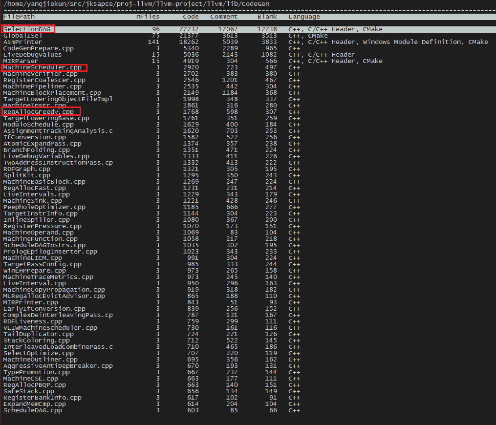

### llvm/lib/Transforms

22 万行代码。

IPO 是什么

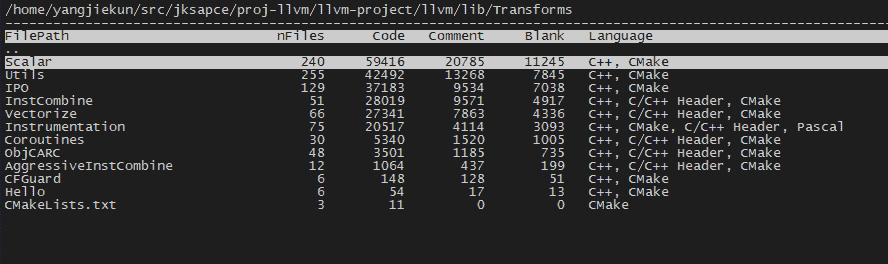

Scalar 下面，包括 GVN，LICM，LoopFuse 等概念。每一个都是几百到三五千行代码。

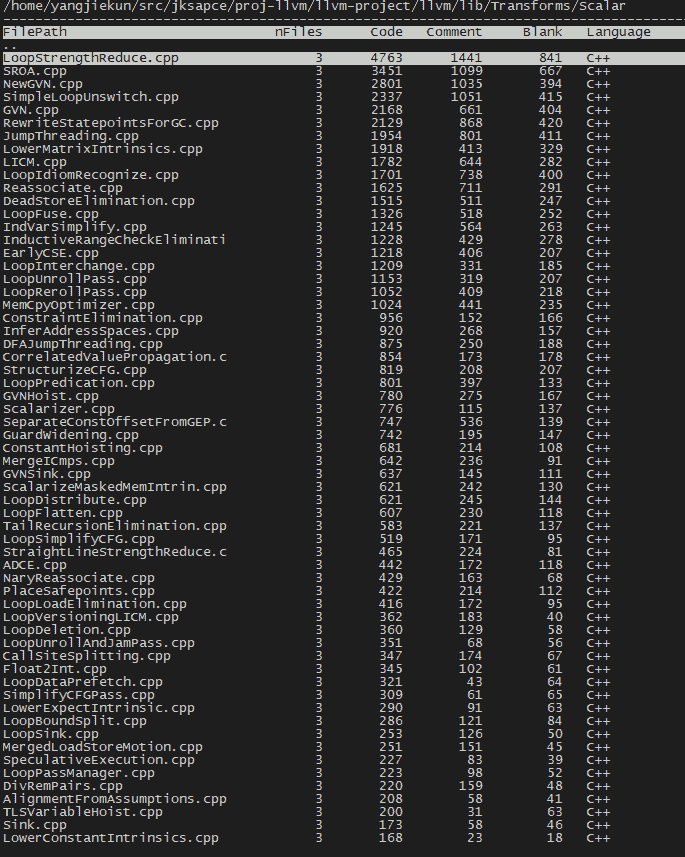

Vector 下面，没看到多少熟悉的东西。

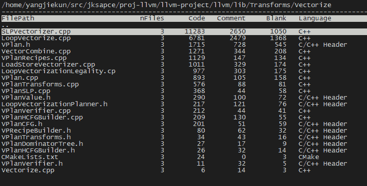

### llvm/lib/Analysis

Analysis 目录下，内容基本符合认知。除了 ScalarEvolution.cpp 有一万行代码，其他都是几百到三五千行。

一些肉眼可见的，可能比较好玩的。

1.  ValueTracking.cpp

1.  DependenceAnalysis.cpp

1.  ConstantFolding.cpp

1.  MemorySSA.cpp

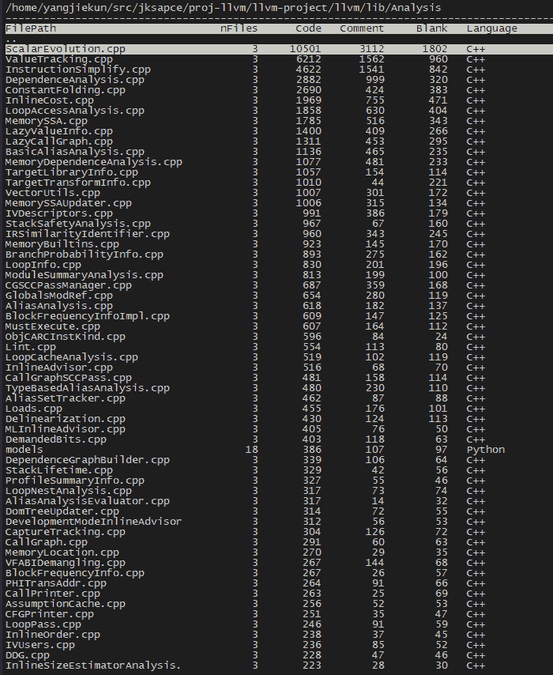

## MLIR 代码分布

一共 40 万行代码，其中 30 万 c++。

主体都在 lib 目录下，23 万。include 目录下 5 万行。

跟 llvm 一样，重点是 lib 和 include 目录。

从 lib 目录看，

1.  与 LLVM 相比，主要是多了 Dialect 这个抽象，且占了 50% 的代码。

1.  Conversion，有点像 LLVM 里的 pass，但又有区别。

1.  target 目录，只有 1 万多行代码，比 llvm 少了太多。

1.  其他目录：IR Bindings Analysis Transforms TableGen

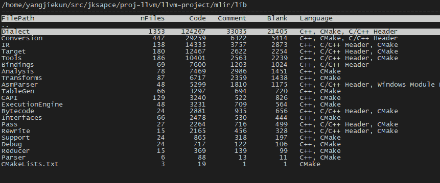

### mlir/lib/Dialect

大部分 dialect，几百到 2 万行代码不等。

都是一些比较基础的计算组件，没有与 deep learning 直接相关的。

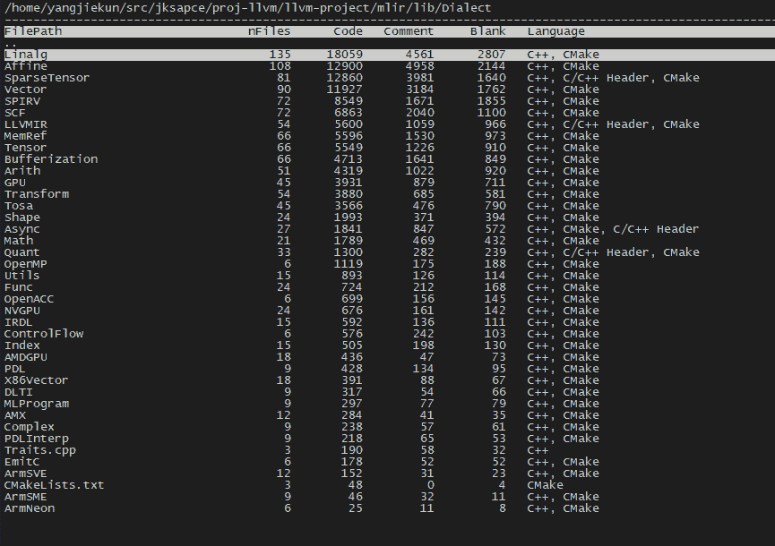

### mlir/lib/Conversion

看起来，像是一些场景的 dialect 之间转来转去的代码。

Pass 是分析和转 IR 的。

Conversion 是转 dialect，好像基本不需要像 analysis pass 分析 IR 一样分析 dialect？

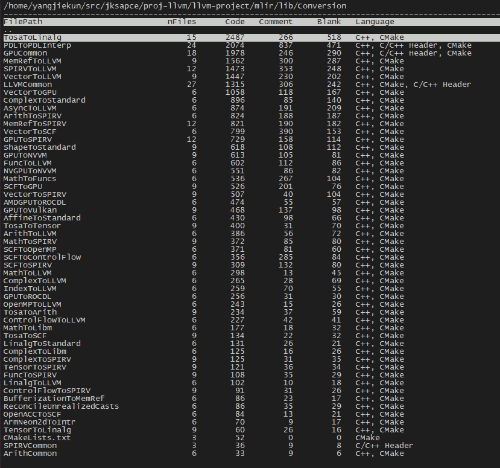

### mlir/lib/IR

看起来不像是具体的 IR，更像是写 IR 的基础组件。

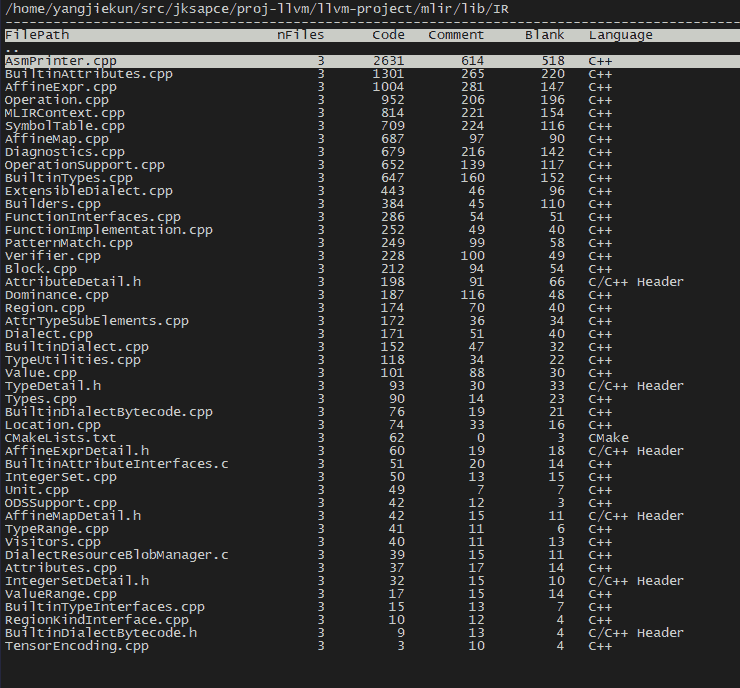

### mlir/lib/Target

Target 更加简单，目标就 3 个：llvm ir，spirv，cpp。

每个 target，只需要几千行代码。

SPIR-V 是一种可以在不同 GPU 和其他加速器上运行的中间着色器语言。SPIR-V stands for Standard Portable Intermediate Representation for Vulkan，是一个低级别、可移植的中间表示形式，支持多种图形和计算 API，包括 Vulkan、OpenGL 和 OpenCL 等。

LLVM 的 SPIR-V后端可以将 LLVM IR 转换成 SPIR-V 字节码，使得开发者可以使用 LLVM 生成代码，并且能够在多个平台上运行。这对于需要在不同 GPU 和其他加速器上运行的应用程序非常有用，因为它可以让开发人员使用 LLVM 提供的高级优化功能，并自动将代码转换为适用于所选择平台的中间语言。

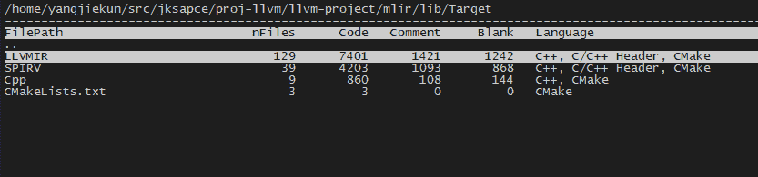