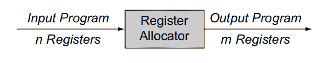
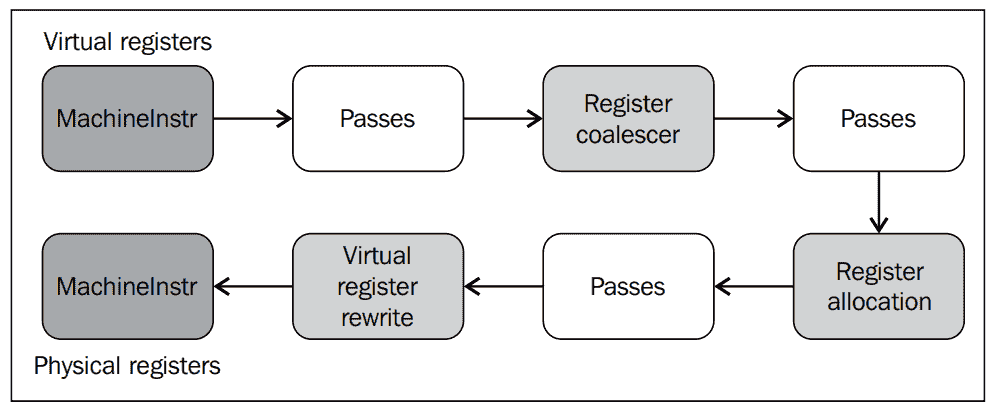
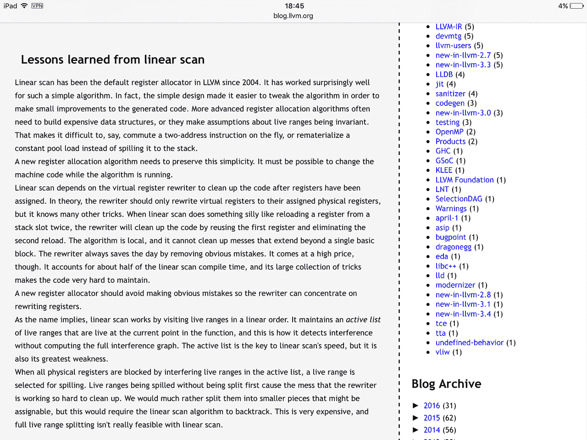
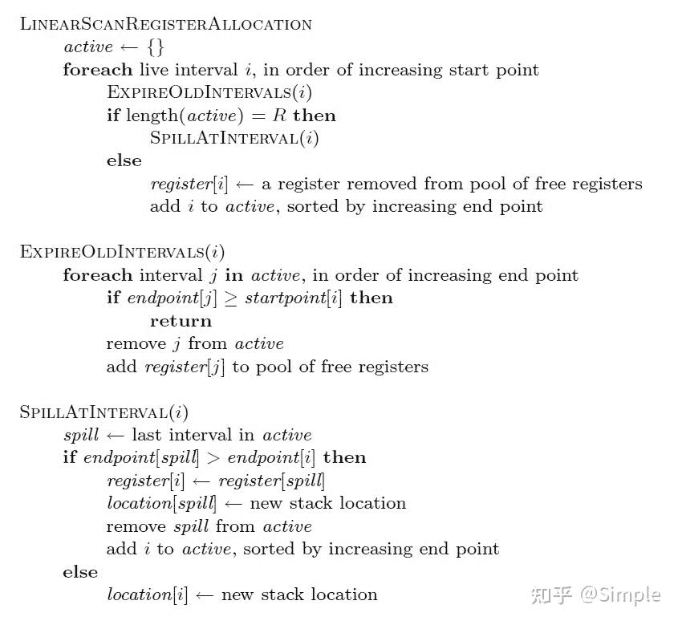
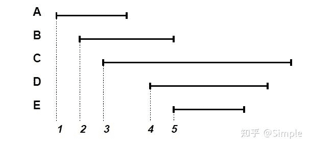
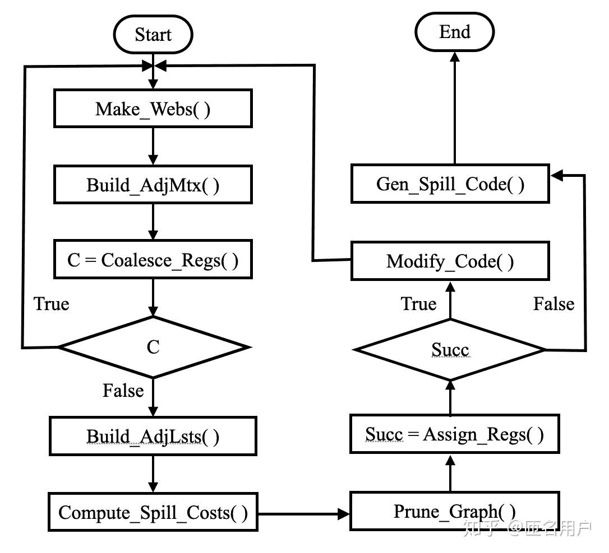

# WIP - LLVM 寄存器分配

> 来源：[https://learning.feishu.cn/docx/HOlydQV0go7p9QxKf8NceXDonKf](https://learning.feishu.cn/docx/HOlydQV0go7p9QxKf8NceXDonKf)

# 预置条件

[CS143 编译原理笔记 6 - Register Allocation](https://deep-learning.feishu.cn/wiki/K7Riwre9oiOlqXkBPEUcOtOzntc?fromScene=spaceOverview)解编译原理 & graph coloring 算法

LLVM IR 通常是无限寄存器模型，而，硬件的物理寄存器是有限的，不满足。

用 register allocation 解决。

1.  把多个 temporaries 分配给同一个 register

1.  不改变 program 的计算结果

更一般的，输入 n-register 模型的程序，输出 m-regeter 模型的。



编译原理课，讲的都是 graph coloring 算法，包括 2 阶段：

1.  graph coloring 算法，研究的问题是 colorable using K registers without spilling。

1.  spill effectively。物理寄存器的 k 一般很小，需要 spill。即，插入 load/store 指令。

实践中，spill 问题是更关键，影响更大的。但 graph coloring 并不解决这个问题。

LLVM 实现了 linear scan 和 greedy 算法，可以解决 spill 问题。

LLVM 没有实现 graph coloring。

# 不能 k-colorable 的问题建模

常见的思路：

1.  spill code

1.  rematerialization

1.  live range splitting

本质就是一个巨大的整数线性规划问题。integer-linear programming problem

Goal: minimize the number of loads and stores that the code must execute.

Spill code:** **Loads and stores inserted by the register allocator are spill code.

spill code 的 3 种代价：

1.  time to execute the spill code,

1.  code space that it occupies,

1.  the data space occupied by the spilled values

A good register allocator tries to minimize all three.

# LLVM 的实现

LLVM 的 Register allocation 流程



寄存器，不是用的越少越好。

比如，使用更多的寄存器，可以空间换时间，减少重复计算。

一般分成 2 个问题：龙书第 8.8 节。

1.  寄存器分配：选择一组将被存放在寄存器中的变量。选出的数量，与寄存器数量有关，N-register model。

1.  寄存器指派：指定一个变量放在哪一个寄存器。

## 没有 graph coloring

不会有图着色。一是有了greedy allocator，二是有了 PBQP

graph color的缺点是模型太简单，没有考虑spill, copy coalesce这些，导致只能使用启发式方法来求得近似最优解.LLVM选择使用greedy linear scan也有这方面的原因

以linear scan为基础的Greedy算法，其核心部分的着色能力已经“够用“了，实现简单、调整起来也简单。

Chaitin系的graph coloring算法的核心部分就比较复杂，毕竟要额外算interference graph啥的，再外挂降低spill的heuristic会使实现更加复杂。

Greedy的取舍就是核心要简单点，heuristic要容易实现和调整

graph-coloring 不解决更重要的 spill

问题。所以如果一个寄存器分配器把重点放在如何减少spill/reload开销上，只要有一个效果OK的着色实现就OK了。

Greedy的重点就是减少spill/reload开销。

Greedy的着色实现效果已经OK了。虽然它是在线性的live intervals上做着色的，比传统的interference graph的粒度粗一些，但它采用的spilit/pack heuristics其实效果就像是比较高效地事先避免interference、然后lazy方式发现interference并调整。

所以在着色方面并不需要一个传统的graph-coloring实现。

另外，虽然现在在LLVM主线上并没有基于SSA形式的寄存器分配器，但架构上允许这样的分配器设计。如果采用基于SSA形式的寄存器分配器，基本上就可以免费得到“着色”信息，只要把关注点放在如何降低spill/reload开销就好了。这也使得传统的graph-coloring算法没用用武之地。目前诸如 TargetPassConfig::addOptimizedRegAlloc() 会把PHIElimination配置在寄存器分配之前，但要想把它修改为先分配寄存器然后再退出SSA形式也是完全可以做到的。

寄存器分配之前做PHIElimination是为了做coalesce。不然在分配的时候再考虑这个问题会很难看。反之不考虑的话，greedy也就无从谈起了吧

SSA-based RA自身就很有可能做coalescing，这不是问题。Greedy没有设计成SSA-based的而已，所以以它的实现去讨论框架的其它方向的潜力感觉还是自己把视野限制住了。

感觉基于LLVM实现过的SSA-based RA应该已经有很多个了。至少随便搜搜就能找到一个，然后肯定还有更多稍微挖掘一下能挖掘出来的。它们的实际效果如何先不谈（毕竟学术作品跟产品比成熟度没法比啊），至少说明框架是有潜力做这种实现的。

实现难度上，一个可用的图着色算法的寄存器分配器还是有难度的。

GCC 尝试过几年才解决。

GCC目前用的IRA的核心就是一个经典的Chaitin-Briggs graph-coloring register allocator啊，IRA是Chaitin-Briggs的改进增强版

虽然编译原理教材通常会说图着色算法是“最好”的寄存器分配算法，但是它的性价比是值得讨论的。

图着色算法看着并不复杂，但对应各种体系是有很多tricky在里头的，尤其是pre-color，spill乃至着色本身。

llvm作为跨平台的通用编译器架构要想抽象出这些特性，设计出公共的着色器并将细节暴露给各架构自行实现是个很大的挑战。如果做的不好，一个仅仅是可用的图着色分配器其实没有多大意义。



其实有一个pbqp分配器。听过从作者那个组的人的报告，他说这个solver基本可以看成一个generalized graph coloring。我以前试过（在一个VLIW架构上），在数据上看spill/reload少了些，但生成代码性能比默认的greedy差非常多，估计是spill code placement太差。

llvm默认的寄存器分配效果一般，尤其对VLIW处理器而言，trunk上这类处理器太少，没有足够的关注。

在表达式树层面上做寄存器分配是其中比较简单的一种，比local（在基本块内做分配）更弱一些。

正统的做法大多是global的，例如：

+   图着色（graph coloring）；

+   线性扫描（linear-scan）；

+   以上两者的一些变种，像是Graph Fusion，Graph Coloring over SSA，Linear-Scan over SSA，Extended Linear Scan，Greedy Linear Scan（LLVM的Greedy分配器）；

+   以及一些比较新奇或暂时还比较冷门的，例如PBQP、puzzle solving之类，这些都有实现在一些编译器里。还有一些没怎么实现在编译器里的，像是王垠大大提出的Model Transformer Semantics之类。

## 线性扫描 - linear scan

线性扫描寄存器分配算法是1999年提出的。相比基于图着色原理的寄存器分配算法，线性扫描算法速度更快、更易于实现，且生成的代码同样高效。

假设 IR 的指令按照一定的顺序排列并编号，且指令中采用无限多个的虚拟寄存器，可用物理寄存器个数为R。live interval是指虚拟寄存器的活跃区间用[i,j]来表示，i和j为指令编号，表示其开始点和结束点。冲突是指两个活跃区间有重叠，此时不能为其分配相同的寄存器。若在某个程序点活跃区间重叠个数n>R，则必须将(n-R)个虚拟寄存器溢出(spill)到内存中。

该算法的具体过程如下：

集合list表示所有虚拟寄存器live interval的集合，以其开始点升序排列。集合active为当前活跃虚拟寄存器live interval的集合，以结束点升序排列。

S1：对集合list中的虚拟寄存器按顺序扫描，每次取出一个虚拟寄存器的interval；

S2：根据新的虚拟寄存器的interval，以其开始点为“当前点”，若集合active中有虚拟寄存器的结束点小于"当前点"，则说明其在“当前点”不再活跃，将其从集合active删掉，并释放相应的物理寄存器;

S3：若集合active中虚拟寄存器的个数等于R，则需要溢出一个虚拟寄存器。溢出规则是选择结束点最大的将其溢出。因为集合active中的虚拟寄存器是按结束点升序排列的，所以溢出必然“集合active中的最后一个虚拟寄存器”或“新的虚拟寄存器”。

若集合active中虚拟寄存器的个数小于R，则将这个新的虚拟寄存器加入集合active，并为其分配一个物理寄存器。

S4：返回S1，至到集合list中的虚拟寄存器扫描完。

其伪代码如下图所示：





图中左边为虚拟寄存器的名字，右边为其对应的interval。假设可用物理寄存器的个数R=2。集合list为{A、B、C、D、E}，该算法需扫描5次。当第2次扫描结束，active={A、B}；第3次扫描时，active中虚拟寄存器个数等于2，此时必须溢出一个虚拟寄存器，因C的结束点大将其溢出到内存中，此时active={A、B}；第4次扫描时，因end(A)<start(D)即active={B}，因此有一个物理寄存器可用并将其分配给D，此时active={B、D}；同第4次扫描，在第5次扫描结束时active={D、E}。

## Greedy 算法 - TODO

llvm目前的greedy工作的足够好

the idea behind LLVM's (relatively) new greedy allocator: the graph-coloring part of the problem is simple, and the focus is on spilling and splitting.

Greedy Register Allocation in LLVM 3.0

https://blog.llvm.org/2011/09/greedy-register-allocation-in-llvm-30.html

# 算法总架构



1.  Make_Webs()函数

多个相交的du链形成一个网，Make_Webs函数用来发现du链中所有的网。

1.  Build_AdjMtx()函数

冲突图需要用一个二维的邻接矩阵表示，该邻接矩阵的下三角表示两个寄存器是否冲突。AdjMtx[i,j] = true表示符号寄存器(或真实寄存器)i与j相互冲突。

1.  Coalesce_Regs()函数

使用邻接矩阵合并寄存器。会搜索赋值指令例如 Si = Sj这样的指令，而且要满足Si与Sj不相互冲突（AdjMtx[i,j]的值为false）。如果找到这样的指令，就会将对Sj的定义改为对Si的定义，并删除改赋值指令。如果执行了寄存器合并，则跳转到1继续执行，如果没有则进行下一步

1.  Build_AdjLsts()函数

构建一个邻接表，其中的每一个元素表示一个符号寄存器，记录了与符号寄存器相关的信息。邻接表用一个数组AdjLsts[1..nwebs]表示，数组中的每一个元素是一个listrecd记录。

1.  Compute_Spill_Cost函数

计算每个符号寄存器溢出到内存和从内存恢复到寄存器的开销。

1.  Prune_Graph()

使用degree<R原则移除邻接表中相应的节点。

1.  Assign_Regs()

根据邻接表的信息给每个节点着色，不相邻的两个节点可以有相同的颜色。如果成功则执行Modify_Code()将符号寄存器换为真实寄存器。如果着色失败，则执行下一步

1.  Gen_Spill_Code

将符号寄存器溢出到内存，产生相应的store/load指令。如果重建该值得开销小于溢出，也可重新计算该值，而不是溢出到内存。然后返回到步骤1

1.  Modify_Code

如果步骤7成功，则执行Modify_Code,将分配的颜色替换为实际的寄存器。

```
do
  do
    Make_Webs();
    Build_AdjLsts();
    C = Coalesce_Regs();
  while !C
  
  Build_AdjLsts();
  Compute_Spill_Costs();
  Prune_Graph();
  Succ = Assign_Regs();
  
  if Succ
    Modify_Code();
  else
    Gen_Spill_Code();
while Succ
```

# References

Complete Register Allocation Problems

https://dl.acm.org/doi/abs/10.1145/800125.804049

1973-complete-register-allocation-problems.pdf

https://web.cecs.pdx.edu/~mperkows/temp/register-allocation.pdf

Greedy Register Allocation in LLVM 3.0

https://blog.llvm.org/2011/09/greedy-register-allocation-in-llvm-30.html

Poletto, Massimiliano, and Vivek Sarkar. "Linear scan register allocation."ACM Transactions on Programming Languages and Systems (TOPLAS)21.5 (1999): 895-913.

https://zhuanlan.zhihu.com/p/628123333

hacker news 的讨论

https://news.ycombinator.com/item?id=9754013