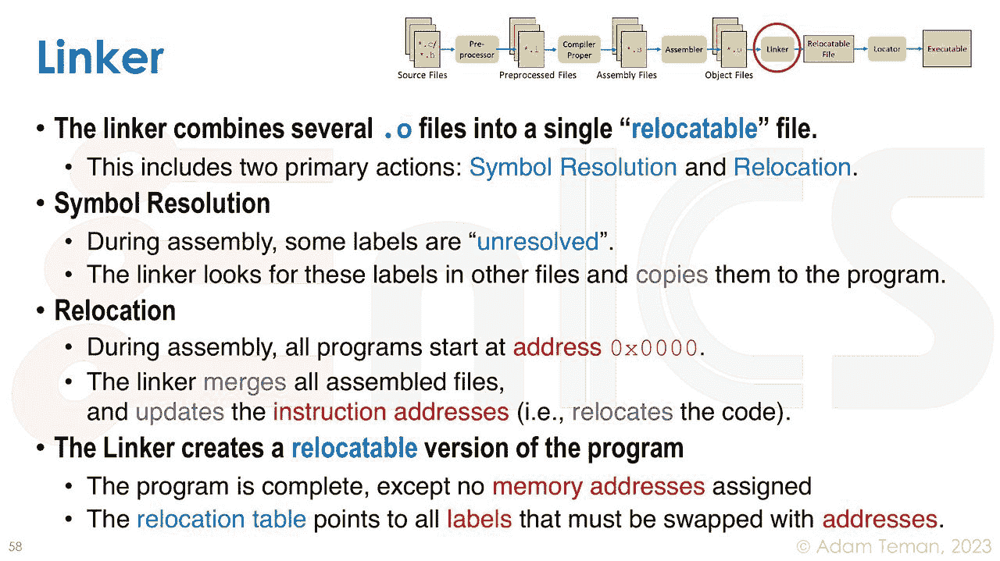
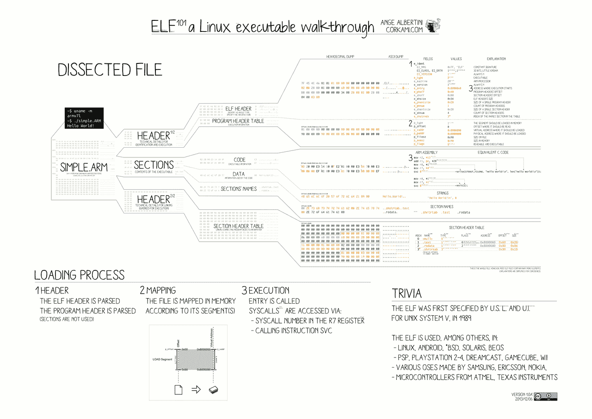
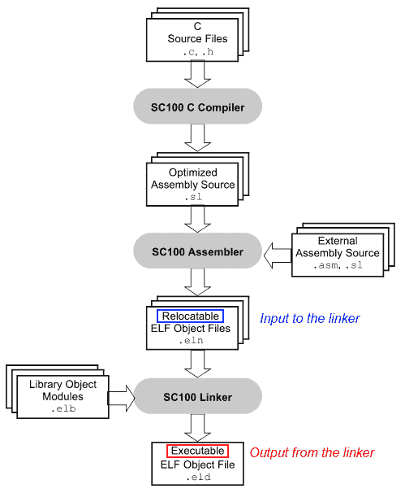
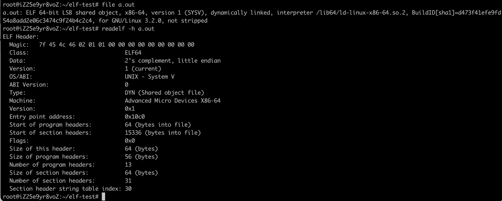
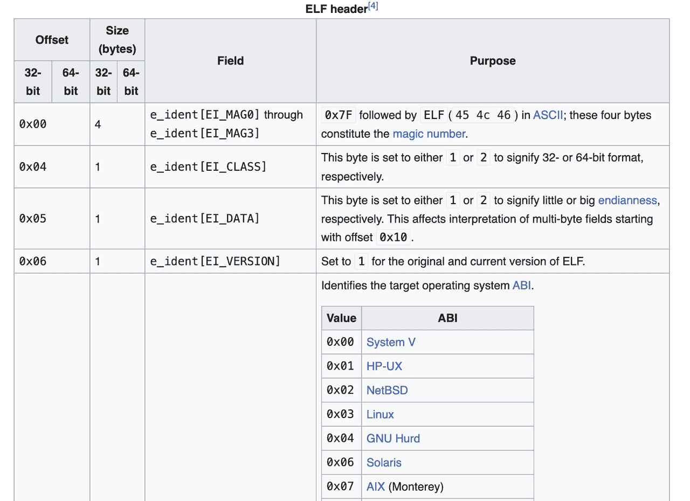
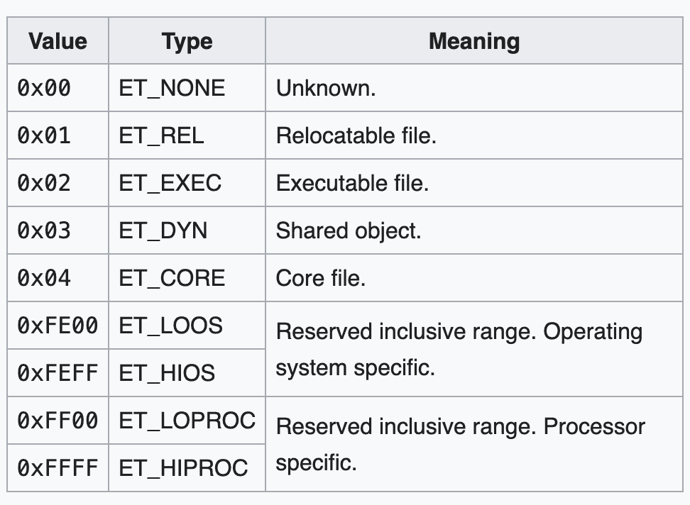
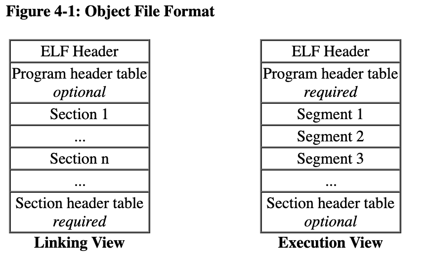
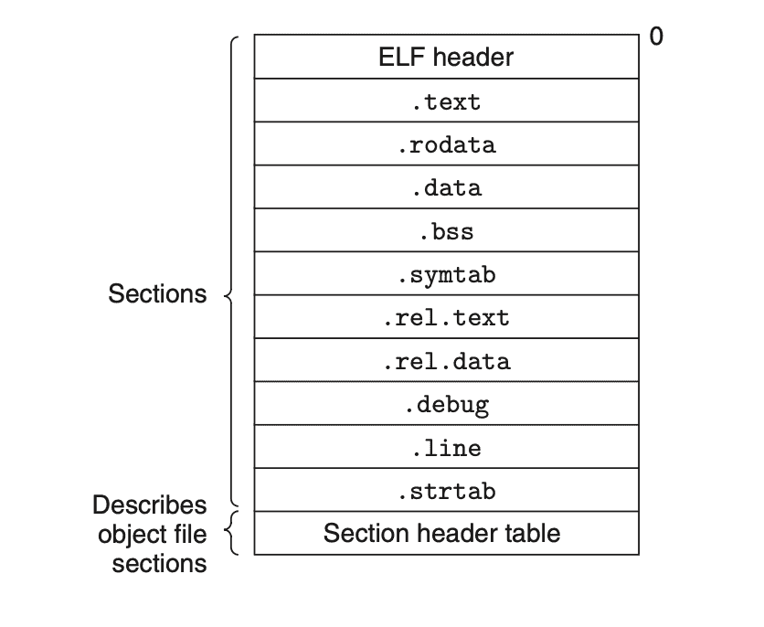
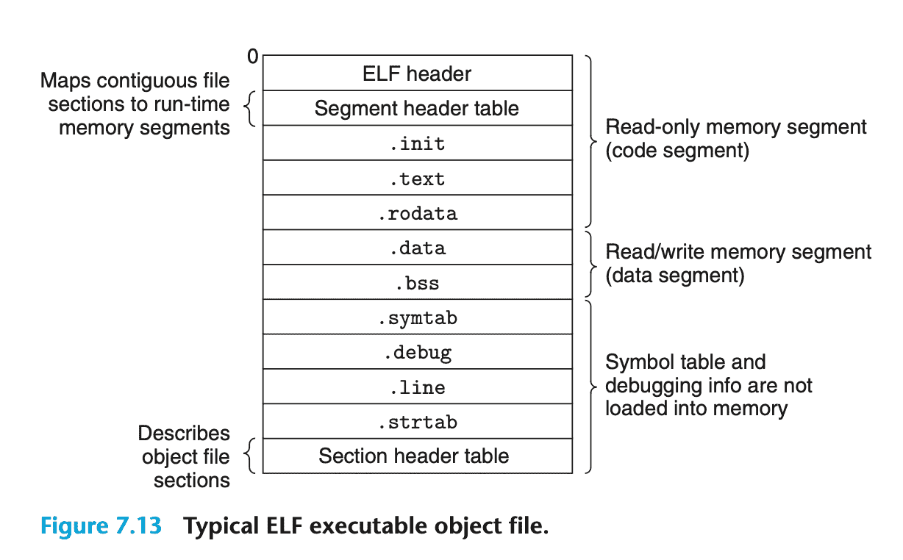
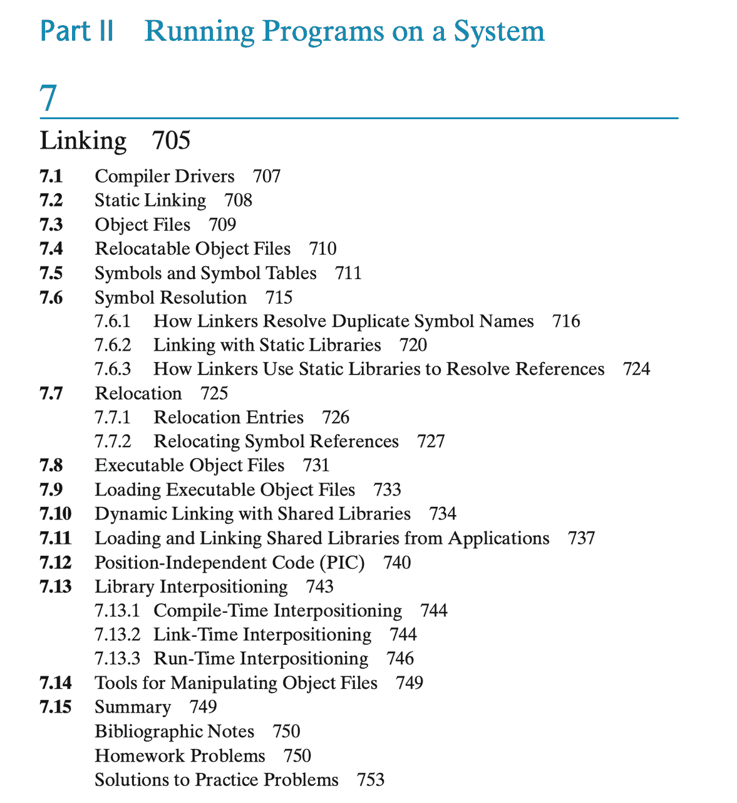

# Linker & Unix ELF

> 来源：[https://learning.feishu.cn/docx/OaDwdj809ooYT9x0vBEcUQmfnVh](https://learning.feishu.cn/docx/OaDwdj809ooYT9x0vBEcUQmfnVh)

Linker 处在 compiler, architecture & OS 的交叉点上，恰好不落在某个通常的计算机系统专业中。相关文献也不太完备。大部分人都了解有限，甚至基本不懂。

理解 Linker，需要的背景知识还比较多，包括 codegen、machine language programming、程序实例化和虚拟存储器等。不太难，还是有些门槛的。

了解 Unix ELF 格式，有助于更好的理解操作系统。

学习材料：

1.  程序员的自我修养



# 基本概念

## 目标文件

c/c++ 编译的目标文件类型，有 3 种：

1.  Relocatable Files: .o 文件。compiler or assembly compiler 的输出。

1.  Executable Files: 可以直接 load (copy) 到存储器并执行。Linker 的输出。

1.  Shared Libraries: .so 文件。被动态的加载到存储器并 linking。

目标文件的格式，比较丰富：

1.  贝尔实验室的 Unix 系统使用 a.out

1.  System V Unix 早期版本用 COFE (Common Object File format，一般目标文件格式）

1.  Windows 使用 COFE 的变种，叫 PE （portable Executable，可移植可执行）

1.  现代 Unix（比如，Linux，System V Unix 后来的版本，BSD Unix，Sun Solaris）使用 Unix ELF

当前讨论比较多的，都是 ELF。现代 unix 和 Linux 的主流目标文件格式。

## Unix ELF

了解 ELF 格式，有助于更好的理解操作系统。

Generic understanding of how an operating system works

全称 Executable and Linkable Format。

ELF 是一种封装格式，支持的文件类型很多，除了 3 种目标文件，常见的，还有 core files。

结构上，包括 1 header + sections。

In 1999, it was chosen as[ the s](https://en.wikipedia.org/wiki/Executable_and_Linkable_Format#86open)tandard binary file format for Unix and Unix-like systems on x86 processors by the 86open project.



## Linker

2 个主要任务：

1.  符号解析 symbol resolution。将每个符号引用和一个符号定义联系起来

1.  重定位 relocation。把每个符号定义与一个存储器位置联系起来，然后修改所有对这些符号的引用，使得他们指向这个存储器位置，从而重定位这些 section。

Linker 是文献不是很好。因为，Linker 处在 compiler, architecture & OS 的交叉点上，要求理解 codegen、machine language programming、程序实例化和虚拟存储器。

恰好不落在某个通常的计算机系统专业中。



# ELF Structure

## demo code

test.cpp

```
// cat test.cpp
#include &lt;iostream&gt;

int main() {
    std::cout &lt;&lt; &quot;Hello World!&quot; &lt;&lt; std::endl;
    return 0;
}
```

run.sh

```
# cat run.sh
g++ --std=c++11 -o a.out test.cpp

./a.out
```

## ELF header

```
file a.out
# a.out: ELF 64-bit LSB shared object, x86-64, version 1 (SYSV), dynamically linked, interpreter /lib64/ld-linux-x86-64.so.2, BuildID[sha1]=d473f41efe9fd54a8add2e06c3474c9f24b4c2c4, for GNU/Linux 3.2.0, not stripped

# show ELF header
readelf -h a.out
```



ELF header 的解释，详见 https://en.wikipedia.org/wiki/Executable_and_Linkable_Format

比如，

1.  **前** 4 b**i**t 声明**了****是 **ELF 文件 (45=E,4c=L,46=F), prefixed with the 7f value.

1.  然后是 Class field. determine**s the **architectu**re. 32**-bit (=01) or 64-bit (=02)



file type 字段，可以查到 ELF 支持的所有文件类型

主要就是 4 种



## ELF view

For convenience and efficiency, object file format provides different views depending on environment:



Elf header is at the beginning used as a “road map” describing file’s organization. Sections are the bulk of object file information for linking view: instructions, data, symbol table, relocation information, and so on. A program header table tells system how to create a process image. So files that will be executed needs from a program header table; relocatable files do not need one (not intended to be executed).

A section header table contains information describing file’s sections. Every section has an entry; each entry gives information (section name, size, etc). Files used during linking must have a section header table.

Important the order of the tables in the figure may differ. Sections and segments have no specified order. Only ELF header has a fixed position, and this gives the offsets to the other headers.

## Sections

Besides the ELF header, ELF files consist of three parts.

+   Program Headers or Segments (9)

+   Section Headers or Sections (28)

+   Data

Before we dive into these headers, it is good to know that ELF has two complementary “views”. One is to be used for the linker to allow execution (segments). The other one for categorizing instructions and data (sections). So depending on the goal, the related header types are used. Let’s start with program headers, which we find on ELF binaries.

# ELF section 详解

## relocatable file

relocatable file 的 ELF section 格式



## Executable Object Files



# Library Interpositioning

allows you to intercept calls to shared library functions and execute your own code instead.

Using interpositioning, you could trace the number of times a particular library function is called, validate and trace its input and output values, or even replace it with a completely different implementation.

Interpositioning can occur at compile time, link time, or run time as the program is being loaded and executed.

做 performance 分析 / tracing 的时候，可能是比较有用的 feature。

# Reference

https://en.wikipedia.org/wiki/Executable_and_Linkable_Format

https://linux-audit.com/elf-binaries-on-linux-understanding-and-analysis/

https://refspecs.linuxbase.org/elf/gabi4+/ch4.intro.html

https://raw.githubusercontent.com/K0deless/k0deless.github.io/master/pdfs/documents/elf_notes.pdf

https://www.gabriel.urdhr.fr/2015/09/28/elf-file-format/

https://blog.mygraphql.com/zh/notes/low-tec/elf/elf-format/

csapp pdf download https://www.cs.sfu.ca/~ashriram/Courses/CS295/assets/books/CSAPP_2016.pdf

chapter 7, ~50 pages



https://blog.mygraphql.com/zh/notes/low-tec/elf/elf-format/