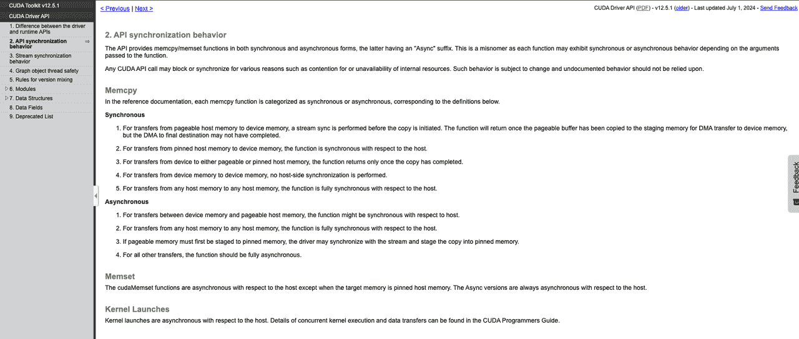

# GPU Driver & Runtime

> 来源：[https://learning.feishu.cn/docx/EyLGdgvjEoysxBxx7EFcU9Yrnsd](https://learning.feishu.cn/docx/EyLGdgvjEoysxBxx7EFcU9Yrnsd)

# SPIR-V

设计为硬件驱动的输入程序表示

Standard Portable Intermediate Representation (SPIR)

1.  稳定的字节码。注重于字节码的高效处理并提供强兼容性。

1.  GPU 领域专用。着眼于 GPU 领域的行业标准规范

是为表示 OpenCL 设备程序 (kernel) 而设计的，它锁定了某一版本的 LLVM IR，使用 LLVM 内联函数 (intrinsic) 和元数据 (metadata) 来定义 OpenCL 的计算原语以及定义。 但 Khronos Group 逐渐意识到 LLVM IR 实在不适合这种任务，遂转向了设计与开发 SPIR-V。

SPIR-V 是多个 Khronos API 共用的中间语言，包括 Vulkan, OpenGL, 以及 OpenCL。

完整的 GPU 编译器被分为两部分

1.  通过离线工具链从高层次源代码生成 SPIR-V

1.  通过驱动内部编译器将 SPIR-V 在线编译成机器码。

GPU Driver 内要有 compiler 的。

SPIR-V 更侧重于驱动内部二次编译的高效，核心是字节码。

其编码有很多简化驱动二次编译的考量，像是用各种提前的显示声明来避免运行时复杂的分析。

SPIR-V 并没有在规范中指定内存表示或者文本表示，这些都是实现 SP[IR-V](https://github.com/KhronosGroup/SPIRV-Tools/tree/master/source) [标准规范](https://github.com/KhronosGroup/SPIRV-Tools/blob/master/docs/syntax.md)的工具链自行定义的。 比如[ SPIRV-Tools 有](https://mlir.llvm.org/docs/Dialects/SPIR-V/)其自己的内存表示和文本表示， 同样 MLIR 中的 SPIR-V dialect 也是。

SPIR-V 的 IR 部分和 LLVM IR 相差并不太大。 SPIR-V 借鉴了很多 LLVM IR 的设计——它同样是由控制流、基本块、以及静态单赋值来表示程序。 指令的粒度和 LLVM IR 也相差不大。

S[PIR-V 中独特的部](https://www.khronos.org/registry/SPIR-V/specs/unified1/SPIRV.html#_decoration)分在[于对很多 GPU](https://www.khronos.org/registry/SPIR-V/specs/unified1/SPIRV.html#_builtin) 概念的原生支持。 这种[支持通过](https://www.khronos.org/registry/SPIR-V/specs/unified1/SPIRV.html#_derivative_instructions)很[多 SP](https://www.khronos.org/registry/SPIR-V/specs/unified1/SPIRV.html#_image_instructions)IR-V 独有的机制来实现，比如 deco[ra](https://www.khronos.org/registry/SPIR-V/specs/unified1/SPIRV.html#Execution_Model)t[io](https://www.khronos.org/registry/SPIR-V/specs/unified1/SPIRV.html#Execution_Mode)ns, builtins, 以及特殊的指令（像是导数计算、图像取样）。 另外为了支持图形图像和高性能计算的两种使用场景， SPIR-V 中有许多执行模型和模式。 当然，对图形图像也有 structured control flow 的特殊需求。

一个 GPU 为主的标准规范需要原生支持各种 GPU 概念，能够提供不同等级的扩展需求， 以及提供稳定和兼容的字节码。 这些需求并不符合 LLVM IR 的设计理念，所以 Khronos Group 推出了 SPIR-V。 但是设计一套中间表示只是个开始，围绕其开发和维护整套工具链需要持续不断的工程投入。 SPIR-V 与 LLVM IR 完全无关，SPIR-V 的编译器栈无法利用现有的 LLVM 库。 所以 SPIR-V 的整个栈是从头开始独立开发的，从汇编、反汇编，一步步到各种语言的编译器和优化。 如果我们当时能够有一套帮助开发编译器的基础设施——

# Reference

https://www.xilinx.com/products/technology/ai-engine.html

https://www.xilinx.com/content/dam/xilinx/support/documents/white_papers/EW2020-Deep-Learning-Inference-AICore.pdf

https://www.xilinx.com/content/dam/xilinx/support/documents/white_papers/wp506-ai-engine.pdf

https://docs.nvidia.com/cuda/cuda-driver-api/api-sync-behavior.html

cuda 的 runtime 和 driver api 看起来都是不开源的。

AMD 的开源。

浅谈Cuda driver API

https://zhuanlan.zhihu.com/p/111602648

https://dl.acm.org/doi/abs/10.1145/3542929.3563467

2022

Arax: a runtime framework for decoupling applications from heterogeneous accelerators

Today, using multiple heterogeneous accelerators efficiently from applications and high-level frameworks, such as Tensor-Flow and Caffe, poses significant challenges in three respects: (a) sharing accelerators, (b) allocating available resources elastically during application execution, and (c) reducing the required programming effort.

In this paper, we present Arax, a runtime system that decouples applications from heterogeneous accelerators within a server. First, Arax maps application tasks dynamically to available resources, managing all required task state, memory allocations, and task dependencies. As a result, Arax can share accelerators across applications in a server and adjust the resources used by each application as load fluctuates over time. Additionally, Arax offers a simple API and includes Autotalk, a stub generator that automatically generates stub libraries for applications already written for specific accelerator types, such as NVIDIA GPUs. Consequently, Arax applications are written once without considering physical details, including the number and type of accelerators.

Our results show that applications, such as Caffe, TensorFlow, and Rodinia, can run using Arax with minimum effort and low overhead compared to native execution, about 12% (geometric mean). Arax supports efficient accelerator sharing, by offering up to 20% improved execution times compared to NVIDIA MPS, which supports NVIDIA GPUs only. Arax can transparently provide elasticity, decreasing total application turn-around time by up to 2X compared to native execution without elasticity support.

GPU通过Host Interface读取CPU指令，GigaThread Engine将特定的数据从Host Memory中拷贝到内部的Framebuffer中。随后GigaThread Engine创建并分发多个Thread Blocks到多个SM上。多个SM彼此独立，并独立调度各自的多个Thread Wraps到SM内的CUDA Cores和其他执行单元上执行。

+   SM: 对应于上图中的SM硬件实体，内部有很多的CUDA Cores

+   Thread Block: 一个Thread Block包含多个线程（比如几百个），多个Blocks之间的执行完全独立，硬件可以任意调度多个Block间的执行顺序，而Block内部的多个线程执行规则由程序员决定，程同时程序员可以决定一共有多少个Blocks

+   Thread Warp: 32个线程为一个Thread Warp，Warp的调度有特殊规则，本文后面会继续深入

上图存在16个SMs，每个SM带32个Cuda Cores，一共512个Cuda Cores. 这些数量不是固定的，和具体的架构和型号相关。

每个CUDA Core含有一个Integer arithmetic logic unit (ALU)和一个Floating point unit(FPU). 并且提供了对于单精度和双精度浮点数的FMA指令。

SM内还有16个LD/ST单元，也就是Load/Store单元，支持16个线程一起从Cache/DRAM存取数据。

4个SFU，是指Special Function Unit，用于计算sin/cos这类特殊指令。每个SFU每个时钟周期只能一个线程执行一条指令。而一个Warp(32线程)就需要执行8个时钟周期。SFU的流水线是从Dispatch Unit解耦的，所以当SFU被占用时，Dispatch Unit会去使用其他的执行单元。