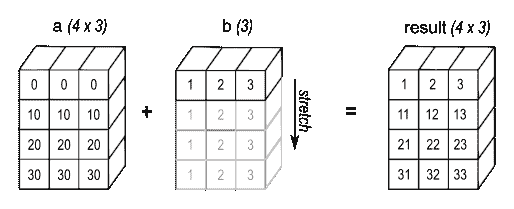
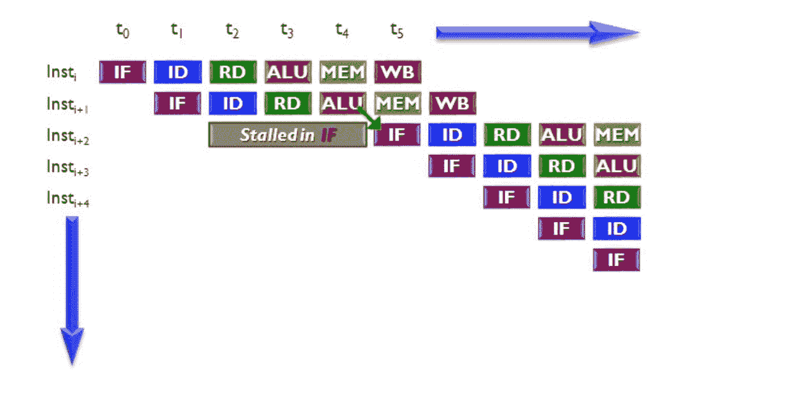
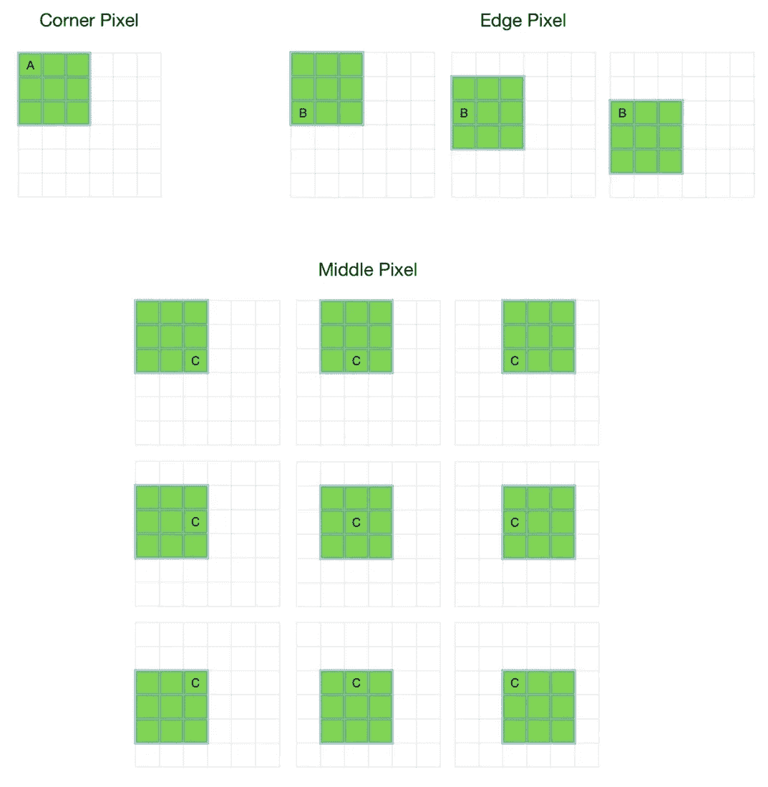
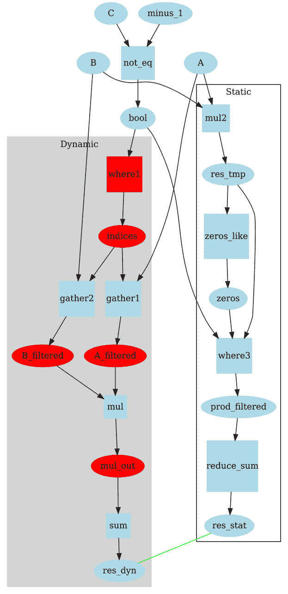
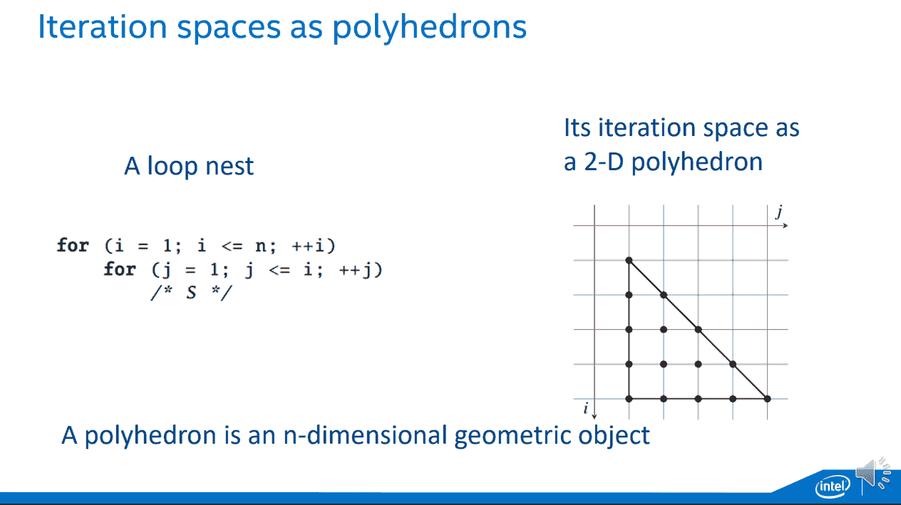
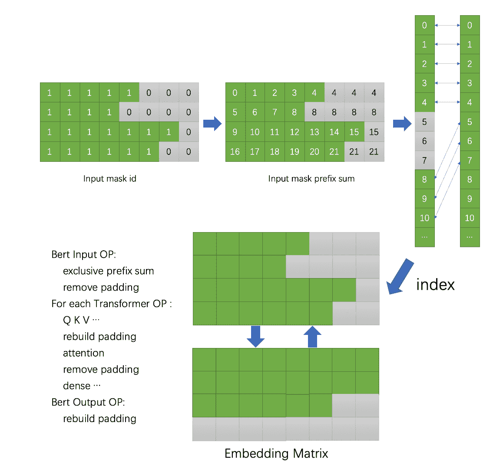
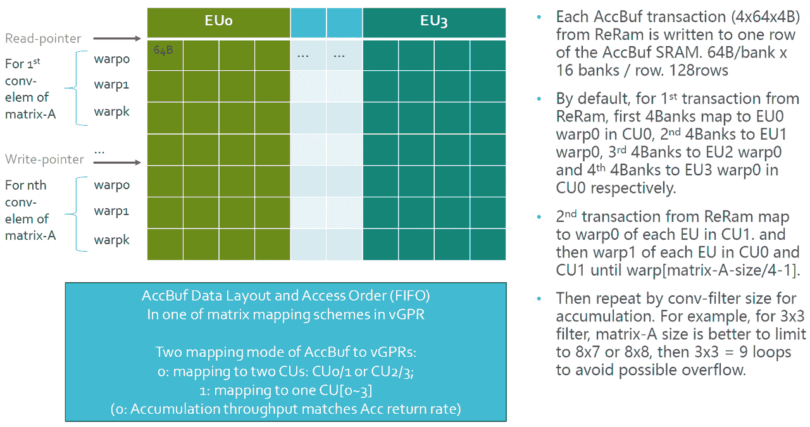

# 动态 shape 的挑战与解决现状

> 来源：[https://learning.feishu.cn/docx/MVPRdLYcoo3dyhxTDl9ck95anvf](https://learning.feishu.cn/docx/MVPRdLYcoo3dyhxTDl9ck95anvf)

published: https://zhuanlan.zhihu.com/p/661889518

# **概述**

## **动态 shape 是什么**

动态 shape，一般是 2 个问题：

1.  Tensor 的 shape 是动态的。

1.  Control flow 的动态性。即 if-else / loop 类的结构。比如，where，while，Switch 等。

Tensor shape 的动态性，类型比较多。比如：

1.  变化的 batch size。

1.  变化的 input shape。CV 模型的 image resolution，NLP 模型的 input sequence length。

1.  算子逻辑导致的。unique，nonzero。

1.  稀疏矩阵导致的。输入本身可以是静态的，但为了节约存储空间，使用稀疏矩阵表示输入。搜推模型用的多。

1.  其他特殊情况。比如，random 算子，可能间接导致动态 shape。

解决方案，集中在 compiler 层面。核心是如何 static 化，基本靠 padding。

“解决” 基本是不可能的，只能 case by case 的绕过去。

## **动态 shape 的挑战**

Compiler 不擅长处理动态 shape。

静态 shape 语义下比较确定性的问题，动态 shape 场景很复杂。比如：

1.  算子占用的显存预估 & 调度策略，

1.  是否需要 implicit broadcast，https://numpy.org/doc/stable/user/basics.broadcasting.html

1.  指令层的向量化，

1.  codegen 模版选择。

Broadcast 的例子

A one dimensional array added to a two dimensional array results in broadcasting



Hardware 层面的困难：

1.  最终产生数据依赖、跳转/条件分支 类指令，导致更多的 流水线气泡 (pipeline stall)。

1.  （还有别的吗？）

pipeline stall on Control Flow 的例子



## **解决思路**

分 3 大类。

1.  软件层面。主要是 compiler 相关，核心是如何 static 化，基本靠 padding。

1.  Hardware 层面支持。没怎么关注，不了解。有些在尝试支持 control flow，比如 tensorrent。

1.  不解决不优化，用 cpu 慢慢跑。

1.  标量运算特别慢。比如 topk

1.  Gather 算子。

# **软件的解决方案**

图片来自 https://zhuanlan.zhihu.com/p/305546437 阿里 pai 团队的 ai compiler blog


## 1. Padding 成 static shape

Padding 也分两种情况：

1.  模型的 input，可以在 CPU 上做 padding，灵活性很高，方案很多。

1.  Model 内部算子的 input，padding 不好做，有需求，但相对也少。

模型的 input 的常见 padding 方案：

| 方案 | 说明 | 分析 |
| --- | --- | --- |
| Naive padding | 把变化的维度，padding 到最大长度。 | 1.  问题：Shape length 变化很大时，计算效率非常低。 |
| 多个模型，分桶 | 1.  准备 N 个模型，最大长度 64, 128，512, 2048。 | 1.  使用最广泛。一般，模型只需要训练一个最大的即可。 |
| 动态编译 | 1.  第一次执行时，不优化。 | 1.  一些 AI compiler、算子库开始采用。不用提前调研用户需求。cann |
| crop 数据 | 针对特别长的 input，数据截断不处理。 | 1.  作为系统健壮性的兜底方案，一般都会做，区别只是 threshold。 |

1.  cv 场景把 225*226 的图片 crop 成 224 * 224.

1.  Bert 模型按 max length 512 截断。

Padding 的主要难点

1.  引入较少/更少的无效数据。如表格里的方案。除了占用 memory / bandwidth，也可能增加 compute 时间。

1.  Padding 策略不能（明显）影响模型的精度表现。

1.  新策略，一般需要数学、算法实验论证。有工作量和研发成本。

1.  尺寸的局限性。以 CV 模型为例，700*700 的图片，padding 成 800*800，一般是可以的，但如果 padding 成 1600*1600，算法精度可能急剧下降。

1.  Padding 导致的内存搬运 or 不连续。

1.  Tensor 一般是高维的，但内存里通常是一维的排列。比如，灰度图的长宽是 2 维，RGB image 的 3 个 channel。

1.  CPU 的计算通常不是瓶颈，在 CPU 上做 padding，计算效率的影响会小一些。

以二维数据（image）为例，多种 padding 策略，算法精度、计算效率的影响是很丰富的。



## 2. **消除“伪”动态 shape**

很多看似是动态的模型，在推理时，完全等价于静态模型。

推理框架、AI compiler 可以自动的静态化，模型精度无损失。

典型场景：

1.  动态 batch size 引入 shape 等额外算子。如果固定 batch size，可以消除掉动态性。

1.  能静态化的算子。比如，flatten, gather, expand, slice 等。

以 flatten 为例。

1.  flatten 有 2 个输入：data 和 axis。axis 取值不一样，Output shape 很可能会变，即，动态 shape。

1.  推理时，算子的 axis 一般是 constant 参数，不会变。即，可以处理成静态 shape。

| Data (Input) shape | axis | Output shape |
| --- | --- | --- |
| (2, 3, 4, 5) | 0 | (1, 120) |
|  | 1 | (2, 60) |
|  | 2 | (6, 20) |
|  | 3 | (24, 5) |

## 3. Shape Constraint - 缩小动态的范围

推理框架、AI compiler 尝试的另一个方向。

有些“真”动态的算子，可以通过前后算子推演出 shape 的约束关系。

AI compile 知道算子内存的 upper bound，可以明显缩小搜索空间。

比如：

1.  Int8 推理时，unique 算子的输出，shape 的 upper bound 是 min(input length, 255)。

1.  A + B = C 场景，Add 算子的输入 vector A 和 vector B，shape 是相同的。

## 4. **改代码、换算子**

有点难，普适性也不高。但，确实有一些能用的成熟规则。

来自 habana 的例子：https://docs.habana.ai/en/latest/PyTorch/Model_Optimization_PyTorch/Dynamic_Shapes.html#mitigation-techniques-for-dynamic-ops



## 5. Control Flow 的支持

分 2 种情况：

1.  尝试消除 Control flow。

1.  基本就是编译原理、cpu pipeline 中 control flow 消除的方法。

1.  比如，loop unrolling (循环展开), Polyhedral Model （多面体模型）

1.  消除不掉的：

1.  if-else、switch 等条件选择分支，每个分支都编译，cache 起来。runtime 动态选择。

1.  Loop / while 等结束条件动态的循环，暂不知道加速方法。也比较少见。

以 Polyhedral Model 为例，

当 if...else / loop 的判断条件全部已知时，实际触发 compute 计算的，是 N 维空间里的一个 subset 子集。

Compilation time 可以精确枚举 subset 子集，transform 成 1 层的 loop 循环。

然后 loop unrolling (循环展开)，消掉了所有的 control flow 指令。

详见 https://www.cse.iitk.ac.in/users/swarnendu/courses/autumn2020-cs610/intro-to-polyhedral-model.pdf



## 6. **Sequence Mask**

实现参考 https://github.com/bytedance/effective_transformer

思路：

1.  发现：模型的部分计算，与 token 的位置和上下文无关。把多个短 input concatenate 成 1 个长的，推理结果不变。

1.  方案：注册 TransformerInput、Transformer、TransformerOutput 三个算子，分别进行 input 数据标记、静态图计算、output 数据恢复。



# Chip design 的可能需求

初步设计了几个 case，（没做过估算，可能对整体影响不大）

1.  EU/CU 的调度效率。

1.  warp dispatcher 级别，支持一定的动态性。动态的 warp 数量自动调度。

1.  Matmul 的左矩阵的输入 shape 是 1/7/8 * N，如何打满 EU 里的 64 个 CU。

1.  数据排布的动态性支持。一个 row 排不满时，计算效率是否明显下降。

1.  control flow 算子的执行效率。比如，where，在 chatGLM 有。



硬件上，加速空间：control flow 支持能力

VM runtime 的路线。

+   tensorrent芯片，每个 tensix 包含 5 个 riscv 小核，可以执行 VM 里面定义的操作。https://www.designnews.com/electronics-test/tenstorrent-changing-way-we-think-about-ai-chips-0

+   Nimble - AWS 基于 TVM 的方案。做了基于 Virtual Matchine 的轻量级跨平台 runtime。

Spatial Computing 的 topic。

+   Towards Efficient Control Flow Handling in Spatial Architecture via Architecting the Control Flow Plane https://browse.arxiv.org/pdf/2307.02847.pdf

# **业界 compiler 调研**

主要看了 3 条线：

1.  NV 的 TensorRT

1.  MLIR。阿里的 BladeDISC。

1.  TVM 方向。relax，Amazon 的 Nimble 和 DietCode 2 个工作。

具体的实现上，主要是 3 类工作。前 2 个是辅助，最后一个是目的。

1.  Shape 的语义编码 & IR 中的传递。

1.  shape function。运行时的 shape inference、shape 估算、上下界约束。

1.  调度。

1.  单算子分：计算密集型、访存密集型。另外，还有算子融合、自动 codegen 等。

1.  基本都是拿时间换空间，比如，申请个稍微偏大的内存（冗余计算）、保持多个版本的 cache（知识库）。

解决方案，本质都是：静态化。区别只是 coding 的工作量、overhead 的来源和大小。

1.  Padding / mask

1.  预分配更大的内存，比如，NMS。

数学的说，

static shape -> global observation

Dynamic shape -> partial observation，部分可观察。难以实现全局最优解。

求解的方法和难度，完全不一样。

## TensorRT - Padding

没有详细调研。

根据杨军在 2022 年的文章描述，

TensorRT 至今的动态 shape 方案，依然就是 padding。

Ampere 架构 (2020年5月) 时代引入的 software (TensorRT) 工作，没看到对硬件的依赖。

## DISC - 阿里 基于 MLIR

DISC：A Dynamic Shape Compiler for Machine Learning Workloads

https://browse.arxiv.org/pdf/2103.05288.pdf

https://github.com/alibaba/BladeDISC

个人感觉最好的工作。

2022 年，在 Transformer 中的加速比为 1.8 倍，优于 Nimble。

Nvidia T4硬件上几个真实的业务例子的性能收益数字：

以GPGPU为例，在Nvidia GPU上的绝大部分技术栈可以迁移至海光DCU和AMD GPU等体系结构相近的硬件上。BladeDISC较强的硬件泛化能力配合硬件本身较强的通用性，很好的解决了新硬件适配的性能和可用性问题。

下图为海光DCU上几个真实业务例子上的性能数字：

| 某识别类模型 | 推理 | 不同batchsize下 2.21X ～ 2.31X |
| --- | --- | --- |
| 某检测类模型A | 推理 | 不同batchsize下 1.73X ～ 2.1X |
| 某检测类模型B | 推理 | 不同batchsize下 1.04X ～ 1.59X |
| 某分子动力学模型 | 训练 | 2.0X |

## **TVM - Relax**

https://zhuanlan.zhihu.com/p/627449108?utm_id=0

（TVM）Dynamic shape 目标

1.  shape可以通过symbolic表达，并且将shape推断作为一等公民支持

```
@R.function
def shape_example(x: R.Tensor[(n, 2, 2), &quot;f32&quot;]):
    with R.dataflow():
        lv0: R.Tensor[(n, 4), &quot;f32&quot;] = R.reshape(x, (n, 4)) 
        lv1: R.Tensor[(n * 4,), &quot;f32&quot;] = R.flatten(lv0)
        lv2: R.Shape = (n * 4,)
        lv3: R.Shape = R.call_packed(&quot;myshape_func&quot;, lv2)
```

这段代码可以体现了想达到的效果：

1）shape可以在IR语言中单独作为表达式存在了（lv2），以前在relay中shape必须作为tensor的附属；

2）shape中可以包含“n”这样的未知变量了，这类变量不需要在编译时确定具体数值，而是可以在运行时再确定。而且“n”虽然未知但并不会完全破坏shape的语义，比如我们可以推断出R.Tensor[(n, 4), "f32"]需要的存储空间是R.Tensor[(n, 2), "f32"]的两倍。

动态 rank 支持吗？看起来不支持。

D2: Shape refinement

参考以上的例子，在V2的case中，lv5的shape直接用None表示，意思是lv5对应的op是data dependent，编译时无法推断shape，只能在运行时获取。但是后面的程序希望这个shape能给出一个symbolic的表达，以支持后面程序潜在的优化，这就需要“match_shape”了。

```
value = match_shape(lhs, pattern)
```

lns 既可以是 tensor，也可以是 shape。pattern 是一个带符号的表达式。

值得一提的是 match_shape 使得relax  对于数据的表达更加灵活，比如稀疏的数据。

编译时无需为 shape 负责，其实也负责不了，所以它们的结果也无法提前分配内存，需要运行时动态分配。这种状态在官方文档中称作 “no shape computation land”。

## Nimble - AWS 基于 TVM

将动态 shape 模型的运行时控制逻辑预构建为 VM 解释执行

1.  支持动态 shape 的编译优化框架，包括类型系统、内存优化、算子生成等；

1.  基于 Virtual Matchine 的轻量级跨平台 runtime。

支持动态 shape 的额外开销：

+   相比 TVM 静态模型性能降低 5%~25%，性能降低主要来自于动态 shape 算子 index 的计算和 VM 引入的指令开销；

+   相比 TVM 额外占用 8% 内存

+   Dense 算子 Full Dispatch 性能基本持平静态 shape，No Dispatch 性能最差。

### **类型系统**

这可能是 relax 的工作。

引入 Any 类型解决动态 shape 下维度信息的表达：

Tensor[(1, 10, Any), float32]  # 支持：固定 rank，1 维动态

Tensor[(1, Any, Any), float32]  # 支持：固定 rank，多维动态

Tensor[(*), float32]  # 不支持：动态 rank

### **shape function**

根据算子的不同特性，将shape function分成3类：

+   数据无依赖型，输出shape只与输入Tensor的shape相关；

+   数据依赖型，输出shape需要输入Tensor的value计算得到；

+   上边界型。

数据无依赖型的动态shape算子在编译阶段可以很容易的融合。在实现中shape function是作为一个算子注册到框架中，所以shape function本身也是可融合的。以下是我们在TVM代码里面找到的shape function：

| type | Is Data Dependent |
| --- | --- |
| elemwise_shape_func | No |
| no_data_full_shape_func | Yes |
| full_shape_func | Yes |
| broadcast_shape_func | No |
| conv_shape_func | No |
| pool2d_shape_func | No |
| global_pool2d_shape_func | No |
| reduce_shape_func | No |

### **内存编排**

扩展新增4条Relay IR表达内存相关操作

1.  invoke_mut(op, inputs, outputs)

1.  alloc_storage(size, alignment, device)

1.  alloc_tensor(storage, offset, shape, dtype, attrs)

1.  kill(tensor)

### VM-based Runtime

设计了一套CISC-style的指令集，采用变长指令格式，优化时可用无限寄存器。

经过编译优化后的模型可执行件包含两部分：

+   平台无关的字节码，包含模型的控制执行逻辑；

+   平台相关的高性能kernel。

可执行件由专门设计的解析器负责加载和执行。得益于粗粒度的指令集设计，VM带来的运行时开销极小，其轻量级特性也保证了平台间的可移植性。

### **异构算子编排**

### **符号算子生成**

这部分，特别是挑战 2，感觉上，应该是完全不如 dietcode 和 DISC

## DietCode - AWS 基于 TVM

https://assets.amazon.science/14/33/43345d8142d8936ec591f5600aa5/dietcode-automatic-optimization-for-dynamic-tensor-programs.pdf

TVM-RFC：[t](https://link.zhihu.com/?target=https%3A//github.com/apache/tvm-rfcs/blob/main/rfcs/0072-dynamic-autoscheduler.md)vm-rfcs/0072-dynamic-autoscheduler.md at main · apache/tvm-rfcs

https://zhuanlan.zhihu.com/p/590531033?utm_id=0

多看看 padding 的讨论

也是 TVM 生态的方案的。https://github.com/apache/tvm/issues/11516

以 BERT 模型为例，DietCode 与 Ansor 相比， 搜索时间减少 5.88倍，性能提高约 70%

[DietCode项目](https://link.zhihu.com/?target=https%3A//github.com/apache/tvm/issues/11516)已经开始合入TVM中，但目前来看，只是在 tir 优化 Pass 中增加了 LocalPad，其他 feature 还未合入。

主要提出了 micro-kernel 的概念来解决动态 Shape 在TVM中自动调度的问题，极大减少了搜索时间。

本质上仍然是一种“分组”策略，将动态问题转化为静态问题。在我们之前的实践中，针对bert模型的优化，使用过一种类似“桶分组”的方法，但是“分组”概念停留在了模型层面，导致了不小的存储开销，并且最终性能的提升取决于输入的分布情况，很明显，输入非均匀分布的时候，很多模型的存在意义很低。DietCode 将“分组”下沉，将会节省大量的存储空间，并且它更大的优势是自动搜索，降低搜索时间。

计算密集型算子

性能优化的 2 种解决方案：

1.  使用供应商的算子库

1.  使用 auto-scheduler 来完成算子调优

TVM auto-scheduler 不能为所有可能形状的工作负载构造一个确定的搜索空间。为了解决以上问题，DietCode 应运而生。

不同代码生成过程对比（a）表示目前TVM中的自动调度过程，（b）表示DietCode的自动调度过程

Ansor 的输入是 TE，TE 中包含了算子的计算描述和形状信息。

---

# **附录 - 问题分类**

一般是 2 个问题：

1.  Tensor 的 shape 是动态的。又细分为 rank 动态，rank 静态但 dimension size 动态。

1.  https://docs.habana.ai/en/latest/PyTorch/Model_Optimization_PyTorch/Dynamic_Shapes.html#handling-dynamic-shapes

1.  Control flow。主要指 if ... else / for ... loop。体现为，图的计算逻辑动态性，即，不同的 input data，经常的 datalow（operator） 不一样。

1.  Tensorflow 的算子 Switch、Merge、Enter、Exit、NextIteration、LoopCond、While

1.  https://www.cnblogs.com/jicanghai/p/9672310.html

当 control flow 的判断条件刚好是 动态 shape 的 tensor 时，问题更复杂。

特别是循环，不好事先估算并行度。

在 inference 阶段，基本不涉及 Control flow，主要是 Tensor Shape 的 dynamic 问题。

动态的数据结构，具体是什么？

Tensor Shape 的动态性来源，从 Operator 层面看

1.  输入本身动态。一般是算法/业务逻辑决定的。

1.  Batch size 动态。方便在不同算力 device 上，按需设定 batch。

1.  非 batch 轴动态。比如，CV 模型的 image resolution，NLP 模型的 input sequence length。

1.  稀疏矩阵。输入本身可以是静态的，但为了节约存储空间，使用稀疏矩阵表示。搜推模型用的多。

1.  算子产生动态 shape。

1.  算子输入决定的，比如，gather，expand，reshape。给定具体模型以后，可以静态 shape 化。

1.  数据 dependence 导致的。比如，unique，nonzero，NMS。没法静态化，相同算子的不同 input data，输出 shape 可能完全不一样。

1.  特殊算子。比如，random 算子。

1.  生成类模型，为了避免相同 prompt 总是产生相同输入，会引入一些随机性，但，通常在后处理里。

1.  一般不直接产生动态 shape，但可能间接导致动态性。需要具体分析后再明确结论。

1.  针对 Transformer 的加速，比如，dynamic batch，

动态性检测

Habana的软件栈，提供了动态性检测工具

Shape inference and 携带。symbolic 方案。

消除动态性主要有以下方法：padding、修改动态性代码、回cpu

1 Padding & Bucketing

+   对 Compiler 在圈图过程中的自动化干预；

+   在编译期内部自动对变化维度做bucketing补齐并将子图计算结果做自动的slicing。

前者只能适配于小部分子图shape变化剧烈的情况，后者在很多模型上都无法得到自动slicing的完备数学推导。

对Sequence Length的变化，可以通过padding到固定长度来解决。但如果全部padding到最大长度，会影响效率。因此可以用分桶（Bucketing）的办法，将较短的sequence放在一起，padding到较短的长度，将较长的放在一起，padding到较长的长度。需要考虑到batch_size，小Bucketing可以用较大的batch_size，大Bucketing则需要调小batch_size。

Bucketing

1.2 编译多个 shape。

也是 padding 策略的衍生优化手段。

为每个shape编译，从而会增加编译开销、内存使用、优化和部署的复杂性，可能会产生负优化。

也可以运行时动态做，即，堆编译 cache，然后查表。

2 修改动态性代码

看一下 pytorch

3 控制分支的处理

对于if/else的控制分支动态性，一般考虑缓存计算图。包括YoloV3等检测模型，只要缓存有限的几张图，就可以避免重编译。

对于while算子，目前较难支持。但考虑到一般while算子较多出现在RNN网络中（如LSTM），而目前涉及到的模型相对较少。因此暂时可以降低优先级考虑。

4 Sequence Mask

基本原理是向Tensorflow/Pytorch注册TransformerInput、Transformer、

TransformerOutput

三个算子，分别进行input数据标记、静态图计算、output数据恢复。

具体实现参考：https://github.com/bytedance/effective_transformer/tree/master

+   通过 padding、slicing 的方式对动态shape张量处理至特定shape

+   Nimble 将动态shape模型的运行时控制逻辑预构建为VM解释执行